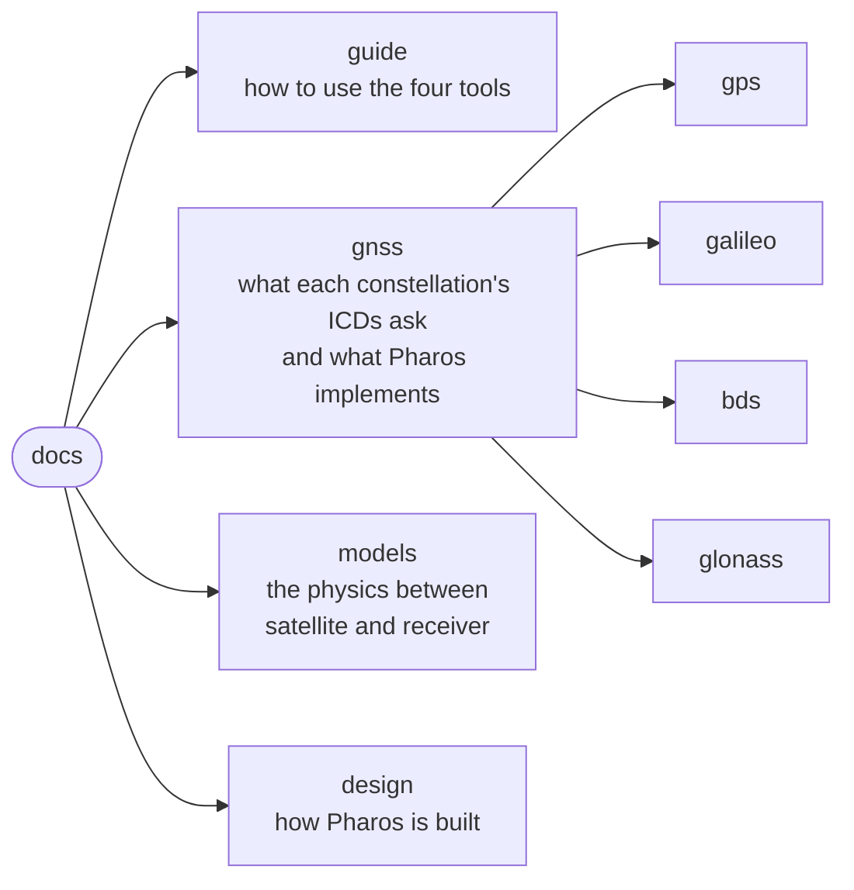

# Pharos documentation

| Part | For | Start at |
|---|---|---|
| Guide | running Pharos: building, trajectories, scenarios, navigation data, samples, observation files, the C API, the examples | [guide/README.md](guide/README.md) |
| GNSS | the sixteen signals and their messages: one tree per constellation, one implementation matrix per message | [gnss/README.md](gnss/README.md) |
| Models | the propagation and satellite models: ionosphere, troposphere, geometry, geoid, antennas and attitude | [models/README.md](models/README.md) |
| Design | the architecture, the data flow, the engine and the file formats | [design/README.md](design/README.md) |

| Constellation | Pages |
|---|---|
| GPS | [overview](gnss/gps/README.md), [signals](gnss/gps/signals.md), [LNAV](gnss/gps/lnav.md), [CNAV](gnss/gps/cnav.md), [CNAV-2](gnss/gps/cnav2.md), [data](gnss/gps/data.md) |
| Galileo | [overview](gnss/galileo/README.md), [signals](gnss/galileo/signals.md), [I/NAV](gnss/galileo/inav.md), [F/NAV](gnss/galileo/fnav.md), [HAS](gnss/galileo/has.md), [data](gnss/galileo/data.md) |
| BDS | [overview](gnss/bds/README.md), [signals](gnss/bds/signals.md), [D1/D2](gnss/bds/d1-d2.md), [B-CNAV1](gnss/bds/b-cnav1.md), [B-CNAV2](gnss/bds/b-cnav2.md), [B-CNAV3](gnss/bds/b-cnav3.md), [PPP-B2b](gnss/bds/ppp-b2b.md), [data](gnss/bds/data.md) |
| GLONASS | [overview](gnss/glonass/README.md), [signals](gnss/glonass/signals.md), [GNAV](gnss/glonass/gnav.md), [data](gnss/glonass/data.md) |
