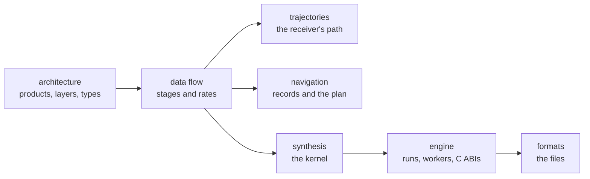

# Design

These pages say how Pharos is built and why. Each starts with a diagram.
The physics between satellite and receiver has its own tree,
[models](../models/README.md). How to use the tools is in the
[guide](../guide/README.md); what each constellation's ICDs ask is in
[gnss](../gnss/README.md).

| Page | Covers |
|---|---|
| [Architecture](architecture.md) | principles, products, the cut at the bundle, layers, the tree, central types, extension points |
| [Data flow](data-flow.md) | the stages, their inputs and outputs, and the rate of each |
| [Trajectories](trajectories.md) | trajectory plans read and built segment by segment, the least-jerk solve, the stored path's knots, the limits' checks, the knot interpolant and receiver domain |
| [Navigation](navigation.md) | the one clock, the readers, the selection schedule, blends, almanacs, precise products, correction streams, health |
| [Synthesis](synthesis.md) | code tables, the two kernel paths, the carrier, noise, quantisation and the gain, embedded data |
| [Engine](engine.md) | the run lifecycle, windows, workers, seeking, commands, events, the C ABIs, determinism |
| [Formats](formats.md) | `.pht`, `.phb`, samples, `.tag`, manifest, dumps, observation and position files, the JSON Schemas, format standards |
| [Models](../models/README.md) | light time, relativity, the gravitational delay, the ionosphere, the troposphere, the geoid, phase centres and attitude |
