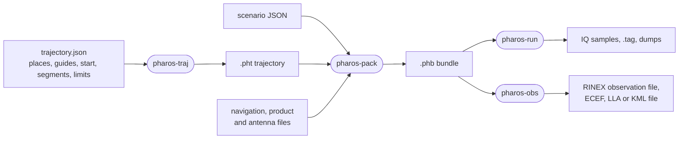
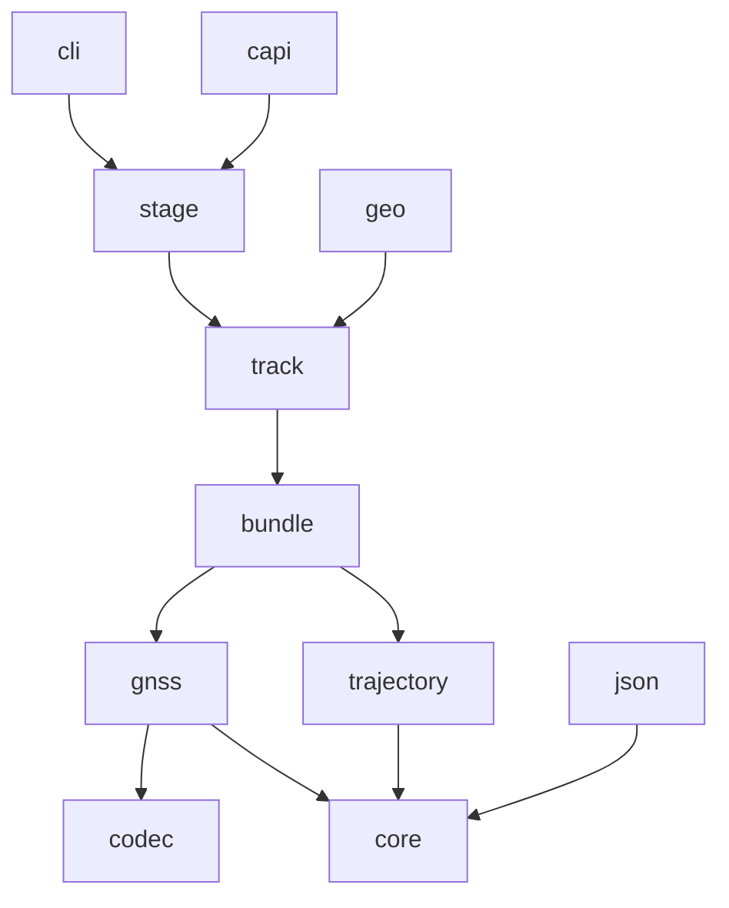
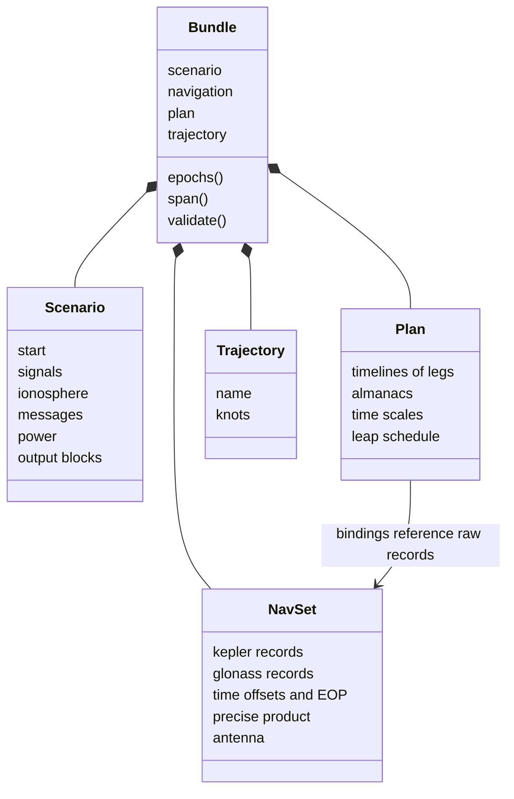

# Architecture

Pharos is a GNSS IF signal simulator. A scenario goes in; quantised IQ
samples or observation files come out. This page covers the principles,
the four products, the layers, the tree, the central types and the
extension points.

## Principles

| Principle | What it means in the code |
|---|---|
| Pure stages over immutable values | each stage maps typed inputs to typed outputs; nobody changes the bundle |
| One clock | GPS time is the only stored time; BDT, GST, GLONASS time and UTC are views |
| Determinism by construction | the samples depend on the bundle, the seed, the noise mode, the gain and the command log alone |
| The standards are the authority | tables, constants and schedules follow the pinned documents; no value is invented |
| No hidden cost | tables and buffers are sized at creation; in a pull only the channel table and the command log grow; a large value lives in memory sized at creation, built in place, never on the stack |

Pure stages run on any thread in any order, so workers share no mutable data.
One clock resolves a leap second or a time offset once. The simulated
time and the broadcast time therefore agree. The only global mutable
state is the per-thread error buffer of each C ABI.

## The four products



Each product is a Zig module, a command and a C ABI over one shared
module, `src/shared`. The build makes the modules `shared`,
`pharos_traj`, `pharos_pack`, `pharos_run` and `pharos_obs`.

| Product | Command | Module root | Library root | Header |
|---|---|---|---|---|
| trajectory tool | `pharos-traj` | `src/traj/root.zig` | `src/traj/capi.zig` | generated `pharos_traj.h` |
| packer | `pharos-pack` | `src/pack/root.zig` | `src/pack/capi.zig` | generated `pharos_pack.h` |
| generator | `pharos-run` | `src/run/root.zig` | `src/run/capi.zig` | generated `pharos_run.h` |
| observer | `pharos-obs` | `src/obs/root.zig` | `src/obs/capi.zig` | generated `pharos_obs.h` |

Each library is one object compiled from its library root and archived
in the target's format by `zig ar`. The build compiles `src/wasm.zig`
once for each of traj, pack and obs, producing `pharos_traj.wasm`,
`pharos_pack.wasm` and `pharos_obs.wasm`. Each exports its product's C ABI
and adds `pharos_alloc`, `pharos_free` and `pharos_wasm_layout` for its host. `src/schema.zig`
roots a program the build runs on its own machine: it writes the JSON
Schemas of trajectory plans and scenarios from the readers' key tables.

The command of each product is its `main.zig` over its `cli/` directory.
The core never prints. Only `src/shared/cli.zig` and the four `cli/`
directories write to the console.

## Why the chain is cut at the bundle

| Cut | Effect |
|---|---|
| every scenario input error is met in `pharos-pack` | diagnostics identify the source, semantic path and optional text position; the generator and the observer hold no scenario parser |
| the request becomes a resolved scenario in `pharos-pack` | duration, per-system ionosphere models, coefficients and sources, and power execution order are fixed before runtime construction |
| the packer builds every message set at every leg boundary | a bundle that packs does not fail later for missing data |
| one navigation plan is computed by the packer | samples, observations, messages and corrections share each leg's raw reference, common delays and family attributes |
| D1/D2 broadcast parameters are prepared with the plan | message sets and correction references share each contiguous binding leg's fitted and decoded values |
| the bundle is a cache, not an archive | its header carries a hash of its types; another build refuses it |
| the trajectory is a product of its own | a `.pht` holds no absolute time, so one path flies under any start |
| the bundle carries the knots | a run reads no trajectory file |
| the observer shares the generator's stages | a receiver of the samples measures the observation file's values |
| the truth drives the run's channel sequencer | it names the channels on air at any epoch without running the samples |

The last cut is exact up to whole carrier cycles. The Doppler agrees to
first order. The observer takes it over the millisecond around the epoch.
The samples take it over the epoch itself.

## Layers

A file imports only layers below its own. Code outside a layer reaches
it through the layer's index file (`core.zig`, `gnss.zig`, and so on).
The graph therefore has no cycles, and a path tells what a file may
know. An arrow means "imports"; imports implied by a longer path
are left out.



| Layer | Holds | Imports |
|---|---|---|
| `core` | time, identity types, the signal row, diagnostics, coordinates, the physical models, the target's facilities | std only |
| `codec` | fields, frames, CRC, convolutional, BCH and LDPC codes, interleavers, code generators | std only |
| `gnss` | records, health, delays, the Keplerian propagator, the signal table; one directory per system | core, codec |
| `json` | the JSON tree with paths, the key and kind tables, their walker and the JSON Schema writer | core |
| `trajectory` | knots and their path; the `.pht`, KML and position formats | core |
| `bundle` | scenario, commands, navigation set, precise product, antennas, plan, wire format | core, gnss, trajectory |
| `track` | what a leg resolves to; the transmitted state and its blend | core, gnss, bundle |
| `geo` | receiver frames, geometry windows and complete observation corrections | core, gnss, trajectory, bundle, track |
| `stage` | the per-system ionosphere model table, power, the message-family table, the channel rules and their sequencer, the command log | core, codec, gnss, bundle, track |
| `cli` | the console, the command-line convention, the command entry point, bundle loading, report lines | core, trajectory, bundle, stage |
| `capi` | status codes, the target's allocator, error buffer, byte copies, bundle reading, failure statuses, the C command | core, bundle, stage |

Parsing headers belong to `pack`; the bundle stores resolved ionosphere choices,
broadcast coefficients and leap timing. Each coefficient set has one owner.
Observation inspection projects the same track bindings and message sets used
by runtime consumers; it does not define another availability policy.
Its common value types own exact integer serialization, instants, intervals,
orbit values and typed availability reasons. The observation JSON is a
projection of those values; query construction does not allocate strings for
individual times.

Input readers share `InputError` (`OutOfMemory` or `InvalidInput`). File
acquisition adds `IoFailed` through `LoadError`. A diagnostic scope carries
the source name and semantic path; a position carries line and column
separately. A reader emits the reason at the point it can identify the fault,
and adapters translate the shared result to CLI or C status without a second
failure channel. Internal JSON walkers may accumulate several diagnostics
before their public reader returns `InvalidInput`.

A type may carry the functions that read its private layout. The precise
product interpolates its own samples, and `track` reaches it through the
handle the product gives out.

### Product layers

| Product | Layers, lower first | Joined by |
|---|---|---|
| `src/traj` | plan; track, guide, motion and through, under path, which builds a plan; check over the stored path; source joins reading, building and checking; inspect, stats and kml over its result; static | capi, over source, inspect and trajectory operations |
| `src/pack` | scenario, nav, plan | assemble; capi over assemble and nav |
| `src/run` | msg, synth; engine over msg and synth; io over engine | capi, over engine, io and synth |
| `src/obs` | observe owns numerical values; formats renders them; output owns file progression over both; inspect projects typed values; truth joins sky queries and channel replay | capi source, output and truth adapters |

`obs.output.File` owns the output grid, selected range, commands and
generation cursor. Its bounded pulls return complete epochs in borrowed
UTF-8 storage. `obs.observe.Evaluator` returns reusable typed epoch values;
`obs.formats` owns column layout and text rendering. Truth queries share
the physical models but have independent mutable state: `truth/sky` owns
geometry and checkpoints, while `truth/replay` owns channel history and
prepared message views. The C API's reference-counted source owns the
parsed bundle retained by each output and truth. Native Zig callers
lend the bundle directly.

The command of a product imports the product's module, never the shared
module directly.

## Rules of the tree

| Rule | Why |
|---|---|
| systems never import each other | a new system cannot break another |
| the root files of `gnss` assemble the systems | one table per concern: signals, constants, records, codes, delays |
| behaviour attaches by enum tag and `switch` | the compiler finds every place a new tag must reach |
| runtime function pointers are confined to frame suppliers, the GPS correction source and computed fields | sample synthesis and the trajectory build keep direct calls |
| a multi-file family is an entry file over a directory of the same name, such as `src/shared/gnss/gps/cnav.zig` | the entry owns the contract; its tables stay private |
| family encoders take typed inputs built in `stage` | a family knows neither the file readers nor the engine |
| tables too large to derive are blobs in a directory's `manifest.zig` | size checked at compile time, digest recorded |

## Directory map

```
build.zig, build.zig.zon   the build graph and its modules
src/abi.zig                names the actual public ABI types and functions
src/headers.zig            generates the four installed C headers
src/wasm.zig               the WebAssembly entry, selected per product at build time; allocation and layout exports
  wasm/layout.zig         derives that product's WebAssembly record layouts and enum values
src/schema.zig             writes trajectory.schema.json and scenario.schema.json at build time
src/shared/                the shared module
  root.zig                 the layers and the products' version
  core/                    constants, types, dictionary, diagnostics, spec, time, civil,
                           coord, geoid, clock, lighttime, iono/, tropo/, elements,
                           linear, sun, attitude, provenance, hex, target
  codec/                   bitwriter, scaling, field, frame, crc, conv, bch, ldpc, gf,
                           gf256, interleave, lfsr, weil
  gnss/                    records, reference, auxiliary, delay, kepler, kepler_parameters, plausible, health, accuracy,
                           allocation, klobuchar_fields, almanac, almanac_reference, constants,
                           spec, codes, publication
    gps/ galileo/ bds/ glonass/   signals, codes, records and the message families
  json/                    node, table, schema
  trajectory/              hermite, pht, kml, positions (the knots in trajectory.zig)
  bundle/                  command, scenario, ionosphere, messages, navigation, precise, antex,
                           plan, format
  track/                   selection, provider
  geo/                     receiver, geometry, window, observation
  stage/                   ionosphere, power, messages, messages/inputs, channels, sequence,
                           commands
  cli.zig                  the console, the command-line convention and the command entry point
  capi/                    command (the shared C ABI code is in capi.zig)
src/traj/                  plan/, the build, check, source, inspect, static, stats, kml, capi/, cli/
  plan/                    model, read, resolve, geometry
  path.zig                 the build: segments, stretches, knots, the segments' lengths
  through.zig              the least-jerk solve
  track.zig, guide.zig     ground tracks of constant geodesic curvature; guides' paths
  motion.zig               a run's motion in time, at its height
  frame.zig, measure.zig   the local frame and a state read in it; lengths from speeds
  check.zig                the limits held against the stored path, and its extremes
  source.zig               reads one plan, builds it and checks it into source.Result
  inspect.zig              writes the events, segments, checks and samples as JSON
src/pack/                  scenario/, nav/, plan/, assemble, capi/, cli/
src/run/                   msg/, synth/, io/, engine/, capi/, cli/
src/obs/                   observe, output, formats, inspect/, truth/, capi/, cli/
  truth/                   sky, replay
  capi/                    source, output, truth, common
docs/                      guide/, gnss/, models/, design/
examples/                  scenarios/, trajectories/, data/
```

`src/headers.zig` reflects the declarations named by `src/abi.zig` to emit
C records, enum values and complete function signatures into the build
cache. The build installs those headers and exposes each as a named lazy
path. Each WebAssembly module derives its layout metadata from its
product's declarations for its own target. Every instance owns its memory,
allocator and handles. Products exchange `.pht` and `.phb` bytes; the host
copies them into the receiving instance. Worker placement and scheduling
belong to the host.

| Trajectory boundary | Ownership |
|---|---|
| `plan.model.Plan` | the plan as read: places, guides, the start, the segments, the events and the limits |
| `path.Built` | the knots, each segment's first knot, end, length and end speed, and where the built motion leaves the domain |
| `check.Check` | a limit's verdict, its worst value and the stretches where it is broken |
| `source.Result` | the plan, the trajectory, the segments' figures, the checks, whether the path lies in the domain and whether it can be written |

`source.build(allocator, result_allocator, text, diags)` reads one
`plan.model.Plan`, builds it and checks it, and returns `source.Result`.
The result allocator owns the plan and the result; the solves, tracks and
guides live in a scratch arena for one build. The C trajectory handle
holds no path, a loaded trajectory or a built result, from which it
tells whether a `.pht` may be written.

`inspect.write(writer, result, sample_count, lengths)` writes the
events, segments, checks and samples as JSON straight to its writer, with
the lengths `inspect.Lengths.of(allocator, result, sample_count)` tells
once for both writes of `pharos_traj_inspect`
([inspection](../guide/c-api/traj.md#inspection)). The plan and the
result must stay alive while it writes.

`plan.read.parseGeometry` reads a plan's coordinates, places and guides,
each on its own, without requiring a complete plan; `guide.outline`
traces each whole guide for `pharos_traj_describe_geometry`, whose C
adapter owns the resulting JSON in a short-lived geometry description.

## Central types



| Type | Holds | Rule it enforces |
|---|---|---|
| `GpsTime` | whole milliseconds since the GPS epoch, plus a fraction in [0, 1) | the only stored time |
| `Epoch` | an epoch of a run: whole milliseconds from its start | an index is neither a count nor a time; `atEpoch` gives its `GpsTime` |
| `SampleRate`, `Hz` | an integer kHz sample rate; a frequency | a rate cannot be passed as a frequency; Hz is derived from its stored kHz |
| `System` | GPS, BDS, Galileo, GLONASS | canonical order; capacity 32, 63, 36, 24 |
| `SatId` | a system and an index, packed in one byte | built from a PRN in range; its bits index 256-slot tables |
| `FreqId` | a GLONASS frequency number | -7 to 13 |
| `Signal` | the sixteen signals | its order fixes the observation columns |
| `ChannelKey` | a satellite and a signal | one channel per key |
| `Spec` | one row per signal: carrier, codes, gains, frame timing, observation codes | checked at compile time |
| `KeplerEphemeris`, `GlonassEphemeris` | ICD field names, typed health, named group delays | raw records stay immutable after loading |
| `plan.Binding` | one raw reference, common group delays, family attributes and GLONASS P1 | one binding per satellite and leg for every consumer |
| `reference.Kepler` | a raw record with the binding's delays and attributes | a target family never changes the raw source or clock basis |
| `kepler_parameters.Parameters` | orbit and clock values for a physical satellite | a prepared broadcast value has no source-record tag; target issue and health fields belong to its family |
| `Diagnostic` | severity, code, source, semantic path, optional line and column, message | the readers, the packer and the trajectory tool report this way |
| `Command` | an epoch and an action: noise floor, elevation mask or signal power | one type, one check and one C layout for the run and the observer |

Code lengths in the signal rows come from each family's code
implementation. The primary length agrees with the chip rate and period;
every code, frame and secondary-code period divides its time scale's
period, checked at compile time. The symbol layer is therefore exact.

The generated C headers declare the owning enum's current values.
`Signal` and `System` also enter the bundle's layout hash and determine
observation column order.

## Extension points

| Addition | Where it attaches |
|---|---|
| a signal | a `Spec` row in the system's signal file; its codes behind `src/shared/gnss/codes.zig`; its satellites in `src/shared/gnss/allocation.zig` |
| a scenario or trajectory-plan key | a row of its reader's key table, with its description, unit and default, or of a kind table; the reader and the JSON Schema both follow it |
| a message family | an entry file and its directory in the system's tree, then one case in the family table of `src/shared/stage/messages.zig` |
| an ionosphere model | a variant in `src/shared/core/iono.zig` and the bundle's coefficient contract; pack resolves each system's choice, and `stage/ionosphere.zig` builds the model table with shared NeQuick G data |
| an orbit source | a variant of the selection's source, resolved in `src/shared/track/selection.zig` |
| a correction service | a stream in `src/run/msg/streams/`, handed to its family as a supplier |
| antenna gain | the power stage, which already turns elevation into C/N0 |
| another transmitter | more tracks in the knot stage; their channels are ordinary rows |
| another kernel, such as a GPU | the kernel call of the engine's task; the kernel is a pure function of one epoch |

Every table keyed by signal derives from the one signal table. A source
that is not enabled is null and costs nothing. Multipath, interference
and spoofing are not modelled. They would attach as extra rows, an
extra noise term in the kernel, or another transmitter.
