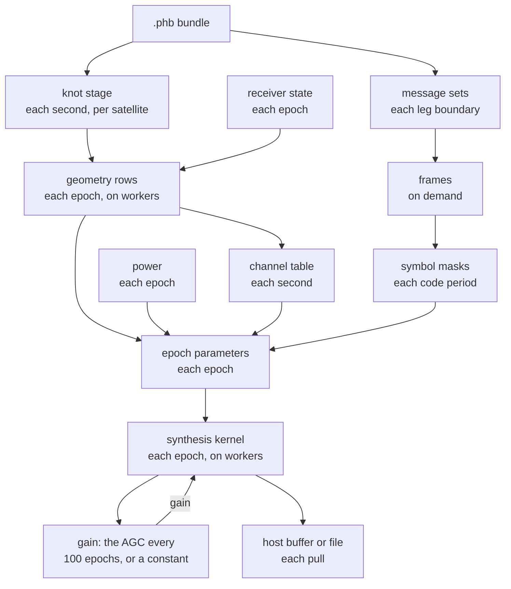
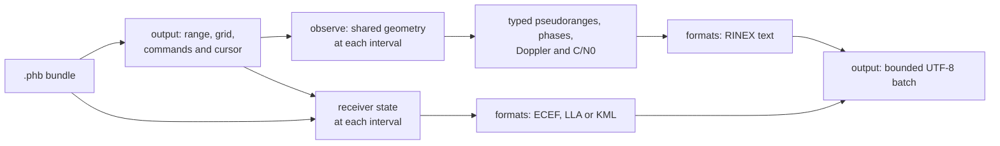
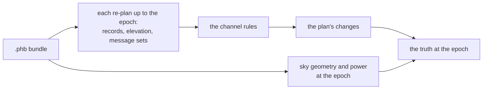

# Data flow

The work is a fixed sequence of stages. Each stage is a function from
earlier outputs to its own, at its own rate. The packer runs its stages
once. The generator and the observer run theirs per epoch, per second or
per interval.

## The packer

```mermaid
flowchart LR
    json["scenario JSON"] --> read["read and validate"]
    read --> traj["load the .pht"]
    traj --> nav["load navigation files"]
    nav --> extra["load ANTEX and<br/>precise product"]
    extra --> plan["plan one binding per leg<br/>reference, delays, attributes"]
    plan --> trim["keep the raw records<br/>the plan references"]
    trim --> prepare["prepare D1/D2<br/>per contiguous binding leg"]
    prepare --> check["build every message set<br/>at every leg boundary"]
    check --> phb[".phb bundle"]
```

A scenario or data error adds a diagnostic with a JSON path and stops
the pack. A file that cannot be read stops it with the file's name.
Warnings never stop it. When the scenario asks for samples, the message
check builds each listed family's set at every leg boundary of the run.
A bundle that packs therefore has the data its messages need.

Loading leaves the raw records unchanged. The plan selects one reference
per satellite and resolves missing delays and family attributes from the
full raw pool. These resolved values are stored in the binding before
unused raw records are removed. Every runtime consumer follows the same
binding; encoding another family does not select another physical record.

Parsed navigation headers belong to packing. Their ionosphere coefficients
resolve the scenario's requested models, and their leap declarations resolve
the plan's leap schedule. The bundle stores those resolved values; it does not
retain the input headers. Each applied ionosphere model names its model and
coefficient source. Its coefficients come from the bundle's single broadcast
set, which also supplies navigation messages.

The pack C handle retains its serialized bundle, summary and copied diagnostic
strings. Source files, parsed inputs and assembly allocations are released
before creation returns. When a command-line consumer loads a bundle, it also
releases the encoded input bytes after decoding into the bundle's arena.

## The generator

| Stage | Input | Output | Rate | Thread |
|---|---|---|---|---|
| receiver state | the trajectory's knots | position at an instant | each epoch | any |
| knot stage | a satellite's track, the receiver at both ends of the second | state, clock, delays, elevation and phase-centre ranges at both ends | each second | caller |
| geometry rows | the two knots, the receiver, the instant | one row per satellite, whatever its elevation | each epoch, one block ahead | workers |
| channel table | rows, elevation mask, band, allocation, message sets | the channels, one per satellite and signal | each second | caller |
| message sets | bundle, publications, correction streams | one set per family | each leg boundary | caller |
| frames | a set, a PRN, a frame index | the frame's bits | on demand | caller |
| symbol masks | frames, NH and secondary codes | one byte per code period | each code period | caller |
| power | schedule, commands, elevation | C/N0 per satellite | each epoch | caller |
| epoch parameters | the rows at the epoch's two ends, delays, C/N0 | carrier and code ramps per channel | each epoch | caller |
| synthesis kernel | parameters, code tables, masks, gain | the epoch's bytes and its clip count | each epoch | workers |
| gain | clip counts | the AGC's gain for the next period, or a constant | every 100 epochs; a constant once, at creation | caller |
| sink | bytes | the host buffer or the file | each pull | caller |

The epoch is 1 ms. It sizes the row and mask buffers, and each epoch is
one task for the workers. A leg boundary is every GPS minute, and for
GLONASS every superframe boundary of Moscow time. Tracks resolve the
stored binding at every GPS minute and at their system's leg boundaries.
The next GLONASS boundary is the first future GPS instant on a Moscow
150 s grid, found within the leap schedule's constant-offset intervals.

## Why the work is cut this way

| Cut | Reason |
|---|---|
| satellite state on a 1 s grid | the expensive propagation runs once a second; epochs interpolate |
| rows computed without history | any epoch in any order gives the same row, so workers need no order |
| rows for every selected satellite | the mask and its hysteresis act on rows that already exist |
| parameters derived on the caller at pull time | a command applies exactly at its epoch |
| per-epoch steps as differences of end values | block and pull boundaries cannot change a byte |
| frames built on demand | a set is proved encodable once; frames cost nothing until read |

## Geometry in segments

A row depends on its track's two knots, the receiver and the instant. The
knots move at each second and at each re-selection. The caller therefore
cuts a block of epochs at every second it crosses and at the earliest
re-selection instant of any track. It advances the tracks to each
segment, then hands the segment's epochs to the workers. Re-selections
and their events happen on the caller, in epoch and satellite order.

`shared.geo.receiver` prepares position, velocity, geodetic coordinates
and the local frame. `geo.Window` owns provider advancement and the two
geometry endpoints. `geo.Observation` owns that window and its matching
corrections, with one `advance` operation keeping them together. Each
endpoint prepares the receiver's atmosphere models and Sun position
once, then evaluates each satellite's corrections. Workers consume
read-only geometry or observation frames; delay evaluation reads a
`track.provider.DelaySnapshot` without mutating provider state. Frames
borrow their owner's storage and remain valid until it advances,
resets, restores or is destroyed.

## Message sets

A family's set is a typed snapshot. It is built at a leg boundary from
the bundle, checked once and never changed. Frames are encoded from it on
demand. A rebuilt set is adopted at the start of the family's next set
cycle, so no cycle mixes two sets. A channel holds at most one pending
set, so two stored generations per family suffice. Creation allocates
these generations only for families used by the listed signals; disabled
families have no set storage.

## The observer

`observe.Evaluator` uses the generator's shared `geo.Observation`, with
no synthesis. It prepares a compact list of enabled, allocated signals
per satellite and reuses its typed `Epoch`, `Satellite` and `Signal`
buffers. Evaluation takes an epoch, mask and read-only power state.
It checks the interpolated elevation against the mask before evaluating
the full satellite observables, then skips signals the current record
does not serve. The Doppler is the phase difference over the millisecond
around the epoch; the central state and Doppler pair are shared by the
satellite's signals. Realized C/N0 is part of the numerical result.

Visible satellites at one epoch are paired in their existing order.
`geo.observation.evalPair` gathers each pair's endpoints into a local
structure of two-lane `f64` vectors and reuses it at the central instant
and at 0.5 ms before and after it. This packet needs no allocation and
lasts only for that pair's evaluation. The vector and scalar paths share
the interpolation, light-time and observation formulas; time arithmetic
normalizes each lane through `GpsTime`. An odd final satellite uses the
scalar path. Signal projection retains the satellite and signal order.

`formats` prepares the RINEX column layout and renders these values.
`output.File` owns the selected grid, command log, power cursor, file
stage and generation cutoff. It reserves byte storage at creation and
pulls at most 64 whole epochs without allocating. The first batch
includes the header and the last includes any footer. Progress counts
generated epochs cumulatively; the host consuming or copying bytes
does not advance the cursor. Commands at or before the last generated
epoch are rejected.

`truth.zig` coordinates commands, power and query results. `truth/sky`
owns geometry queries and their provider checkpoints. It can evaluate
one target or the full sky using `geo.Window`, without observation
corrections or channel planning. Full truth queries add signal states,
power and DOP; compact visible-count queries use sky geometry alone.

`truth/replay` initializes lazily when a query needs channel history.
It drives the run's sequencer, `src/shared/stage/sequence.zig`, from
re-plan to re-plan without rows. It rebuilds the message sets at
each leg boundary, advances every track, takes its elevation at the
re-plan from the same light-time solution as a knot, and applies the
channel rules of `src/shared/stage/channels.zig`. It keeps the plan's
changes and a snapshot of the channel states every 10 minutes, so an
earlier query applies the recorded changes from a snapshot. Sky
geometry maintains separate provider checkpoints every 10 minutes and
includes satellites in `maskOut`; the replay's tracks exclude them.
Their providers remain independent because the two queries can be at
different epochs.

The sequencer reserves its bounded held-channel and change buffers at
creation, and validates a re-plan before applying its changes. The truth
reserves each re-plan's history and snapshot before advancing, then
publishes the history, snapshot and planned epoch together. Geometry
checkpoints follow the same order, so allocation failure leaves completed
steps available for queries and retries. A message failure rewinds the
incomplete re-plan before another query uses the sequencer.

Effective-value inspection asks the same truth for one satellite and
signal, evaluating only the requested projections. The channel state
still requires its replay history. The track projection reads the
provider's orbit, clock and group-delay state; resolved ionosphere
coefficients come from the immutable bundle. Replay retains one prepared
query view per message family and navigation window, built through the
sequencer's shared set builder. Query views are separate from the
sequencer's current message generations. The effective interval starts
at the receiver re-plan that adopts the set, even when the absolute
navigation boundary falls between re-plans. A later truth query therefore
cannot leak a future set into an earlier inspection. A cached family view still
projects the requested signal's carrier values. The message projection
reads prepared parameters and separately evaluates publication intervals.
Frame adoption, quantised bits and correction-stream payloads remain
outside this query.

The run, output and truth use one command-log type,
`src/shared/stage/commands.zig`, in epoch order. The run records the
commands it applies; outputs and truths record those the host submits.
Power replays each command after the schedule's entries at that epoch. The
sequencer takes a re-plan's mask from it: the last mask command at or
before the re-plan. Lazy replay preserves two epoch-0 plans: the initial
state before commands, then the first re-plan with commands, as the run
does at creation and at its first pull. A mask command at or before the
furthest re-plan sends the plan back to the snapshot before the command's first
re-plan, replays the recorded changes up to it, and makes the re-plans
from there again at the next query that reaches them. Power queries
advance a cursor for increasing epochs and reset it for earlier epochs
or commands affecting its state. Submitting any command invalidates the
cached full truth result.

The observation C API reads a bundle once into a source. Each output or
truth retains it and owns its own mutable state. Inspection JSON and
output batches borrow their handle's reusable byte storage; callers copy
or decode the bytes before another operation on that handle. Each
inspection evaluates and serializes once into that storage.

## Rates at a glance

| Rate | Fixed by |
|---|---|
| 1 ms epoch; samples and bytes per epoch | the interface |
| AGC period and rule; frame timing; observation interval | the interface |
| 1 s knots and re-plan; leg boundaries | the design |
| geometry block, kernel sub-tile, sink buffer | the design: sizes that never change the bytes |
