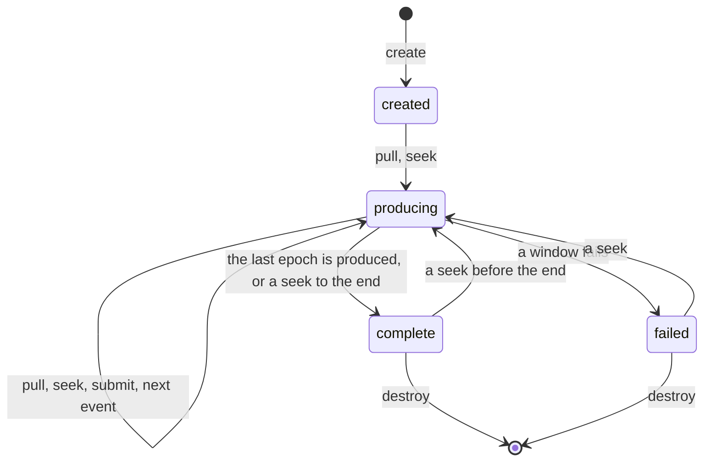
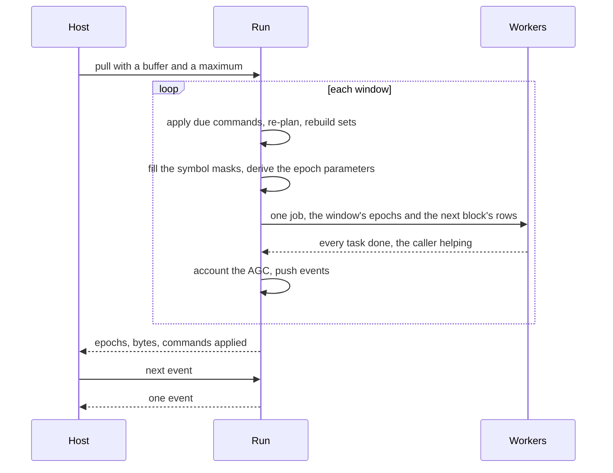
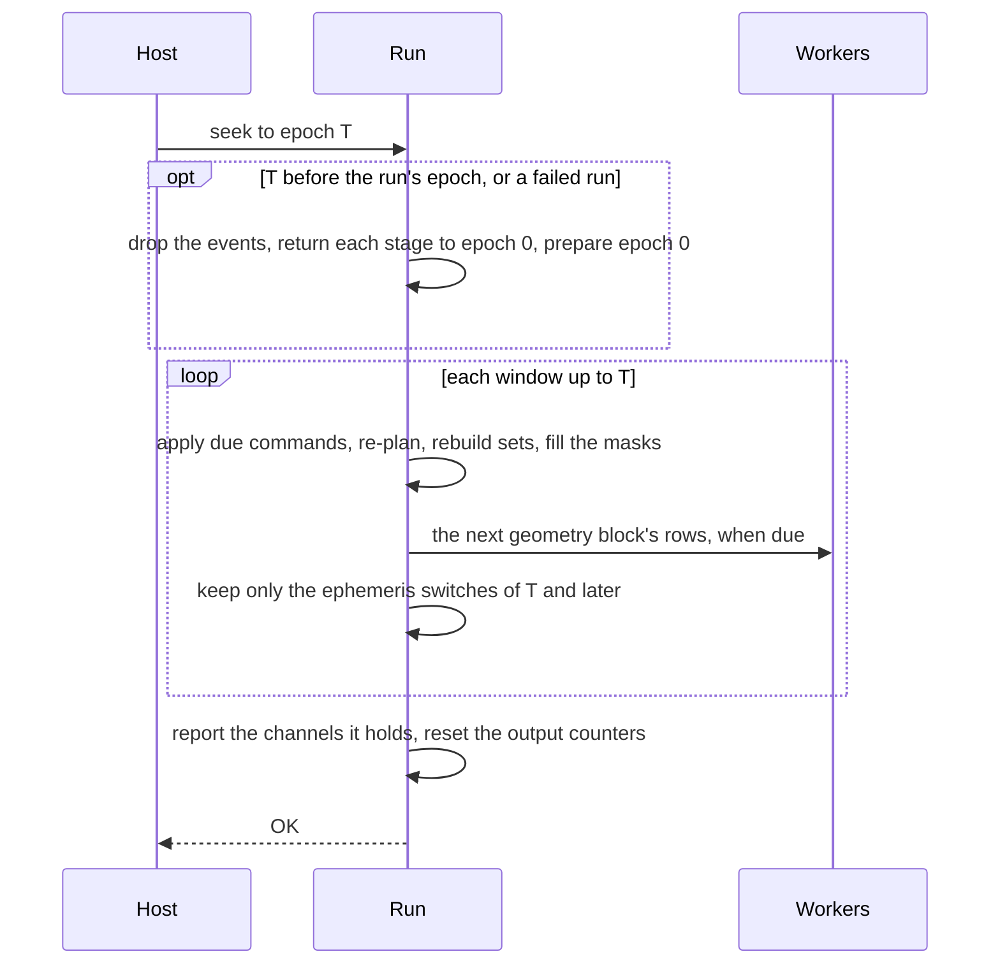

# Engine

The engine is the generator's layer over the message and synthesis
layers. It creates a run from a bundle and produces samples in whole
epochs on demand, from the start or from any epoch a seek enters at. It
takes commands bound to epochs and hands back events. It is a pull API
with no callbacks: the host's thread drives it, and workers hold no work
between pulls.

## The run lifecycle

| Call | What happens |
|---|---|
| create | builds code tables and buffers for the listed signals, spawns the workers, sizes their scratch, primes the geometry |
| pull | produces whole epochs, window by window, into the host's buffer; returns the epochs and the commands applied |
| seek | steps the run to an epoch without synthesis; the next pull starts there |
| submit | checks a command and queues it |
| next event | takes one event from the ring |
| destroy | frees everything |

Create builds a code table for every satellite of each listed signal. It
produces the first geometry block before the first pull.

A pull after the last epoch returns no epoch.
A failing pull returns the windows produced before the failure, with the
failure in its result. The failure is latched, because a window's
commands and message sets may be half applied. Every later pull returns
it, until a seek starts the run again.

The packer built every message set at every leg boundary. A run of a
packed bundle therefore never fails on missing UTC, EOP or time offsets.
The run keeps the check all the same. A host's power level is bounded on
submit to what a scenario could express. No level can push the amplitude
past the float range.

## Windows and workers

The caller works through the window in epoch order. It applies the commands
bound to the window, derives the C/N0, re-plans every second and rebuilds
message sets at leg boundaries. It then fills the masks and derives the
parameters of every channel of every epoch. Parameters are derived at pull
time, so a command applies exactly at its epoch. The message-set
generations and the re-plan pass are one sequencer,
`src/shared/stage/sequence.zig`, over the rules of
`src/shared/stage/channels.zig`: the run drives it epoch by epoch, and
the truth of `libpharos_obs` drives it from re-plan to re-plan.

| A window ends | Why |
|---|---|
| before an AGC evaluation | one gain covers the window |
| at the end of the geometry block it reads | its rows exist |
| at a command's epoch | the command applies exactly there |
| at a scheduled power change | the change applies exactly there |

The caller then dispatches one job: the window's epochs and the first
segment of the next geometry block. The next block's rows go into the
other of two row buffers. Further segments of that block follow as jobs
of their own. A window whose next block already exists sends its epochs
alone.

The workers park on a condition between jobs. Tasks come from an atomic
counter, and the dispatching thread takes tasks too. Each task writes a
disjoint slot of the host's buffer or a band of the row buffer. The pool
is generic over its context, so no function pointer sits in the hot path.
The worker count includes the caller: zero means one per hardware
thread, one runs every task on the caller's thread with no pool, and N
starts a pool of N - 1 threads. Create starts the pool before it
allocates a scratch per thread, so a count the system cannot start fails
before it costs that memory.

The mask slots are sized from the window, the shortest code period and
the kernel's rate deviation, with slack. A window whose masks outgrow
their slots fails with `Internal` rather than overrun.

## Seeking

A seek enters the run at an epoch T. It runs the pull's window step from
the run's epoch to T with the synthesis left out: the kernel's output
feeds only the samples and the AGC, and a seek refuses the AGC. Pull and
window boundaries change no byte, so a seek is a pull boundary at T, and
the bytes from T on are the sequential run's. The seek passes the epochs
before T and stops there: the next pull applies the commands due at T
and, at a multiple of 1000 epochs, re-plans at T, as a pull reaching T
does.

| State | Stepped by the pull's code |
|---|---|
| commands and their order | due commands apply at each window start; windows end at command epochs |
| power schedule | advanced to each window start; windows end at its epochs |
| geometry: record cursors, blends, knots, row blocks | every block the pull would produce, on the workers |
| correction streams and their counters | advanced with each window |
| message sets and their generations | rebuilt at every leg boundary |
| the channel table, its hysteresis and order | pruned and re-planned every second |
| the symbol sources: pending sets, adoption, frame cache | filled for every window |
| the AGC | nothing: a seek needs a constant gain |

A seek to an epoch before the run's, or of a failed run, starts the run
again. Each stage returns to epoch 0 in place, by the code that set it up
at create, and the run prepares epoch 0 as create does.

| Starting again | Stage |
|---|---|
| back to epoch 0 | the geometry's record cursors, knots and row blocks; the channel table; the correction streams; the message sets of epoch 0; the power levels, the schedule's position and the command log's; the events |
| kept as create resolved them | the per-system ionosphere models, the allocation, the tracks, the code tables, the prepared message content, the power schedule, the buffers, the pool, the kernel scratch, the options and the gain |

The pending commands stay queued and apply on the way. An applied command
would be lost, so a run that has applied one does not start again: that
seek returns `CommandsApplied` and leaves the run as it was. A failure
while starting again or stepping is latched as a pull's.

## Commands and events

A command carries the epoch it applies at; 0 means the first epoch of the
next pull. At one epoch the scenario's power schedule applies before the
host's commands, so a host command overrides a scheduled entry. Epoch 0
is planned at creation, before any command, and again by the first pull,
after the commands bound to it. The pull reports the epoch at which each
command applied, and the run keeps each in the log of
`src/shared/stage/commands.zig`: power replays it, and each re-plan
takes its mask from it, as in the observation file and the truth. A
command log therefore replays the same bytes whatever the pull sizes.

| Command | Action |
|---|---|
| `noise_floor_dbm_hz` | a new noise floor; every C/N0 shifts by the opposite amount |
| `elevation_mask` | a new mask, applied at the next re-plan, at most a second later |
| `signal_power` | a level in dB-Hz, dBm or dBW for a system or one satellite; no level restores the default |

The mask is in radians inside the run and in degrees on the C ABI. Rows
exist for every selected satellite whatever the mask, so no block
boundary reaches the bytes.

| Event | Raised |
|---|---|
| `agc` | when the AGC changes the gain |
| `command_applied` | when a command applies |
| `channel_added`, `channel_removed` | at a re-plan, with the channel's satellite and signal |
| `ephemeris_switched` | when a satellite's orbit switches to another record, up to two geometry blocks ahead |

Events fill a fixed ring on the caller's thread; the host drains it. An
overflow is counted, never blocking. Events are raised in epoch and
satellite order on the caller, so they are the same for any worker count.
A seek leaves the ring as a create does: the switches queued for its
epoch or later, then a `channel_added` for each channel the run holds.
The manifest's signals are those of the channels in force from the
entry on: the re-plan at the entry epoch replaces them, and every later
re-plan adds to them.

## Sinks

The host's buffer is the primary sink. The file sink is one loop, shared
by the command and `pharos_run_to_file`. It pulls 100 epochs at a time
through a write buffer until the run ends, an epoch fails or a write
fails, and counts the bytes on file. After each block the command prints
the block's events; `pharos_run_to_file` drops them and keeps the events
queued before it was called. The manifest and the `.tag` are returned as
text; the host writes them.

## The C ABIs

Each product's C ABI is a thin layer in its `capi/` directory over
`src/shared/capi.zig`. An object holds no lock, so one thread calls it
at a time.

| Shared piece | What it gives |
|---|---|
| status codes | 0 ok, 1 end, 2 argument, 3 out of memory, 4 internal; then the product's own |
| allocator | the target's: Zig's WebAssembly allocator in the module, its SMP allocator elsewhere; no libc |
| error text | a NUL-terminated buffer per object, and one per thread for the calls without an object: the creation calls and `pharos_pack_describe_nav` |
| copy out | text or entries copied into the caller's buffer, with their count |
| diagnostics | severity, code, JSON path and message as C structs |
| exact records | complete input and output records; NULL options select defaults |
| declarations | `src/headers.zig` generates C headers from the actual ABI types and functions; WASM publishes layouts from those types |

| Library | Own statuses | Object |
|---|---|---|
| `pharos_traj` | program, input | a trajectory: built, read, imported or at rest |
| `pharos_pack` | scenario, load, bundle | a pack with diagnostics and summary, or an owned navigation-description result |
| `pharos_run` | bundle, nav, io, busy | a run: pull, seek, submit, events, file loop, manifest and tag text |
| `pharos_obs` | bundle, nav | a shared bundle source; observation or position outputs in bounded batches; truth queries at any epoch; commands submitted to each output or truth |

## Determinism

A run is a function of the bundle, the seed, the noise mode, the gain and
the epoch-bound command log. The worker count and the pull sizes never
change a byte, and a seek lands on the bytes the sequential run produces
from its epoch. Noise depends on the seed and the absolute sample index.
Per-epoch steps are differences of end values, and re-selections happen
on the caller in epoch order. The AGC counts across whatever pieces make
up its period. The only wall-clock value in any output is the creation
time in the observation file's header, which `--created` or a C host may
give instead.
`--dump` writes the stage values with every double as its bits in hex,
so two runs compare to the last bit. A parameter-dump writer selected at
creation owns its additional phase, transmit-time and C/N0 records.
Without that writer, the run allocates no parameter-dump buffer and
copies no values into one.

## Limits and messages

| Limit | Value |
|---|---|
| geometry block | 100 epochs |
| kernel sub-tile | 2560 samples, capped at the samples per epoch, rounded up to a multiple of 16 |
| file sink buffer | 1 MiB |
| queued commands | 256 |
| event ring | 1024 events |

| Failure | Message |
|---|---|
| `MessageSet` | the bundle's supplied message content cannot be encoded into the message sets of the listed signals |
| `MissingEarthOrientation` | B-CNAV3 on B2b (a BDS record) and GNAV on G1/G2 (any system's) require an available EOP record in the navigation data |
| `MissingTimeOffset` | GLONASS navigation requires available, constant GLUT and GLGP time offsets |
| `MissingUtcParameters` | the selected BeiDou navigation message requires available, encodable BDUT parameters |
| `BufferTooSmall` | the buffer holds no whole epoch, or no epoch was asked for |
| `ThreadSpawnFailed` | a worker thread could not be started |
| `EpochOutOfRange` | the epoch lies beyond the end of the run |
| `AdaptiveGain` | the adaptive AGC depends on every epoch before the target |
| `CommandsApplied` | the seek starts the run over, which would drop the commands it has applied |
| `Internal` | a failure no input explains |

| Submit refusal | Meaning |
|---|---|
| `EpochPassed` | the command's epoch is already produced |
| `InvalidValue` | a value is not finite or lies outside its range |
| `TooManyPending` | the queue is full; the C ABI returns busy |
