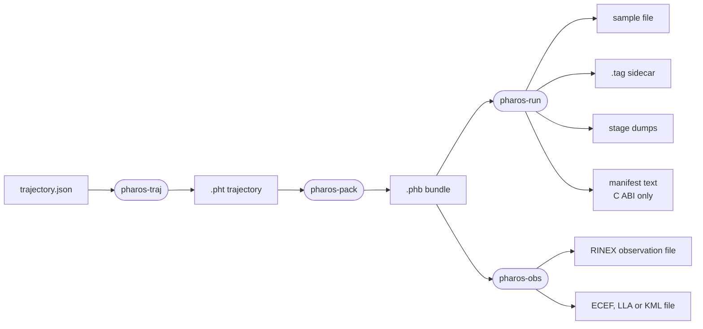
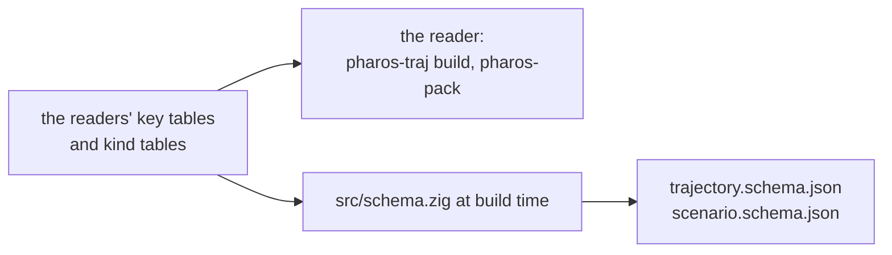

# Formats

Pharos writes six kinds of file: trajectories, bundles, sample files with
their `.tag`, dumps, observation files and position files. A C host also
gets a manifest as text. The build writes the JSON Schemas of the two
JSON inputs: trajectory plans and scenarios. A trajectory plan is the
source; `.pht` is the path built of it. Observation and
position files are text other tools read. The bundle is a binary cache
that builds with the same bundle layout read.



## The trajectory plan

`trajectory.json` is a UTF-8 JSON object with `format` set to
`"pharos.trajectory-plan"` and `version` set to `1`. It holds its
coordinate reference, named places and guides, the start, the segments
one after another, and the limits that check the built path. A path that
leaves the receiver's domain or breaks a limit is not written as a
`.pht`. The full model is in
[trajectories](../guide/trajectories.md#the-plan).

## The .pht trajectory file

A `.pht` file is a stored path in UTF-8 JSON Lines: a header line, then
one line per knot. Time is relative, so one file flies under any start.

| Line | Content |
|---|---|
| first | a JSON object: `format` "pht", `version` 1, `knots` (the count; always written, checked where given), `name` (optional), `frame` "ECEF", `interpolation` "quintic-hermite", `columns` |
| each further line | one knot: [t, x, y, z, vx, vy, vz, ax, ay, az] |
| units | seconds from the first knot; WGS 84 ECEF metres, m/s and m/s^2 |

Numbers are written in the shortest form that reads back to the same
bits, so a file round-trips exactly. A knot line is read column by column,
not as a JSON value. A file of millions of knots then costs its knots
alone. The JSON number grammar decides what a column may hold. The
reader accepts a leading byte-order mark and CR line ends, and refuses an
unknown header key.

## The .phb bundle

The wire form is derived from the bundle's types by reflection, so no
schema is kept by hand.

The scenario stores a concrete duration, the requested ionosphere mode,
the applied coefficients and source per system, the broadcast ionosphere
sets, and the power schedule in execution order. A scenario with only
position output marks ionosphere processing inactive. The plan also
stores each contiguous D1/D2 binding leg's service interval and prepared
broadcast result. Message generation and correction streams read that
same result.

| Part | Form |
|---|---|
| magic | the four bytes PHB1 |
| format version | a u32, currently 1 |
| layout hash | a u64 hash of a text description of the bundle's type tree |
| body | the bundle, field by field, in declaration order |

| Value | Encoding |
|---|---|
| integer | little-endian, at its byte-aligned width |
| float | its bits; a value that is not finite is refused on read |
| boolean | one byte, 0 or 1 |
| optional | one presence byte, then the value |
| enum or union tag | a u32 |
| array | its elements |
| slice | a u64 count, then the elements |
| packed struct | its backing integer |
| enum map | one optional per key, since absent keys hold undefined memory |

The type-tree text names every field with its type, width and order. It
also names every enum value, tag type and container key. No field may
have the target's pointer width; the compiler refuses one. The hash and
the bytes are therefore the same on every target. Any change of a type
changes the hash, which is what makes it safe to trust the values. A
reader trusts a bundle once the header matches, every float is finite
and the bundle's own check holds.

## The sample file

The sample file is raw complex samples, I then Q, with no header. It
holds whole 1 ms epochs at the sample rate. The quantisers define the
layouts; `gain` is the run's gain, the AGC's or a constant
([synthesis](synthesis.md#quantisation-and-gain)).

| Format | Bytes per sample | Layout | Level | Clip |
|---|---|---|---|---|
| IQ2 | 1/2 | two samples a byte: bits 0-1 I0, 2-3 Q0, 4-5 I1, 6-7 Q1; high bit sign, low bit magnitude | magnitude set at or above 1.1 / gain | at or above 5 times that level |
| IQ4 | 1 | I in the high nibble, Q in the low; the nibble's top bit is the sign | value x gain x 3, truncated, at most 7 | a magnitude above 7 |
| IQ8 | 2 | int8 I, then int8 Q | value x gain x 25, truncated and saturated | a value outside int8 |
| IQ16 | 4 | int16 I, then int16 Q, little-endian on every host | value x gain x 3277, truncated and saturated | a value outside int16 |

An IQ2 scenario needs an even number of samples per millisecond, so every
epoch ends on a byte.

## The .tag sidecar

`<output>.tag` is seven lines a receiver reads beside a raw sample file.

```
PROG = pharos-run
TIME = YYYY/MM/DD hh:mm:ss.mmm
FMT  = CS8 | CS16
F_S  = <sample rate in MHz>
F_LO = <centre frequency in MHz>
IQ   = 2
BITS = 8 | 16
```

`TIME` is the first epoch the file holds, in GPS calendar time: the
scenario start, or the epoch a seek entered at. IQ8 is `CS8` and IQ16 is
`CS16`. The form has no 2-bit or 4-bit pair, so IQ2 and IQ4 have no tag.

## The manifest

A C host gets the manifest from `pharos_run_manifest_json`; the command
line writes none. It is JSON text with its keys in alphabetical order and
a four-space indent.

| Key | Content |
|---|---|
| `antenna` | the ANTEX file as the scenario names it, or null |
| `ionosphere` | requested `model`, `parameters` (empty for `auto`), and `systems`: the applied model, parameters and source for each enabled constellation |
| `navigation` | the navigation files as the scenario names them |
| `output` | `center_freq_mhz`, `duration_ms`, `file`, `first_epoch`, `format`, `sample_freq_mhz`, `size_bytes`; the duration and the size count from `first_epoch`, 0 or the epoch of the last seek |
| `precise` | null, or `clock`, `orbit` and `phase_centre` (`antenna` or `centre_of_mass`) |
| `run_id`, `start_time`, `output.file` | the host's own text |
| `scenario_name` | the scenario's name |
| `services` | `has` and `ppp_b2b`: null, or their intervals and, for HAS, the status |
| `signals` | one `signal` and `system` pair per signal with a channel in force from `first_epoch` on |

Each `ionosphere.systems` entry has `system` (`GPS`, `BDS`, `Galileo` or
`GLONASS`), the concrete `model`, its `parameters`, and `source`
(`scenario`, `navigation`, `built_in` or `none`). Only systems with listed
signals appear. For an explicit concrete model the outer `parameters`
holds its resolved coefficients; `auto` uses an empty outer array because
each system has its own applied values. GLONASS under `auto` reports
`klobuchar` and the source of the substituted GPS set.

## The dumps

`--dump` writes four text files. Every double is written as its 64-bit
pattern in hex, so two runs compare to the last bit.

| File | Content |
|---|---|
| `scenario.txt` | the scenario as `key = value` lines |
| `rows.txt` | per epoch and satellite: range, clock, ionosphere, troposphere, elevation, azimuth |
| `plan.txt` | per re-plan that changes the channels: every active channel with its IF |
| `params.txt` | per channel and epoch: phase, transmit time and the kernel's parameters |

## The observation file

`pharos-obs` writes RINEX 3.04, the first issue whose Table 9 defines the
BDS-3 codes it writes. Each epoch lists every satellite above the
elevation mask.

| Header record | Content |
|---|---|
| `RINEX VERSION / TYPE` | 3.04, observation data, the one system or mixed |
| `PGM / RUN BY / DATE` | `pharos-obs` and its version, PHAROS, the creation time in UTC: `--created`, a C host's time or the wall clock |
| marker, observer, agency, receiver and antenna type | PHAROS |
| `APPROX POSITION XYZ` | the receiver at the file's first epoch |
| `ANTENNA: DELTA H/E/N` | zero: the receiver is the phase centre |
| `SYS / # / OBS TYPES` | C, L, D and S for each observation code of each listed signal |
| `SIGNAL STRENGTH UNIT` | DBHZ |
| `SYS / PHASE SHIFT` | the band's reference signal with a blank correction; every other code 0 |
| `INTERVAL`, `TIME OF FIRST OBS`, `TIME OF LAST OBS` | the observation block, in GPS time; the first is the seek's epoch when there is one |
| `GLONASS SLOT / FRQ #`, `GLONASS COD/PHS/BIS` | the frequency numbers and zero biases, when GLONASS is listed |
| `LEAP SECONDS` | the run's count; the future fields only when the count changes within the run |

Every code of a signal carries the signal's one carrier phase, so every
other code has a zero phase shift. The header omits `MARKER TYPE`: the
scenario does not say what carries the receiver. A moving receiver opens
the data with the "start moving antenna" event, which makes the file
kinematic.

| Observable | Written |
|---|---|
| pseudorange, Doppler | F14.3; blank outside that range |
| carrier phase | F14.3; outside that range, wrapped by 10^9 cycles with the loss-of-lock flag |
| C/N0 | per signal, to 0.01 dB-Hz |

## The position files

An ECEF or LLA file is one `%` header line naming the columns. One line
per epoch follows: a GPS calendar stamp and three numbers.

```
%  GPST                      x-ecef(m)      y-ecef(m)      z-ecef(m)
%  GPST                  latitude(deg) longitude(deg)  height(m)
```

The stamp is `YYYY/MM/DD hh:mm:ss.sss`. The LLA height is above the
EGM96 geoid. There are no solution-quality fields: the receiver is the
truth, not a solution. These files are observation outputs.

The KML file is a KML 2.2 document with one placemark. Its line string
carries `absolute` altitudes above the geoid, KML's vertical datum. It is
written in three pieces, head, coordinates and foot, so a writer can
stream it. `pharos-traj export` writes the same form under the
trajectory's name, its line through the stored path
([trajectories](../guide/trajectories.md#limits-and-messages)).

## The JSON Schemas

`trajectory.schema.json` and `scenario.schema.json` describe the two
JSON inputs. `src/schema.zig` writes them at build time from the readers'
declarations. The trajectory schema comes from `Raw` in
`src/traj/plan/read.zig`, including its schema metadata. `zig build wasm`
installs both beside the three WebAssembly modules, and a dependent takes
each schema as a named lazy path.



| Table entry | Schema, draft-07 |
|---|---|
| a key | a property, with the JSON type of its field; an integer field adds its type's range |
| its description | `description`, one line, with what an absent key means |
| its default | `default`: the value the reader takes for an absent key; an object for an object key |
| its unit | `x-unit`, such as `s`, `m/s`, `deg`, `MHz`, `dBm/Hz` |
| a unit another key names | `x-unit-key`: the sibling key whose word is the unit |
| its range | `minimum`, `maximum`, and their exclusive forms for an open end |
| its item count | `minItems` and `maxItems`: the events, the orbit files, the GPS configuration codes |
| a dictionary | `enum` of its words |
| the signal words | also `x-system`: each word's system, as `GPS`, `BDS`, `Galileo` or `GLONASS` |
| required | `required` |
| one or many | `anyOf` of the value and an array of it |
| a kind table | `oneOf` a branch per word of the discriminating key, such as `type`: the key's `const`, the keys the kind takes with their own description, unit, default, range and item count, and those it requires |
| a kind taking a count of its keys | the combinations it may give, one key of each group where the kind names groups |

Each kind is resolved once, at compile time, into the attributes of the
keys it takes: a kind's own description, unit, range, item count or
default over its key's, and a kind may not give a range, item count or
default its key already has. The reader and the writer both take that
resolution, and the reader hands out each kind as a value whose required
and defaulted keys are never absent.

The shared reader checks each list's item count; a scalar accepted as
one or many counts as one item. Kind resolution checks the selected
kind's item counts and supplied-key combinations before applying its
defaults. A distinct combination takes at most one key from each named
group; a key without a group forms its own. The schema writer uses the
same combination rule.

| Rule | Reader | Schema |
|---|---|---|
| a key another kind takes | read, checked, then dropped with the warning `the <word> <key> takes no <name>` | allowed in every branch |
| an unknown key | an error naming the object's keys, such as `samples.extra: unknown key; the keys here are format, sampleFreq, centerFreq` | refused: every object has `additionalProperties` false |

Everything is written inline, with no `$ref`. The schemas describe field
types, units, defaults and structural conditions. Cross-references,
calendar dates and physical feasibility still require the readers and
the build: a plan the schema accepts may still be refused when read,
when built, or for its domain or its limits.

| A consumer | Needs |
|---|---|
| ajv, whose strict mode refuses unknown keywords | `ajv.addKeyword("x-unit")`, `ajv.addKeyword("x-unit-key")` and `ajv.addKeyword("x-system")`, or `strict: false` |
| the words of `signals` | in the order of the `pharos_run_signal` and `pharos_obs_signal` values ([run](../guide/c-api/run.md#enums), [obs](../guide/c-api/obs.md#enums-and-structs)), the first word 0 |

## Format standards

| Format | Issue | Used for |
|---|---|---|
| RINEX | 3.04 and 4.02 read (the 3.0x and 4.0x syntax); 3.04 written | navigation input; observation output |
| SP3 | SP3-d; SP3-c read by the same rules | precise orbits and clocks |
| RINEX clock | 3.04; the `AS` records and `TIME SYSTEM ID` | precise clocks |
| ANTEX | 1.4 | satellite phase-centre offsets |
| JSON | RFC 8259 | scenarios and trajectory plans |
| JSON Schema | draft-07 | the schemas of scenarios and trajectory plans |
| JSON Lines | one JSON value per line | the `.pht` file |
| KML | 2.2 written; 2.3 for the vertical datum | position output and trajectory export |

## Limits and messages

| Bundle refusal | Message |
|---|---|
| `BadMagic` | the file does not begin with a bundle header; pharos-pack writes the .phb files |
| `BadVersion` | the bundle format version is not this build's; re-run pharos-pack on the scenario |
| `BadLayout` | the bundle was written by a build of pharos-pack with other bundle types; re-run pharos-pack on the scenario |
| `EndOfStream` | the file ends inside the bundle: it is truncated |
| `Corrupt` | a value or a cross-reference does not hold |

| Trajectory file diagnostic | Meaning |
|---|---|
| `invalid_json`, `wrong_type`, `missing_field` or `invalid_format` at line 1 | the first line is not a JSON object with `format` "pht" |
| `invalid_format`: `unsupported PHT version <n>; expected 1` | the `version` is not 1 |
| `unknown_key`, `missing_field`, `wrong_type` or `invalid_format` at line 1 | a header key is unknown, missing or of the wrong value; the diagnostic names it |
| `invalid_format` at line 1: `the header says <n> knots; the file has <m>` | the knot count disagrees |
| `invalid_format` at the knot's physical line | the line is not ten JSON numbers in brackets; or no knot, a first knot not at 0 s, a time that goes back, three knots at one time, two knots at one time at different positions |
| `out_of_range` at the knot's physical line | a value that is not finite, a time past 10^7 s, a position, speed or acceleration outside the receiver's domain, or a path from the knot before that may leave it |

The trajectory reader reports `InvalidInput` after adding its diagnostic
to the caller's scope. Allocation failures remain `OutOfMemory`.

When the bundle's own check fails, the message names that check instead.
