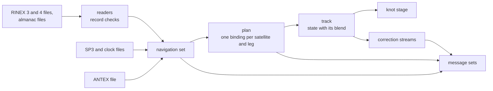
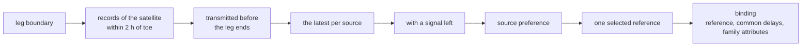
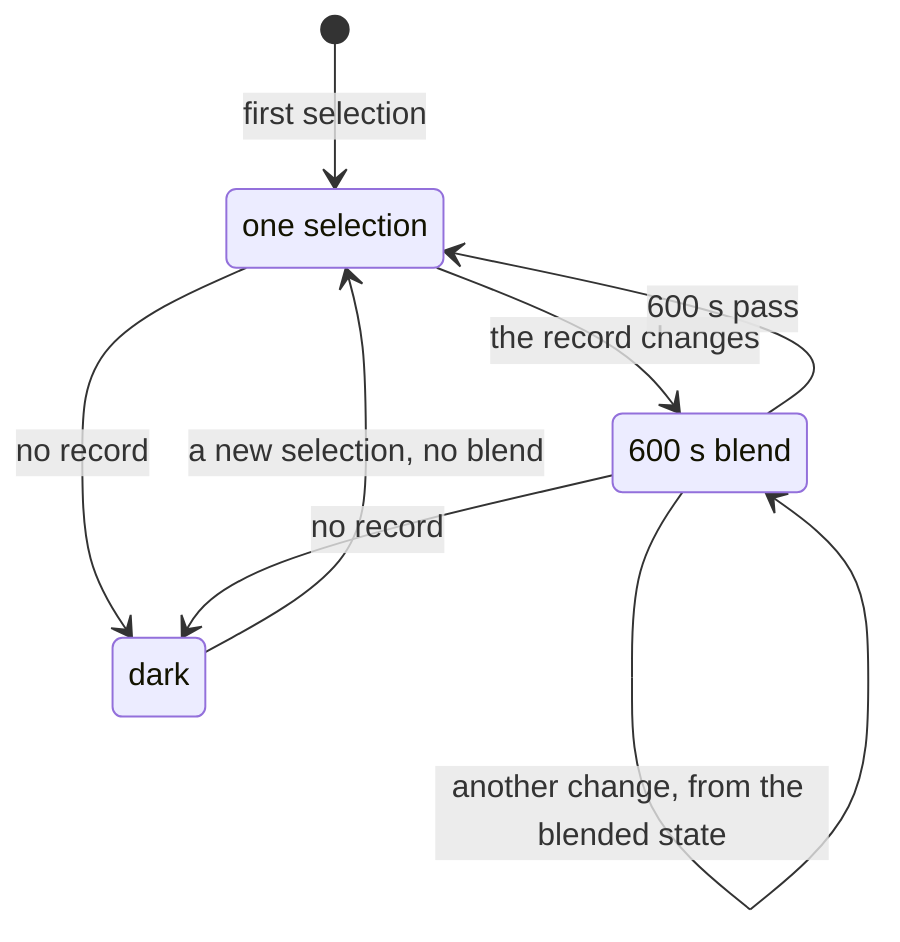

# Navigation

The navigation data decide what each satellite transmits: orbit, clock,
group delays, health, time scale and messages. The packer reads the data
once, checks every record and writes a plan into the bundle. The generator, the observer and the correction streams
then follow one schedule. The content each system reads and broadcasts is
in its own data page, such as [GPS data](../gnss/gps/data.md).

## One clock

GPS time is the only stored time. Every other scale is a view of it,
computed where it is read.

| Scale | View of GPS time |
|---|---|
| Galileo System Time | the same seconds; weeks counted 1024 later |
| BDT | 14 s less; weeks counted 1356 later |
| UTC | less the leap count of the run's schedule |
| GLONASS time | UTC plus 3 h |

A satellite's time against GPS time is its record's clock plus its
system's declared offset (GAGP, BDGP or GLGP). The plan takes the offset
transmitted last at or before the run start. It prefers the system's own
record, then one broadcast by GPS.

### The leap-second schedule

The packer resolves one leap schedule for the run. Every consumer reads
it, so the simulated UTC and the broadcast UTC agree.

| Case | Rule |
|---|---|
| no declaration | the built-in table throughout |
| a declared count | the first file's `LEAP SECONDS` record flies; a later file that differs is a warning |
| a start inside the built-in table | the declared count must be the table's count then in force; a negative count is refused |
| an announced event | changes the count at the end of the UTC day it names, before or after the start alike |
| an announced step larger than one second | the record keeps its count and loses its event, with a warning |
| after the event, or without one | the declared count holds; the table's later entries are not used |
| the broadcast leap-second fields | read from this schedule: the announced event, else the table's last insertion as a past event |
| the run's span | the count at the start and the change within the run, resolved once from this schedule; the C hosts read it, `pharos-pack` and `pharos-run` print it |

The Sun's sidereal time, NeQuick G's universal time and a UTC or GLONASS
scenario start use the built-in table. They take UTC as a measure of the
Earth's rotation, which a declared count does not move.

## Readers and records

The packer reads the navigation, almanac, product and antenna files. The
leap record comes first, because it places the UTC epochs of the rest.

| Rule | Why |
|---|---|
| one function fetches a file by name, from the file system or from a host's table | the readers see only bytes, so a scenario packs alike from either |
| a target without a file system has only the table: the directory source and `pharos_pack_create` are not compiled | `pharos_pack.wasm` carries no file-system code |
| a blank field never becomes a value | the pinned ICDs give most fields no "not available" form |
| a blank accuracy becomes the family's "no prediction" index | the ICDs define that index |
| a blank group delay stays absent in the raw record | the plan resolves missing terms from time-eligible records |
| every kept record is checked against the fields of its message | no message can overflow a field |
| a line, record or block that does not read is skipped, with a warning | one bad record does not fail a file |
| the GLONASS P1 word is computed from the tb spacing and stored in the plan | the raw record stays unchanged |

Raw records are immutable after loading. The bundle checks their fields
and the plan's references before consumers use them.

## The selection schedule

The packer samples the run at its start and at every leg boundary. A leg
boundary is each GPS minute; for GLONASS, each superframe boundary of
Moscow time. The packer writes the result as legs per satellite. The
plan spans the run and one more minute. Consumers resolve legs; they
never select.

| Rule | Behaviour |
|---|---|
| a Keplerian record | flies from the start of the leg it is sent in, until its source's next record takes over |
| its transmission | t_tm, else toe less the GPS ICDs' lead; without either, the healthy record nearest in toe |
| its health | the latest record of a source flies only with a signal left |
| source preference | families carried by the satellite's enabled signals first, then the remaining sources in the default order below |
| a GLONASS record | adopted 15 min before its tb; the latest flies until 30 min after tb or its Moscow day ends |

The enabled signals are the scenario's listed signals that the satellite
actually carries at the run start. Within each pass the default order is
LNAV, CNAV, CNAV-2 for GPS; D1/D2, B-CNAV1, B-CNAV2, B-CNAV3 for BDS;
and I/NAV, F/NAV for Galileo. Thus L1 C/A favours LNAV, L2C or L5 favours
CNAV, and L1C alone favours CNAV-2. Legacy BDS signals favour D1/D2;
modern-only runs try the enabled B-CNAV families in order. E1 or E5b
favours I/NAV, while E5a alone favours F/NAV. When enabled signals exist,
a candidate must leave at least one on the air. A latest record declaring its source
dead does not expose an older record of that source. Exact timing ties
use a stable order of the raw record contents.

A navigation file alone is described by the same timing rules: the packer
walks each system's leg grid over every instant one of its records could
fly, with only the satellite's own records, and reports the stretches
where a satellite flies at every boundary. This query has no scenario
signals and uses the default source order. Satellites without enabled
signals also retain a default-order plan for correction targets. The mask
does not remove a satellite from the plan.

The ICDs cut data sets over on transmission intervals, not midway
between toes. A record transmitted at 12:00:41 therefore flies from
12:00:00.

### One binding per leg

Each leg binds one raw reference to a common group-delay table and
attributes for each message family. Geometry, observables, message sets
and corrections all consume that binding. A target family's attributes
never change the reference's raw source or its clock basis.

The reference's own delay terms win. Each missing term is resolved
independently from the same satellite's raw records within two hours of
the leg instant and adopted before the next boundary. Adoption is the
explicit transmission time, else the GPS lead time, else toe. The nearest
toe to the selected reference wins, then the latest adoption, then stable
raw-record order. Different terms may come from different records. A
required base delay that remains absent makes that signal unavailable;
the raw record and the satellite's other usable signals remain available.
The donor adoption gate is separate from orbit selection: a Galileo or
BDS reference without a transmission time can be the nearest healthy
record with a future toe, while a secondary donor with that toe is not
eligible until its adoption precedes the next boundary.

Family attributes come from the latest time-eligible record of that exact
source, including its health declaration. Accuracy and issue fields stay
coherent with the selected physical parameters: GPS modern accuracy uses
the selected orbit's URA, Galileo mismatched toe or issue uses NAPA, and
BDS uses the selected modern accuracy or conservative fallback values.
These attributes do not claim the accuracy of a donor's different orbit.
The selected source retains its own attributes; Galileo's E5a declaration
is resolved from F/NAV beside the raw I/NAV record.

A reference, delay or attribute change starts a new binding leg. Resolving
another family's metadata does not select another orbit.

### What each family encodes

| Family | Record |
|---|---|
| LNAV, I/NAV | the selected reference, when its raw source is the family's own |
| F/NAV, D1/D2, GNAV | the selected reference in the family's form |
| CNAV, CNAV-2, B-CNAV1, B-CNAV2, B-CNAV3 | the same selected reference in the family's form, with its resolved attributes |

A family carries a record of another source in a converted form. CNAV
and B-CNAV move it onto their 300 s grid; D1/D2 fits it over the binding leg.
A record the fields cannot carry goes out in the family's unavailable
form. With `samples`, unfit conversions to CNAV, CNAV-2, B-CNAV or D1/D2
produce an `unfit_record` warning. The per-family forms are in
the constellation pages, such as [CNAV](../gnss/gps/cnav.md).

Converted orbit and clock parameters have their own type. The source
record retains its provenance and still drives the geometry. The family
owns the converted value's issue, health and field layout. For D1/D2,
the packer prepares one result for each contiguous binding leg and its
service interval, including separate results when a reference returns
after a gap. The plan stores the fitted parameters and their decoded
broadcast form. Set refreshes and D2
corrections reuse this result.

## Transitions across a switch

| Case | What moves over 600 s |
|---|---|
| a broadcast record replaces another | position, velocity, clock bias and drift, relativistic term, group delays |
| the record changes under a precise product | the group delays and their shift against the product clock |
| an effective signal delay or precise clock shift changes | a new delay blend starts; orbit and clock keep their current transition |
| only family attributes change | message metadata updates; active orbit and delay blends keep their original end times |
| a change inside a running blend | the new blend starts from the blended state, not the outgoing record's |

The blend is linear from the state reached at the switch. Its velocity
and drift are the derivatives of its position and bias, so the knots'
cubic Hermite pairs stay consistent. Every track
walks the re-selection instants by the same rule. The geometry, the
observer and the streams therefore make the same transitions at the
same instants.

## Almanacs

The packer completes the almanacs once, at the run start. File almanacs
come first. Other satellites get a reduction of their nearest ephemeris
to a common toa on the system's almanac grid. The health word comes from
the nearest record of a family that declares it. GLONASS almanacs are
built only when a GLONASS signal is listed.

The GNSS model modules own the numerical reductions and reference grids.
Pack owns record selection, the common reference and completion policy.

## Precise products

With a `precise` block, the selection keeps the broadcast binding for
health, window, source preference, common delays and the GLONASS frequency.
The orbit and clock come from the product. The product's identity never
changes, so a record change blends only the group delays. A satellite the
product does not serve over the selection span is dark. The product's
conventions are in [geometry](../models/geometry.md).

## Correction streams

Each stream takes the truth from the flight track, on the service's time.
It takes the reference from the common binding in the form the named
family broadcasts. The streams own scheduling, reference matching and
lifetime. The constellation code owns the fields and the unavailable
forms.

The reference's orbit and clock parameters are separate from the source
record used for identity and source metadata. Target issue numbers,
including the B-CNAV clock issue used by PPP-B2b, belong to the prepared
broadcast value.

| Stream | Carried on | Refines | Time | Runs when |
|---|---|---|---|---|
| HAS | E6 C/NAV pages | LNAV and I/NAV records | GST | a `has` block and E6 listed |
| PPP-B2b | B2b of the satellites that carry it | B-CNAV1, LNAV and I/NAV records | BDT | a `pppB2b` block and B2b listed |
| D2 | D2 subframes of the BDS GEO satellites | the D1/D2 form of the flight record | BDT | a D2 publication |
| GPS differential corrections | CNAV and CNAV-2 correction messages | LNAV records | GPS time | a product, a GPS publication with `differential`, CNAV or CNAV-2 listed |

The encoded reference uses the same resolved delays as the signal track.
Family conversions preserve the selected raw clock basis and apply the
required clock shift from that common table. D2 uses the decoded
parameters prepared for the current binding leg. A change of resolved
delays or attributes refreshes a correction reference even when the raw
orbit record is unchanged.

## Health

One rule serves every system. It follows the line IS-GPS-200N 6.4.6.2
and 6.4.6.3 draw.

| Declaration | Effect |
|---|---|
| the signal is gone | the signal goes off the air |
| the signal is not to be trusted | the signal stays on the air, with the flag set |
| an almanac health word | reaches the almanac pages, never the air |

Which words say which is in each system's data page, such as
[Galileo data](../gnss/galileo/data.md).

## Not modelled

| Item | Why |
|---|---|
| RINEX 2 navigation files; SBAS, QZSS and NavIC blocks | the reader takes the 3 and 4 syntax for the four systems |
| monitoring in the correction streams | no stream estimates the accuracy of its own corrections |

## Standards

| Document | Issue | Used for |
|---|---|---|
| IERS Bulletin C | the leap seconds through 2017-01-01 | the built-in leap table |

The navigation file formats are in [formats](formats.md).
