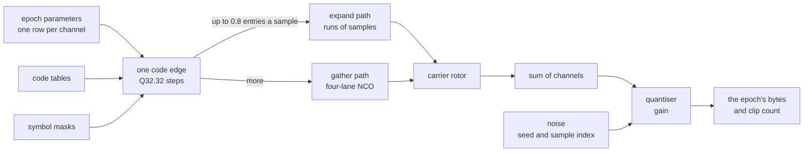

# Synthesis

The kernel turns one epoch's channel parameters into bytes. For every
sample it reads each channel's code and symbol state, rotates it onto the
carrier and sums the channels. It then adds noise and quantises. The
bytes depend on the epoch's parameters, the seed, the noise mode and
the gain alone. The tiling, a channel's path and the worker never
change them.

## Code tables

At creation, each primary code is folded with its signal's periodic
pattern into a table of one byte per entry. The low bits of an entry
take the data and pilot symbol masks. The higher bits select one of the
composed complex values the signal row defines. What those values mean
stays in the system's signal definition.

| Signal kind | Entries per chip | Why |
|---|---|---|
| plain codes | 1 | one value per chip |
| L1C, B1C, E1 | 12 | enough for every BOC(1,1) and BOC(6,1) transition |
| L2C | 2 | the two codes alternate chip by chip |

## Epoch parameters

The parameters are all the kernel reads for one channel over one epoch.

| Part | Content | Why |
|---|---|---|
| carrier | a linear ramp between the phases at the epoch's two ends, plus the IF | the Doppler changes smoothly within 1 ms |
| IF term | exact integer arithmetic on whole milliseconds | it never drifts; every channel keeps one oscillator's phase |
| code | a linear ramp of the transmit time between the two ends | the same ends give the same code, however the epochs are blocked |
| period and masks | the code period at the epoch start; one mask byte per period | symbols change only at period boundaries |
| amplitude | from the channel's C/N0 | see below |
| lead | a fixed number of entries for the component with the smaller delay | data and pilot keep their own group delays under one carrier |

A channel is inactive for an epoch when its transmit time advances by
more than 3 % above or below a millisecond. It is also inactive when its
transmit time lies before its time scale's origin. The mask slots are
sized for the 3 % deviation. No receiver in the
[trajectory domain](trajectories.md) comes near it.

## The two paths and their one code edge

Chips advance from the transmit time at the epoch start, in Q32.32 steps.
The step is rounded once per channel and epoch. Sample n takes the entry
into which the phase plus n steps falls.

| Path | Used when | How |
|---|---|---|
| expand | at most 0.8 entries per sample | each entry's value is written over its run of samples, by an exact integer walk |
| gather | more entries per sample | a four-lane chip NCO reads each lane's entry off the same edge |

Both paths quantise one sequence of edges. The threshold is therefore a
speed choice, not a contract. Positions count from the epoch start, so a
sample's entry does not depend on the sub-tile that computes it. A
leading component splits each run where its own edge falls. The lead is
exact to the sample on both paths.

## The carrier

The carrier is an f32 rotor: four chains of four lanes over sixteen
consecutive samples. It is re-seeded from the f64 phase every 512
samples, on a grid anchored to the epoch start. The tiling is therefore
invisible in the bytes.

## Noise and amplitude

The noise is complex Gaussian, with a sigma of 1 per component. It is a
pure function of the seed and the absolute sample index. A SplitMix64
counter feeds a four-lane Box-Muller transform, so chunking never changes
it. The noise mode `off` writes zeros instead.

The noise's density is the N0 that the C/N0 values refer to. A channel's
amplitude is therefore sqrt(2 x 10^(C/N0 / 10) / fs) on the unit mean
power of the table values.

## Quantisation and gain

Four quantisers cover IQ2, IQ4, IQ8 and IQ16, each counting clipped
components. The scalar quantisers are the contract; the vector ones give
the same bytes. The layouts are in [formats](formats.md). One gain scales
each window: the AGC's, or a constant resolved at creation.

| Gain | Rule |
|---|---|
| adaptive, the default | the AGC below, starting at 1 |
| constant | 10^(dB / 20) on every epoch, dB in [-60, 60]; 0 dB is the AGC's start |

| AGC step | Rule |
|---|---|
| evaluation | every 100 epochs, over the clip rate of those epochs |
| clip rate above 1 % | the gain is multiplied by 0.95 |
| clip rate below 0.1 %, gain below 1 | the gain is multiplied by 1.02, to at most 1 |

The AGC accumulates its counts over whatever pieces the run produces. The
gain therefore moves on the same epochs however the run is pulled,
blocked or threaded. A constant gain reads no count, so an epoch's bytes
do not depend on how the epochs before it clipped. The kernel works in
sub-tiles of whole 16-sample rotor strides. Each sub-tile starts on a
byte in every format, and its length never changes the bytes.

## Embedded data

Some tables are too large or too arbitrary to derive. They are embedded
as blobs. Each directory's `manifest.zig` lists its
blobs with their size and SHA-256. Sizes are checked at compile time;
the digests are recorded, not checked. Every other table is computed
from the parameters its document prints.

| Data | Directory: files | Source | Form |
|---|---|---|---|
| CNAV-2 LDPC generators | `src/shared/gnss/gps/blobs/`: l1c_gen2.bin, l1c_gen3.bin | IS-GPS-800 | big-endian 32-bit rows, one per parity bit |
| B-CNAV LDPC generators over GF(2^6) | `src/shared/gnss/bds/blobs/`: b1c_gen2.bin, b1c_gen3.bin, b2a_gen.bin, b2b_gen.bin | the B1C, B2a and B2b ICDs | one byte per symbol; 100, 44, 48 and 81 square |
| Galileo memory codes | `src/shared/gnss/galileo/blobs/`: e1_codes.bin, e6_codes.bin | OS SIS ICD Annex C; the E6-B/C Codes Technical Note | 50 data codes then 50 pilot codes, chips MSB first |
| EGM96 geoid | `src/shared/core/geoid/`: egm96_15.bin | NGA's WW15MGH.GRD | per row, north first: the 0 E post in mm, then steps to the next posts |
| GPT3 grid | `src/shared/core/tropo/`: gpt3_5.bin | gpt3_5.grd of the VMF Data Server | per grid point, the file's columns as scaled integers |
| VMF3 expansions | `src/shared/core/tropo/`: vmf3_bc.bin | the VMF3 b and c coefficients of the VMF Data Server | little-endian doubles |
| NeQuick G data | `src/shared/core/iono/nequick/data/`: ccir11.txt to ccir22.txt, modipNeQG_wrapped.txt | the European Commission's NeQuick G document, Annex C | the published files, verbatim |

The geoid, GPT3 and VMF3 blobs also name the published file they were
converted from, with that file's SHA-256.

## Not modelled

| Item | Why |
|---|---|
| front-end filtering and anti-alias resampling | the square-wave subcarriers are sampled directly; the sample rate decides which transitions appear |
