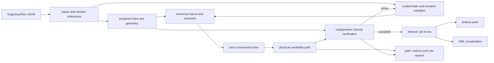

# Trajectories

A trajectory plan describes a receiver's journey with geometry, events,
sections and rules. The authored file is `trajectory.json`. Pharos solves
its timing, positions and motion together, verifies the candidate and
writes internal `.pht` knots for the packer. The observer may write LLA
or ECEF position logs; those logs are not trajectory authoring inputs.

## Solve boundaries

| Entry | Owns |
|---|---|
| `solve.kernel` | scalar and automatic differentiation forms of physical quantities and cell evaluation; `kernel/domain` and `kernel/autodiff` hold their implementation |
| `solve.rules` | prepared geometry, authored checks and their residual meanings, shared by optimization and verification |
| `solve.mesh` | scaled variables, connectivity and bounds; `mesh/seed` initializes the path and `mesh/presolve` applies exact hard constraints |
| `solve.problem` | the numerical layout for one mesh and its evaluator; `problem/prepare` builds rows and batches, and `problem/evaluate` owns mutable evaluation storage |
| `solve.nlp` | constrained optimization through value and derivative requests |
| `solve.candidate` | physical path state, coefficients, event times, distances and sampling |
| `solve.verify` | checks over the candidate and prepared rules; `verify/polynomial` supplies interval bounds |

`solve.build` joins these stages and controls refinement. Rule semantics
are prepared once for the resolved plan. Each mesh gets its own numerical
layout, sparse derivative structure and evaluation workspace.

## One authored model

`plan.read` reads the raw JSON shape, and `plan.resolve` turns identifiers
into typed references. `plan.model.Plan` owns the resulting geometry,
events, sections, rules and initial guess. The generated
`trajectory.schema.json` comes from the same reader. It describes field
shapes and values; reference integrity and physical validity are reader
and solver checks.

| Part | Meaning |
|---|---|
| coordinates | WGS84 positions with altitude above EGM96 or the ellipsoid |
| geometry | named points, piecewise cubic Bezier or polyline guides, and circular or convex polygon regions |
| events | ordered boundaries with shared position, velocity and acceleration according to C0, C1 or C2 continuity |
| sections | the chain between consecutive events |
| rules | hard equalities and ranges, soft targets, or minimization and maximization objectives |
| initial guess | starting event times and states for the numerical solve |

A geometric guide has no effect until a rule refers to it. A stop uses
position or speed constraints; a dwell is a stationary section between
two events. Arrival time, duration, speed and geometry constraints enter
the same optimization problem. The model has no separate motion program
or route compiler.

Rules may select one event side, a section, an interval between events,
a fixed time, a fixed time range, or the whole trajectory. Values can be
constants, named points or another event's compatible quantity with a
factor and offset. `scale` normalizes a physical quantity; `weight`
sets the strength of a soft rule. Initial guesses do not impose rules.
The complete field and unit reference is in the
[trajectory guide](../guide/trajectories.md).

## Transcription

Each section has a mesh of polynomial cells. A node carries ECEF
position, velocity and acceleration. Cell position is quintic Hermite.
Section durations are positive optimization variables. Event times are
cumulative sums of those durations, with the first event fixed at zero.

Variables use a local ECEF origin and physical scales. At an event,
position variables are shared. C1 also shares velocity; C2 also shares
acceleration. These settings govern translational continuity. Course
and turn-rate variables are shared across events for all three settings.
Optimization interpolates local position offsets and adds the ECEF
origin to the resulting position, preserving precision in short
displacements and their derivatives. Verification evaluates the emitted
ECEF knot representation.

Course and turn rate become active when the plan supplies an initial
course or uses `course`, `turnRate`, `turnRadius`, a forward quantity or
`lateralAcceleration`, including through an event-value reference. Course
then uses cubic Hermite interpolation. Alignment constraints keep
horizontal velocity along the solved forward direction, and signed
forward speed permits reverse motion. For a plan using only translation
quantities, inspection derives course and turn rate from horizontal
velocity where it is nonzero; at rest it retains the initialized course
state.

An exact presolve fixes literal hard event position, velocity and
acceleration values, zero speed and acceleration, and section durations
in the variable bounds. Fixed event times can determine a remaining
section duration. Zero-speed interval rules share position variables
and fix derivatives to zero throughout the covered cells. Conflicting
fixed values mark the candidate infeasible before iterative solving.
These simplifications come from hard rules; initial guesses remain
starting values.

`rules.prepare` resolves physical checks, curve points and region frames
once. `problem.prepare` places those checks on the current mesh as
equality and inequality rows and soft objective terms. Geometric curve
rules introduce progress variables and progress ordering. Fixed time
scopes include their dependence on the current section durations. A
scope requiring a later time also requires the trajectory to cover
that time.

`problem.Layout` records each row's participating columns, the sparse
Jacobian structure and batches of related terms. Event-value references
include dependencies on the referenced event. State and duration
variables participate in the same Jacobian and are adjusted in the same
solve. `problem.Workspace` holds the mutable state used to evaluate that
layout.

## Evaluation

| Component | Evaluation role |
|---|---|
| `kernel.Scalar` | `f64` values for objective and constraint evaluation, candidate sampling and verification |
| `kernel.Differential` | `Dual` values carrying derivatives with respect to optimization variables, for the gradient and sparse Jacobian |
| `kernel.autodiff` | arithmetic on derivative lanes in SIMD groups selected for the target, with a scalar fallback |

Both kernel forms use the Hermite coefficients defined in
`shared.trajectory.hermite` and the physical quantities in
`kernel/domain`. EGM96 grid interpolation and polar blending share the
compile-time `shared.core.geoid.Evaluator`; `kernel/domain` supplies the
motion chain rule. A derivative pass seeds up to 32 participating
variables at a time. SIMD groups operate on those derivative lanes; the
lane count does not set the number of path samples.

Within a scalar evaluation, cell coefficients and physical state at each
sample are reused across terms. Derivative batches reuse them within each
seeded block. The layout records the quantities needed at each sample,
so its physical point prepares the required local frame, altitude,
heading and motion derivatives once. These caches are reset for each
value or derivative request. Each request builds the scalar prefix of
event times once for its current variables. Batches retain duration seeds
as `{ slot, section }`; an event time's derivatives use that prefix and
only the active duration lanes from preceding sections.

The numerical solver receives `nlp.Layout` for bounds and sparse row
structure, plus a concrete evaluator type with two methods:

| Method | Output |
|---|---|
| `values(x, nlp.Values)` | objective and constraint values |
| `derivatives(x, nlp.Derivatives)` | objective gradient and sparse Jacobian values |

The evaluator methods return `error.Domain` when the requested values or
derivatives are invalid. Calls resolve through the concrete type at
compile time. `problem.Workspace` supplies the trajectory evaluator.

## Physical quantities

ECEF vector derivatives come directly from the polynomial. The local
frame is derived from the current WGS84 position. Moving-frame
calculus includes changes of the east, north and up axes, so forward
acceleration and jerk are derivatives of signed forward speed rather
than projections of ECEF acceleration and jerk alone.

Altitude, climb rate and vertical acceleration use the plan's declared
altitude datum. For EGM96, the geoid's spatial derivatives contribute to
altitude derivatives. Course is clockwise from north; turn rate is its
time derivative. Lateral acceleration is signed across the course.
Turn radius is signed forward speed divided by turn rate in radians/s.
A hard radius equality uses the product form
`forwardSpeed = radius * turnRate` inside the optimizer. Independent
verification checks the physical radius residual at every nonzero turn
rate, so a small product residual near zero is not sufficient. An exact
zero forward speed and zero turn rate pair is accepted as a stationary
extension. Radius ranges, targets and objectives use the ratio and
require a nonzero turn rate.

The frame calculation supports the poles. The EGM96 surface uses a
smooth local cap near each pole and blends into the tabulated surface.
There is no latitude clipping or longitude adjustment in the authored
plan.

## Numerical solve

The implementation is pure Zig and runs on native and WebAssembly
targets. `solve.nlp` uses an augmented Lagrangian for hard constraints,
with projected limited-memory BFGS steps and an Armijo line search.
BFGS acts on free variables and resets its history when the active
bounds change. A projected-gradient step is the fallback when the BFGS
direction cannot make progress. Constraint multipliers and the penalty
are updated after an inner solve meets its stationarity tolerance.
Variable bounds preserve positive durations and bounded curve progress.
A feasible point whose objective is stationary under those bounds can
also converge with zero constraint multipliers.

Each Armijo trial first evaluates the objective and constraints with the
scalar kernel. Only a trial with finite merit and sufficient decrease
requests derivatives. Acceptance also requires valid derivatives; a
failed derivative evaluation sends the line search to a shorter step.

Default convergence tolerances are `1e-7` for primal feasibility and
complementarity and `1e-6` for projected stationarity. The numerical
budgets are 40 outer iterations, 300 inner iterations per outer pass,
and 30,000 evaluations per solve. These are stopping criteria for a
local method. They do not establish a global optimum or prove that an
unresolved plan is impossible.

| Report field | Meaning |
|---|---|
| `status` | `converged`, `iterationLimit`, `infeasible`, `numericalFailure` or `verificationFailed` |
| `feasible` | no detected hard constraint or receiver-domain violation, and no conflicting fixed values; interval verification may remain unresolved |
| `verified` | the numerical solve converged and independent verification accepted the candidate |
| `iterations` | accumulated inner iterations across mesh passes |
| `objective` | final normalized soft objective |
| `maxViolation` | maximum normalized violation reported by independent checks, including hard rules, continuity and domain constraints |
| `stationarity` | final projected stationarity measure |

The failed candidate and individual rule reports remain inspectable.
An `infeasible` status means the current solve did not produce an
accepted feasible candidate; it is not an unsatisfiability proof.
Only a verified result can be serialized as `.pht` by the source build
API or written by the CLI build command.

## Verification and refinement

`verify.check` takes `rules.Prepared` and a physical `candidate.Candidate`.
It evaluates authored checks over the candidate independently of the
optimizer's row assembly, using the shared residual definitions in
verification mode. The candidate also supplies curve progress samples
for ordering and endpoint checks. Verification covers continuity, both
event sides and the intervals selected by each rule.

Polynomial quantities use Bernstein bounds;
nonpolynomial quantities use adaptive interior checks. This is numerical
validation with bounded polynomial subproblems, not a formal certificate
for every nonlinear physical expression.

The mesh starts with two cells per section. When the candidate meets
the constraints at the optimizer's collocation points, an independent
verification failure may flag sections for doubling and solve again
from the previous candidate. A candidate that still violates those
collocation constraints stops without refinement. There are at most six
mesh passes, reaching at most 64 cells in a repeatedly flagged section.
Verification uses a normalized tolerance of `1e-5`. Refinement does not
change the authored rules or relax their scales.

The final `.pht` trajectory also passes the shared receiver-domain
checker. Its knots and the intervening polynomial must stay within the
physical domain below. Domain checking is separate from the plan's
user-supplied limits.

## The knot interpolant

A solved trajectory is a sequence of time, position, velocity and
acceleration knots. Between neighbouring knots it is the quintic
Hermite polynomial matching both endpoint states.

| Case | Rule |
|---|---|
| between two knots | the quintic through both positions, velocities and accelerations |
| a time given twice | a velocity or acceleration step at one continuous position |
| before the first or after the last knot | constant acceleration from the endpoint |
| time | seconds from the first knot at zero |
| number of epochs | duration in milliseconds, rounded down after a rise of eight ulps |
| lookup | a binary search for the two knots, with no stepping or history |

Relative time lets the same trajectory run under any scenario start.
The eight-ulp rise makes a decimal duration include its final epoch.
State lookup has no history, so epochs can be evaluated in any order.

## The receiver domain

| Quantity | Domain |
|---|---|
| distance from the geocentre | 6350 km to 200,000 km |
| speed | at most 20,000 m/s |
| acceleration | at most 1000 m/s^2 |
| knot time | first at zero, none past 10^7 s |

The path can leave the range of its endpoint knots. The shared checker
therefore bounds each Hermite piece using its endpoint values and the
largest magnitudes of its basis functions. The acceleration has an
additional bound relative to constant acceleration; the tighter bound
counts. An interval whose bound leaves the domain is refused.

## Inspection and other products

| Storage | Lifetime |
|---|---|
| parsed plan and `solve.Result` | the caller's result allocator |
| prepared rules and geometry | one build call |
| mesh, numerical layout, evaluator and verification storage | one mesh pass |
| numerical solver workspace | one `nlp.solve` call |
| path copied for refinement | until the next mesh has been seeded |

`source.build(allocator, result_allocator, text, diags)` uses `allocator`
for temporary arenas and `result_allocator` for the parsed plan and final
`solve.Result`. That result retains the plan, a `candidate.Path`, the
emitted trajectory, the solver report and per-rule reports. The path
owns its physical nodes, cell coefficients, section durations, event
times and accumulated distances. Each mesh pass releases its temporary
storage before the next pass or return.

`inspect.of(arena, result, sample_count)` projects this result into events,
sections, samples and rule reports. It uses uniform time samples and
adds both sides of events and every emitted knot. Duplicate identical
samples are removed. Sampling density does not change the solved path.
An ordered cursor reuses the current path cell while producing samples.
Inspection arrays use `arena`; their identifiers refer to the retained
plan, whose storage must remain alive.

Inspection altitude uses the plan's declared datum. Course comes from
the authored orientation state or is derived from velocity. The
simple C `pharos_traj_state` record always reports altitude above EGM96
and the position, velocity and acceleration available in `.pht`.
A `.pht` read or static factory result has no authored plan to inspect.
[The C API](../guide/c-api/traj.md) defines retained buffers and candidate
access after an unsuccessful solve.

The static factory creates one knot at zero and, for positive duration,
a second identical state at the end. `check` reports sampled dynamics,
altitude and derivative steps of an internal product. `export` creates
KML for visualization.
