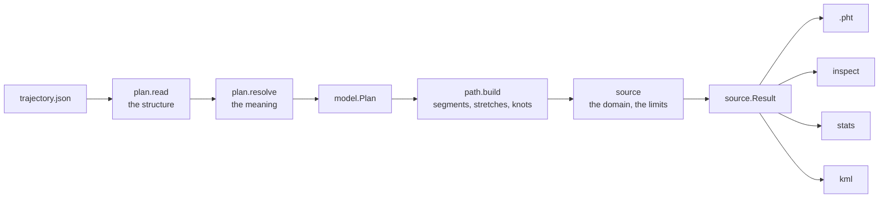

# Trajectories

The trajectory part turns a plan into a path the way the rest of Pharos
is built: a defined input contract, a defined transform, layers with
clear boundaries. A plan is read into typed segments, built forward into
motion, cut into the knots of a stored path, and checked against the
receiver's domain and its own limits. Nothing is searched; the one
segment that is solved, `through`, is a linear problem with one answer.
The plan's keys and their rules are in the
[trajectory guide](../guide/trajectories.md).

## Layers

| File | Owns | Over |
|---|---|---|
| `plan/model.zig` | the plan as read: places in ECEF, angles in radians, times in seconds from the start, segments, events, limits | |
| `plan/read.zig` | the key tables, which are also the JSON Schema's source; the plan read whole, or its guides alone | model, resolve |
| `plan/resolve.zig` | names made indices, the rules between segments, the events, the limits; the guides of a plan being written | model, geometry |
| `track.zig` | ground tracks of constant geodesic curvature, geodesics to a place | |
| `guide.zig` | a guide's path and its ground track by length over the ground; its outline for a map | track, measure |
| `motion.zig` | a run's motion in time: its ground run by the speed's step, at its height | track, guide, through |
| `through.zig` | the least-jerk solve | |
| `frame.zig` | the local frame of a point in motion, and a state read in it | |
| `measure.zig` | lengths from speeds | |
| `path.zig` | the build: segments, stretches, the knots, the segments' lengths | all of the above |
| `check.zig` | the limits held against the stored path; its extremes | frame |
| `source.zig` | a plan's text made a path, held against the domain and the limits | plan, path, check |
| `inspect.zig`, `stats.zig`, `kml.zig`, `static.zig` | what a caller reads of a path; a receiver at rest | source, check |
| `capi/`, `cli/` | the C API and the command | the files above |

The PHT, its interpolation, the receiver's domain and the geoid are the
shared code's (`src/shared/trajectory.zig` and its directory,
`src/shared/core/geoid.zig`), used as they are: the PHT is the boundary
`pharos-pack` reads, and through the bundle `pharos-run` and
`pharos-obs`.

## Reading

`plan.read` reads the text through its key tables: required keys,
counts, types, ranges, unknown keys. A fault there is reported with every
other the stage finds, and the plan goes no further. `plan.resolve` then
reads its meaning: names to places, guides and segments; each segment's
keys against its kind; the rules between a segment and the one before it
(`Before`: at rest, free or moving, with a direction or not, at which
place, on which guide); the times the text gives; the events; the
limits. Every fault of this stage is reported too. What only numbers
decide is left to the build.

`plan.read.parseGeometry` reads only the coordinates, places and guides
of a plan that may be incomplete, each place and guide on its own, for
`describe_geometry`: a guide with a fault is not whole, and the others are
still described.

## Building

`path.build` walks the segments in order, each from the `State` the one
before leaves: its time, position, velocity and acceleration (left to the
segment where the start is free or a through comes before), its foot on
the ellipsoid, its direction over the ground, its speed, its altitude with
its rates, and the guide an along left.

| Segment | Built as |
|---|---|
| `stay` | one knot at rest at its end |
| `straight`, `turn` | a run: a track from the state's foot and direction, of curvature 0 or the turn's, by the speed's step, at the segment's own height |
| `along` | a run: a part of the guide's path from where it begins to its `to`, by the speed's step, at the heights of the guide's places |
| `through` | solved: its places' positions and heights at their times, its ends held where the plan states them |

A through before a run is solved after the run is made ready from the
through's last place, so that the through ends in the run's first state.

### Runs

A run's speed is a step from v0 to v1 over its duration T, its length
s(t) = v0 t + (v1 − v0) T (5/2 u^4 − 3 u^5 + u^6) with u = t / T: the
acceleration and jerk are nothing at both ends. `motion.Timing` takes the
length the shape fixes, or the one the time and speeds give; its time at
a length is found by halving.

`track.zig` integrates a track over the WGS84 ellipsoid by its length s:

    F'' = k_n n + k (T × n),   n = D F / |D F|,   k_n = -(T · D T) / |D F|,   D = diag(1/a^2, 1/a^2, 1/b^2)

with T = F' its unit tangent and k the geodesic curvature (0 for a
straight), by classical Runge-Kutta steps of at most 10 km and at most a
32nd of the radius, each step's point put back onto the ellipsoid; between
nodes the track is the quintic Hermite of F, T and F''. It is defined
everywhere, the poles included. A straight `to` a place is a geodesic
found by Newton's method on its initial azimuth and its length, at most
32 iterations, settled where it ends within a nanometre of the place or
the rounding of its steps; a turn `onto` a course steps until its azimuth
has turned by the angle, the last step found by halving.

`guide.zig` builds a guide's pieces in ECEF: a polyline's legs and the
arcs that round its corners, or a Bezier's cubics. Its ground track is the
pieces' foot on the ellipsoid by length over the ground: eight-point
Gauss-Legendre over each piece's parts, a part halved until its length
agrees with its halves' to a nanometre or its rounding, in at most 1024
parts and 40 halvings; the parameter of a length by Newton's method kept
within its part. A gentle corner's legs run on along their chords into
its arc, evenly in their parameter, to meet at its place.

A run's point is its ground's foot lifted along the ellipsoid's normal to
its height: for a straight or a turn, its own quintic in time in the
plan's altitude (`motion.Vertical`), the geoid's height added over
EGM96; for an along, the heights of its guide's places by least jerk in
ground length (`motion.Profile`, a one-axis `through.solve`).

### Joints and stretches

Each run is cut into stretches at its joints: an along where its guide's
pieces meet and at its heights' places, a straight or a turn over EGM96
where its track crosses a line of the geoid's 0.25° grid (each crossing
found by halving, and the polar caps' edges too). A joint says how the
motion goes on: smoothly, with a step of acceleration (a segment's start,
a polyline's tangent points, a straight meeting a turn), or with a step of
velocity (a Bezier joint, the geoid's slope, a gentle corner). A step is
two knots at one time and one position. Over EGM96 each stretch is read
in the geoid's cell of its middle.

A polyline corner whose arc would change the velocity by less than
1e-4 m/s and last under 10 ms is no arc: inside an along by the arc's
ends' velocities and time, at an along's end or start by the speed the
two alongs share there. A corner whose arc takes no time steps the
velocity too, and marks the build out of the domain where v^2/R passes
1000 m/s^2.

### The through

`through.zig` solves the path of least

    J = sum over the pieces k of  ∫ |jerk|^2 dt  +  (10^-6 / h_k^2) ∫ |acceleration|^2 dt

between knots at the places, each piece the quintic Hermite of its knots'
states, on four axes: the ECEF track P and the height h*. The positions
are held, and so are the velocity and acceleration where the segment's
ends state them; each axis is one banded system. Each piece takes its
positions as their own difference, each knot's unknowns are scaled by the
shorter of its gaps, the held values are eliminated, and the band of
half-width 3 is factored as L D L'. The solution is then checked: its
residual taken in f128 of the exact piece integrals, and the correction
applied, until no piece moves by more than a nanometre or the rounding of
its own velocities and accelerations, in at most 4 corrections; a plan
that does not settle is refused, with its places.

The path is the track at that height: Q = P + (h* − h_P) up, with h_P
and up the height and the normal of P. It passes every place, and P's foot
is Q's.

### The knots

`path.cut` cuts each stretch, and each piece of a through, by halving:
level by level, every piece whose knots' quintic lies farther than 1 µm
from the built motion at a quarter, a half and three quarters of it; then,
once none does, every piece whose knots' bound of the receiver's domain
fails, while halving shortens the share of the stretch where it fails.
The domain is tested first: where the built motion leaves it, the time is
found by halving, nothing more is cut, and the path is kept as cut, out
of the domain from that time. The knots are counted before they are
taken, at most `max_bytes / 256` of a PHT, 4,194,304.

### Lengths

Each segment's length and end speed are in the plan's terms, over the
ground: a run's from its timing; a through's from `measure.told` of each
piece between two places, and its end ground speed. `measure.told` cuts
a path where its speed is least inside it, found where the speed's rate
turns from falling to rising between 16 even steps, then by halving; a
rate that moves the speed by less than its tolerance over a step neither
falls nor rises, and two minima closer than a sixteenth of it are cut as
one. Each part is settled by eight-point Gauss-Legendre,
halved while its length disagrees with its halves' by more than a
billionth of it, in at most 16 parts. The cut keeps a reversal's kink, at
which Gauss-Legendre settles only as the square of a part's length, out
of every part. A through's piece is read on its track P, whose foot is the
path's. `inspect`'s `distance3d` reads each stored piece the same way, by
its speed in space.

## Checking

`source.build` reads the plan, builds it, and holds the result against
the receiver's domain (where the build marked it out, or where the shared
check of every knot and the bound between knots fails) and against each
limit. A path out of the domain or that breaks a limit is kept, to be
inspected, and is not written as a PHT.

`check.zig` holds each limit against the stored path's pieces, read as
the path moves at its height:

| Quantity | Read |
|---|---|
| `speed3d`, `acceleration3d`, `jerk3d` | their exact extremes on each piece, from the Bernstein form of their squares, refined by halving |
| the six of the local frame | at 16 points a piece, each part halved at most 6 times while it bends by more than the resolution where it could pass the bound or the worst |

The pieces are read in the order of an exact bound of each, highest first,
while a bound can pass the tolerance or top the worst found: the bound
comes from the Bernstein bounds of the motion's squares and the turn of
the frame over the piece. The extremes are found to a tenth of the
tolerance; the ends of the stretches beyond the bounds by halving, to 40
halvings of a piece or the rounding of its parameter. A piece under 10 ms
reads its knots. A
knot reads the geoid's cell of its own piece, a millimetre into it, so the
two knots of a grid crossing read their own sides. `check.extremes` reads
`info_get`'s and `pharos-traj check`'s numbers as limits of 0.

## The knot interpolant

A stored path is a sequence of knots: time, position, velocity and
acceleration. Between neighbouring knots it is the quintic Hermite
polynomial matching both states.

| Case | Rule |
|---|---|
| between two knots | the quintic through both positions, velocities and accelerations |
| a time given twice | a velocity or acceleration step at one position |
| a time given three times | refused |
| before the first or after the last knot | constant acceleration from the end knot |
| time | seconds from the first knot, at zero |
| number of epochs | duration in milliseconds, rounded down after a rise of eight ulps |
| lookup | a binary search for the two knots, with no stepping or history |

Relative time lets one path fly under any scenario start. The eight-ulp
rise makes a decimal duration include its final epoch. State lookup has
no history, so epochs can be evaluated in any order.

## The receiver domain

| Quantity | Domain |
|---|---|
| distance from the geocentre | 6,350 km to 200,000 km |
| speed | at most 20,000 m/s |
| acceleration | at most 1000 m/s^2 |
| knot time | first at zero, none past 10^7 s |

A path can leave the range of its end knots. The shared check therefore
bounds each Hermite piece by its end states and the largest magnitudes of
its basis functions; the acceleration has a second bound against
constant acceleration, and the tighter counts. A piece whose bound leaves
the domain is refused when a PHT is read, and halved while a path is
built.

## Inspection and other products

| Storage | Lifetime |
|---|---|
| the plan and `source.Result` | the result allocator of `source.build` |
| the solves, tracks and guides | one build |
| the limits' scratch | one limit |
| the inspection's lengths | one inspection, its count and its text |

`source.build(allocator, result_allocator, text, diags)` uses `allocator`
for its scratch and `result_allocator` for the plan and the result: the
knots, each segment's first knot, end, length and end speed, and each
limit's check. `inspect.Lengths.of` tells the path's length to each knot
and to each sample once, for both writes of an inspection
([inspection](../guide/c-api/traj.md#inspection)); `inspect.write` writes
the JSON with them straight to its writer. `stats.of` gives `info_get`'s
record, which the C object keeps after the first call. `static.build`
makes one knot at rest, and a second at the end for a positive duration.
`kml.zig` draws the stored path as its KML line
([trajectories](../guide/trajectories.md#limits-and-messages)).
