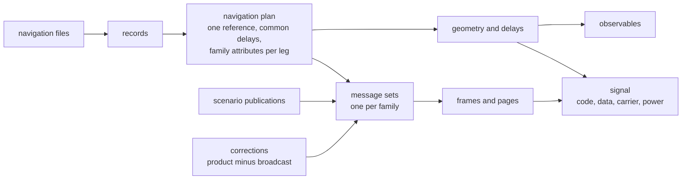
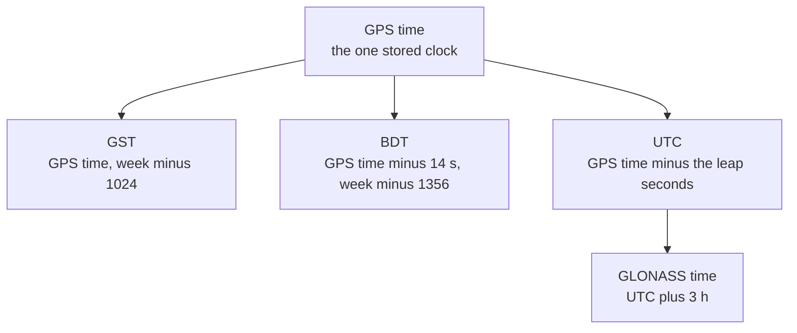

# GNSS

Pharos transmits sixteen signals of four constellations. Each
constellation has its own pages: the signals, one implementation matrix
per message, and the navigation data behind them. This page compares
the four and covers what they share.

| Constellation | Signals | Messages | Satellites | Pages |
|---|---|---|---|---|
| GPS | `L1CA`, `L1C`, `L2C`, `L5` | LNAV, CNAV-2, CNAV | PRN 1-32, by block | [gps](gps/README.md) |
| Galileo | `E1`, `E5a`, `E5b`, `E6` | I/NAV, F/NAV, C/NAV with HAS | 1-36 | [galileo](galileo/README.md) |
| BDS | `B1I`, `B2I`, `B3I`, `B1C`, `B2a`, `B2b` | D1, D2, B-CNAV1, B-CNAV2, B-CNAV3, PPP-B2b | 1-63, by allocation | [bds](bds/README.md) |
| GLONASS | `G1`, `G2` | GNAV | slots 1-24 | [glonass](glonass/README.md) |

## Signals by band

| Band (MHz) | GPS | Galileo | BDS | GLONASS |
|---|---|---|---|---|
| 1602 + 0.5625 k | | | | `G1` |
| 1575.42 | `L1CA`, `L1C` | `E1` | `B1C` | |
| 1561.098 | | | `B1I` | |
| 1278.75 | | `E6` | | |
| 1268.52 | | | `B3I` | |
| 1246 + 0.4375 k | | | | `G2` |
| 1227.60 | `L2C` | | | |
| 1207.14 | | `E5b` | `B2I`, `B2b` | |
| 1176.45 | `L5` | `E5a` | `B2a` | |

k is the GLONASS frequency number of the satellite's record.

## From data to signal

The plan decides which raw reference each satellite flies and resolves
its common delays and family attributes. The same binding feeds the
messages, geometry and corrections, so a receiver that decodes the
message measures what was generated. A family's converted form keeps
the selected physical orbit and clock.

## Where message content comes from

| Content | Source |
|---|---|
| ephemeris, clock, group delays, health, UTC, time offsets, EOP | the navigation files, through the plan ([navigation data](../guide/navigation-data.md)) |
| almanacs | the `almanac` files; otherwise reductions of the ephemerides |
| ionosphere coefficients | the matching concrete model's explicit override, else the navigation files, else a built-in Klobuchar set (LNAV page 18, CNAV, CNAV-2, D1/D2) or zeros (Galileo, B-CNAV) |
| GPS configuration codes | the PRN allocation on the run's date, unless a publication declares them |
| HAS, PPP-B2b, GPS differential corrections, D2 clock corrections | the simulation: the orbit and clock the signals fly with, less those the corrected message gives |
| D2 ionosphere grid delays | the BDS system's applied ionosphere model at the grid points |
| GPS integrity flags | the resolved family attributes, else the publications |
| GPS text and ISM, Galileo I/NAV ISM, BDS D2 integrity and grid declarations | the scenario's `messages` publications only, never inferred |

Every family encodes from a set built at each GPS minute; GNAV builds
its set at each GLONASS superframe boundary. A channel adopts a new set
where its family's next frame starts.

## When a satellite transmits

A satellite transmits a listed signal when all of these hold:

| Condition | Rule |
|---|---|
| allocation | its PRN carries the signal on the run's date |
| record | it has a binding whose resolved declaration permits the signal and whose required base delay is available |
| mask | it is at or above the elevation mask and not in `maskOut` |
| band | the carrier lies inside the sampled band |
| message | its family has frames for it |

The channel set is re-planned once a second. A channel is removed only
0.5 degrees below the mask. The truth of `libpharos_obs` names the rule
that keeps each signal off the air, in the order its channel table gives
([channels](../guide/c-api/obs.md#channels)). Some families need extra
records: B-CNAV3 of the MEO and IGSO satellites needs EOP and UTC
records, GNAV needs `GLUT` and `GLGP` offsets without rates and an EOP
record, D1/D2 and B-CNAV3 need a `BDUT` record. Without them
`pharos-pack` refuses a scenario with `samples`. The leap-second fields
of every UTC message come from the run's leap schedule
([leap seconds](../guide/navigation-data.md#leap-seconds)).

## What the observables and samples carry

| Term | Model |
|---|---|
| satellite clock | the record's polynomial with the relativistic term (none for GLONASS), plus the system time's declared offset from GPS time; under `precise`, the product clock |
| geometry | the exact light time with the Earth's rotation, and the gravitational delay of the Earth, common to code and carrier |
| phase centre | with `antenna`, each signal from its own band's phase centre |
| ionosphere | the satellite's system model at L1, scaled by (1575.42 MHz / f)^2; a concrete scenario model applies to all systems, `auto` selects by constellation |
| troposphere | GPT3 meteorology and VMF3 mapping, evaluated at 3 degrees at the lowest; zero at or below the horizon |
| group delay | each code with its binding's common term; the terms per system are on each system's signals page |
| carrier | one per band and satellite, delayed as the band's reference data code |
| record switch | orbit, clock and group delays move to the new record over 600 s |
| effective signal delay or precise clock shift change | starts a new delay blend without restarting the orbit or clock transition |
| attribute change alone | updates message metadata; active orbit and delay blends keep their original end times |
| C/N0 | the scenario's `power`; `B2b` realises 3.01 dB less |

The samples take each signal's square-wave envelope at the sample
instant: no front-end filter is applied. The models are described in
[models](../models/README.md).

## Observation codes

| Signal | Codes | Signal | Codes |
|---|---|---|---|
| `L1CA` | `1C` | `B2a` | `5D`, `5P` |
| `L1C` | `1S`, `1L` | `B2b` | `7D` |
| `L2C` | `2L` | `E1` | `1C` |
| `L5` | `5I`, `5Q` | `E5a` | `5Q` |
| `B1C` | `1D`, `1P` | `E5b` | `7Q` |
| `B1I` | `2I` | `E6` | `6C` |
| `B2I` | `7I` | `G1` | `1C` |
| `B3I` | `6I` | `G2` | `2C` |

A signal with two codes gets a pseudorange per component, each with its
own group delay, and one carrier phase, Doppler and C/N0.

## Time scales

GPS time is the only stored time; the others are views of it. Each
system may declare its time off these views by nanoseconds (GGTO,
BGTO, tau_GPS); the signals of that system carry the declared offset.
Leap seconds and offsets are resolved once, in `pharos-pack`
([navigation data](../guide/navigation-data.md)).

## Standards

| Constellation | Documents |
|---|---|
| GPS | IS-GPS-200N, IS-GPS-705J, IS-GPS-800J; the constellation status of the U.S. Coast Guard Navigation Center |
| Galileo | OS SIS ICD 2.1, E6-B/C Codes Technical Note 1, HAS SIS ICD 1.0; the Galileo Satellite Metadata of the European GNSS Service Centre |
| BDS | BDS-SIS-ICD-B1I 3.0, the open-service ICD 2.0 and 2.1, B3I 1.0, B1C 1.0, B2a 1.0, B2b 1.0, PPP-B2b 1.0; the CSNO constellation status; BD 420025-2019 |
| GLONASS | GLONASS ICD (L1, L2) 5.1 |

Each constellation's page gives the pinned issues and what each covers.
The file formats are in [design/formats](../design/formats.md), the data
products of the models in [models](../models/README.md).
