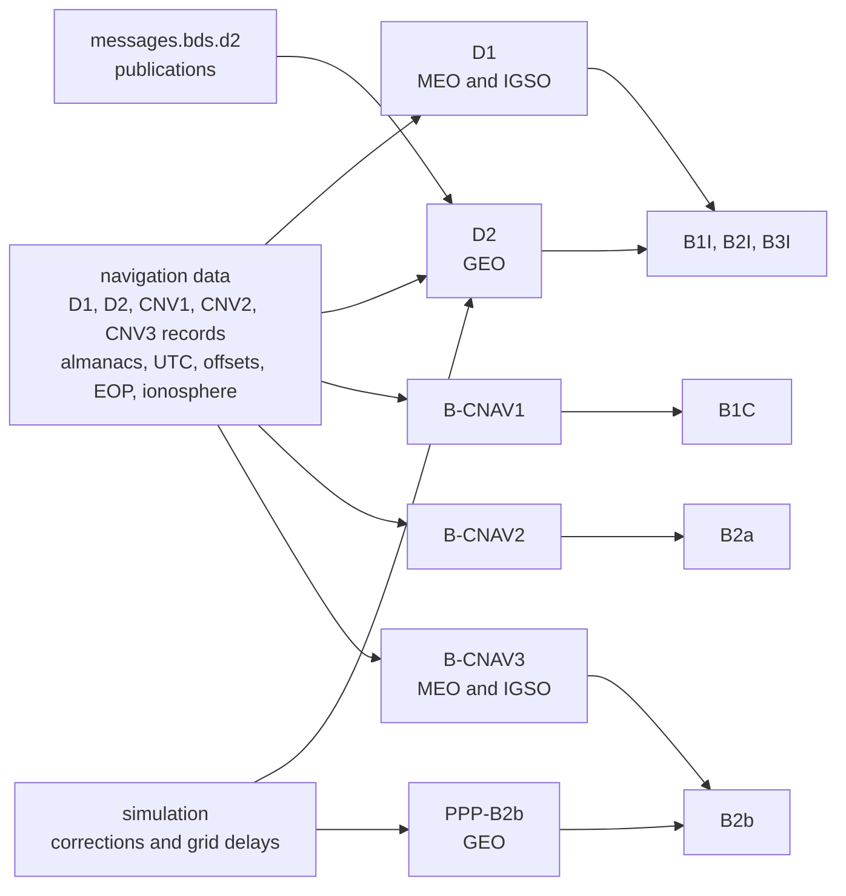

# BDS

Pharos transmits six BDS signals with five message families. This page
shows where the message content comes from and which satellites carry
which signal. It also lists the pinned documents, the time scale and
the yaw laws. The pages listed at the end hold the detail, and
[GNSS](../README.md) compares BDS with the other constellations.

## From data to signal

The navigation data feed every family. Each satellite has one selected
reference for its orbit and clock, a common delay table and separate
family attributes ([data](data.md#records-and-the-families-they-feed)).
The D2 augmentation takes its declarations from the scenario and its
corrections from the simulation. PPP-B2b takes all of its corrections
from the simulation.

## Signals

| Signal | Carrier (MHz) | Message | Carried by |
|---|---|---|---|
| B1I | 1561.098 | D1, D2 | every satellite but PRN 40 after April 2026 |
| B2I | 1207.14 | D1, D2 | the BDS-2 satellites, before April 2026 |
| B3I | 1268.52 | D1, D2 | every satellite |
| B1C | 1575.42 | B-CNAV1 | the BDS-3 MEO and IGSO satellites but PRN 40 after April 2026 |
| B2a | 1176.45 | B-CNAV2 | the BDS-3 MEO and IGSO satellites |
| B2b | 1207.14 | B-CNAV3; PPP-B2b on the GEO satellites | the BDS-3 satellites |

Codes, power split and observation codes are on [signals](signals.md).

## Satellites

BDS has PRN 1-63. PRN 1-5 and 59-63 are the GEO satellites: they send
D2 instead of D1 and PPP-B2b instead of B-CNAV3. The PRN allocation of
the China Satellite Navigation Office (CSNO) decides which signals each
PRN carries. The allocation is taken at the scenario start and held for
the run.

| PRN | Before the April 2026 restructuring | After it |
|---|---|---|
| 1-4 | BDS-2 | BDS-3 GEO |
| 5 | BDS-2 | none |
| 6-8, 11-14 | BDS-2 | BDS-3 |
| 9, 10 | BDS-2 | B1I, B3I |
| 15-18 | BDS-2 | none |
| 19-39, 41, 42 | BDS-3 | BDS-3 |
| 40 | BDS-3 | B3I, B2a, B2b |
| 43-58 | BDS-3 | none |
| 59-63 | BDS-3 GEO | none |

| Set | Signals |
|---|---|
| BDS-2 | B1I, B2I, B3I |
| BDS-3 | B1I, B3I, B1C, B2a, B2b |
| BDS-3 GEO | B1I, B3I, B2b |

Each PRN switches at its own instant between 2026-04-10 12:00 and
2026-04-21 12:00 UTC ([signals](signals.md#prn-allocation)).

## Standards

| Document | Issue | Covers | Page |
|---|---|---|---|
| BDS-SIS-ICD-B1I | 3.0, February 2019 | B1I codes, D1 and D2, the D2 integrity and grid pages, CGCS2000 and the GEO rotation | [signals](signals.md), [D1 and D2](d1-d2.md) |
| BDS-SIS-ICD, open service B1I and B2I | 2.0, December 2013 | the D1 and D2 field tables, ranges and schedules | [D1 and D2](d1-d2.md), [data](data.md) |
| BDS-SIS-ICD, open service B1I and B2I | 2.1, November 2016 | B2I, T_GD2, the D2 augmentation on B2I | [signals](signals.md), [D1 and D2](d1-d2.md) |
| BDS-SIS-ICD-B3I | 1.0, February 2018 | B3I codes, the D2 augmentation on B3I | [signals](signals.md), [D1 and D2](d1-d2.md) |
| BDS-SIS-ICD-B1C | 1.0, December 2017 | B1C codes, QMBOC, B-CNAV1, the BDGIM parameters | [signals](signals.md), [B-CNAV1](b-cnav1.md) |
| BDS-SIS-ICD-B2a | 1.0, December 2017 | B2a codes, the pilot secondary code, B-CNAV2 | [signals](signals.md), [B-CNAV2](b-cnav2.md) |
| BDS-SIS-ICD-B2b | 1.0, July 2020 | B2b codes, B-CNAV3 | [signals](signals.md), [B-CNAV3](b-cnav3.md) |
| BDS-SIS-ICD-PPP-B2b | 1.0, July 2020 | the PPP-B2b frame, message types, validity and corrections | [PPP-B2b](ppp-b2b.md) |
| BDS constellation status change table (CSNO) | 2026-03-20 (English 2026-04-07), with the notices of 2026-04-09 to 2026-04-19 | the PRN allocation after April 2026 | [signals](signals.md#prn-allocation) |
| BD 420025-2019 (CSNO) | issued 2019-11-07, in force 2019-12-01 | the attitude control modes (5.4) | [attitude](#attitude) |
| RINEX | 3.04 and 4.02 | the BDS navigation records | [data](data.md) |

Two issues of the open-service document are in play. Issue 2.0 gives the
D1 and D2 field tables, ranges and schedules. Issue 2.1 adds B2I and
limits its D2 augmentation to satellites 1-30, at most 18, with
subframe 4 reserved. Issue 2.1 also reserves the expanded almanac pages.
Pharos sends those pages on B2I as B1I 3.0 and B3I 1.0 define them.

## BDT and the offsets it carries

BDT is GPS time less 14 s, and its week 0 is GPS week 1356. Pharos
stores GPS time only. BDT is a view of it. In a broadcast run each BDS
clock is its record's clock plus a BDGP offset. That offset comes from
the record transmitted last at or before the run start. Under `precise`
the product's clock flies as it is
([navigation data](../../guide/navigation-data.md)).

| Offset | Navigation record | Broadcast in |
|---|---|---|
| BDT-UTC | BDUT, with the run's leap seconds | D1 and D2 UTC pages, B-CNAV1 page type 1, B-CNAV2 type 34, B-CNAV3 type 30 |
| BDT-GPS, BDT-Galileo, BDT-GLONASS | BDGP, BDGA, BDGL | D1 and D2 time-offset pages; the BGTO of B-CNAV1 page type 3, B-CNAV2 type 33, B-CNAV3 type 40 |
| Earth orientation | EOP of a BDS satellite | B-CNAV1 page type 3, B-CNAV2 type 32, B-CNAV3 type 30 |

The record rules are on [data](data.md#time-offsets-utc-and-eop).

## Attitude

The antenna type of the ANTEX file selects the yaw law by prefix. The
BEIDOU laws follow BD 420025-2019, section 5.4. The mechanism is
described in [antennas](../../models/antennas.md).

| ANTEX type | Law | Parameter | Source |
|---|---|---|---|
| BEIDOU-2G, BEIDOU-3G | orbit-normal at every instant: yaw zero | none | zero yaw for every GEO satellite |
| BEIDOU-2I, BEIDOU-2M (any other BEIDOU-2 type) | yaw steering; orbit-normal while the Sun's elevation above the orbit plane is at or below the threshold | 3 degrees | the threshold, given as generally 3 degrees |
| BEIDOU-3M-SECM, BEIDOU-3M-CAST, BEIDOU-3SM-CAST, BEIDOU-3I, BEIDOU-3SI-CAST | yaw steering with the Sun's elevation held at the floor or above | 3 degrees | 3 degrees for every BDS-3 IGSO and MEO satellite |
| any other type | nominal yaw steering, with a warning | none | none |

The standard floors only the Sun's cross-track component. Pharos floors
the elevation itself. The standard does not name the BDS-3S test
satellites, which fly the same law.

## Not modelled

| What | Reason or effect |
|---|---|
| B1C and B2a on the GEO satellites | no pinned ICD defines B-CNAV there |
| the B2b Q component | B2b carries its I component alone, 3.01 dB below the scenario's power |
| the manoeuvre between yaw steering and orbit-normal | the law switches at the instant |
| ranking the BDS Klobuchar sets by satellite class (RINEX 3.04 Table A5 note 2) | one BDS Klobuchar set serves every satellite |
| PPP-B2b corrections of GLONASS satellites | the mask covers BDS, GPS and Galileo only |
| monitoring in the correction services | the D2 indices are declarations; PPP-B2b sends URA index 0 |

## Pages

| Page | Content |
|---|---|
| [signals](signals.md) | codes, power split, secondary codes, phase relations, observation codes, group delays, PRN allocation |
| [D1 and D2](d1-d2.md) | the B1I, B2I and B3I message: every subframe and page, the D2 augmentation, the fit |
| [B-CNAV1](b-cnav1.md) | B1C: subframes and page types |
| [B-CNAV2](b-cnav2.md) | B2a: message types |
| [B-CNAV3](b-cnav3.md) | B2b of the MEO and IGSO satellites |
| [PPP-B2b](ppp-b2b.md) | B2b of the GEO satellites: the correction service |
| [data](data.md) | RINEX records, checks, health, accuracy, time offsets, ionosphere, almanac, `messages.bds.d2` |
