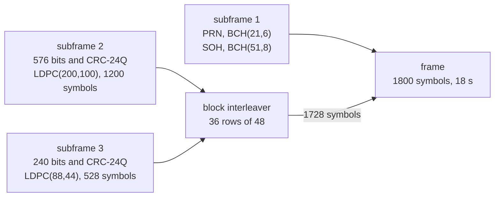

# B-CNAV1 (B1C)

B-CNAV1 is the message of B1C on the BDS-3 MEO and IGSO satellites. An
18 s frame carries the ephemeris and clock every time and one page of
subframe 3. Pharos sends the four page types the ICD defines.

## Frame structure

| Carrier | Component | Frame | Symbol rate | Coding | ICD |
|---|---|---|---|---|---|
| B1C | data | 18 s, 1800 symbols | 100 sps | BCH; CRC-24Q and LDPC over GF(64); interleaver | BDS-SIS-ICD-B1C 1.0, section 6 |

Subframe 1 takes 72 symbols: 21 for the PRN and 51 for the SOH. The
interleaver writes the codewords in rows of 48: two rows of subframe 2,
then one of subframe 3, eleven times. The last three rows are subframe
2. It reads by columns.

## Implementation matrix

Every page of subframe 3 opens with a header: page ID, HS, DIF, SIF,
AIF and SISMAI of B1C.

| Subframe, page type | Content | Sent when | Content from | B1C 1.0 |
|---|---|---|---|---|
| subframe 1 | PRN, SOH: the frame of the hour, 0-199 | every frame | the frame count | 6 |
| subframe 2 | WN, HOW, IODC, IODE, ephemeris, clock, TGD_B2ap, ISC_B1Cd, TGD_B1Cp | every frame | navigation record | 6.2.3, Tables 7-8 and 7-9 |
| page type 1 | header, SISAI_OE, SISAI_OC, BDGIM, BDT-UTC | 10 frames of 100 | record, BDGIM set, BDUT | 6.2.3, Tables 7-10 and 7-20 |
| page type 2 | header, SISAI_OC, WNa, toa, 4 reduced almanacs | 16 frames of 100 | almanac file, else reduced ephemerides | 6.2.3, Tables 7-15 and 7-16 |
| page type 3 | header, EOP, BGTO | 10 frames of 100, with an EOP | EOP; BDGP, BDGA, BDGL | 6.2.3, Tables 7-18 and 7-21, Figures 6-19 and 6-20 |
| page type 4 | header, SISAI_OC, 1 midi almanac | 63 frames of 100 | almanac file, else reduced ephemerides | 6.2.3, Tables 7-15 and 7-16 |
| page ID 0 | header, zero bits | 1 frame of 100, and in place of type 1 without BDT-UTC | none | |

HOW is the hour of the BDT week and WN the BDT week modulo 8192.
SISAI_OC includes top. The BDGIM set and its fallback are on
[data](data.md#ionosphere-sets).

## Schedule

The page cycle is 100 frames, 30 min, and runs twice an hour. The
position of a frame in the cycle is its SOH modulo 100.

| Position in the cycle | Page | Content of the slot |
|---|---|---|
| 0, 10, 20 ... 90 | type 1 | |
| 5, 15, 25 ... 95 | type 3 | the BGTO of GPS, Galileo, GLONASS in turn |
| 1, 6, 11 ... 76 | type 2 | satellites 4k+1 to 4k+4, k being the position divided by 5 |
| 99 | page ID 0 | |
| every other | type 4 | satellites 1 to 63 in order |

A slot falls back as the diagram shows. The BGTO steps GPS, Galileo,
GLONASS from one type 3 page to the next. A missing offset gives way to
the next that exists. With none the BGTO is zero with GNSS ID 0. Type 2
leaves its 64th packet empty.

B-CNAV1 projects the satellite's selected reference, using the common
delay table and resolved CNV1 attributes
([data](data.md#records-and-the-families-they-feed)). A new message set
is built every GPS minute and taken up at the next frame.

## Where Pharos departs from the ICD default

| Case | What is sent |
|---|---|
| no resolved B1C flags | DIF 0, SIF 0, AIF 1 |
| no CNV1 attributes | health and flags from the selected reference where applicable; HS = SatH1 for a D1/D2 reference |
| family accuracy attributes | tied to the selected physical parameters ([data](data.md#accuracy-indices)) |
| a selected D1 or D2 record off the 300 s grid | toe, toc and top moved onto it, the orbit and clock carried along |
| a selected D1, D2 or CNV3 record | IODE and IODC derived from the projected toe and toc in 300 s steps of the BDT week, modulo 256 |
| no BDGIM set | zero coefficients |
| no BDT-UTC | page ID 0 in the type 1 slots |
| no EOP | type 1 in the type 3 slots |
| no almanac for a packet | a zero packet, PRN 0 included |
| position 99 of the cycle | page ID 0 |
| a record the fields cannot carry | no B-CNAV1 frames for the satellite while it is selected |

## Limits and messages

| Case | Result |
|---|---|
| navigation data outside the B-CNAV1 fields at a set's epoch | `pharos-pack`: `out_of_range` on `ephemeris`: `B-CNAV1 at <n> s into the run: the navigation data cannot be encoded into its message set (<Error>)` |
| a record of another type outside the fields | `unfit_record` on `ephemeris`: `<sat> <type> record of <toc> GPST: <field> outside its CNV1 field, sent there as unavailable while it is selected` |
| a satellite without B-CNAV1 frames | no channel in the samples; the observation file still lists it |
| an almanac outside the reduced or midi fields | left out of B-CNAV1; its packets are zero |
| the almanac reference | the toa of the first almanac taken, else the set's epoch |
