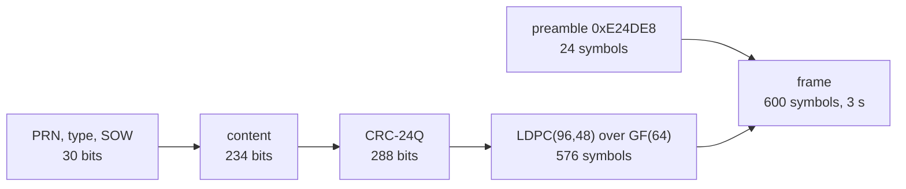
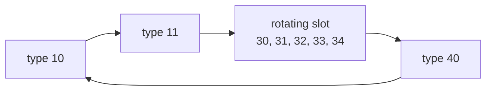

# B-CNAV2 (B2a)

B-CNAV2 is the message of B2a on the BDS-3 MEO and IGSO satellites. A
3 s message carries one of the eight types the ICD defines. Pharos sends
all eight in a fixed one-minute cycle.

## Message structure

| Carrier | Component | Message | Symbol rate | Coding | ICD |
|---|---|---|---|---|---|
| B2a | data | 3 s, 600 symbols | 200 sps | CRC-24Q, LDPC(96,48) over GF(64) | BDS-SIS-ICD-B2a 1.0, section 6 |

Types 11 to 40 open with HS, the B2a DIF, SIF and AIF, SISMAI and the
B1C DIF, SIF and AIF. Type 10 carries the same flags after WN, without
HS.

## Implementation matrix

| Type | Content | Sent when | Content from | B2a 1.0 |
|---|---|---|---|---|
| 10 | WN, flags, IODE and ephemeris I | every 12 s | navigation record | 6.2.3, Tables 7-8 and 7-9 |
| 11 | HS, flags, ephemeris II | every 12 s | navigation record | 6.2.3, Tables 7-8 and 7-9 |
| 30 | HS, flags, clock, IODC, TGD_B2ap, ISC_B2ad, BDGIM, TGD_B1Cp | once a minute; in place of 32 without EOP | record, BDGIM set | 6.2.3, Table 7-10 |
| 31 | HS, flags, clock, IODC, WNa, toa, 3 reduced almanacs | once a minute; in place of 34 without BDT-UTC | almanac file, else reduced ephemerides | 6.2.3, Tables 7-15 and 7-16 |
| 32 | HS, flags, clock, IODC, EOP | once a minute, with an EOP | EOP | 6.2.3, Table 7-18, Figure 6-18 |
| 33 | HS, flags, clock, BGTO, 1 reduced almanac, IODC, WNa, toa | once a minute | BDGP, BDGA, BDGL; almanac | 6.2.3, Table 7-21, Figure 6-19 |
| 34 | HS, flags, SISAI_OC, clock, IODC, BDT-UTC | once a minute, with BDT-UTC | BDUT | 6.2.3, Table 7-20 |
| 40 | HS, flags, SISAI_OE, SISAI_OC, 1 midi almanac | every 12 s | almanac file, else reduced ephemerides | 6.2.3, Tables 7-15 and 7-16 |

The SOW counts the 3 s messages of the BDT week.

## Schedule

A group of four messages lasts 12 s. Five groups make the 60 s cycle.

| Group of the minute | Rotating slot | Fallback |
|---|---|---|
| 1 | 30 | |
| 2 | 31 | |
| 3 | 32 | 30 without EOP |
| 4 | 33 | |
| 5 | 34 | 31 without BDT-UTC |

A minute's four reduced almanacs are four consecutive satellites: three
in type 31, the fourth in type 33. The next minute starts four
satellites further on, modulo 63. Type 40 steps through satellites 1-63,
one per group. The BGTO of type 33 steps GPS, Galileo, GLONASS by
minute. A missing offset gives way to the next that exists. With none
the BGTO is zero with GNSS ID 0.

B-CNAV2 projects the satellite's selected reference, using the common
delay table and resolved CNV2 attributes
([data](data.md#records-and-the-families-they-feed)). A new message set
is built every GPS minute and taken up at the next message.

## Where Pharos departs from the ICD default

| Case | What is sent |
|---|---|
| no resolved B2a flags | B2a DIF 0, SIF 0, AIF 1 |
| no resolved B1C flags | B1C DIF 0, SIF 0, AIF 1 |
| no CNV2 attributes | health and flags from the selected reference where applicable; HS = SatH1 for a D1/D2 reference |
| family accuracy attributes | tied to the selected physical parameters ([data](data.md#accuracy-indices)) |
| a selected D1 or D2 record off the 300 s grid | toe, toc and top moved onto it, the orbit and clock carried along |
| a selected D1, D2 or CNV3 record | IODE and IODC derived from the projected toe and toc in 300 s steps of the BDT week, modulo 256 |
| no BDGIM set | zero coefficients |
| no EOP | type 30 in the type 32 slot |
| no BDT-UTC | type 31 in the type 34 slot, with that minute's satellites |
| no almanac for a packet | a zero packet, PRN 0 included |
| a record the fields cannot carry | no B-CNAV2 frames for the satellite while it is selected |

## Limits and messages

| Case | Result |
|---|---|
| navigation data outside the B-CNAV2 fields at a set's epoch | `pharos-pack`: `out_of_range` on `ephemeris`: `B-CNAV2 at <n> s into the run: the navigation data cannot be encoded into its message set (<error>)` |
| a record of another type outside the fields | `unfit_record` on `ephemeris`: `<sat> <type> record of <toc> GPST: <field> outside its CNV2 field, sent there as unavailable while it is selected` |
| a satellite without B-CNAV2 frames | no channel in the samples; the observation file still lists it |
| an almanac outside the reduced or midi fields | left out of B-CNAV2; its packets are zero |
| the almanac reference | the toa of the first almanac taken, else the set's epoch |
