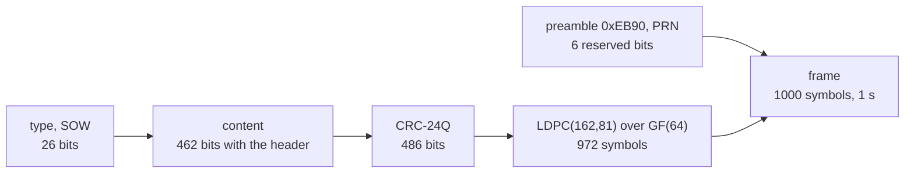
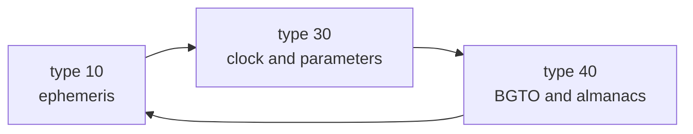

# B-CNAV3 (B2b)

B-CNAV3 is the message of B2b on the BDS-3 MEO and IGSO satellites. A
1 s message carries type 10, 30 or 40 in a fixed cycle of three. The GEO
satellites carry [PPP-B2b](ppp-b2b.md) on B2b instead, in the same
frame.

## Message structure

| Carrier | Component | Message | Symbol rate | Coding | ICD |
|---|---|---|---|---|---|
| B2b | I | 1 s, 1000 symbols | 1000 sps | CRC-24Q, LDPC(162,81) over GF(64) | BDS-SIS-ICD-B2b 1.0, section 6, 6.1 |

The frame opens with the 16-bit preamble, the 6-bit PRN and 6 reserved
bits. On the MEO and IGSO satellites the reserved bits are zero.

## Implementation matrix

| Type | Content | Sent when | Content from | B2b 1.0 |
|---|---|---|---|---|
| 10 | SOW, ephemeris I without IODE, ephemeris II, B2b DIF, SIF, AIF, SISMAI | every 3 s | navigation record | 6, Tables 7-6 and 7-7 |
| 30 | SOW, WN, clock, TGD_B2bI, BDGIM, BDT-UTC, EOP, SISAI_OC, SISAI_OE, HS | every 3 s | record, BDGIM set, BDUT, EOP | 6, Tables 7-6 to 7-8, 7-16 and 7-18 |
| 40 | SOW, BGTO, 1 midi almanac, WNa, toa, 5 reduced almanacs | every 3 s | BDGP, BDGA, BDGL; almanac file, else reduced ephemerides | 6, Tables 7-13, 7-14 and 7-19 |

Figures 6-3 to 6-5 of the ICD lay out the three types. The SOW counts
seconds of the BDT week.

## Schedule

Type 30 has no fallback: it needs both an EOP and BDT-UTC. Without them
a satellite with a record gets no B-CNAV3 frames, and `pharos-pack`
refuses the scenario. Type 40 steps its midi almanac one satellite per
cycle through 1-63. Its five reduced almanacs step through the
satellites as well. Its BGTO steps GPS, Galileo, GLONASS by cycle. A
missing offset gives way to the next that exists. With none the BGTO is
zero with GNSS ID 0.

B-CNAV3 projects the satellite's selected reference, using the common
delay table and resolved CNV3 attributes
([data](data.md#records-and-the-families-they-feed)). A new message set
is taken up at a type 10, so a cycle never mixes two sets.

## Where Pharos departs from the ICD default

| Case | What is sent |
|---|---|
| no resolved B2b flags | DIF 0, SIF 0, AIF 1 |
| no CNV3 attributes | health and flags from the selected reference where applicable; HS = SatH1 for a D1/D2 reference |
| family accuracy attributes | tied to the selected physical parameters ([data](data.md#accuracy-indices)) |
| a selected D1 or D2 record off the 300 s grid | toe, toc and top moved onto it, the orbit and clock carried along |
| no BDGIM set | zero coefficients |
| no almanac for a packet | a zero packet, PRN 0 included |
| a record the fields cannot carry | no B-CNAV3 frames for the satellite while it is selected |

## Limits and messages

| Case | Result |
|---|---|
| a MEO or IGSO satellite with a record, no EOP | `pharos-pack`: `missing_field` on `ephemeris`: `B-CNAV3 at <n> s into the run: B-CNAV3 on B2b (a BDS record) and GNAV on G1/G2 (any system's) require an available EOP record in the navigation data` |
| the same with an EOP but no BDT-UTC | `missing_field` on `ephemeris`: `B-CNAV3 at <n> s into the run: the selected BeiDou navigation message requires available, encodable BDUT parameters` |
| navigation data outside the B-CNAV3 fields at a set's epoch | `out_of_range` on `ephemeris`: `B-CNAV3 at <n> s into the run: the navigation data cannot be encoded into its message set (<error>)` |
| a record of another type outside the fields | `unfit_record` on `ephemeris`: `<sat> <type> record of <toc> GPST: <field> outside its CNV3 field, sent there as unavailable while it is selected` |
| a satellite without B-CNAV3 frames | no channel in the samples; the observation file still lists it |
| B2b power | the I component alone, 3.01 dB below the scenario's power ([signals](signals.md)) |
