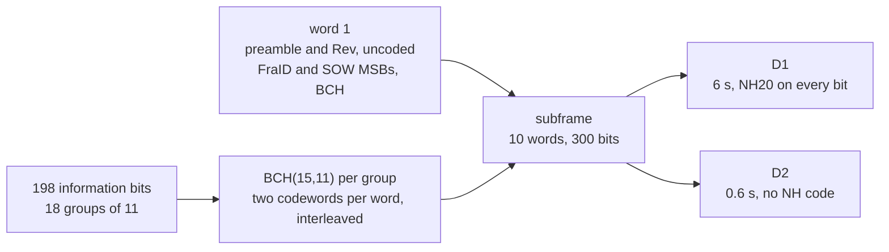
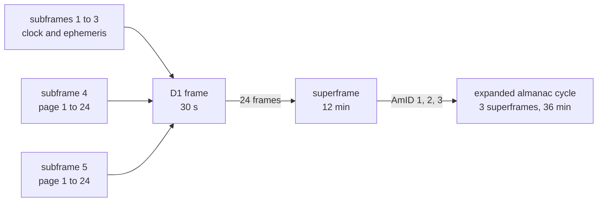
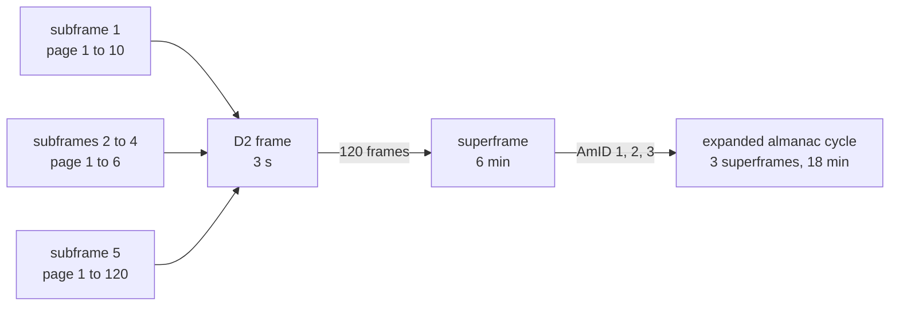
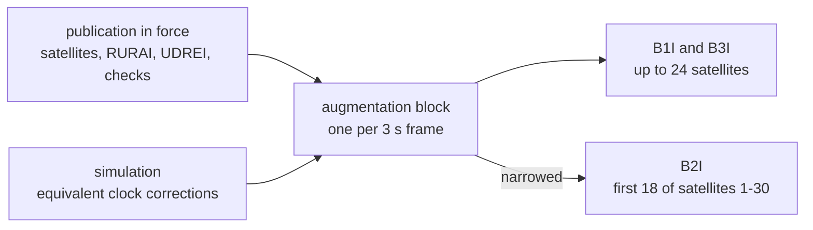
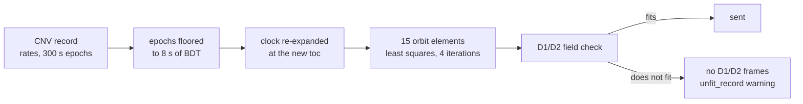

# D1 and D2 (B1I, B2I, B3I)

D1 is the message of the MEO and IGSO satellites, D2 that of the GEO
satellites (PRN 1-5 and 59-63). Both run on B1I, B2I and B3I with the
same content on each carrier. Only the D2 augmentation is narrower on
B2I. Pharos sends every subframe and page the ICD defines.

## Structure

| Message | Satellites | Subframe | Frame | Superframe | Bit rate | ICD |
|---|---|---|---|---|---|---|
| D1 | MEO, IGSO | 6 s | 5 subframes, 30 s | 24 frames, 12 min | 50 bps | BDS-SIS-ICD-B1I 3.0 5.2 |
| D2 | GEO | 0.6 s | 5 subframes, 3 s | 120 frames, 6 min | 500 bps | BDS-SIS-ICD-B1I 3.0 5.3 |

The preamble is 11100010010. The code is BCH(15,11) with
g(x) = x^4 + x + 1 (B1I 3.0 5.1.3). Words 2 to 10 each carry 22
information bits as two codewords interleaved bit by bit. The SOW
counts BDT: D1 gives the subframe's start, D2 the frame's start.

Section numbers below are those of BDS-SIS-ICD-B1I 3.0. The field
sections 5.2.4.x are those of the open-service ICD 2.0, from which the
field tables come.

## D1 frames

Frame n of the superframe carries page n of subframes 4 and 5.

| Subframe, page | Content | Sent when | Content from | ICD |
|---|---|---|---|---|
| 1 | SatH1, AODC, URAI, WN, toc, T_GD1, T_GD2, Klobuchar alpha and beta, a0 to a2, AODE | every frame | record; BDS Klobuchar set | 5.2; 2.0 5.2.4.5 to 5.2.4.11 |
| 2 | Delta n, Cuc, M0, e, Cus, Crc, Crs, sqrt A, toe MSBs | every frame | record | 5.2; 2.0 5.2.4.12 |
| 3 | toe LSBs, i0, Cic, OMEGA-dot, Cis, IDOT, OMEGA0, omega | every frame | record | 5.2; 2.0 5.2.4.12 |
| 4, pages 1-24 | almanac of satellites 1-24, AmID 3 | page n in frame n | almanac file, else a reduced ephemeris | 5.2; 2.0 5.2.4.14 |
| 5, pages 1-6 | almanac of satellites 25-30, AmID 3 | page n in frame n | as subframe 4 | 5.2; 2.0 5.2.4.14 |
| 5, page 7 | health of satellites 1-19 | frame 7 | almanac health words | 5.2.4 |
| 5, page 8 | health of satellites 20-30, WNa, toa | frame 8 | almanac health words, the almanac reference | 5.2.4 |
| 5, page 9 | A0 and A1 of BDT-GPS, BDT-Galileo, BDT-GLONASS | frame 9, with all three offsets | BDGP, BDGA, BDGL records | 2.0 5.2.4.18 to 5.2.4.20 |
| 5, page 10 | A0UTC, A1UTC, delta tLS, delta tLSF, WNLSF, DN | frame 10 | BDUT record and leap second | 2.0 Table 5-16 |
| 5, pages 11-23 | expanded almanac: one satellite of the AmID's group per page | frames 11-23 | as subframe 4 | 5.2 |
| 5, pages 18-23 in the AmID 3 superframe | reserved, AmID 3 | frames 18-23 | none | 5.2 |
| 5, page 24 | health of the AmID's satellites, AmID | frame 24 | almanac health words | 5.2 |

Pages 9 and 10 carry A0 referred to the start of the frame's BDT week.
The BDS Klobuchar set and its fallbacks are on
[data](data.md#ionosphere-sets).

## D2 frames

Count the frames from the BDT epoch. Frame n carries these pages:

| Subframe | Page | Cycle |
|---|---|---|
| 1 | n mod 10 + 1 | 30 s |
| 2 to 4 | n mod 6 + 1 | 18 s |
| 5 | n mod 120 + 1 | 6 min |

The matrix gives every page of the D2 frame.

| Subframe, page | Content | Sent when | Content from | ICD |
|---|---|---|---|---|
| 1, page 1 | SatH1, AODC, URAI, WN, toc, T_GD1, T_GD2 | every 30 s | record | 5.3 |
| 1, page 2 | Klobuchar alpha and beta | every 30 s | BDS Klobuchar set | 5.3 |
| 1, pages 3-10 | a0 to a2, AODE and the ephemeris, split across pages | every 30 s | record | 5.3 |
| 2, pages 1-6 | SatH2, BDID 1-30, UDREI of 18 satellites, RURAI and delta t of one | every 18 s | publication; delta t from the simulation | 5.3.3.3 to 5.3.3.7, Figure 5-15 |
| 3, pages 1-6 | RURAI and delta t of two satellites | every 18 s | as subframe 2 | 5.3.3.3 to 5.3.3.7, Figure 5-16 |
| 4, pages 1-6 | BDEpID; with it, BDID 31-63, UDREI of 6 more, RURAI and delta t of one | every 18 s | as subframe 2 | 5.3.3.3 to 5.3.3.7, Figure 5-17 |
| 5, pages 1-13 | grid points 1-160: delta tau and GIVEI | every 6 min | GIVEI from the publication; delay from the simulation | 5.3.3.8, Figures 5-18-1 to 5-18-26 |
| 5, pages 14-34 | reserved | every 6 min | none | 5.3 |
| 5, page 35 | health of satellites 1-19 | every 6 min | almanac health words | Figures 5-18-27 to 5-18-34 |
| 5, page 36 | health of satellites 20-30, WNa, toa | every 6 min | almanac health words | Figures 5-18-27 to 5-18-34 |
| 5, pages 37-60 | almanac of satellites 1-24, AmID 3 | every 6 min | almanac file, else a reduced ephemeris | Figures 5-18-27 to 5-18-34 |
| 5, pages 61-73 | grid points 161-320 | every 6 min | as pages 1-13 | 5.3.3.8, Figures 5-18-1 to 5-18-26 |
| 5, pages 74-94 | reserved | every 6 min | none | 5.3 |
| 5, pages 95-100 | almanac of satellites 25-30, AmID 3 | every 6 min | as pages 37-60 | Figures 5-18-27 to 5-18-34 |
| 5, page 101 | A0 and A1 of BDT-GPS, BDT-Galileo, BDT-GLONASS | every 6 min, with all three offsets | BDGP, BDGA, BDGL records | Figures 5-18-27 to 5-18-34 |
| 5, page 102 | BDT-UTC | every 6 min | BDUT record and leap second | Figures 5-18-27 to 5-18-34 |
| 5, pages 103-115 | expanded almanac: one satellite of the AmID's group per page | every 6 min | as pages 37-60 | 5.3 |
| 5, pages 110-115 in the AmID 3 superframe | reserved, AmID 3 | every 18 min | none | 5.3 |
| 5, page 116 | health of the AmID's satellites, AmID | every 6 min | almanac health words | 5.3 |
| 5, pages 117-120 | reserved | every 6 min | none | 5.3 |

A reserved page carries its page number, zero bits and an AmID: 3 on
the reserved expanded-almanac pages, else 0.

## The expanded almanac

The AmID steps from one superframe to the next: 1, 2, 3, then 1 again.
The pages of satellites 1-30 always carry AmID 3.

| Superframe of the cycle | AmID | D1 pages 11-23, D2 pages 103-115 | D1 page 24, D2 page 116 |
|---|---|---|---|
| first | 1 | satellites 31-43 | health of 31-43 |
| second | 2 | satellites 44-56 | health of 44-56 |
| third | 3 | satellites 57-63, then reserved pages | health of 57-63 |

A satellite without an almanac gets its page with zero almanac fields.
Its health word is 0x1FF, every bit set. The messages carry one almanac
reference time, that of the first almanac they take
([data](data.md#almanacs)).

## The D2 augmentation

Subframes 2 to 4 describe up to 24 satellites. Pharos fills them from
the `messages.bds.d2` publication in force at the frame's epoch
([data](data.md#the-messagesbdsd2-publications)). The corrections come
from the simulation. Every GEO satellite sends the same augmentation.

The declared satellites form packets in PRN order. Page p of subframe 2
carries packet 3p-2, subframe 3 packets 3p-1 and 3p, and subframe 4
packet 18+p. Every subframe 2 page lists the UDREI of packets 1-18.
Subframe 4 lists those of 19-24.

| Field | With a publication in force | Without one |
|---|---|---|
| SatH2 | integrity check as the MSB, grid check as the LSB: 0 good, 1 bad, 1 when not declared | 11 (binary) |
| BDID | the declared satellites | none |
| RURAI | as declared | 15 |
| UDREI | as declared; 15 while the satellite has no correction | 15 |
| delta t | the equivalent clock correction, in 0.1 m steps | -4096: not available |
| BDEpID | 11 (binary) with a satellite above 30 or more than 18 satellites; else 0 | 0 |

Delta t is the simulated clock less the broadcast clock, less the orbit
difference along the line of sight of the simulated receiver. The
broadcast state is the prepared D1/D2 projection of the satellite's
selected reference, as a receiver decodes it in the frame's 30 s cycle
([data](data.md#corrections-the-simulation-computes)).

B2I describes satellites 1-30 only, at most 18 (2.1 5.3.3.5). It keeps
the first 18 declared satellites of 1-30 and sends subframe 4 without
the expansion. B1I and B3I carry all 24.

## The ionospheric grid

The grid has 320 points at longitudes 70 to 145 degrees east in 5 degree
steps (Tables 5-24-1 and 5-24-2). Points 1-160 lie at latitudes 10 to 55
degrees north. Points 161-320 lie at 7.5 to 52.5 degrees north. Each
page carries 13 points, but pages 13 and 73 carry 4.

| Grid point | delta tau | GIVEI |
|---|---|---|
| monitored | the simulation's vertical delay at B1I, in 0.125 m steps | as declared |
| monitored, delay above code 509 (63.625 m) | 511: not available | 15 |
| listed in `notMonitored` | 510: not monitored | 15 |
| no grid declared, or no publication in force | 511 | 15 |

The vertical delays come from the BDS system's applied ionosphere model
at each point: with `auto`, BDGIM when available, else BDS Klobuchar.
They are computed once per superframe, at its start, and scaled from L1
to B1I.

## Records the fields cannot carry: the fit

D1 and D2 carry epochs on an 8 s grid and no orbit rates. A D1 or D2
record fits them by its checks. A CNV1, CNV2 or CNV3 record the
plan selects is fitted when it has orbit rates or epochs off that grid.

The fit moves M0, Delta n, i0 and OMEGA0 to the new toe and drops A-dot
and Delta n-dot. It then fits sqrt A, e, omega, Delta n, M0, OMEGA0,
OMEGA-dot, i0, IDOT and the six harmonic terms to the record's own orbit.
It samples 61 instants over the contiguous binding leg, extending to
at least 30 min either side of toe.

The packer prepares each contiguous binding leg separately, including
legs that share a raw reference but differ in delays or attributes.
Disjoint uses of a record never share a fit interval. The bundle stores
the result and its decoded broadcast parameters for that leg. Message
sets and D2 corrections share these values; tracking uses the selected
raw reference's orbit and clock.

| Field | Source |
|---|---|
| SatH1 | resolved D1/D2 attributes; otherwise the selected CNV record's B1C, B2a or B2b unhealthy declaration |
| AODC, AODE | the selected D1/D2 reference's values, 5 bits; for a CNV reference, the age of its top, else the prepared toe, at the frame's hour |
| URAI | the selected D1/D2 reference's accuracy, or D1/D2 attributes describing identical physical parameters; otherwise 15 |
| T_GD1, T_GD2 | the binding's common delay table, else 0 |

## Where Pharos departs from the ICD default

| Case | What is sent |
|---|---|
| no `messages.bds.d2` publication in force | SatH2 11, no satellite, RURAI and UDREI 15, delta t -4096; every grid point 511 with GIVEI 15 |
| BDGP, BDGA or BDGL missing, or one with no reference time or a non-zero A2 | D1 page 9 and D2 page 101 carry zero bits |
| a time page whose values leave their fields in the frame's week | that subframe carries zero bits |
| a satellite without an almanac | its almanac page with zero fields; health word 0x1FF |
| reserved pages | page number, zero bits, AmID 3 on expanded-almanac pages, else 0 |
| B2I | the expanded almanac and health pages as on B1I; ICD 2.1 reserves them |
| a CNV record | fitted when needed; SatH1, AODC, AODE and URAI derived as above |
| a record the fields cannot carry, or a failed fit | no D1/D2 frames for the satellite while it is selected |

## Limits and messages

| Case | Result |
|---|---|
| what BDT-UTC needs | a BDUT record with A2 of 0, and a leap-second event on or after BDT week 0 ([leap seconds](../../guide/navigation-data.md#leap-seconds); [data](data.md#time-offsets-utc-and-eop)) |
| a satellite with a record and no encodable BDT-UTC | `pharos-pack`: `missing_field` on `ephemeris`: `D1/D2 at <n> s into the run: the selected BeiDou navigation message requires available, encodable BDUT parameters` |
| navigation data outside the D1/D2 fields at a set's epoch | `out_of_range` on `ephemeris`: `D1/D2 at <n> s into the run: the navigation data cannot be encoded into its message set (<error>)` |
| a fitted record outside the D1/D2 fields | `unfit_record` on `ephemeris`: `<sat> <type> record of <toc> GPST: <field> outside its D1 field, sent there as unavailable while it is selected` (D2 for a GEO satellite) |
| a fit that fails | no D1/D2 frames while the record is selected; no warning |
| a satellite without D1/D2 frames | no channel in the samples; the observation file still lists it |
| B2I listed, with a satellite above 30 or more than 18 of 1-30 declared | `no_effect` on `messages.bds.d2[i].integrity.satellites` ([data](data.md#limits-and-messages)) |
| delta t | 0.1 m steps within 4095 steps either side of zero |
| delta tau | codes 0 to 509 of 0.125 m |
| a new message set | built every GPS minute; taken up at the next 30 s cycle |
