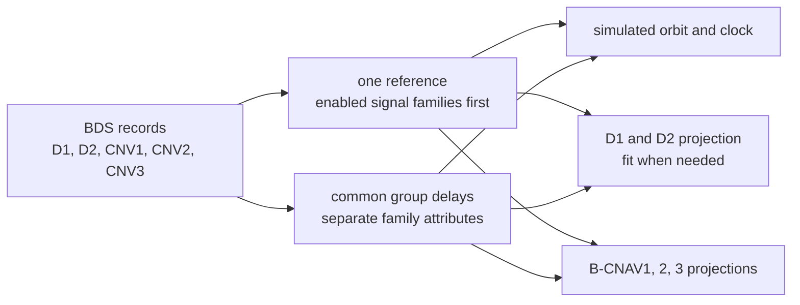

# BDS navigation data

The BDS messages take their content from RINEX navigation records, BDS
almanacs and the scenario's `messages.bds.d2` publications. The
simulation adds the D2 and PPP-B2b corrections. The rules shared by all
systems (file kinds, record selection, leap seconds) are in
[navigation data](../../guide/navigation-data.md).

## Records and the families they feed



| Family | Record it carries | Conversion |
|---|---|---|
| D1, D2 | the selected reference | a CNV record with orbit rates or epochs off the 8 s grid is fitted ([D1 and D2](d1-d2.md#records-the-fields-cannot-carry-the-fit)) |
| B-CNAV1, B-CNAV2, B-CNAV3 | the same selected reference | a D1 or D2 record is moved onto the 300 s grid |

The plan selects one raw reference for each satellite and interval.
It first tries the families of the scenario's enabled signals that
the satellite's allocation carries at the run start. Among them,
B1I, B2I or B3I gives D1/D2 priority, followed by B1C (CNV1), B2a
(CNV2) and B2b (CNV3). If none has an eligible record, the remaining
families follow in D1/D2, CNV1, CNV2, CNV3 order. With no enabled
signal, that default order applies. Within a family, a BDS record
without a transmission time is selected by the nearest toe among the
eligible records, including a future toe within the eligibility window.

All message families project this reference's orbit and clock. The
binding also holds common group delays and separate family attributes
for health, integrity and accuracy. Resolving those values leaves the
raw records and the reference's source unchanged. A change to the
reference, delays or attributes starts a new contiguous binding leg.

| RINEX | Record | BDS fields read | Feeds |
|---|---|---|---|
| 3.04 C record; 4.02 `EPH` D1, D2 | D1/D2 | AODE, AODC, toe in the BDT week, URA, SatH1, T_GD1, T_GD2, transmission time | all families through the binding |
| 4.02 `EPH` CNV1 | CNV1 | A-dot, Delta n-dot, top, satellite type, SISAI_OE, SISAI_ocb, SISAI_oc1, SISAI_oc2, ISC_B1Cd, TGD_B1Cp, TGD_B2ap, SISMAI, health, B1C flags, IODC, IODE | all families through the binding |
| 4.02 `EPH` CNV2 | CNV2 | as CNV1, with ISC_B2ad in place of ISC_B1Cd and the B1C and B2a flags | all families through the binding |
| 4.02 `EPH` CNV3 | CNV3 | A-dot, Delta n-dot, top, satellite type, the SISAI, TGD_B2bI, SISMAI, health, B2b flags; IODE and IODC from toe | all families through the binding |
| 3.04 header `IONOSPHERIC CORR` `BDSA`, `BDSB`; 4.02 `ION` `D1D2` | BDS Klobuchar set | | D1, D2 |
| 4.02 `ION` `CNVX` | BDGIM set, 9 coefficients | | B-CNAV |
| 3.04 header `TIME SYSTEM CORR` `BDUT`; 4.02 `STO` `BDUT` | BDT-UTC | | all families |
| 4.02 `STO` `BDGP`, `BDGA`, `BDGL` | BDT-GPS, BDT-Galileo, BDT-GLONASS | | D1, D2, B-CNAV; BDGP also the satellites' time |
| 4.02 `EOP` of a BDS satellite | Earth orientation | | B-CNAV |
| header `LEAP SECONDS` | the leap second schedule | | BDT-UTC |

The records follow RINEX 4.02 Tables A23 to A26. A `TIME SYSTEM CORR`
line naming BDGP, BDGA or BDGL is not read. A `LEAP SECONDS` line
marked BDS is converted to the GPS convention when read.

## Record checks

| Check | D1, D2 record | CNV1, CNV2, CNV3 record |
|---|---|---|
| epochs | toe and toc on the 8 s grid of BDT | toe, toc and top on the 300 s grid |
| toc and top | within half a week of toe | within half a week of toe |
| orbit rates | A-dot and Delta n-dot zero | carried |
| group delays | T_GD1 and T_GD2 under 51.2 ns, every other term under 2^-23 s | the same |
| fields | every field within its D1/D2 field | every field within its B-CNAV field; a satellite type of 1 to 3 |
| blank accuracy | URAI 15 | a blank SISAI or SISMAI skips the record |

B-CNAV satellite types must fit the unsigned two-bit field when read.
Integrity words must fit three bits for CNV1 and CNV3, or six bits for
CNV2. A value outside that integer field's range skips the record
during parsing.

A completed record that fails a check is skipped with an `implausible_record`
warning naming the type (`D1`, `D2`, `CNV1`, `CNV2`, `CNV3`) and the
field. Blank group delays remain blank in the raw record and do not
discard it.

At each binding leg, the reference's own delay terms take priority.
Each missing term can come from another record of the same satellite,
with toe within two hours of the leg epoch and transmission before the
next GPS minute boundary. For these donors a missing transmission time
uses toe. The donor with toe nearest the reference's toe wins; a tie
takes the later transmission, then a stable comparison of the original
record fields.
Tracking, observations and all message families use this common table.
An unresolved base delay makes that signal unavailable while leaving
the raw record and other signals usable. Missing ISC_B1Cd or ISC_B2ad
adds zero to its resolved pilot delay
([signals](signals.md#observation-codes-and-group-delays)).

## Health and flags

No BDS declaration takes a signal off the air. Every BDS record counts
as healthy for the selection. Each family uses the reference's own
attributes when it is of that family; otherwise the binding takes
attributes from that family's latest eligible transmission under the
same time bounds as the delays. Without such attributes the encoder
uses the selected reference's declarations where applicable.

| Declaration | Signals | On the air | Broadcast |
|---|---|---|---|
| SatH1 = 1 in the resolved D1/D2 attributes | every BDS signal | yes | SatH1 = 1 in D1 and D2 |
| health not 0 in the resolved CNV1 attributes | B1C | yes | HS = 1 in B-CNAV1 |
| health not 0 in the resolved CNV2 attributes | B2a | yes | HS = 1 in B-CNAV2 |
| health not 0 in the resolved CNV3 attributes | B2b | yes | HS = 1 in B-CNAV3 |
| integrity flags in the resolved CNV attributes | B1C (CNV1, CNV2), B2a (CNV2), B2b (CNV3) | yes | DIF, SIF and AIF of those signals |
| almanac health words | | yes | the almanac pages only |

The integrity flags are DIF, SIF and AIF as bits 2, 1 and 0. A CNV2
record keeps the B1C flags in bits 0 to 2 and the B2a flags in bits 3
to 5. A family without resolved flags sends DIF 0, SIF 0 and
AIF 1.

## Accuracy indices

| Index | Carried in | From | Otherwise |
|---|---|---|---|
| URAI | D1 subframe 1, D2 subframe 1 page 1 | the selected D1/D2 reference, or D1/D2 attributes describing identical physical parameters | 15 |
| SISAI_OE, SISAI_OC | B-CNAV1 page types 1, 2, 4; B-CNAV2 types 34, 40; B-CNAV3 type 30 | the selected CNV reference's accuracy, or CNV attributes describing identical physical parameters | see below |
| SISMAI | B-CNAV1 page headers, every B-CNAV2 type, B-CNAV3 type 10 | as SISAI | see below |
| RURAI, UDREI, GIVEI | D2 subframes 2 to 5 | the `messages.bds.d2` publication | 15 |
| URA class and value | PPP-B2b type 2 | none | 0 and 0 |

URAI is the first index whose bound holds the RINEX accuracy (2.0
5.2.4.5, Table 5-4). The bounds are 2.4, 3.4, 4.85, 6.85, 9.65, 13.65,
24, 48, 96, 192, 384, 768, 1536, 3072 and 6144 m. Beyond them it is 15.

Family attributes never substitute another orbit's accuracy. With a
legacy reference and CNV attributes for different physical parameters,
SISMAI is 15, SISAI_OE and SISAI_ocb are 31, SISAI_oc1 and SISAI_oc2
are 7, and each available AIF is set. Without CNV attributes the
legacy projection sends zero accuracy indices. Top follows the
selected reference, or the projected toe when the epochs are rebased.
The B-CNAV satellite type also follows the selected CNV reference;
for a legacy reference it is inferred from the PRN and orbit size.

## Time offsets, UTC and EOP

Each record is the one transmitted last at or before the set's epoch. A
header line serves only when no transmitted record does.

| Parameters | Record | D1 and D2 | B-CNAV |
|---|---|---|---|
| BDT-UTC | BDUT, with the run's leap seconds | page 10 and page 102; A2 must be 0; A0UTC referred to the start of the frame's BDT week | B-CNAV1 page type 1, B-CNAV2 type 34, B-CNAV3 type 30; tot on the 16 s grid |
| BDT-GPS, BDT-Galileo, BDT-GLONASS | BDGP, BDGA, BDGL transmitted by a BDS satellite | page 9 and page 101, with all three; each needs a reference time and A2 of 0 | the BGTO, GNSS ID 1 GPS, 2 Galileo, 3 GLONASS; each on its own, reference on the 16 s grid |
| Earth orientation | EOP transmitted by a BDS satellite | none | B-CNAV1 page type 3, B-CNAV2 type 32, B-CNAV3 type 30; reference on the 16 s grid, acceleration terms zero |

The leap second fields go out in BDT terms. Delta tLS and delta tLSF
lose 14 s, WNLSF counts from BDT week 0 and DN runs from 0 to 6. An event
before BDT week 0 leaves BDT-UTC unencodable. Without an announced event
the fields describe the built-in history's last insertion
([leap seconds](../../guide/navigation-data.md#leap-seconds)). On D1
and D2 the BDT-GNSS A1 is rounded to its 0.1 ns/s step and A0 is
referred to the start of the BDT week.

The BDGP record transmitted last at or before the run start also sets
the satellites' time. In a broadcast run each BDS clock flies as its
record's clock plus that offset
([BDS](README.md#bdt-and-the-offsets-it-carries)).

## Ionosphere sets

| Set | Source, in order | Carried by | Without a set |
|---|---|---|---|
| BDS Klobuchar | `ionosphere.parameters` with the model `bdsKlobuchar`, else the navigation data's set | D1 subframe 1, D2 subframe 1 page 2 | the GPS Klobuchar set, else the built-in set |
| BDGIM | `ionosphere.parameters` with the model `bdgim`, else the navigation data's set | B-CNAV1 page type 1, B-CNAV2 type 30, B-CNAV3 type 30 | zero coefficients |

The navigation data's set is that of the latest `ION` record transmitted
at or before the run start. Without one it is the first file header
whose set fits its fields. The models themselves are described in
[ionosphere](../../models/ionosphere.md).

With `ionosphere.model` set to `auto`, BDS delays use the available BDGIM
set first, else an actual BDS Klobuchar set. If neither exists, packing a
scenario with a listed BDS signal fails. The message fallbacks above do
not qualify as either set. All BDS signals and the D2 ionosphere grid use
the chosen model for the whole run, while each message family continues
to broadcast its own set.

## Almanacs

A BDS text almanac holds one satellite per line: twelve numbers
separated by blanks. The format is recognised when the first non-blank
line holds twelve or more numbers. Numbers after the twelfth are
ignored.

| Column | Field | Unit |
|---|---|---|
| 1 | satellite, 1-63 | |
| 2 | e | |
| 3 | toa | s of the BDT week |
| 4 | i0 | rad |
| 5 | OMEGA-dot | rad/s |
| 6 | sqrt A | m^0.5 |
| 7 | OMEGA0 | rad |
| 8 | omega | rad |
| 9 | M0 | rad |
| 10 | af0 | s |
| 11 | af1 | s/s |
| 12 | week | BDT week |

A line with a satellite number outside 1-63, a toa outside the week or
a week out of range is skipped. A line that does not read fails the load
(`MalformedRecord`). The newest toa per satellite is kept, and every
BDS text almanac counts as healthy.

The messages take the almanac file first and reduce the ephemerides for
the other satellites. They carry one reference time, the toa of the
first almanac they take, and leave out almanacs of another toa. An
almanac outside the D1/D2 almanac page is skipped at loading with an
`implausible_record` warning. B-CNAV also leaves out an almanac outside
its reduced or midi packet. A health word comes from the almanac: 0
from a BDS text almanac, the nearest record's declaration in a
reduction. A D1/D2 health page sends 0x1FF for a satellite without an
almanac.

## The `messages.bds.d2` publications

`messages.bds.d2` is an array of publications. Each declares the D2
augmentation of the GEO satellites on B1I, B2I and B3I. It holds
`integrity` for subframes 2 to 4, `grid` for the grid pages, or both. The
corrections and the vertical delays come from the simulation, never
from the entry. The general rules of publications (intervals, order,
snapshots) are in [scenarios](../../guide/scenarios.md).

| Key | Content | Rule |
|---|---|---|
| `from`, `until` | `time` objects | required |
| `integrity` | the integrity and correction declaration | optional |
| `integrity.check` | `good` or `bad`: the MSB of SatH2 | required |
| `integrity.satellites` | an array of objects with `svid`, `rurai` and `udrei` | required; an empty array declares none |
| `svid` | a BDS satellite 1-63, or an array of them | none repeated; at most 24 across the array |
| `rurai` | index 0-15 | required |
| `udrei` | index 0-15; sent as 15 while the satellite has no correction | required |
| `grid` | the grid declaration | optional |
| `grid.check` | `good` or `bad`: the LSB of SatH2 | required |
| `grid.givei` | one index 0-15 for every grid point, or an array of 320 in grid-point order | required |
| `grid.notMonitored` | grid points 1-320 sent as not monitored | optional, default none; none repeated |

```json
{
  "messages": {
    "bds": {
      "d2": [
        {
          "from": { "type": "UTC", "year": 2026, "month": 8, "day": 20, "hour": 17, "minute": 0, "second": 0 },
          "until": { "type": "UTC", "year": 2026, "month": 8, "day": 20, "hour": 19, "minute": 0, "second": 0 },
          "integrity": {
            "check": "good",
            "satellites": [
              { "svid": [1, 2, 3, 4], "rurai": 3, "udrei": 4 },
              { "svid": 19, "rurai": 2, "udrei": 3 }
            ]
          },
          "grid": { "check": "good", "givei": 9, "notMonitored": [1, 2, 161] }
        }
      ]
    }
  }
}
```

`examples/scenarios/bds_b1i_d2_augmentation.json` publishes two entries
in turn. What each field then carries, and its form without a
publication, is on [D1 and D2](d1-d2.md#the-d2-augmentation).

## Corrections the simulation computes

The truth is the simulated state: the product under `precise`, else the
selected raw reference, with the 600 s transition after a switch.
Each service compares that state with its message projection of the
same binding. D1/D2 and B-CNAV1 count as a receiver decodes them. Both
services work on BDT.

| Service | Quantity | Against | When |
|---|---|---|---|
| D2 subframes 2 to 4 | delta t: the clock difference less the orbit difference along the simulated receiver's line of sight | the corrected satellite's prepared D1/D2 projection, in the frame's 30 s cycle | every 3 s frame, for each declared satellite |
| D2 grid pages | delta tau: the BDS system's applied model's vertical delay at each grid point, scaled to B1I | nothing | once per 6 min superframe |
| PPP-B2b | orbit, clock and code-bias corrections | B-CNAV1, LNAV, I/NAV | per its cadence ([PPP-B2b](ppp-b2b.md)) |

Without a product the corrections need not be zero. They carry the
difference introduced by a fit, epoch conversion, field resolution or
the transition between bindings. A delay change starts a transition
even when the selected raw record stays the same; the simulated code
delays blend while messages use the current binding's delay table.

## Limits and messages

| Case | Result |
|---|---|
| a repeated satellite | `duplicate` on `messages.bds.d2[i].integrity.satellites[j].svid`: `satellite <n> is repeated` |
| more than 24 satellites | `out_of_range` on `messages.bds.d2[i].integrity.satellites`: `D2 describes at most 24 satellites (18 in subframes 2 and 3, the rest in subframe 4), got <n>` |
| `givei` of another length | `out_of_range` on `messages.bds.d2[i].grid.givei`: `takes one index for every grid point or 320, got <n>` |
| a repeated grid point | `duplicate` on `messages.bds.d2[i].grid.notMonitored[k]`: `grid point <n> is repeated` |
| no `samples`, or none of B1I, B2I, B3I listed | `no_effect` on `messages.bds.d2`: `the D2 augmentation is transmitted by the GEO satellites' B1I, B2I and B3I in the samples` |
| no GEO satellite outside `maskOut` carries a listed one | `no_effect` on `messages.bds.d2`: `no GEO satellite outside maskOut transmits a listed B1I, B2I or B3I at the start (the BDS allocation) to carry the D2 augmentation` |
| B2I listed, with a satellite above 30 or more than 18 of 1-30 | `no_effect` on `messages.bds.d2[i].integrity.satellites`: `B2I describes satellites 1-30 only, at most 18 (BDS-SIS-ICD 2.1 5.3.3.5); the others are described on B1I and B3I only` |
| a publication D2 cannot encode | `out_of_range` on `messages.bds.d2[i]`: `the publication cannot be encoded for D2 (<Error>)` |
| a record outside its fields | `implausible_record` on the file's key: `<n> BDS <type> record(s) skipped, <field> outside its ICD range: <records>` |
| no eligible source for a signal's base delay | that signal is unavailable; the raw record remains in the navigation data |
| D1/D2 without encodable BDT-UTC, B-CNAV3 without EOP or BDT-UTC | `missing_field` on `ephemeris` ([D1 and D2](d1-d2.md#limits-and-messages), [B-CNAV3](b-cnav3.md#limits-and-messages)) |
| a `TIME SYSTEM CORR` line, `STO` or `EOP` outside the broadcast fields | skipped with an `implausible_record` warning |
| a `STO` or `EOP` sent more than four weeks from its reference | skipped with an `implausible_record` warning |
