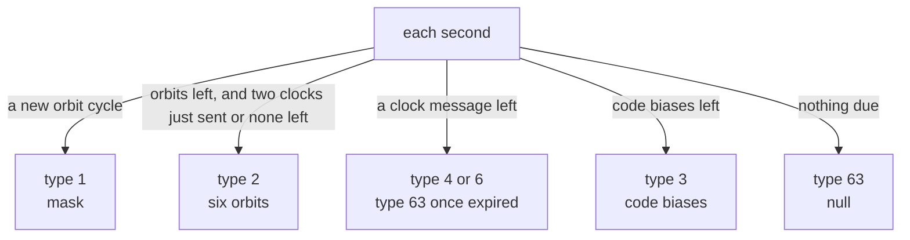

# PPP-B2b

PPP-B2b is the correction service on B2b of the BDS-3 GEO satellites. It
corrects the orbits, clocks and code biases of BDS, GPS and Galileo
satellites. Pharos computes the corrections from the simulation and
sends one message a second while the scenario has a `pppB2b` block.

## Frame

PPP-B2b uses the frame of [B-CNAV3](b-cnav3.md): preamble, PRN, six
reserved bits, then 486 bits coded LDPC(162,81). The first reserved bit
is the unavailable flag. Every GEO satellite sends the same message each
second.

| Carrier | Satellites | Message | Symbol rate | Coding | ICD |
|---|---|---|---|---|---|
| B2b | GEO: PRN 1-5, 59-63 | 1 s, 462 bits and CRC-24Q | 1000 sps | LDPC(162,81) over GF(64) | BDS-SIS-ICD-PPP-B2b 1.0, 6.1 and 6.1.1 |

A message opens with its 6-bit type. Types 1 to 4 then carry the epoch
(the second of the BDT day), 4 reserved bits and IOD SSR.

## Implementation matrix

| Type | Content | Sent when | Content from | PPP-B2b 1.0 |
|---|---|---|---|---|
| 1 | satellite mask: IODP and 255 slot bits | at each orbit cycle's start | the satellites corrected | 6.2 |
| 2 | orbit corrections of 6 satellites: slot, IODN, IOD Corr, radial, along, cross, URA class and value | after the mask, between clock messages | the simulation | 6.2, 7 |
| 3 | code biases: per satellite, one DCB per tracking mode | when no mask, orbit or clock is due | the group delays the codes fly with | 6.2, Table 6-5 |
| 4 | clock corrections of 23 satellites: IOD Corr and C0 | at each clock epoch | the simulation | 6.2, 7 |
| 5 | URA indices | not sent | | 6.2 |
| 6 | clock and orbit combination with IODP | at each clock epoch, for the clocks after the last full type 4 | the simulation | 6.2 |
| 7 | clock and orbit combination by slot | not sent | | 6.2 |
| 8-62 | reserved in the ICD | not sent | | 6.2 |
| 63 | null message | when nothing is due, or a clock message has expired | none | 6.2 |

The scales are those of Tables 6-2 to 6-11. Type 6 carries clocks only:
its orbit count is zero.

## Cadence

The orbit cycle lasts `orbitInterval` seconds, 48 by default. A clock
epoch recurs every `clockInterval` seconds, 6 by default. The keys are
described in [scenarios](../../guide/scenarios.md).

Each second takes the first case that holds, in the order drawn.

| Rule | Value |
|---|---|
| orbit cycle | starts once `orbitInterval` has passed and every orbit of the cycle is sent; the mask is rebuilt |
| a new orbit cycle | drops the clock messages still pending |
| clock epoch | once `clockInterval` has passed and no clock message is pending |
| clock message life | 12 s from its epoch, and 96 s from the oldest orbit it relies on (6.3) |
| clock of a satellite | only while its orbit correction is under 96 s old; else the unavailable code |
| clocks and orbits | at most two clock messages in a row while orbits are left |
| code biases | as many satellites as fit, up to 31 a message; they resume where the last cycle stopped |

## Satellites and references

A satellite enters the mask at a cycle's start when it transmits a
listed signal of its system's tracking modes. It also needs a reference
record and an orbit correction within the fields.

| System | Mask slots | Satellites | Reference message | IODN |
|---|---|---|---|---|
| BDS | 1-63, the PRN | those whose allocation includes B1C: the BDS-3 MEO and IGSO satellites | [B-CNAV1](b-cnav1.md), as a receiver decodes it | its IODC |
| GPS | 64-95: 63 + PRN | those flying an LNAV record | LNAV | its IODC |
| Galileo | 101-136: 100 + PRN | those flying an I/NAV record | I/NAV | IODnav |

GPS and Galileo satellites join only when the scenario lists a signal
of their tracking modes. IODP steps, modulo 16, whenever the mask
changes. IOD Corr steps, modulo 8, whenever a satellite's reference
binding changes, including a change to its delays or family attributes.

| System | Tracking modes of Table 6-5 |
|---|---|
| BDS | 0 B1I, 1 B1C data, 2 B1C pilot, 4 B2a data, 5 B2a pilot, 7 B2b, 12 B3I |
| GPS | 0 L1CA, 4 L1C pilot, 7 L2C pilot, 8 L2C data, 11 L5 data, 12 L5 pilot |
| Galileo | 1 E1 data, 2 E1 pilot, 4 E5a pilot, 5 E5a data, 7 E5b data, 8 E5b pilot, 11 E6 pilot |

A satellite's type 3 entry lists the modes whose signal it transmits
and whose delay is available in the current binding. A mode with an
unresolved base delay is omitted.

## The corrections

The corrections turn the reference message into the simulated state:
the product under `precise`, else the selected raw reference. The BDS
reference message uses the same B-CNAV1 projection as the encoder,
including its family attributes, grid conversion and field resolution.
The corrections refer to BDT (section 7): the BDGP offset is taken out
of every clock.

| Quantity | Value | Step and range |
|---|---|---|
| radial, along, cross | the reference position less the simulated one, on the reference orbit's axes | radial 0.0016 m, along and cross 0.0064 m; within 26.2 m each |
| C0 | the reference clock less the simulated clock, in metres | 0.0016 m within 26.2 m; -16384 when unavailable |
| DCB | the group delay the code flies with, in metres | 0.017 m, codes -2048 to 2047 |
| URA | class 0, value 0 | |
| IOD SSR | 0 | |

Without a product the corrections need not be zero. They carry the
difference introduced by projecting and quantizing the selected
reference. After a binding switch they follow the simulated state's
600 s transition. A delay change starts that transition even when the
raw reference stays the same; DCB follows the delay the code currently
flies with ([data](data.md#corrections-the-simulation-computes)).

## Unavailable service

| Case | What the GEO satellites send on B2b |
|---|---|
| no `pppB2b` block, or `enable` false | type 63 in every second, unavailable flag set |
| no satellite to correct | the empty mask and type 63, unavailable flag set |
| otherwise | the messages above, flag clear |

## Where Pharos departs from the ICD default

| Case | What is sent |
|---|---|
| URA | class 0, value 0 in every orbit entry; no type 5 |
| IOD SSR | always 0 |
| GLONASS | no corrections; its mask slots stay clear |
| type 6 | clocks only, never orbits |
| type 7 | never |
| an orbit entry left over in a type 2 | all zero, slot 0 |
| a clock whose orbit is too old or missing | C0 -16384 |

## Limits and messages

| Case | Result |
|---|---|
| `pppB2b` without a `samples` block | `no_effect` on `pppB2b`: `PPP-B2b is transmitted in the samples and there is no samples block` |
| B2b not listed | `no_effect` on `pppB2b`: `PPP-B2b is carried on B2b, which is not listed` |
| every GEO satellite with B2b masked out | `no_effect` on `pppB2b`: `PPP-B2b is carried by the BDS-3 GEO satellites, which are all masked out` |
| `clockInterval`, `orbitInterval` | whole seconds in 1 to 3600 |
| a GEO satellite without a record the B-CNAV fields can carry | no B2b frames |
