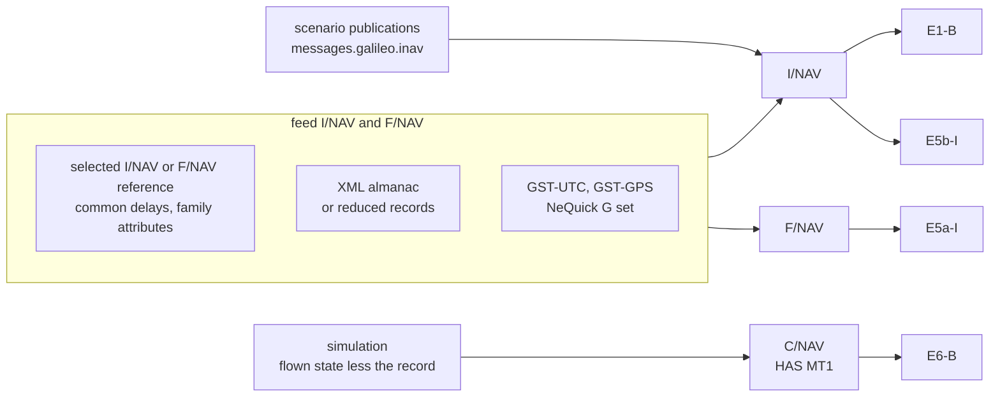

# Galileo

Pharos generates the four Galileo signals E1, E5a, E5b and E6 for satellite slots 1 to 36.
Their messages come from the navigation files, the scenario's publications and the simulation.
This page is the overview; the pages at the end hold the detail.

Each satellite's enabled signals choose one reference for both message families.
E1 or E5b makes I/NAV the first choice; E5a without either makes F/NAV the first choice.
F/NAV converts an I/NAV reference's clock when needed; its orbit still comes from that same reference.
Without the scenario's `has` block, every C/NAV page is the dummy page.

## Signals

| Signal | `signals` word | Carrier | Components | Message |
|---|---|---|---|---|
| E1 | `E1` | 1575.42 MHz | E1-B data, E1-C pilot | [I/NAV](inav.md) |
| E5a | `E5a` | 1176.45 MHz | E5a-I data, E5a-Q pilot | [F/NAV](fnav.md) |
| E5b | `E5b` | 1207.14 MHz | E5b-I data, E5b-Q pilot | [I/NAV](inav.md) |
| E6 | `E6` | 1278.75 MHz | E6-B data, E6-C pilot | [C/NAV with HAS](has.md) |

Codes, modulation, observation codes and group delays are on the [signals](signals.md) page.

## Satellites

Galileo has slots 1 to 36, and every slot carries all four signals.
There is no allocation table.

| Condition | Rule |
|---|---|
| any signal | the satellite has a selected reference and the signal's required delay |
| E1 and E5b | the selected raw reference is an I/NAV record |
| a signal declared out of service | off the air ([health](data.md#health-and-flags)) |

## Standards

The pinned issues are the ones implemented, not necessarily the latest.

| Document | Issue | Covers | Pages |
|---|---|---|---|
| Galileo OS SIS ICD | 2.1, November 2023 | E1 CBOC (2.3.3), codes (3.4.1, 3.5, Annex C), F/NAV (4.2), I/NAV (4.3), BGD (5.1.5), GTRF (Table 66) | [signals](signals.md), [I/NAV](inav.md), [F/NAV](fnav.md) |
| Galileo E6-B/C Codes Technical Note | 1, January 2019 | the E6-B and E6-C primary codes, the E6-C secondary code | [signals](signals.md) |
| Galileo HAS SIS ICD | 1.0, May 2022 | C/NAV pages (2.2 to 2.4), page header (3), MT1 (5), Reed-Solomon code (6), corrections (7) | [HAS](has.md) |
| Ionospheric Correction Algorithm for Galileo Single Frequency Users (European Commission) | 1.2, September 2016 | NeQuick G and its data files (Annex C) | [ionosphere](../../models/ionosphere.md) |
| Galileo Satellite Metadata (European GNSS Service Centre), section 3, "Attitude Law" | the page read on 2026-09-21; it carries no issue or date | the IOV and FOC yaw laws, the FOC switch-over (3.1.1, 3.1.2) | [attitude](#attitude) |
| RINEX | 3.04 and 4.02, read | I/NAV and F/NAV records, time offsets, NeQuick G sets | [data](data.md) |

The issues were checked against the issuing sites on 2026-09-14; the metadata page on 2026-09-21.
The service centre's copy of OS SIS ICD 2.1 is marked superseded.
The copy of the Publications Office of the European Union supplies the Annex F attachments.

## Time

GST is a view of GPS time.
Its week is the GPS week less 1024; its seconds of week are the same.
The messages carry the week modulo 4096.

| Offset | Record | Carried by |
|---|---|---|
| GST against GPS time | `GAGP` in force at the run start | every Galileo signal and observable of a broadcast run |
| GST-GPS (GGTO) | `GAGP` in force at each GPS minute | I/NAV word 10, F/NAV page 4 |
| GST-UTC | `GAUT` and the run's leap seconds | I/NAV word 6, F/NAV page 4 |
| HAS clocks | on GST | E6-B; a GPS clock correction includes the `GAGP` offset |

Under a `precise` product, the product clock flies as it is.
The rules for each record are on the [navigation data](data.md#time-offsets-and-utc) page.

## Attitude

With the scenario's `antenna` key, the yaw of each satellite turns its phase-centre offsets.
The ANTEX antenna type chooses the yaw law; the mechanism is on the [antennas](../../models/antennas.md) page.
Away from orbit noon and midnight, both Galileo laws are nominal yaw steering.

| Satellites | ANTEX type | Law | Acts | Parameters | Source |
|---|---|---|---|---|---|
| IOV | beginning GALILEO-1 | `auxiliary`: steers on an auxiliary Sun direction | Sun elevation below 2 degrees, Sun within 15 degrees of the nadir and cross-track plane | floor 2 degrees, 15 degrees | the service centre's law and parameters |
| FOC | any other type beginning GALILEO | `smoothed`: a cosine turn of fixed period | Sun elevation below 4.1 degrees | 4.1 degrees, cone 10 degrees, period 5656 s | the service centre's law and parameters; the end of the turn is UNCONFIRMED |

The IOV law blends the auxiliary direction's out-of-plane component with a cosine of the Sun's along-track component.
The blend runs from the Sun's own value at the edge of the region to the 2-degree floor at the turn's centre.
The FOC turn starts where the angle between the satellite and the Sun line falls to 10 degrees.
The yaw then follows a cosine of period 5656 s for half the period.

UNCONFIRMED: the service centre does not say when the FOC turn ends.
Pharos ends it after half the period, at the mirror of the yaw it began with.
The nominal law resumes there, with a step that grows with the Sun's elevation.

## Not modelled

| What | What Pharos does |
|---|---|
| OSNMA | its document is not pinned; the 40-bit field of every odd page part is zero |
| SAR return-link messages | the E1-B SAR field carries a fixed pattern |
| I/NAV alert pages | every page is a nominal page |
| ionospheric disturbance flags | the five flags are always zero |
| the E5 AltBOC signal | E5a and E5b are separate signals on their own carriers |
| integrity monitoring | the I/NAV ISM is the scenario's declaration; HAS never marks a clock "do not use" |
| the almanac health words in the health rule | they reach the almanac words and pages, never the air |

## Pages

| Page | Content |
|---|---|
| [Signals](signals.md) | codes, modulation, phases, observation codes, group delays |
| [I/NAV](inav.md) | E1-B and E5b-I: page layout, words, schedule |
| [F/NAV](fnav.md) | E5a-I: page types, schedule, an I/NAV record on F/NAV |
| [HAS](has.md) | E6-B: C/NAV pages carrying HAS Message Type 1 |
| [Navigation data](data.md) | records, health, SISA, time offsets, NeQuick G, almanac, `messages.galileo.inav` |
