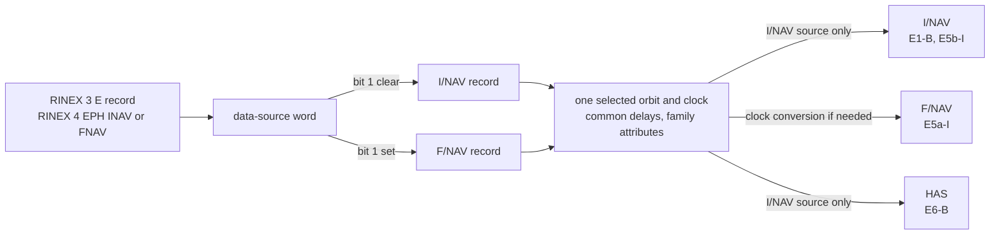

# Galileo navigation data

This page lists the Galileo records Pharos reads and what each message family takes from them.
It gives the rules for health, SISA, time offsets, NeQuick G, the almanac and the `messages.galileo.inav` publications.
Reading, checking and selecting records in general is in the [navigation data guide](../../guide/navigation-data.md).

## Records

| Record | File | What it gives |
|---|---|---|
| `E` record | RINEX 3.0x | an I/NAV or F/NAV record, by the data-source word |
| `> EPH` of an `E` satellite, `INAV` or `FNAV` | RINEX 4.0x | an I/NAV or F/NAV record, by the data-source word |
| `IONOSPHERIC CORR`, `GAL` | RINEX header | the NeQuick G set |
| `> ION` of an `E` satellite | RINEX 4.0x | the NeQuick G set, with its transmission time |
| `TIME SYSTEM CORR` or `> STO`, `GAUT` | header, RINEX 4.0x | GST-UTC |
| `TIME SYSTEM CORR` or `> STO`, `GAGP` (header `GPGA` too) | header, RINEX 4.0x | GST-GPS |
| `LEAP SECONDS` | RINEX header | the leap schedule GST-UTC needs |
| Galileo XML almanac | an `almanac` file | almanacs |

Each satellite has one selected reference for every plan interval.
Its enabled signals determine which family is tried first.

| Enabled signals | Reference order |
|---|---|
| E1 or E5b present | I/NAV, F/NAV |
| E5a without E1 or E5b, with or without E6 | F/NAV, I/NAV |
| E6 only, or none for a correction target | I/NAV, F/NAV |

Selection applies the [time and health checks](../../guide/navigation-data.md).
When signals are enabled, the reference must serve at least one of them.
I/NAV and F/NAV encode the same selected orbit and clock, using the interval's common delays and their separately resolved family attributes.
I/NAV requires a raw I/NAV reference; F/NAV also accepts an I/NAV reference with its clock converted ([F/NAV](fnav.md#an-inav-record-on-fnav)).
HAS corrects only a selected raw I/NAV reference.
While an F/NAV reference is selected, E1 and E5b get no channel in the samples; the observation file still lists them.
The raw records remain unchanged: resolving attributes or delays never changes their source or clock reference.
A record's transmission time is the first value of its last line, in seconds from the start of toe's GST week.
Without it, the selection takes the healthy record with the nearest toe, which may lie after the interval start.

## Record fields

| Field | I/NAV record | F/NAV record |
|---|---|---|
| source | data-source bit 1 clear | data-source bit 1 set |
| IODnav | the issue of data, 10 bits | the same |
| SISA | SISA(E1,E5b) | SISA(E1,E5a) |
| health | E1-B and E5b HS and DVS | E5a HS and DVS |
| group delays | BGD(E1,E5a), BGD(E1,E5b) | BGD(E1,E5a); BGD(E1,E5b) is not read |

The data-source bits 8 and 9, the clock's frequency pair, are not read: bit 1 alone decides.
An F/NAV record's BGD(E1,E5b) is not valid (RINEX 4.02 Table A13 note 6).

| Health word bits | Flag | Read from |
|---|---|---|
| 0 | E1-B DVS | an I/NAV record |
| 1 and 2 | E1-B HS | an I/NAV record |
| 3 | E5a DVS | an F/NAV record |
| 4 and 5 | E5a HS | an F/NAV record |
| 6 | E5b DVS | an I/NAV record |
| 7 and 8 | E5b HS | an I/NAV record |

## Delays and family attributes

The common delay table starts with the selected record's terms.
Each missing term takes a donor of the same satellite whose toe is within 7200 s of the interval start and whose adoption time precedes the next plan boundary.
For a donor without a transmission time, toe is its adoption time.
The nearest toe to the selected record wins, then the latest adoption time, then a stable order by raw record contents.
The selected record's own terms always win.
A signal whose required delay remains missing stays off the air; the raw record and other usable signals remain available.

The selected record supplies its own family's attributes.
The other family takes the latest adopted eligible donor, including declarations that signals are out of service; equal adoption times use the same stable order.
Its IODnav is that of the selected reference; SISA is usable only when donor and reference have the same toe and IODnav, otherwise it is 255 (NAPA).
Health can therefore come from another epoch without claiming that epoch's orbit accuracy.
Each encoder uses these attributes with the selected physical parameters and the common delay table.
Delay changes are blended even when the selected record stays the same; they do not restart the orbit blend.

## Record checks

| Check | Rule |
|---|---|
| every field fits its message field | the I/NAV and F/NAV fields (OS SIS ICD 5.1) |
| toe and toc on the grid | 60 s of GST |
| toc within half a week of toe | yes |
| each group delay | below 2^-23 s in magnitude, about 119 ns |
| may be blank | SISA, the group delays |

A blank SISA is index 255, "no accuracy prediction available" (NAPA).
Any other blank field skips the record.
A record that fails is skipped with a warning.
Missing delay terms are resolved per plan interval; loading preserves the raw record with its missing terms.

## Health and flags

A declaration that says a signal is gone takes it off the air.
One that says the signal is not to be trusted leaves it on the air, with the flag broadcast.

| Declaration | Signal | On the air |
|---|---|---|
| resolved I/NAV declaration, E1-B HS = 1, signal out of service | E1 | off |
| resolved I/NAV declaration, E5b HS = 1 | E5b | off |
| resolved F/NAV declaration, E5a HS = 1 | E5a | off |
| HS = 2 or 3, or DVS = 1 | that signal | on, the flags broadcast |
| an I/NAV reference without an F/NAV declaration | E5a | on, if its delay is available |
| no record declares it | E6 | on |
| an I/NAV record with E1-B and E5b HS = 1 | all | the record is not selected |
| an F/NAV record with E5a HS = 1 | all | the record is not selected |

HS = 1 is "signal out of service" (OS SIS ICD 2.1 Table 82).
Each signal uses its family's resolved declaration, falling back to the selected record's declaration when that family has none.
The E5a declaration is resolved from F/NAV attributes for the interval and is never written into the raw I/NAV record.
Word 16, the reduced CED, needs E1-B and E5b both at HS 0 and DVS 0 ([I/NAV](inav.md)).
The almanac health words are a declaration about another satellite: they reach the almanac words and pages, never the air.

## SISA

A RINEX record gives SISA in metres; Pharos turns it into the broadcast index.
The value is rounded to whole centimetres, then truncated to the step.

| SISA | Index | Step |
|---|---|---|
| 0 to 0.49 m | 0 to 49 | 1 cm |
| 0.50 to 0.98 m | 50 to 74 | 2 cm |
| 1.00 to 1.96 m | 75 to 99 | 4 cm |
| 2.00 to 6.00 m | 100 to 125 | 16 cm |
| blank, negative or above 6 m | 255 (NAPA) | |

I/NAV word 3 and F/NAV page 1 carry their resolved family's index.
The selected record keeps its own index; another family's index requires matching toe and IODnav, else it is 255.

## Time offsets and UTC

| Content | I/NAV | F/NAV | Record |
|---|---|---|---|
| GST-UTC and leap seconds | word 6 | page 4 | `GAUT`, the run's leap seconds |
| GST-GPS | word 10 | page 4 | `GAGP` |
| GST against GPS time in the signals | | | `GAGP` |

A message set takes the record transmitted last at or before its GPS minute.
A header line serves only when no transmitted record precedes that minute.
Only a Galileo satellite's `> STO` block or a header line counts for the messages.
The signals take the `GAGP` record in force at the run start; without one, a GPS satellite's.

| GST-UTC needs | Rule |
|---|---|
| a `GAUT` record | with a reference time |
| leap seconds | the run's schedule ([leap seconds](../../guide/navigation-data.md#leap-seconds)) |
| t0t | on a whole hour |
| WNt | within 127 weeks of the set's week |
| WNLSF | within 127 weeks too, when the count changes |
| every value | within its field (OS SIS ICD 5.1.7) |

Without it word 6 is the dummy word and page 4 the dummy page.
A scenario that lists `E5a` with `samples` or `observation` needs GST-UTC usable at the run start.

| GST-GPS needs | Rule |
|---|---|
| a `GAGP` record | with A2 = 0 |
| t0G | on a whole hour of GST |
| WN0G | within 31 weeks of the set's week |
| every value | within its field (OS SIS ICD 5.1.8) |

Without it A0G, A1G, t0G and WN0G are sent all ones.

## NeQuick G coefficients

| Source | Rule |
|---|---|
| the scenario | `ionosphere.parameters` with `model` `nequick`: three numbers that replace the navigation data's |
| RINEX 4.0x | the latest `> ION` of an `E` satellite transmitted at or before the run start |
| RINEX header | else the first `IONOSPHERIC CORR` `GAL` set that fits its fields |
| none | zeros in I/NAV word 5 and F/NAV page 1 |

| Field (OS SIS ICD 5.1.6) | Bits | Step | Range |
|---|---|---|---|
| ai0 | 11 | 2^-2 sfu | 0 to 511.75 sfu |
| ai1 | 11, signed | 2^-8 sfu per degree | ±3.996 |
| ai2 | 14, signed | 2^-15 sfu per degree squared | ±0.25 |

A set outside its fields is dropped with a warning.
The five ionospheric disturbance flags are always zero.
The same set drives the `nequick` model of the delays ([ionosphere](../../models/ionosphere.md)).
With `ionosphere.model` set to `auto` and a Galileo signal listed, a navigation NeQuick G set is required at pack time; the message's zero fallback does not supply it.

## Almanac file

An `almanac` file whose first non-blank line begins with `<` is a Galileo XML almanac.
The format is the European GNSS Service Centre's.

| Element | Content |
|---|---|
| `issueDate` | the file's date, YYYY-MM-DD; required |
| `svAlmanac` | one satellite's block |
| `SVID` | the satellite, 1 to 36 |
| `iod` | the almanac's issue |
| `t0a` | seconds of GST week, 0 to 604200, on the whole 600 s grid |
| `wna` | the week modulo 4, taken nearest the issue date's GST week |
| `aSqRoot` | sqrt(A) less sqrt(29600000 m) |
| `ecc` | e |
| `deltai` | i0 less 56 degrees, in semicircles |
| `omega0`, `w`, `m0` | in semicircles |
| `omegaDot` | in semicircles per second |
| `af0`, `af1` | in s and s/s |
| `statusE1B`, `statusE5b`, `statusE5a` | the HS of each signal; 0 when absent |

A block with an element missing or unreadable is skipped and counted.
The newest block of each satellite is kept.
An almanac outside the I/NAV and F/NAV almanac fields or off the t0a grid is skipped with a warning.
The words and pages carry one t0a, that of the lowest-numbered satellite's almanac.

A satellite without a file almanac gets its nearest record reduced to the t0a of the first file almanac.
Without any file almanac, the t0a is the run start rounded to 600 s of GST.
The reduction's health comes from the nearest record declaring each flag, healthy records first.

## Publications: `messages.galileo.inav`

The scenario publishes the integrity support message of I/NAV word 22.
The block is an array of entries, each in force over its interval.
The rules for `from`, `until`, order and snapshots are in the [scenarios guide](../../guide/scenarios.md).

| Key | Content |
|---|---|
| `from`, `until` | `time` objects: the entry is in force from `from` until before `until` |
| `ism.service` | `test`, `noData` or `horizontal` |
| `ism.testMessage` | `test` only: exactly 22 hexadecimal digits, the first 0 to 7 |
| `ism.reference` | `horizontal` only: a `time` on the whole 30-minute grid of GST |
| `ism.satellites` | `horizontal` only: satellites of one mask bank, 1 to 32 or 33 to 63; none repeated; may be empty |
| `ism.pConst`, `ism.pSat`, `ism.ura`, `ism.ure`, `ism.bNom` | `horizontal` only: indices 0 to 15 |
| `ism.tValidity` | `horizontal` only: index 0 to 15 of the validity |

| `tValidity` | 0 | 1 | 2 | 3 | 4 | 5 | 6 | 7 | 8 | 9 | 10 | 11 | 12 | 13 | 14 | 15 |
|---|---|---|---|---|---|---|---|---|---|---|---|---|---|---|---|---|
| hours | 1 | 2 | 3 | 4 | 6 | 8 | 12 | 18 | 24 | 36 | 48 | 72 | 120 | 168 | 720 | 1440 |

| `service` | Word 22 (OS SIS ICD 4.3.7, 5.2) |
|---|---|
| `test` | GNSS ID 0, then the 87 bits of `testMessage` |
| `noData` | GNSS ID 1, service level ID 0: service level 1, no integrity support data; zeros |
| `horizontal` | GNSS ID 1, service level ID 2, WN, TOW in 30-minute units, the mask, the six indices |

Every form ends with the CRC-32Q of the first 96 bits.
The first mask bit is satellite 1, or 33 in the second bank.
A `horizontal` entry is available from `reference` for its validity; `until` can end it earlier.
An absent or expired entry leaves the dummy word; an explicit `noData` is a real word.
The example `examples/scenarios/galileo_e1_inav_ism.json` publishes a `horizontal` entry, then a `test` entry.

## Corrections

The simulation computes the HAS corrections of E6-B ([HAS](has.md#corrections)).
No other Galileo message carries simulated corrections.
The example `examples/scenarios/galileo_e6_has_precise.json` flies a precise product with HAS.

## Limits and messages

| Condition | Level and key | Message |
|---|---|---|
| `E5a` listed with `samples` or `observation`, no GST-UTC usable at the start | error `missing_field` on `ephemeris` | `an E5a signal is listed but the navigation data transmit no GST-UTC usable at the run start: F/NAV page 4 would be a dummy page for the whole run, carrying neither Cic and Cis nor the GGTO` |
| a record outside its fields | warning `implausible_record` on `ephemeris[i].name` | `<n> Galileo INAV records skipped, <field> outside its ICD range: <records>` (`FNAV` for F/NAV) |
| a required field blank | warning `implausible_record` on `ephemeris[i].name` | `<n> Galileo INAV records skipped, <field> blank: <records>` |
| a header NeQuick G set outside its fields | warning `implausible_record` on `ephemeris[i].name` | `the nequick set of the header is dropped, <field> outside its broadcast field` |
| an XML almanac outside the almanac fields | warning `implausible_record` on `almanac[i].name` | `<n> Galileo ALMANAC records skipped, <field> outside its ICD range: <records>` |
| an XML almanac without a readable `issueDate` | `pharos-pack` error | `<file>:<line>: <path>: the almanac has no usable issue date` |
| `testMessage`, `reference`, `satellites` or an index missing | error `missing_field` on the key | `required` |
| a `service` outside the three words | error `unknown_name` on `ism.service` | the message lists the three words |
| a malformed `testMessage` | error `out_of_range` | `must be exactly 22 hexadecimal digits, the first from 0 to 7`, or `must contain only hexadecimal digits` |
| a satellite outside 1 to 63 | error `out_of_range` | `must be from 1 to 63, got <n>` |
| satellites of both banks | error `out_of_range` | `satellites must share one mask bank: from 1 to 32 or from 33 to 63` |
| a satellite listed twice | error `duplicate` | `satellite <n> is repeated` |
| `reference` off the grid | error `out_of_range` | `must lie on the whole 30-minute grid of GST, the ISM time of week counting 30-minute units` |
| a key the service does not take | warning `no_effect` | `the <service> service takes no test message`, or `the <service> service takes no <key>` |
| an entry I/NAV cannot encode | error `out_of_range` on `messages.galileo.inav[i]` | `the publication cannot be encoded for I/NAV (<error>)` |

| Rule | Value |
|---|---|
| `GAUT` read | A0 up to 2 s, A1 up to 2^-27, A2 zero |
| `GAGP` read | A0 up to 2^-20 s, A1 up to 2^-39, A2 up to 2^-62 |
| transmission time of a time offset | within four weeks of its reference epoch |
| donor window for delays and family attributes | toe within 7200 s of the plan interval start; adopted before its next boundary |
