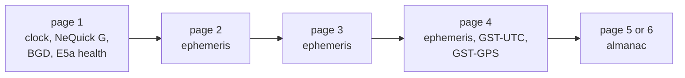
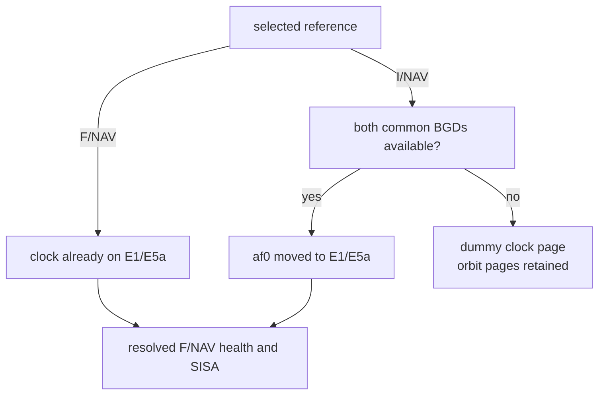

# F/NAV (E5a-I)

F/NAV is the message of E5a-I.
Each 10 s page carries one page type: 1 to 6, or the dummy page 63 where data are missing.
F/NAV encodes the satellite's selected orbit and clock reference, with a clock conversion when that reference is I/NAV.
The interval's common delay table and F/NAV attributes supply BGD, health and SISA.

## Page structure

| Carrier | Component | Page | Pages start | Symbol rate | Coding | ICD |
|---|---|---|---|---|---|---|
| E5a | E5a-I | 10 s | GST seconds that are multiples of 10 | 50 sps | sync 101101110000, rate 1/2, 8 x 61 interleaver | OS SIS ICD 2.1 4.2, 4.2.2 |

The convolutional code is the I/NAV one: K = 7, G1 = 171 and G2 = 133 octal, G2 inverted.
It starts cleared on each page, and the tail flushes it.

## Implementation matrix

| Page type | Content | Sent when | Content from | OS SIS ICD 2.1 |
|---|---|---|---|---|
| 1 | SVID, IODnav, toc, af0, af1, af2, SISA(E1,E5a), ai0 to ai2 and five flags, BGD(E1,E5a), E5a HS, WN, TOW, E5a DVS | first page of every subframe | selected reference, common delays, F/NAV attributes, NeQuick G set, GST | Tables 28 to 31; 5.1.5, 5.1.6 |
| 2 | IODnav, M0, Omega-dot, e, sqrt(A), Omega0, IDOT, WN, TOW | second page | selected reference | Tables 28 to 31 |
| 3 | IODnav, i0, omega, delta n, Cuc, Cus, Crc, Crs, toe, WN, TOW | third page | selected reference | Tables 28 to 31 |
| 4 | IODnav, Cic, Cis; GST-UTC; GST-GPS; TOW | fourth page, when GST-UTC is usable | selected reference, `GAUT` and the run's leap seconds, `GAGP` | Tables 28 to 31; 5.1.7, 5.1.8 |
| 5 | IODa, WNa, t0a; the group's first satellite; the second's SVID to Omega0's 4 high bits | fifth page of even subframes | almanacs | Tables 32 and 33 |
| 6 | IODa; the rest of the second satellite; the third | fifth page of odd subframes | almanacs | Tables 32 and 33 |
| 63 | dummy page: the type, then zeros | in place of page 1 or 4 without data | none | 4.2 |
| any other | | not sent | | |

Each almanac satellite has SVID, delta sqrt(A), e, omega, delta i, Omega0, Omega-dot, M0, af0, af1 and its E5a HS.
F/NAV uses a selected I/NAV or F/NAV reference.

## Schedule

A subframe is 50 s: pages 1 to 4, then page 5 in even subframes and page 6 in odd ones.
Subframes count 0 to 23 in a cycle of 1200 s.
A cycle starts at a multiple of 1200 GST seconds of week.
A pair of subframes carries one almanac group of three satellites.
Each satellite starts the cycle at its own group: PRN p at group p - 1, modulo 12.

| Subframes of the cycle | Group sent by the satellite with PRN p |
|---|---|
| 2k and 2k + 1 | (k + p - 1) mod 12 |

Group n holds satellites 3n + 1 to 3n + 3, so each satellite sends all 36 in one cycle.
Pharos rebuilds the content every GPS minute; a channel takes the new content at its next page.

## An I/NAV record on F/NAV

The enabled signals choose the reference ([navigation data](data.md#records)).
When it is I/NAV, F/NAV carries its orbit and moves its clock to the E1/E5a pair that F/NAV broadcasts.
This is a message format conversion; the raw reference keeps its I/NAV source and E1/E5b clock.

The clock moves by the ionosphere-free E1/E5a combination of the common E1 and E5a delays.
For an I/NAV record that shift is BGD(E1,E5b) - BGD(E1,E5a) (OS SIS ICD 5.1.5).

| Field | From an I/NAV record |
|---|---|
| af0 | af0 - BGD(E1,E5b) + BGD(E1,E5a) |
| BGD(E1,E5a) | kept |
| toc, af1, af2, the ephemeris, IODnav | kept |
| SISA(E1,E5a) | the resolved F/NAV index: a donor's only with matching toe and IODnav, else 255 (NAPA) |
| E5a HS and DVS | the resolved F/NAV declaration, else the I/NAV reference's declaration when present, else 0 |

So af0 - BGD, the clock of a single-frequency E1 user, is the same in I/NAV and F/NAV.
The resolved declaration also decides whether E5a is on the air ([health](data.md#health-and-flags)).

## Where Pharos departs from the ICD default

| Case | What is sent |
|---|---|
| the moved af0 or BGD does not fit page 1 | page 63 in place of page 1 |
| either common BGD needed for the I/NAV clock conversion is missing | page 63 in place of page 1; the orbit pages remain available |
| no usable GST-UTC ([rules](data.md#time-offsets-and-utc)) | page 63 in place of page 4: no Cic, Cis or GST-GPS |
| no usable GST-GPS | page 4 with A0G, A1G, t0G and WN0G all ones |
| no NeQuick G set | ai0, ai1 and ai2 zero |
| ionospheric disturbance flags | always zero |
| a group slot without an almanac | SVID 0, elements 0, E5a HS 1 |
| no resolved F/NAV declaration or E5a declaration in the I/NAV reference | E5a HS 0, DVS 0, SISA 255 |

## Limits and messages

| Condition | Level and key | Message |
|---|---|---|
| `E5a` listed with `samples` or `observation`, and no GST-UTC usable at the run start | error `missing_field` on `ephemeris` | `an E5a signal is listed but the navigation data transmit no GST-UTC usable at the run start: F/NAV page 4 would be a dummy page for the whole run, carrying neither Cic and Cis nor the GGTO` |
| navigation data the F/NAV fields cannot carry, at a set build of `pharos-pack` | error `out_of_range` on `ephemeris` | `F/NAV at <n> s into the run: the navigation data cannot be encoded into its message set (<error>)` |

| Rule | Value |
|---|---|
| donor window for family attributes | toe within 7200 s of the plan interval start; adopted before its next boundary |
| content rebuilt | every GPS minute; taken at the next page |
