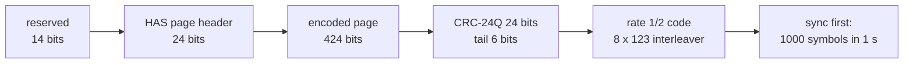
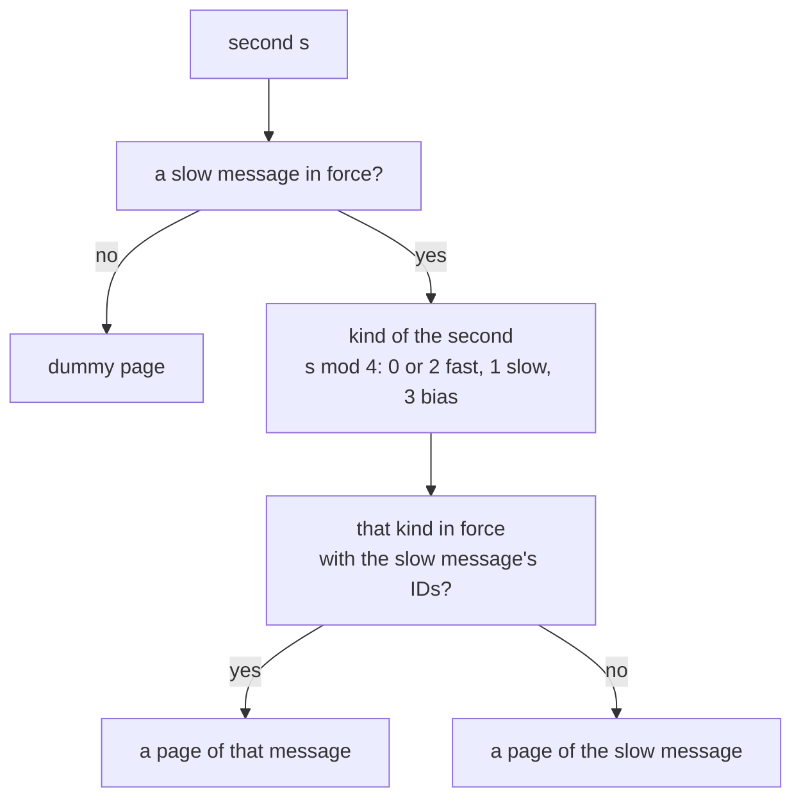

# HAS on E6-B (C/NAV)

E6-B carries C/NAV pages of 1 s.
With the scenario's `has` block they carry HAS Message Type 1 (MT1): orbit, clock and bias corrections.
Without it, every page is the dummy page.

## Page structure

| Carrier | Component | Page | Symbol rate | Coding | ICD |
|---|---|---|---|---|---|
| E6 | E6-B | 1 s, on whole GST seconds | 1000 sps | sync 0xB770, 16 symbols; rate 1/2, K = 7, G2 inverted; 8 x 123 interleaver | HAS SIS ICD 1.0 2.2 to 2.4 |

| Header field | Bits | Pharos (HAS SIS ICD 3, Table 7) |
|---|---|---|
| HAS status | 2 | 0 test or 1 operational, from `has.status` |
| reserved | 2 | 0 |
| message type | 2 | 1 |
| message ID | 5 | 0 to 31, the next free one |
| message size | 5 | the message's pages less one |
| page ID | 8 | 1 to k for data pages, 33 to 255 for parity pages |

The dummy page has the 14 reserved bits zero, the header 0xAF3BC3 and zeros after it (2.4.1).

## Implementation matrix

| Block | Content | Sent when | Content from | HAS SIS ICD 1.0 |
|---|---|---|---|---|
| MT1 header | TOH, six block flags, mask ID, IOD set ID | every message | the second it is made | 5, Table 12 |
| mask | per system: GNSS ID, satellite mask, signal mask, cell mask, nav message 0 | slow messages | selected raw references, listed signals | 5.2.1, Tables 15 to 21 |
| orbit corrections | validity; per satellite: IOD, radial, in-track, cross-track | slow messages | flown state less the selected reference's | 5.2.2, Tables 22 to 26 |
| clock full-set | validity; a multiplier per system; a clock per satellite | fast messages | flown clock less the selected reference's | 5.2.3 |
| clock subset | | not sent | | 5.2.4 |
| code biases | validity; a bias per cell | bias messages | the plan's common group delays, with delay blending | 5.2.5 |
| phase biases | validity; a bias and a discontinuity indicator per cell | bias messages | the same resolved carrier delays as the signals | 5.2.6 |
| dummy page | header 0xAF3BC3 | no `has` block, or no slow message in force | none | 2.4.1 |
| message types other than 1 | | not sent | | 3 |

## Messages and validity

Pharos makes three kinds of MT1 message.
A message ends at its validity, or when the next message of its kind is made.

| Message | Blocks | Made | Validity (Table 23) |
|---|---|---|---|
| slow | mask, orbit corrections | at the first second, every `orbitInterval` seconds, and at once when the satellites or an IOD change | 300 s, index 10 |
| bias | code and phase biases | with every slow message | 300 s, index 10 |
| fast | clock full-set | at the first second, every `clockInterval` seconds, and after a slow message for a change | 30 s, index 4 |

An interval falls due when the GPS second count is a multiple of it.
The keys and their defaults, 10 s and 50 s, are in the [scenarios guide](../../guide/scenarios.md).
TOH is the second of the GST hour the message is made in.

| Identifier | Steps when | Carried by |
|---|---|---|
| mask ID | the set of satellites changes | all three kinds |
| IOD set ID | the set of satellites or an IOD changes | all three kinds |

A fast message covers the satellites of the slow message in force.
A satellite whose IOD changed since then, or which left, gets the clock "not available".

## Pages per second

Each satellite sends a different page of the chosen message.

| Quantity | Value |
|---|---|
| k | the message's data pages, 1 to 32 |
| age | seconds since the message was made |
| q | (36 x age + PRN - 1) mod (k + 223) |
| page ID | q + 1 when q is below k; else 33 + q - k |

In one second, satellites 1 to 36 send 36 different pages.
In the next seconds they go on through the rest of the k + 223 pages.

## Reed-Solomon coding

| Step | Rule (HAS SIS ICD 6) |
|---|---|
| split | the message into k pages of 424 bits, 53 octets, k from 1 to 32 |
| padding | the last page filled with 0, 1, 0, 1 and so on |
| code | RS(255,32) over GF(2^8), field polynomial 0x11D, systematic (6.2.1, Table 42; 6.2.2) |
| columns | each octet position of the pages coded on its own (6.3) |
| pages | sent: data pages 1 to k and parity pages 33 to 255; zero pages k + 1 to 32 are not |

A receiver needs any k distinct pages of a message to decode it.

## Satellites and cells

| System | GNSS ID | In the mask | IOD | Signal cells |
|---|---|---|---|---|
| GPS | 0 | satellites with a selected raw LNAV reference; only when `L1CA`, `L1C`, `L2C` or `L5` is listed | IODE, 8 bits | 0 L1 C/A, 3 L1C data, 4 L1C pilot, 6 L2C CM, 7 L2C CL, 11 L5 I5, 12 L5 Q5 |
| Galileo | 2 | satellites with a selected raw I/NAV reference | IODnav, 10 bits | 0 E1-B, 1 E1-C, 3 E5a-I, 4 E5a-Q, 6 E5b-I, 7 E5b-Q, 12 E6-B, 13 E6-C |

The mask lists GPS first when it is present.
The signal mask holds the cells of the listed signals.
A satellite enters the mask when it transmits one of them, in view or not.
A system gets a cell mask when one of its satellites lacks one of its masked signals (5.2.1.2, 5.2.1.4, 5.2.1.5).
The nav message field is 0: the corrections refer to LNAV and I/NAV.
Resolved family attributes do not make a selected CNAV, CNV2 or F/NAV reference eligible.
The cell mask follows the allocation and stays fixed when a signal's health or required delay becomes unavailable; its bias fields then carry "not available".

## Corrections

The simulation computes every correction against the same selected raw orbit and clock reference used by the signals (HAS SIS ICD 7).
Its source and clock reference remain those of the raw record, even when a delay or family declaration comes from another record.

| Quantity | Computed as |
|---|---|
| orbit | the flown position less the record's, in radial, in-track and cross-track |
| clock | the flown clock less the record's, on GST, in metres |
| code bias | minus the cell's group delay, in metres |
| phase bias | minus the band's carrier delay in cycles, less a kept whole number of cycles |

The code and carrier delays come from the interval's common table, including its transition blend.
A change to delays alone updates the biases without starting another orbit blend.

- The flown state is the `precise` product's when the scenario has one, else the record's own.
- Without a product the orbit corrections are zero outside the 600 s blend after a record change.
- In-track lies along the record's velocity, cross-track along r x v; radial completes the frame.
- Every clock is on GST (7.1.1, 7.3), so a GPS satellite's clock correction includes the `GAGP` offset.
- The record's clock takes the relativistic term -2 r.v / c^2 of the record's state.
- A flown record keeps the ICD's term, F e sqrt(A) sin E.
- So without a product the clock corrections hold the small difference of the two terms.
- The multiplier of a system is the smallest, 1 to 4, at which all its clocks fit.
- A phase bias keeps its whole number of cycles until the delay moves more than 10.23 cycles from it.
- Then Pharos takes a new whole number, and the discontinuity indicator steps.

## Where Pharos departs from the ICD default

| Case | What is sent |
|---|---|
| no `has` block | the dummy page |
| no satellite to correct, or no slow message in force | the dummy page |
| a value outside its field | the field's "not available" value |
| a signal unavailable through health or a missing required delay | its code and phase biases "not available" |
| a satellite whose IOD changed after the slow message in force | clock "not available" |
| clock "do not use" | never sent |
| clock subset block | never sent |
| every message ID in use | the due message is skipped |
| a change whose mask ID and IOD set ID pair ended less than 1800 s ago | the new slow message waits |

## Limits and messages

| Condition | Level and key | Message |
|---|---|---|
| a `has` block | `pharos-pack` and `pharos-run` info | `HAS MT1 on E6-B: status <status>, clocks every <n> s, orbits and biases every <n> s` |
| a `has` block without `samples` | warning `no_effect` on `has` | `HAS MT1 is transmitted in the samples and there is no samples block` |
| a `has` block without `E6` listed | warning `no_effect` on `has` | `HAS MT1 is carried on E6, which is not listed` |

| Rule | Value |
|---|---|
| message size | 1 to 32 pages |
| message ID | 32 values; one is used again 150 s after its message ends |
| mask ID, IOD set ID | 32 values each; a pair is not defined again within 1800 s of its last validity |
| orbit radial | -10.2375 to 10.2375 m in steps of 0.0025 m |
| orbit in-track and cross-track | -16.376 to 16.376 m in steps of 0.008 m |
| clock | -4095 to 4094 steps of 0.0025 m times the multiplier |
| code bias | -20.46 to 20.46 m in steps of 0.02 m |
| phase bias | -10.23 to 10.23 cycles in steps of 0.01 cycle |
| discontinuity indicator | 0 to 3, stepping modulo 4 |
