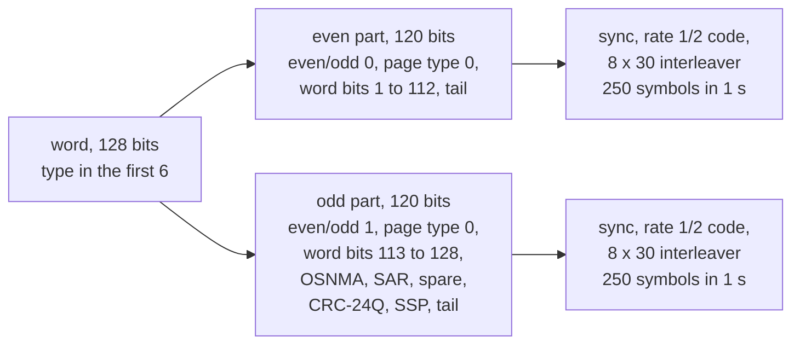

# I/NAV (E1-B and E5b-I)

I/NAV is the message of E1-B and E5b-I: one 128-bit word per 2 s page.
Pharos sends word types 0 to 10, 16 to 20 and 22 on the nominal subframes.
The dummy word 63 replaces a word whose data are missing.

## Page structure

| Carrier | Component | Page | Pages start | Symbol rate | ICD |
|---|---|---|---|---|---|
| E1 | E1-B | 2 s, even part then odd part | odd GST seconds | 250 sps | OS SIS ICD 2.1 4.3 |
| E5b | E5b-I | 2 s, even part then odd part | even GST seconds | 250 sps | OS SIS ICD 2.1 4.3 |

So the even part of an E1-B page goes out with the odd part of an E5b-I page.

| Field | Bits | Where | Pharos (OS SIS ICD 4.3.2) |
|---|---|---|---|
| even/odd | 1 | both parts | 0 even, 1 odd |
| page type | 1 | both parts | 0, the nominal page |
| data | 112 and 16 | even and odd part | the word of the slot |
| OSNMA | 40 | odd part | zero |
| SAR | 22 | odd part | E1-B: first bit 1, the rest 0; E5b-I: zero |
| spare | 2 | odd part | zero |
| CRC-24Q | 24 | odd part | over the even part's first 114 bits and the odd part's first 82 |
| SSP | 8 | odd part | E1-B: 0x04, 0x2B, 0x2F in turn; E5b-I: zero |
| tail | 6 | both parts | zero |

| Coding step | Rule |
|---|---|
| sync | 0101100000, 10 symbols, before each part, not encoded |
| convolutional code | rate 1/2, K = 7, G1 = 171 and G2 = 133 octal, G2 inverted |
| encoder | starts cleared on each part; the tail flushes it |
| interleaver | 8 rows by 30 columns, on each part |

## Implementation matrix

| Word | Content | Sent when | Content from | OS SIS ICD 2.1 |
|---|---|---|---|---|
| 1 | IODnav, toe, M0, e, sqrt(A) | every subframe | I/NAV record | Tables 40 to 45 |
| 2 | IODnav, Omega0, i0, omega, IDOT | every subframe | I/NAV record | Tables 40 to 45 |
| 3 | IODnav, Omega-dot, delta n, Cuc, Cus, Crc, Crs, SISA(E1,E5b) | every subframe | I/NAV record | Tables 40 to 45 |
| 4 | IODnav, SVID, Cic, Cis, toc, af0, af1, af2 | every subframe | I/NAV record | Tables 40 to 45 |
| 5 | ai0 to ai2 and five flags, BGD(E1,E5a), BGD(E1,E5b), E5b and E1-B HS and DVS, WN, TOW | every subframe | NeQuick G set, record, GST | Tables 40 to 45; 5.1.5, 5.1.6 |
| 6 | GST-UTC: A0, A1, delta tLS, t0t, WNt, WNLSF, DN, delta tLSF; TOW | every subframe, when GST-UTC is usable | `GAUT` record, the run's leap seconds | Tables 40 to 45; 5.1.7 |
| 7 | IODa, WNa, t0a; the group's first satellite, SVID to M0 | even subframes | almanacs | Tables 46 to 49, 84 |
| 8 | IODa; the first satellite's af0, af1, health; the second's SVID to Omega-dot | even subframes | almanacs | Tables 46 to 49, 84 |
| 9 | IODa, WNa, t0a; the second's M0, af0, af1, health; the third's SVID to delta i | odd subframes | almanacs | Tables 46 to 49, 84 |
| 10 | IODa; the third's Omega0 to health; GST-GPS: A0G, A1G, t0G, WN0G | odd subframes | almanacs, `GAGP` record | Tables 46 to 49, 84; 5.1.8 |
| 0 | time field 10 binary, WN, TOW; spare | every slot no other word takes | GST | Tables 52 and 55 |
| 16 | reduced CED: delta A, ex, ey, delta i0, Omega0, lambda0, af0, af1 | E1-B, twice a subframe, when available | I/NAV record, reduced | 5.1.11, Tables 50 and 85 to 88 |
| 17 to 20 | FEC2 parity: 15 octets each, and IODnav's 2 low bits | E1-B, two per subframe | parity of words 1 to 4 | 5.1.13, Annex F |
| 22 | ISM | E1-B, once a subframe, while a publication is available | `messages.galileo.inav` | 4.3.7, Tables 57 to 59; 5.2, Tables 95 to 102 |
| 63 | dummy word: the type, then zeros | in place of 6, 16 or 22 without data | none | Tables 52 and 55 |
| any other | | not sent | | |

The selected I/NAV reference supplies the orbit and clock in words 1 to 4 and 16 to 20.
The interval's common delay table and I/NAV attributes supply the delays, health and SISA.
While a raw F/NAV reference is selected, I/NAV has no record: the satellite sends no E1-B or E5b-I page.
The publications are the scenario's `messages.galileo.inav` block ([data](data.md#publications-messagesgalileoinav)).

## Schedule

The E5b-I frame starts at GST seconds of week that are multiples of 720.
The E1-B frame is half a frame, 360 s, from the E5b-I frame, and its pages start 1 s later.
Subframes count 0 to 23 in each frame, so each carrier has even and odd subframes.

| Page | E5b-I word | E1-B word | E1-B SSP |
|---|---|---|---|
| 1 | 1 | 2 | 0x04 |
| 2 | 3 | 4 | 0x2B |
| 3 | 5 | 6 | 0x2F |
| 4 | 7 or 9 | 7 or 9 | 0x04 |
| 5 | 8 or 10 | 8 or 10 | 0x2B |
| 6 | 0 | 17 or 18 | 0x2F |
| 7 | 0 | 19 or 20 | 0x04 |
| 8 | 0 | 16 | 0x2B |
| 9 | 0 | 0 | 0x2F |
| 10 | 0 | 22 | 0x04 |
| 11 | 2 | 1 | 0x2B |
| 12 | 4 | 3 | 0x2F |
| 13 | 6 | 5 | 0x04 |
| 14 | 0 | 0 | 0x2B |
| 15 | 0 | 16 | 0x2F |

In "7 or 9" the first word goes in even subframes, the second in odd ones (OS SIS ICD 4.3.3, 4.3.4, Tables 38 and 39).
Words 6, 16 and 22 fall back to word 63 as [the departures](#where-pharos-departs-from-the-icd-default) say.

A pair of subframes carries one almanac group of three satellites.
Group n holds satellites 3n + 1 to 3n + 3.
Every satellite sends the same group at the same time.

| Subframes of the frame | E5b-I group | E1-B group |
|---|---|---|
| 2k and 2k + 1 | k | (k + 6) mod 12 |

The 12 groups cover satellites 1 to 36 in each 720 s frame.
Pharos rebuilds the content every GPS minute; a channel takes the new content at its next page.

## Reduced CED and FEC2

Word 16 reduces the record to a two-body orbit at the start of the E1-B subframe that carries it.
The elements are quantised first.
Then af0 and af1 take the record's clock, corrected for the reduced orbit's radial error and relativistic term.
af1 is the slope of that clock over 600 s.

Words 17 to 20 carry a Reed-Solomon (255,195) code over GF(2^8), shortened to (118,58).
Its 58 information octets come from words 1 to 4; its 60 parity octets fill words 17 to 20, 15 each.
Each subframe pair sends all four parity words.

## Where Pharos departs from the ICD default

| Case | What is sent |
|---|---|
| no usable GST-UTC ([rules](data.md#time-offsets-and-utc)) | word 63 in the slots of word 6 |
| E1-B or E5b with HS above 0 or DVS 1 | word 63 in the slots of word 16 |
| a SISA index of 126 or more, such as 255 (NAPA) | word 63 in the slots of word 16 |
| a reduced CED value outside its field | word 63 in the slots of word 16 |
| no publication in force, or a `horizontal` one outside its validity | word 63 in the slot of word 22 |
| no usable GST-GPS | word 10 with A0G, A1G, t0G and WN0G all ones |
| no NeQuick G set | ai0, ai1 and ai2 zero |
| ionospheric disturbance flags | always zero |
| a group slot without an almanac | SVID 0, elements 0, E5b and E1-B HS 1 |
| no almanac at all | IODa 0; WNa and t0a of the content's time; every slot empty |
| almanacs of several t0a | only those of the lowest-numbered satellite's t0a |
| OSNMA field | zero |
| SAR field on E1-B | first bit 1, the rest 0 |
| a dummy word on E1-B | the SAR bit and the SSP zero |
| alert pages | never sent |

## Limits and messages

| Condition | Level and key | Message |
|---|---|---|
| navigation data the I/NAV fields cannot carry, at a set build of `pharos-pack` | error `out_of_range` on `ephemeris` | `I/NAV at <n> s into the run: the navigation data cannot be encoded into its message set (<error>)` |

| Rule | Value |
|---|---|
| content rebuilt | every GPS minute; taken at the next page |
| reduced CED clock fit | over 600 s from the subframe start |
| ISM validity | [data](data.md#publications-messagesgalileoinav) |
