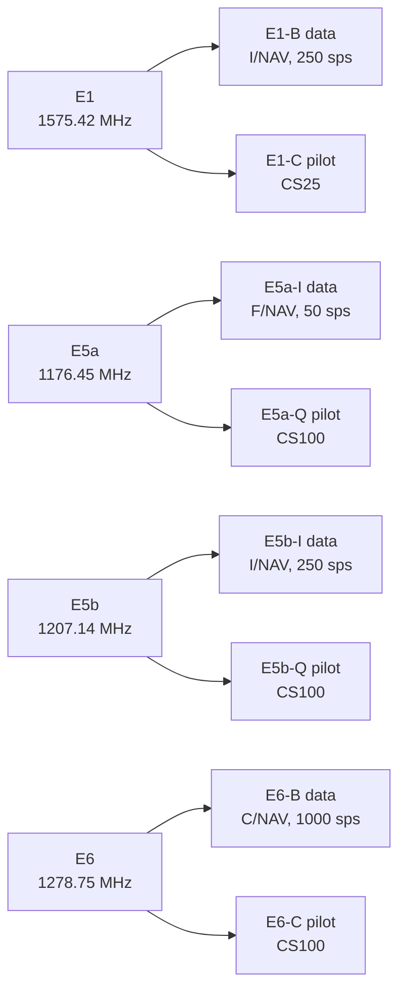

# Galileo signals

Pharos generates E1, E5a, E5b and E6, each with a data component and a pilot component.
This page gives their codes, modulation and phases.
It ends with the observation codes and the group delay each code flies with.

## Signal matrix

| | E1 | E5a | E5b | E6 |
|---|---|---|---|---|
| `signals` word | `E1` | `E5a` | `E5b` | `E6` |
| Carrier | 1575.42 MHz | 1176.45 MHz | 1207.14 MHz | 1278.75 MHz |
| Components | E1-B data, E1-C pilot | E5a-I data, E5a-Q pilot | E5b-I data, E5b-Q pilot | E6-B data, E6-C pilot |
| Primary code | memory code, 4092 chips | register code, 10230 chips | register code, 10230 chips | memory code, 5115 chips |
| Chip rate | 1.023 MHz | 10.23 MHz | 10.23 MHz | 5.115 MHz |
| Code period | 4 ms | 1 ms | 1 ms | 1 ms |
| Modulation | CBOC(6,1,1/11) | QPSK | QPSK | data and pilot on one axis |
| Power split | half each | half each | half each | half each |
| Data secondary code | none | CS20 | CS4 | none |
| Pilot secondary code | CS25 | CS100 | CS100 | CS100 |
| Symbol rate | 250 sps | 50 sps | 250 sps | 1000 sps |
| Message | [I/NAV](inav.md) | [F/NAV](fnav.md) | [I/NAV](inav.md) | [C/NAV with HAS](has.md) |
| Observation code | 1C | 5Q | 7Q | 6C |
| ANTEX frequency | E01 | E05 | E07 | E06 |
| ICD | OS SIS ICD 2.1 2.3.3, Table 9; Annex C | OS SIS ICD 2.1 2.3.1 to 2.3.3, 3.4.1 | as E5a | E6-B/C Codes Technical Note; HAS SIS ICD 2.2 to 2.4 |

Each signal has unit power, and the scenario's `power` block sets its C/N0.
A symbol lasts one code period on E1-B and E6-B.
On E5a-I and E5b-I it lasts one period of the data secondary code: 20 ms and 4 ms.
E5a and E5b are two signals on their own carriers; the AltBOC composite of E5 is not generated.

## Codes

| Code | Generator | Chosen per PRN by | ICD |
|---|---|---|---|
| E1-B, E1-C | memory codes embedded from the document, 50 per component | the table row | OS SIS ICD Annex C |
| E5a-I, E5a-Q | two 14-stage registers | the second register's start value | OS SIS ICD 3.4.1, Tables 15 to 19 |
| E5b-I, E5b-Q | two 14-stage registers, with their own taps | the second register's start value | OS SIS ICD 3.4.1, Tables 15 to 19 |
| E6-B, E6-C | memory codes embedded from the document, 50 per component | the table row | E6-B/C Codes Technical Note |

Slots 1 to 36 take the first 36 codes of each table.
Each secondary chip spans one primary code period, so every pilot secondary code lasts 100 ms.

| Secondary code | Length | On | Value (OS SIS ICD 3.5, Tables 20 to 22) |
|---|---|---|---|
| CS25 | 25 chips | E1-C, every PRN | 380AD90 hex, first chip first |
| CS20 | 20 chips | E5a-I, every PRN | 842E9 hex |
| CS4 | 4 chips | E5b-I, every PRN | E hex |
| CS100 | 100 chips | E5a-Q, one per PRN | codes 1 to 50 of the table |
| CS100 | 100 chips | E5b-Q, one per PRN | codes 51 to 100 of the table |
| CS100 | 100 chips | E6-C, one per PRN | the E5a-Q codes |

## Phases

A code chip 0 is the value +1.
Each band's data component lies on the positive real axis and is the band's reference.
The samples take each component's square-wave envelope; no filter shapes it.

| Band | Data component | Pilot component |
|---|---|---|
| E1 | E1-B, real axis | E1-C, real axis |
| E5a | E5a-I, positive real axis | E5a-Q, positive imaginary axis |
| E5b | E5b-I, positive real axis | E5b-Q, positive imaginary axis |
| E6 | E6-B, positive real axis | E6-C, negative real axis |

On E1 each component mixes BOC(1,1) and BOC(6,1) (OS SIS ICD 2.3.3).

| Component | Envelope for a chip of +1 |
|---|---|
| E1-B | +sqrt(5/11) BOC(1,1) + sqrt(1/22) BOC(6,1) |
| E1-C | -sqrt(5/11) BOC(1,1) + sqrt(1/22) BOC(6,1) |

Each component takes half the power: 10/11 of it in BOC(1,1) and 1/11 in BOC(6,1).
The samples resolve the BOC(6,1) subcarrier at 12 steps per chip.

## Observation codes and group delays

Each signal has one observation code, measured on its pilot.
A signal has one pseudorange, carrier phase, Doppler and C/N0.
The observation header gives every Galileo code a `SYS / PHASE SHIFT` of 0.00000 ([observations](../../guide/observations.md)).

A Galileo plan interval resolves two broadcast group delays, BGD(E1,E5a) and BGD(E1,E5b) (OS SIS ICD 5.1.5).
The selected raw record fixes the clock pair: E1/E5b for an I/NAV record, E1/E5a for an F/NAV record.
Each code flies with the delay below; data and pilot share it.

| Code | Signal | I/NAV record | F/NAV record |
|---|---|---|---|
| 1C | E1 | BGD(E1,E5b) | BGD(E1,E5a) |
| 5Q | E5a | BGD(E1,E5b) + (gamma15 - 1) x BGD(E1,E5a) | gamma15 x BGD(E1,E5a) |
| 7Q | E5b | gamma17 x BGD(E1,E5b) | BGD(E1,E5a) + (gamma17 - 1) x BGD(E1,E5b) |
| 6C | E6 | 0 | 0 |

Here gamma15 = (1575.42 / 1176.45)^2 and gamma17 = (1575.42 / 1207.14)^2.
A term missing from the selected record is resolved from an eligible donor within the time window into the interval's common table ([navigation data](data.md#delays-and-family-attributes)).
So an F/NAV reference can use BGD(E1,E5b) from an eligible I/NAV donor while keeping its E1/E5a clock reference.
The raw records remain unchanged.
A signal without its required delay stays off the air; other usable signals remain available.
The carrier flies the delay of its band's data code, which here equals the pilot's.
Changes to the table blend the signal delays even when the orbit and clock reference stays the same.

Under a `precise` product, every code flies with its delay less the ionosphere-free delay of a pair.
The pair is the one `precise.clockReference` names: `E1E5a` by default, or `E1E5b`.
An interval whose common table lacks a delay of that pair leaves its satellite dark while it is selected.

## Limits and messages

| Condition | Level and key | Message |
|---|---|---|
| a `precise` run whose common table lacks a delay of the clock pair | warning `no_record` on `ephemeris` | `<satellite>: a record it flies carries no <signal> group delay, which the <pair> clock of the precise product refers to: the satellite is dark while that record is selected` |
