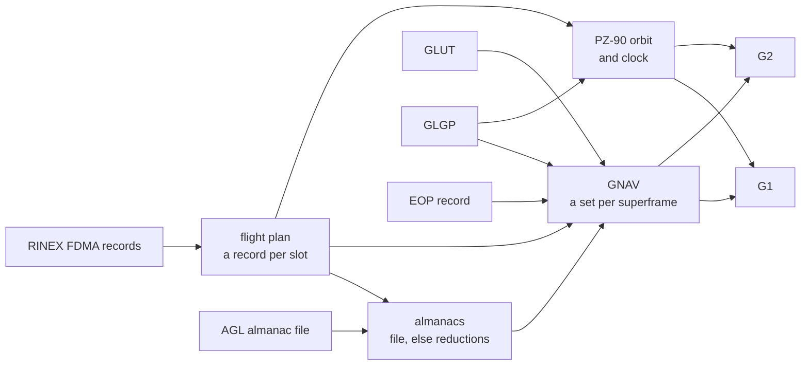

# GLONASS

Pharos generates the GLONASS FDMA signals G1 and G2, both carrying the
GNAV message. This page is the overview. The signals, the message and
the navigation data each have a page of their own.

The selected record feeds the message and, without a `precise`
product, the orbit. No scenario publication changes GNAV, and no
correction service serves a GLONASS satellite.

## Signals

| Signal | Carrier | Code | Message | RINEX code |
|---|---|---|---|---|
| G1 | 1602 + 0.5625 k MHz | C/A, 511 chips in 1 ms | GNAV | 1C |
| G2 | 1246 + 0.4375 k MHz | the same code | GNAV | 2C |

k is the frequency number of the satellite's record. Details are on
[signals](signals.md).

## Satellites

| Item | GLONASS |
|---|---|
| slots | 1 to 24, R01 to R24 |
| signals | every slot with a record sends G1 and G2 |
| frequency number k | from the selected record, -7 to 13 |
| a slot without a record | dark |

## Standard and constants

Pharos pins GLONASS ICD (L1, L2) 5.1 of 2008.

| Covers | ICD 5.1 | Page |
|---|---|---|
| the C/A code and the FDMA plan | 3 | [signals](signals.md) |
| the GNAV strings | 4, Tables 4.5 to 4.12 | [GNAV](gnav.md) |
| PZ-90.02 | 3.3.4, Table 3.2 | [data](data.md) |
| the equations of motion and the almanac algorithm | Appendix 3 | [data](data.md) |

The orbit and the almanac reduction use the constants of the ICD's
algorithms:

| Constant | Value | ICD 5.1 |
|---|---|---|
| GM | 398600.44 km^3/s^2 | A.3.1.2 |
| a_e | 6378.136 km | A.3.1.2 |
| J2 | 1082625.7e-9 | A.3.1.2 |
| Earth rotation rate | 7.292115e-5 rad/s | A.3.1.2 |
| C20 | -1082.63e-6, for the almanac | A.3.2.2 |

Table 3.2 of the ICD gives GM = 398600.4418 km^3/s^2 and
J2 = 1082625.75e-9 for PZ-90.02. Pharos keeps the algorithms' values.

## GLONASS time

| Quantity | In Pharos |
|---|---|
| GLONASS time | UTC + 3 h, Moscow time, a view of GPS time |
| N_4 and N_T | the four-year interval from 1996, and the day within it |
| a leap second | the GLONASS scale repeats 02:59:59 across an inserted second |
| tau_c | the correction of GLONASS time to UTC(SU), from GLUT |
| tau_GPS | the fractional part of GPS time less GLONASS time, from GLGP |
| satellite clock | -tau_n + gamma_n (t - t_b) - tau_GPS against GPS time |
| scenario start | may be given in GLONASS time: `leapYear`, `day`, `second` |

The leap seconds are the run's schedule, resolved once by pharos-pack.
A GLONASS scenario start is read on the built-in leap history
([scenario time](../../guide/scenarios.md#time)).

## Attitude

The ANTEX antenna type selects the yaw law. The mechanism is described
in [antennas](../../models/antennas.md).

| ANTEX type | Law | Rate | Source |
|---|---|---|---|
| starting with `GLONASS-M` | shadowed: noon turn centred on noon, midnight turn from umbra entry | 0.25 degrees per second | a Pharos choice: no operator publishes it |
| other names starting with `GLONASS`, such as GLONASS-K1 and GLONASS-K2 | rate-limited: slews at the rate where the nominal law turns faster | 0.25 degrees per second, GLONASS-M's | a Pharos choice: no operator publishes it |

In the midnight turn the shadowed law slews from umbra entry at the
rate. It then holds the yaw needed at umbra exit. When the slew cannot
finish inside the umbra, the rate-limited law applies instead.

## Not modelled

| Not modelled | Instead |
|---|---|
| the CDMA signals and their messages | G1 and G2 only |
| the turn a GLONASS-K satellite broadcasts in its CDMA message | GLONASS-M's rate |
| a transformation out of PZ-90 | records used in the frame they are broadcast in |
| corrections for GLONASS satellites | none: no correction stream serves them |

## Pages

| Page | Covers |
|---|---|
| [Signals](signals.md) | frequency plan, code, symbols, observation codes, group delays |
| [GNAV](gnav.md) | strings, frames, implementation matrix, schedule, departures |
| [Data](data.md) | records, checks, health, selection, orbit, time offsets, EOP, almanacs |
