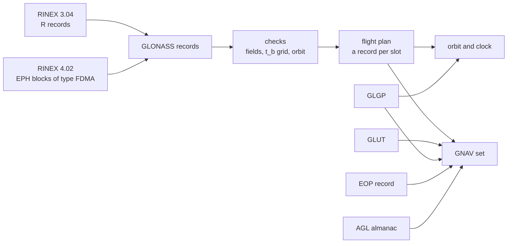
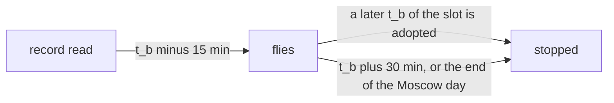
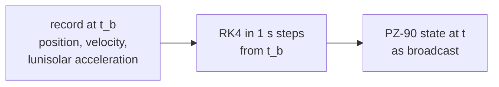

# GLONASS navigation data

This page covers the GLONASS records, time offsets, EOP records and
almanacs that Pharos reads. It says what each one feeds. The rules that
every system shares are in [navigation data](../../guide/navigation-data.md).

## Records

RINEX 3 records are read with three body lines (RINEX 3.04 Table A10).
A fourth body line in a RINEX 3 file is not read. RINEX 4 records add
a fourth line (RINEX 4.02 Table A15).

| Field | Read as | Feeds |
|---|---|---|
| epoch | t_b, a UTC epoch on the run's leap seconds | selection, t_b, N_T |
| SV clock bias | tau_n, the value negated | clock, string 4 |
| SV relative frequency bias | gamma_n | clock, string 3 |
| message frame time | not used | |
| X, Y, Z, their rates and accelerations | kilometres to metres | orbit, strings 1 to 3 |
| health | unhealthy when not zero | B_n, l_n |
| frequency number | k | carriers, H_n^A, observation header |
| age of operation information | E_n in days | string 4 |
| status flags (RINEX 4) | M from bits 7 and 8; with M = 01, P and P4 | strings 3 and 4 |
| L1/L2 group delay difference (RINEX 4) | Delta tau_n; 0.999999999999E+09 is unknown | G2 delay, string 4 |
| URAI (RINEX 4) | F_T when M = 01; 15 is unknown | string 4 |
| health flags, bit 2 (RINEX 4) | l(n), when M = 01 | health |
| health flags, bits 0 and 1 (RINEX 4) | the almanac health C_n, when bit 1 is set | reduced almanac |

P comes from bits 0 and 1 of the status flags, P4 from bit 6. An
unknown value is absent: GNAV then sends the defaults of the
[GNAV departures](gnav.md#where-pharos-departs-from-the-icd-default).
F_T is the one accuracy index, sent as read. GNAV carries no
ionosphere set, and a RINEX 4 ION record of GLONASS is not read.
With `ionosphere.model` set to `auto`, GLONASS uses GPS Klobuchar as a
substitute, from navigation data or the built-in GPS set. G1 and G2 use
that same model, scaled to their satellite's actual carrier frequencies.

## Record checks

A record that fails a check is skipped with a warning naming the field.

| Check | Field named |
|---|---|
| clock terms, orbit, health, frequency number and age given | the blank field |
| frequency number from -7 to 13 | freq |
| age from 0 to 31 days | en |
| status flags 0 to 511, health flags 0 to 7 | status_flags, health_flags |
| URAI 0 to 15, when M = 01 | ft |
| t_b on the 15-minute grid of the Moscow day, not at 00:00 | tb |
| N_4 of t_b from 1 to 31 | tb |
| every value within its GNAV field | the field, such as x or tau_n |
| orbit period 11 h to 13 h | orbit period |
| eccentricity at most 0.03 | eccentricity |
| inclination within 12.06 degrees (0.067 pi) of 63 degrees | inclination |

## Health and flags

A GLONASS declaration never takes a signal off the air. Both signals
stay on and the flags are broadcast.

| Declaration | G1 and G2 | GNAV |
|---|---|---|
| health not zero | on the air | B_n = 100, l_n = 1 |
| RINEX 4 l(n) set, with M = 01 | on the air | B_n = 100, l_n = 1 |
| neither | on the air | B_n = 000, l_n = 0 |
| RINEX 4 almanac health | not read for the signals | C_n of the slot's reduced almanac |

An unhealthy record is still selected. The almanac reduction prefers a
healthy record.

## Record selection

| Rule | Behaviour |
|---|---|
| adoption | at t_b - 15 min, the start of a 30-minute t_b interval |
| end | t_b + 30 min, or the end of the Moscow day of t_b if earlier |
| several records | the latest adopted t_b flies and ends every earlier record |
| after the end | the slot is dark until a later record is adopted |
| the same t_b twice | the first in file order |
| health | not considered: an unhealthy record flies |
| instants | the run start and every superframe boundary, every 150 s of the Moscow day |
| a switch | the 600 s transition of every system |

The plan also stores P1 beside each selected raw reference, leaving the
record unchanged. P1 encodes the t_b step from the record flying just
before the adoption, found among all records read. GNAV reads that value
from the same binding used by the track.

## Orbit and clock

| Item | Rule |
|---|---|
| equations | the Earth-fixed equations of motion of ICD 5.1 A.3.1.2 |
| forces | central term, J2, centrifugal and Coriolis terms, lunisolar acceleration |
| lunisolar acceleration | the record's, held constant over the flight |
| integration | RK4 with fixed 1 s steps from t_b, the remainder as one last step |
| frame | PZ-90, as broadcast, without a transformation |
| constants | GM 398600.44 km^3/s^2, a_e 6378.136 km, J2 1082625.7e-9 |
| Earth rotation rate | 7.292115e-5 rad/s, also over the light time |
| clock | -tau_n + gamma_n (t - t_b) against GLONASS time |
| against GPS time | the clock less tau_GPS of the GLGP record at the run start |
| relativistic clock term | none added |

The [overview](README.md#standard-and-constants) cites the ICD for each
constant. Under a `precise` product the orbit and clock come from the
product. The light time and the other propagation terms are described
in [geometry](../../models/geometry.md).

## Time offsets

| Record | Read from | Becomes | Checks |
|---|---|---|---|
| GLUT | RINEX 3 header TIME SYSTEM CORR, RINEX 4 STO | tau_c = -a0 | a0 below 1 s in magnitude, a1 = a2 = 0, fits string 5 |
| GLGP | the same | tau_GPS = -a0 | a0 below 2^-9 s in magnitude, a1 = a2 = 0, fits string 5 |

| Rule | Behaviour |
|---|---|
| choice | the latest record transmitted at or before the instant |
| a header line | taken only when no transmitted record is, the first in file order |
| GNAV | a GLONASS STO record or a header line, at each superframe |
| the GLONASS clock offset | a GLONASS STO record or header line at the run start, else a GPS one |
| the almanac day | a RINEX 4 GLUT's epoch may set N^A and N_4 of string 5 |
| a rate | a1 or a2 not zero: the record is skipped |
| a far transmission | more than four weeks from the reference: the record is skipped |
| GLGP elsewhere | also a GGTO of the GPS messages ([GPS data](../gps/data.md)) |

## Earth orientation

| Item | Rule |
|---|---|
| read from | RINEX 4 EOP records of any system |
| choice | the latest transmitted at or before the superframe |
| dUT1 | UT1 - UTC below 1 s in magnitude, UT1 - GPST below -1 s |
| checks | the broadcast EOP fields, transmission within four weeks of the reference |
| B1 | UT1 - UTC at the start of the almanac day, extrapolated from dUT1 |
| B2 | the rate of UT1 - UTC there |

## Almanacs

An AGL file holds one almanac per line, in eleven tokens.

| Token | Content | Becomes |
|---|---|---|
| 1 | slot, 1 to 24 | the satellite |
| 2 | date dd.mm.yy, in 20yy | N_4 and N^A of that Moscow day |
| 3 | time of the ascending node (s) | t_lambda_n^A |
| 4 | draconic period (s) | Delta T_n^A, the period less 43200 s |
| 5 | eccentricity | epsilon_n^A |
| 6 | inclination (degrees) | Delta i_n^A, the inclination less 63 degrees |
| 7 | longitude of the ascending node (degrees) | lambda_n^A |
| 8 | argument of perigee (degrees) | omega_n^A |
| 9 | clock correction (s) | tau_n^A |
| 10 | frequency number | k, then H_n^A |
| 11 | rate of the draconic period | Delta T'_n^A |

| Rule | Behaviour |
|---|---|
| recognised by | the first non-blank line's second token, of the form dd.mm.yy |
| fewer than eleven tokens, or a number that does not read | the load fails (MalformedRecord) |
| skipped and counted | a slot outside 1 to 24, k outside -7 to 13, a bad date |
| several lines of one slot | the newest date is kept |
| health | every AGL almanac counts as healthy: C_n = 1 |
| checks | the GNAV almanac fields, N_4 from 1, N^A from 1 to 1461 |

A slot without a file almanac gets a reduction of its records. The
reductions are made once at the run start, when G1 or G2 is listed.

| Step | Rule |
|---|---|
| the day | the first file almanac's day, else the run start's Moscow day |
| the record | nearest the ascending node closest to the run start, within a day, healthy first |
| the node | the first ascending node of the day, by integrating the record's orbit |
| span | none when the node lies more than a day from t_b |
| lunisolar acceleration | applied only within 15 min of t_b |
| lambda, t_lambda | the node's longitude and its time in the Moscow day |
| Delta i, epsilon, omega | the osculating elements at the node |
| Delta T | the draconic period with the C20 term of A.3.2.2, less 43200 s |
| Delta T', tau_n^A | zero, and the record's tau_n |
| C_n, M_n^A | the record's almanac health, else its health, and its M |

A GNAV set keeps the almanacs of one day: that of the first almanac
that fits. A slot without an almanac of that day sends the empty
almanac form.

## Publications and corrections

No `messages` publication changes GNAV, and no correction stream
serves a GLONASS satellite. GNAV carries what the navigation data give.
A GPS ISM publication may name GLONASS satellites, but GPS signals carry
it ([GPS data](../gps/data.md)). The general publication rules are in
[scenarios](../../guide/scenarios.md).

## What the run needs

| Need | For | Without it |
|---|---|---|
| a record per slot | orbit, clock, strings 1 to 4 | the slot is dark |
| GLUT and GLGP without rates at every superframe | GNAV string 5 | pharos-pack refuses a scenario with `samples` |
| an EOP record at every superframe | GNAV string 14 of frame 5 | pharos-pack refuses a scenario with `samples` |
| GLGP at the run start | the GLONASS time offset of the signals | no offset |
| almanacs | the GNAV almanac strings | reductions, else empty slots |
| Delta tau_n | the G2 group delay | zero, and a dark satellite under `precise` |

A scenario without `samples` builds no GNAV. Its observables need the
records alone.

## Limits and messages

Skipped records are reported on the file's key, such as
`ephemeris[0].name`. Each warning names up to three records, then how
many more.

| Case | Message |
|---|---|
| a field out of range (`implausible_record`) | n GLONASS FDMA records skipped, field outside its ICD range: R01 2026-08-20 16:15:00 |
| a blank field | n GLONASS FDMA records skipped, field blank: record list |
| a line that does not read | n GLONASS FDMA records skipped, a line that does not read: record list |
| a RINEX 4 record line naming another satellite | n GLONASS FDMA blocks skipped, the record line naming another satellite: record list |
| a GLUT or GLGP header line | n GLONASS HEADER records skipped, a1 outside its ICD range: GLUT |
| a GLUT or GLGP STO record | n GLONASS STO records skipped, field outside its ICD range: record list |
| an AGL almanac | n GLONASS ALMANAC records skipped, field outside its ICD range: R05 N4 8 NA 234 |
| no record at the run start (`no_record` on `ephemeris`) | no GLONASS satellite has a record at the run start, date GPST: its signals carry nothing until one does |
| no record later | no GLONASS satellite has a record from date GPST, n s into the run |
| the records kept (pharos-pack, pharos-run, pharos-obs) | Navigation data: K Keplerian and G GLONASS records |
