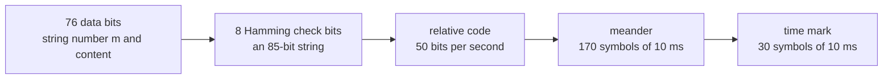
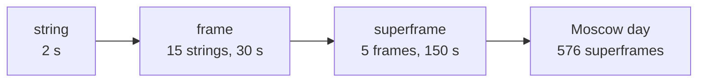
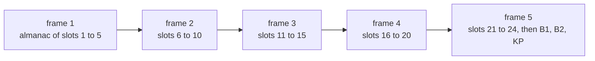
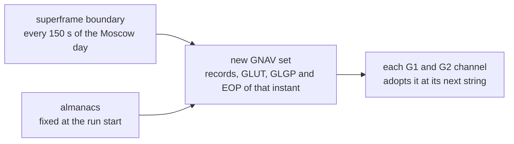

# GNAV (G1 and G2)

GNAV is the navigation message of the GLONASS FDMA signals G1 and G2.
Pharos builds every string that GLONASS ICD 5.1 defines. Both signals
carry the same strings.

## String structure

| Carrier | Component | String | Symbol | ICD 5.1 |
|---|---|---|---|---|
| G1, G2 | C/A code, data | 2 s: 1.7 s of data, then 0.3 s of time mark | 10 ms | 4.7 |

Bit 85, the first bit sent, is an idle zero. The check bits cover bits
9 to 84. The relative code restarts with every string. Each relative bit
becomes two symbols: the bit, then its complement. The time mark is the
fixed sequence 111110001101110101000010010110.

## Frame and superframe

| Unit | Holds | Lasts | ICD 5.1 |
|---|---|---|---|
| string | 85 bits and the time mark | 2 s | 4.7 |
| frame | strings 1 to 15 | 30 s | 4 |
| superframe | frames 1 to 5 | 150 s | 4.3.1 |

Strings count from zero at the start of the Moscow day. String i of the
day is string i mod 15 + 1 of frame i div 15. Frame j of the day is
frame j mod 5 + 1 of its superframe.

## Implementation matrix

Every frame carries all fifteen strings. Strings 1 to 5 repeat in each
frame. Strings 6 to 15 carry the almanac, and in frame 5 also the Earth
orientation.

| String | Content | Sent | Content from | ICD 5.1 |
|---|---|---|---|---|
| 1 | P1, t_k, x position, velocity and lunisolar acceleration | every frame | selected record; P1 from its plan binding, t_k from the frame | 4.4 |
| 2 | B_n, P2, t_b, y position, velocity and acceleration | every frame | record | 4.4 |
| 3 | P3, gamma_n, P, l_n, z position, velocity and acceleration | every frame | record, P3 from the frame | 4.4 |
| 4 | tau_n, Delta tau_n, E_n, P4, F_T, N_T, n, M | every frame | record | 4.4 |
| 5 | N^A, tau_c, N_4, tau_GPS, l_n | every frame | GLUT, GLGP, the almanac day | 4.5 |
| 6, 8, 10, 12, 14 | almanac, first half: C_n, M_n^A, n^A, tau_n^A, lambda_n^A, Delta i_n^A, epsilon_n^A | frames 1 to 4, frame 5 up to string 12 | almanac file or reduction | 4.5 |
| 7, 9, 11, 13, 15 | almanac, second half: omega_n^A, t_lambda_n^A, Delta T_n^A, Delta T'_n^A, H_n^A, l_n | frames 1 to 4, frame 5 up to string 13 | almanac file or reduction | 4.5 |
| 14 of frame 5 | B1, B2, KP | every superframe | EOP record, the run's leap seconds | 4 |
| 15 of frame 5 | l_n | every superframe | record | 4 |

The record is the RINEX FDMA record the slot flies ([data](data.md)).
The almanacs come from an AGL file or from reductions of the records.

## Schedule

| Frame | Strings 6, 7 | 8, 9 | 10, 11 | 12, 13 | 14, 15 | P3 |
|---|---|---|---|---|---|---|
| 1 | slot 1 | slot 2 | slot 3 | slot 4 | slot 5 | 1 |
| 2 | slot 6 | slot 7 | slot 8 | slot 9 | slot 10 | 1 |
| 3 | slot 11 | slot 12 | slot 13 | slot 14 | slot 15 | 1 |
| 4 | slot 16 | slot 17 | slot 18 | slot 19 | slot 20 | 1 |
| 5 | slot 21 | slot 22 | slot 23 | slot 24 | B1, B2, KP and l_n | 0 |

A slot without an almanac keeps its place. It sends the empty form of
the [departures](#where-pharos-departs-from-the-icd-default) table.

## GLONASS-M words

Pharos sends the GLONASS-M words of every string. Most come from the
record. Pharos derives the rest as the table says.

| Word | String | Sent |
|---|---|---|
| P1 | 1 | 01, 10, 11 for a t_b step of 30, 45, 60 min, else 00 |
| t_k | 1 | hours, minutes and 30 s of the frame's start in the Moscow day |
| B_n | 2 | 000 for a healthy record, 100 for an unhealthy one |
| P2 | 2 | 1 when t_b is odd |
| t_b | 2 | the record's epoch as a 15-minute index of the Moscow day |
| P3 | 3 | 1 in frames 1 to 4 (five almanacs), 0 in frame 5 (four) |
| P, P4, F_T, M | 3, 4 | the record's status flags and URAI |
| l_n | 3, 5, odd strings 7 to 15 | 1 when the transmitting satellite's record is unhealthy |
| Delta tau_n, E_n | 4 | the record's values |
| N_T | 4 | the day of t_b in the four-year interval |
| n | 4 | the slot number |
| N^A, N_4 | 5 | the almanac day and its four-year interval |
| tau_c | 5 | minus a0 of the GLUT record |
| tau_GPS | 5 | minus a0 of the GLGP record |
| M_n^A | almanac | the record's M, else 01 |
| H_n^A | almanac | the almanac's frequency number k, modulo 32 |
| B1 | 14 of frame 5 | UT1 - UTC at the start of the almanac day |
| B2 | 14 of frame 5 | the rate of UT1 - UTC there, in s per day |
| KP | 14 of frame 5 | 01 or 11 for a second added or removed at the quarter's end, else 00 |

pharos-pack computes P1 from the raw record sequence and stores it in the
plan binding. P1 carries the step in the record's first frame and 00 in
every later frame. KP follows the run's
leap-second schedule, which the simulated UTC also keeps.

The almanac day (N^A and N_4) is the first that applies:

| Order | Almanac day |
|---|---|
| 1 | the day of the first almanac that fits the almanac strings |
| 2 | the reference day of a RINEX 4 GLUT record |
| 3 | the Moscow day of the superframe |

## The message set

The set is built at the run start and again at every superframe
boundary. The plan switches GLONASS records only on those boundaries, so
one superframe carries one record.

| Need | For | Without it |
|---|---|---|
| a record for the slot | strings 1 to 4 | the slot is dark |
| GLUT and GLGP without rates, fitting string 5 (`scaleMisfit`) | string 5 | no GNAV, and pharos-pack refuses the scenario |
| an EOP record of any system, with B1 and B2 in range | string 14 of frame 5 | no GNAV, and pharos-pack refuses the scenario |

pharos-pack checks the set at the run start and at every superframe
boundary, for a scenario with `samples`. The time offsets and the EOP
record are described in [data](data.md).

## Where Pharos departs from the ICD default

| Case | What is sent |
|---|---|
| a slot without an almanac of the set's day, even string | C_n = 0, M_n^A = 00, n^A the slot, zeros |
| the same slot, odd string | zeros and l_n |
| string 15 of frame 5 | zeros and l_n |
| reserved bits | zeros |
| a record without Delta tau_n | Delta tau_n = 0, and G2 flies without a group delay |
| a record without status flags, or with M other than 01 | P = 00, P4 = 0, F_T = 0 |
| a record without status flags | M = 01 |
| an unhealthy record, by health word or l(n) | B_n = 100 and l_n = 1 together |
| an AGL almanac | C_n = 1 and M_n^A = 01 |
| a reduced almanac | Delta T'_n^A = 0, C_n from the record's almanac health flag, else its health |
| almanacs of several days | those of the first almanac's day, the other slots empty |
| t_k | from the frame index, never from the record's frame time |

## Limits and messages

| Case | Limit or message |
|---|---|
| B1 | at most 0.9 s in magnitude, else no string 14 and no GNAV |
| B2 | -4.5e-3 to 3.5e-3 s per day, else no string 14 and no GNAV |
| tau_c | below 1 s in magnitude: 32 bits of 2^-31 s |
| tau_GPS | below 2^-9 s in magnitude: 22 bits of 2^-30 s |
| no usable GLUT or GLGP (pharos-pack, `missing_field` on `ephemeris`) | GNAV at n s into the run: GLONASS navigation requires available, constant GLUT and GLGP time offsets |
| no usable EOP record (pharos-pack, `missing_field` on `ephemeris`) | GNAV at n s into the run: B-CNAV3 on B2b (a BDS record) and GNAV on G1/G2 (any system's) require an available EOP record in the navigation data |
| a word the set cannot encode (pharos-pack, `out_of_range` on `ephemeris`) | GNAV at n s into the run: the navigation data cannot be encoded into its message set (Error) |
| pharos-run creating a run without them | Cannot create the run: MissingTimeOffset (reason above), or MissingEarthOrientation |
| pharos-run reaching a superframe without them | Epoch n of m could not be generated: MissingTimeOffset or MissingEarthOrientation (reason) |
| the C API in either case | `PHAROS_RUN_E_NAV` |
