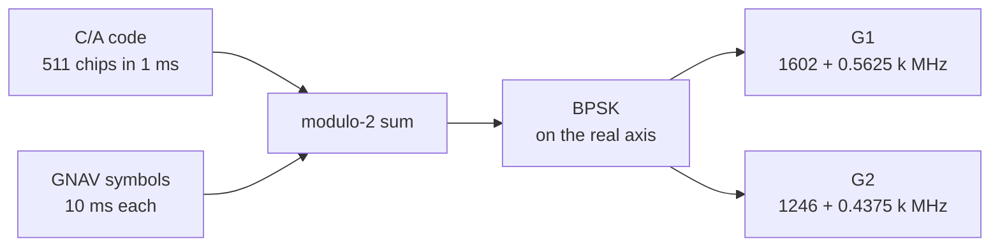

# GLONASS signals

GLONASS separates its satellites by frequency. Every satellite sends
the same code, on G1 and G2 carriers of its own. A carrier takes the
frequency number k of the record the satellite flies when its channel
starts.

## The signals

| | G1 | G2 |
|---|---|---|
| carrier | 1602 + 0.5625 k MHz | 1246 + 0.4375 k MHz |
| k | the frequency number of the selected record | the same k |
| code | C/A: a 511-chip sequence, the same for every slot | the same code |
| chip rate, period | 0.511 Mchip/s, 1 ms | the same |
| modulation | BPSK, one data component | the same |
| secondary code | none | none |
| symbols | 10 ms: meander data, then the time mark | the same |
| message | [GNAV](gnav.md), one string per 2 s | the same strings |
| RINEX observation code | 1C | 2C |
| group delay | none | Delta tau_n |
| ANTEX frequency | R01 | R02 |
| ICD 5.1 | 3, the code 3.3.2.2 | 3, the code 3.3.2.2 |

Only the C/A code is generated. Each carrier has one component, so no
power is split between components.

## Frequency plan

The scenario's band check covers k = -7 to +6. A record may carry any k
from -7 to 13. A channel whose carrier lies outside the sampled band is
not generated.

| k | G1 (MHz) | G2 (MHz) |
|---|---|---|
| -7 | 1598.0625 | 1242.9375 |
| -6 | 1598.6250 | 1243.3750 |
| -5 | 1599.1875 | 1243.8125 |
| -4 | 1599.7500 | 1244.2500 |
| -3 | 1600.3125 | 1244.6875 |
| -2 | 1600.8750 | 1245.1250 |
| -1 | 1601.4375 | 1245.5625 |
| 0 | 1602.0000 | 1246.0000 |
| 1 | 1602.5625 | 1246.4375 |
| 2 | 1603.1250 | 1246.8750 |
| 3 | 1603.6875 | 1247.3125 |
| 4 | 1604.2500 | 1247.7500 |
| 5 | 1604.8125 | 1248.1875 |
| 6 | 1605.3750 | 1248.6250 |

## The code

| Item | Value |
|---|---|
| generator | a 9-stage shift register, all ones at the start |
| feedback | stages 5 and 9 |
| output | stage 7 |
| length | 511 chips, one period per millisecond |
| ICD 5.1 | 3.3.2.2 |

## The symbols

A GNAV string lasts 2 s. Its 85 bits take 1.7 s and the time mark the
last 0.3 s. Each data bit lasts 20 ms and is sent as two 10 ms
symbols: the bit, then its complement. Each symbol spans ten code
periods. The string's content is on the [GNAV](gnav.md) page.

| Part | Symbols | Duration |
|---|---|---|
| data, relative code with the meander | 170 | 1.7 s |
| time mark | 30 | 0.3 s |
| string | 200 | 2 s |

## Observation codes

| Signal | Code | Observables | Phase shift record |
|---|---|---|---|
| G1 | 1C | C1C, L1C, D1C, S1C | R L1C, no correction |
| G2 | 2C | C2C, L2C, D2C, S2C | R L2C, no correction |

The observation file also carries two GLONASS header records.
GLONASS SLOT / FRQ # lists each slot of the navigation data. Its k is
that of the slot's first record read. GLONASS COD/PHS/BIS gives zero
for C1C, C1P, C2C and C2P. The rest of the file is described in
[observations](../../guide/observations.md).

## Group delays

The broadcast clock refers to G1. G2 leaves Delta tau_n later, as the
record gives it and string 4 of GNAV carries it.

| Code | Delay flown | A record without Delta tau_n |
|---|---|---|
| 1C (G1) | none | none |
| 2C (G2) | Delta tau_n | none, and string 4 carries zero |
| both, under a `precise` product | the broadcast delay less the G1G2 offset D | the satellite is dark while the record flies |

The offset D is the ionosphere-free combination of the two delays at
k = 0. With G1 at zero, D = -f2^2 Delta tau_n / (f1^2 - f2^2). The
product's GLONASS clocks refer to that pair, `G1G2`, the only GLONASS
value of `clockReference`.

## Phase relations

| Item | Relation |
|---|---|
| component | the C/A-coded data on the positive real axis of its carrier |
| carrier phase | one per band and satellite, delayed as the band's own code |
| G1 carrier | no group delay |
| G2 carrier | Delta tau_n, as its code |
| ionosphere | scaled per channel by (1575.42 MHz / f)^2 at the channel's own f |

## Limits and messages

| Case | Limit or message |
|---|---|
| in band | inside when twice the carrier's offset from the centre is at most the sample rate |
| no channel inside (`band_excluded` on `signals`) | G1 at 1598.0625-1605.375 MHz (k -7..6) lies outside the sampled band and will not be generated |
| some channels outside (`band_excluded` on `signals`) | G1 channels k a..b lie outside the sampled band and will not be generated (k c..d inside) |
| frequency number of a record | from -7 to 13, else the record is skipped |
| a record without Delta tau_n under `precise` (`no_record` on `ephemeris`) | Rnn: a record it flies carries no G2 group delay, which the G1G2 clock of the precise product refers to: the satellite is dark while that record is selected |
