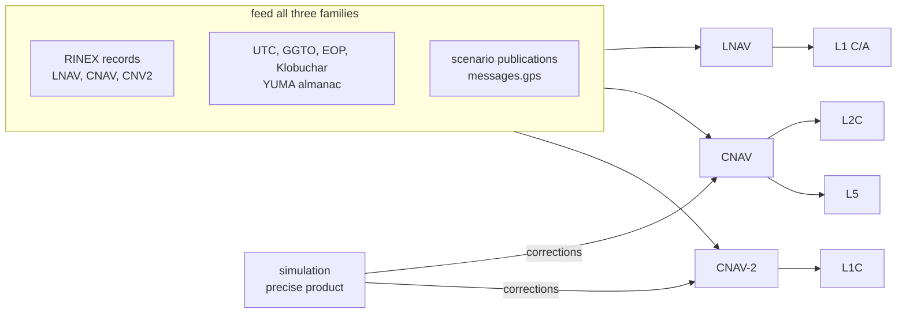

# GPS

Pharos generates four GPS signals and the three message families they carry.
The navigation files give orbits, clocks, health, time offsets and almanacs.
The scenario publishes what only an operator can declare.
The simulation computes the differential corrections.
Each satellite's enabled signals choose one orbit and clock reference for all three message families.
The [navigation data](data.md#records) page gives the selection order and format limits.

## Signals

| Signal | `signals` word | Carrier | Message | Blocks |
|---|---|---|---|---|
| L1 C/A | `L1CA` | 1575.42 MHz | [LNAV](lnav.md) | IIR, IIR-M, IIF, III |
| L1C | `L1C` | 1575.42 MHz | [CNAV-2](cnav2.md) | III |
| L2C | `L2C` | 1227.60 MHz | [CNAV](cnav.md) | IIR-M, IIF, III |
| L5 | `L5` | 1176.45 MHz | [CNAV](cnav.md) | IIF, III |

Codes, modulation and observation codes are on the [signals](signals.md) page.

## Satellites

GPS has PRNs 1 to 32. Each PRN transmits the signals of its satellite's block.
The blocks follow the constellation status of the U.S. Coast Guard Navigation Center from 2025-01-01.
A run takes the allocation of its start and keeps it to the end.

| Block | Configuration code | PRNs on 2025-01-01 |
|---|---|---|
| III | 100 | 1, 4, 11, 14, 18, 23, 28 |
| IIF | 011 | 3, 6, 8, 9, 10, 24, 25, 26, 27, 30, 32 |
| IIR-M | 010 | 5, 7, 12, 15, 17, 29, 31 |
| IIR | 001 | 2, 13, 16, 19, 20, 21, 22 |
| no satellite | 000 | none |

| PRN | From (UTC) | Block |
|---|---|---|
| 21 | 2025-01-27 22:15 | no satellite |
| 21 | 2025-05-30 00:00 | III |
| 20 | 2025-08-04 22:00 | no satellite |
| 20 | 2025-09-30 00:00 | IIR |
| 20 | 2026-01-08 22:00 | no satellite |
| 20 | 2026-01-28 00:00 | III |
| 13 | 2026-04-24 22:00 | III |

A PRN without a satellite transmits nothing.
The configuration codes go into LNAV subframe 4 page 25 and CNAV-2 page 7, unless the scenario publishes others.

## Standards

| Document | Issue | Covers | Pages |
|---|---|---|---|
| IS-GPS-200 | N, 2022-08-01, with IRN-003 (2024-01-19) | L1 C/A and L2C codes, LNAV, CNAV, health | [signals](signals.md), [LNAV](lnav.md), [CNAV](cnav.md) |
| IS-GPS-200 IRN-004 | 2026-06-16 | the ISM CRC only | [CNAV](cnav.md), [CNAV-2](cnav2.md) |
| IS-GPS-705 | J, 2022-08-01, with IRN-003 | L5 codes, L5 CNAV | [signals](signals.md), [CNAV](cnav.md) |
| IS-GPS-800 | J, 2022-08-01, with IRN-003 | L1C codes, TMBOC, CNAV-2 | [signals](signals.md), [CNAV-2](cnav2.md) |
| GPS constellation status and NANUs, U.S. Coast Guard Navigation Center | status of 2026-09-19, NANUs of 2024-12 to 2026-09-19 | the block of each PRN | this page |

The allocation changes come from NANUs DECOM 2025010, 2025056, 2026006 and 2026038, GENERAL 2025067 and LAUNCH 2025043, 2026016 and 2026039.

IS-GPS-800J 3.5.4.7 and IS-GPS-200N 30.3.3.10.1.12 leave the ISM CRC to another document.
Pharos computes it as IRN-004 30.3.3.10.1.2.2.13 states, and uses no other part of IRN-004.

| ISM CRC | Value |
|---|---|
| polynomial | 0x814141AB, 32 bits |
| start | a zero remainder, most significant bit first |
| CNAV type 40 | over bits 39 to 244 |
| CNAV-2 page 8 | over bits 15 to 218 |

## Time

Pharos stores every instant as GPS time.
In a broadcast run a GPS satellite's clock is its record's polynomial, with no system offset.
The messages carry UTC, the offsets to other systems and the Earth orientation.

| Content | LNAV | CNAV | CNAV-2 | Record |
|---|---|---|---|---|
| UTC and leap seconds | subframe 4 page 18, A2 must be 0 | type 33 | page 1 | `GPUT`; the run's leap seconds |
| GPS to Galileo offset | not carried | type 35 | page 2 | `GAGP` |
| GPS to GLONASS offset | not carried | type 35 | page 2 | `GLGP` |
| Earth orientation | not carried | type 32 | page 2 | GPS `EOP`, `CNVX` |

The rules for each record are on the [navigation data](data.md) page.
Leap seconds and time scales in general are in the [navigation data guide](../../guide/navigation-data.md).

## Attitude

The phase-centre offsets turn with the satellite's yaw.
The ANTEX antenna type chooses the yaw law.
The mechanism is on the [antennas](../../models/antennas.md) page.
GPS blocks yaw-steer and slew at a fixed rate through the noon and midnight turns.

| ANTEX type (prefix) | Law | Yaw rate | Source |
|---|---|---|---|
| `BLOCK III` | rate-limited | 0.11 degrees per second, the IIF rate | no operator publication: Pharos's value |
| `BLOCK IIR` | rate-limited | 0.2 degrees per second | no operator publication: Pharos's value |
| `BLOCK IIF` | rate-limited | 0.11 degrees per second | no operator publication: Pharos's value |
| `BLOCK II` (II, IIA) | rate-limited | 0.1211 degrees per second | no operator publication: Pharos's value |
| any other type | nominal, with a warning | none | the nominal yaw-steering law |

## Not modelled

| What | Why |
|---|---|
| the yaw bias a satellite takes into eclipse | a dated quantity of each satellite, not of its block |
| a yaw rate of its own for GPS III | it flies the IIF rate |
| the P(Y) codes | not generated: the L2 real axis stays empty, L2C lies in quadrature to it |
| NMCT corrections | LNAV page 13 declares none available |
| the Civil ISM fields of IRN-004 | only its CRC is used |
| monitoring for the ISM and the UDRA indices | they are the scenario's declarations |

## Pages

| Page | Content |
|---|---|
| [Signals](signals.md) | codes, modulation, phases, observation codes, group delays |
| [LNAV](lnav.md) | the L1 C/A message: subframes and pages |
| [CNAV](cnav.md) | the L2C and L5 message types and their schedule |
| [CNAV-2](cnav2.md) | the L1C message: subframes, pages and coding |
| [Navigation data](data.md) | records, health, time offsets, almanacs, `messages.gps`, corrections |

## Limits and messages

| Condition | Level and key | Message |
|---|---|---|
| run start before 2025-01-01, a GPS signal listed | warning `out_of_range` on `time` | `the GPS satellite allocation starts on 2025-01-01; an earlier start takes its first state` |
| a listed signal no satellite transmits at the start | warning `no_effect` on `signals` | `L1C is transmitted by no satellite at the start` |
