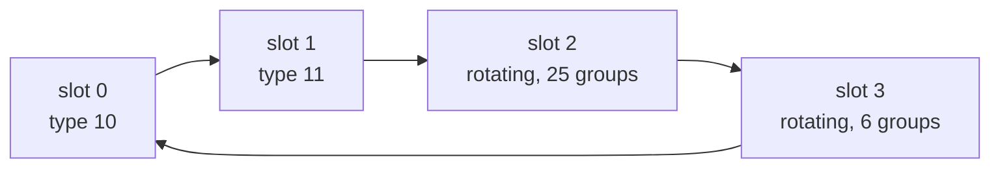

# CNAV (L2C and L5)

CNAV is the message of L2C and L5. Pharos builds every message type the
two ICDs define and sends them in groups of four: two ephemeris
messages, then two slots whose content rotates.

## Message structure

| Carrier | Component | Message period | Symbol rate | ICD |
|---|---|---|---|---|
| L5 | I5 | 6 s | 100 sps | IS-GPS-705J 20.3 |
| L2C | CM | 12 s | 50 sps | IS-GPS-200N 30.3 |

The convolutional encoder runs on from one message into the next.

## Implementation matrix

| Type | Content | Sent when | Content from | IS-GPS-200N |
|---|---|---|---|---|
| 10 | ephemeris 1, health, URA_ED, ISF, L2C phasing | always | navigation record | 30.3.3.1 |
| 11 | ephemeris 2 | always | navigation record | 30.3.3.1 |
| 30 | clock, T_GD and ISCs, Klobuchar, WN_OP | slot 3 of every sixth group; any slot without its content | record, ionosphere set | 30.3.3.2, 30.3.3.3 |
| 31 | clock, 4 reduced almanacs | L5, an almanac exists | almanac file or reduced ephemerides | 30.3.3.4 |
| 12 | 7 reduced almanacs | L2C, an almanac exists | almanac file or reduced ephemerides | 30.3.3.4 |
| 37 | clock, 1 midi almanac | an almanac exists | almanac file or reduced ephemerides | 30.3.3.4 |
| 32 | clock, EOP | a usable EOP record | RINEX EOP | 30.3.3.5 |
| 33 | clock, UTC | usable UTC parameters | RINEX UTC (GPUT) | 30.3.3.6 |
| 35 | clock, GPS/GNSS time offset | a usable GGTO (up to two) | RINEX time offsets | 30.3.3.8 |
| 34 | clock, 1 clock and ephemeris correction | L5, `precise` and a `differential` publication | the simulation | 30.3.3.7 |
| 13 | 6 clock corrections | L2C, as type 34 | the simulation | 30.3.3.7 |
| 14 | 2 ephemeris corrections | L2C, as type 34 | the simulation | 30.3.3.7 |
| 36 | clock, 18 text characters | L5, a `text` publication | scenario | 30.3.3.9 |
| 15 | 29 text characters | L2C, a `text` publication | scenario | 30.3.3.9 |
| 40 | integrity support message | an `ism` publication, from its reference time | scenario | 30.3.3.10 |
| 0 | default message | the satellite has no integrity status, or its record does not fit | none | |

The publications are the scenario's `messages.gps` block ([data](data.md)).
Every ephemeris and clock field comes from the satellite's selected reference, converted to the CNAV format as needed.
CNAV retains a separate toc when both reference epochs already fit its 300 s grid; a grid conversion re-expresses the clock at the projected toe.
The common delay table supplies T_GD and the ISCs; resolved CNAV attributes supply health and flags.
The corrections are the product's orbit and clock less the selected raw LNAV reference's
([data](data.md)).

## Schedule

A group of four messages lasts 24 s on L5 and 48 s on L2C.

| Slot 2, group in the 25-group cycle | L5 | L2C | Fallback |
|---|---|---|---|
| 0, 6, 12, 18, 24 | 40 | 40 | 30 |
| 1, 7, 13, 19 | 34 | 13 at group 1, 14 at the others | the UTC slot: 33, else 30 |
| 2, 4, 8, 10, 14 | 31 | 12 | 30 |
| 16, 20, 22 | 31 | 15, else 12 | 30 |
| 3, 5, 9, 11, 15, 17, 21, 23 | 37 | 37 | 30 |

| Slot 3, group in the 6-group cycle | L5 | L2C | Fallback |
|---|---|---|---|
| 0 | 30 | 30 | |
| 1 | 33 | 33 | 30 |
| 2 | 35, first offset | 35, first offset | 30 |
| 3 | 36 | 30 | 30 |
| 4 | 35, second offset | 35, second offset | 33, else 30 |
| 5 | 32 | 32 | 33, else 30 |

A superframe is 100 messages. The almanac messages step through the
satellites that have an almanac; the correction messages step through
the satellites the product corrects; the text messages step through the
published text.

## Where Pharos departs from the ICD default

| Case | What is sent |
|---|---|
| no integrity status: the resolved CNAV attributes lack flags and no `integrity` publication is in force | type 0 in every slot: the header with the alert flag set, alternating ones and zeros, the CRC |
| a record CNAV cannot carry: a field out of range, or no L1, L2 and L5 health (`unfit_record`) | type 0 in every slot while the record is selected |
| an LNAV record in place of a CNAV record | converted onto the 300 s grid; accuracy, health and ISCs as the [data](data.md) page gives |
| a CNV2 reference without resolved CNAV attributes | type 0 in every slot: it states no L1, L2 and L5 health |
| integrity flags | resolved CNAV flags win; otherwise the publication's ISF and alert list; L2C phasing is 0 without a resolved flag |
| no correction for the slot | the slot falls back as the tables show |
| fewer corrections than packets in types 13 and 14 | a packet with PRN 255, then alternating bits |
| fewer almanacs than packets in types 31 and 12 | a packet with PRN 0, then alternating bits |
| type 40 | 93 alternating bits between the ISM and its CRC |
| optional content missing | the slot falls back as the tables show; nothing is invented |
