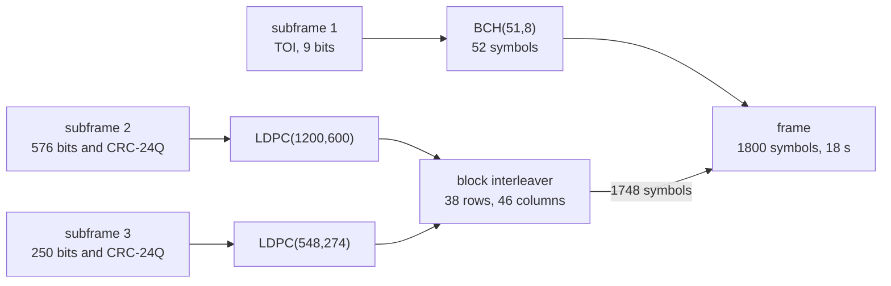

# CNAV-2 (L1C)

CNAV-2 is the message of the L1C data component.
Each 18 s frame holds three subframes.
They carry the time of interval, the clock and ephemeris, and one page of subframe 3.
Pharos builds all eight subframe 3 pages that IS-GPS-800 defines.

## Frame structure

| Carrier | Component | Frame period | Symbol rate | Coding | ICD |
|---|---|---|---|---|---|
| L1 | L1C data | 18 s | 100 sps | BCH(51,8), LDPC, block interleaver | IS-GPS-800J 3.2.3, 3.5 |

The TOI's top bit goes out as the first symbol.
Its eight low bits are BCH(51,8) coded, and the 51 symbols are inverted when the top bit is one.
The interleaver writes the 1748 LDPC symbols in rows of 46 and reads them in columns of 38.
The LDPC generators are embedded data files with recorded SHA-256 digests (IS-GPS-800J 3.2.3.2).

## Implementation matrix

| Subframe, page | Content | Sent when | Content from | IS-GPS-800J |
|---|---|---|---|---|
| 1 | TOI: the next frame's count in its two-hour interval | every frame | frame time | 3.5 |
| 2 | WN, ITOW, top, L1C health, URA_ED, toe, ephemeris, URA_NED, clock, T_GD, ISC_L1CP, ISC_L1CD, ISF, WN_OP | every frame | navigation record | 3.5.3 |
| 3, page 1 | UTC, Klobuchar set, ISC_L1CA, ISC_L2C, ISC_L5I5, ISC_L5Q5 | frame index mod 4 = 0; any slot whose page is missing | `GPUT`, ionosphere set, record | 3.5.4.1 |
| 3, page 2 | GGTO and EOP | in the rotation, with an EOP block | `GAGP` or `GLGP`, GPS `EOP` | 3.5.4.2 |
| 3, page 3 | WNa, toa, 6 reduced almanacs | mod 4 = 2, an almanac exists | almanac file or reduced ephemerides | 3.5.4 |
| 3, page 4 | WNa, toa, 1 midi almanac | mod 4 = 3, an almanac exists | almanac file or reduced ephemerides | 3.5.4 |
| 3, page 5 | 1 clock and ephemeris correction | in the rotation: `precise`, a `differential` publication | the simulation | 3.5.4.4 |
| 3, page 6 | text page number, 29 characters | in the rotation: a `text` publication | scenario | 3.5.4.5 |
| 3, page 7 | configuration codes of SV 1 to 63 | in the rotation, always | `configuration`, else the allocation | 3.5.4.6 |
| 3, page 8 | integrity support message | in the rotation: an `ism` publication, from its reference time | scenario | 3.5.4.7 |

The publications are the scenario's `messages.gps` block ([navigation data](data.md)).
Every ephemeris and clock field comes from the satellite's selected reference, converted to the CNAV-2 format as needed.
The common delay table supplies T_GD and the ISCs; resolved CNV2 attributes supply health and flags.
The corrections are the product's orbit and clock less the selected raw LNAV reference's ([navigation data](data.md)).

## Schedule

The frame index counts 18 s frames of GPS time.
A group of four frames lasts 72 s.
Group g is the frame index divided by 4.

| Slot | Page | Which one | Fallback |
|---|---|---|---|
| 0 | 1 | | |
| 1 | the optional pages in turn | list entry g mod n | none: page 7 is always listed |
| 2 | 3 | the next six satellites with an almanac | page 1 |
| 3 | 4 | the next satellite with an almanac | page 1 |

The optional pages form a list in this order.
With n pages listed, slot 1 of group g sends entry g mod n.
It is that entry's k-th turn, where k = g div n.

| Optional page | Listed when | k selects |
|---|---|---|
| 2 | an EOP block exists | the GGTO, alternating when there are two |
| 5 | a `differential` publication, and the product corrects another satellite | the corrected satellite, offset by the PRN |
| 6 | a `text` publication | the text page |
| 7 | always | |
| 8 | an `ism` publication, at or after its reference time | |

## TOI

| Case | TOI |
|---|---|
| no integrity status: no resolved CNV2 flag and no `integrity` publication | 511 |
| a record CNAV-2 cannot carry (`unfit_record`) | 511 |
| subframe 3 is page 1 and there is no UTC block | 511 |
| otherwise | the next frame's count, 0 to 399 |

## Where Pharos departs from the ICD default

| Case | What is sent |
|---|---|
| no integrity status, or a record CNAV-2 cannot carry | subframe 2 as 576 alternating bits from a one, then the CRC |
| page 1 without a UTC block, or with such a record | all 250 bits alternating from a one, then the CRC |
| integrity status flag | the resolved CNV2 flag wins; otherwise the publication's `isf` |
| page 2 without a GGTO | the GGTO fields as zeros |
| page 3 with fewer than six almanacs | a packet with PRN 0, then alternating bits to the packets' end |
| page 7 without a publication | the codes of the allocation at the run start |
| page 8 | 91 alternating bits between the ISM and its CRC |
| an LNAV or CNAV record in place of a CNV2 record | converted, see below |
| optional content missing | the slot falls back as the tables show; nothing is invented |

A converted record is re-expressed on the 300 s grid of the CNAV-2 fields.
Its clock polynomial is expressed at the projected toe, the clock reference transmitted by CNAV-2.
Its accuracy indices and ISCs follow the rules of the [navigation data](data.md) page.
The resolved CNV2 attributes supply L1C health when present.
Otherwise the conversion below must state it, or the reference is sent as unavailable (`unfit_record`).

| Record | L1C health bit |
|---|---|
| LNAV | from the health code; codes 11110 and 11111 state none |
| CNAV | set when its L1 bit is set; a clear L1 bit states none |
