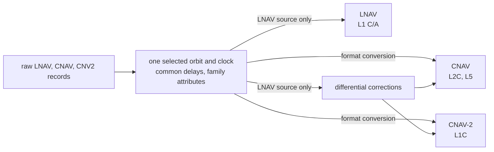
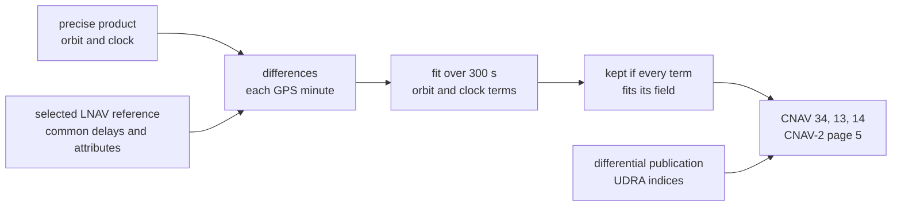

# GPS navigation data

This page lists the GPS records Pharos reads and what each message family takes from them.
It gives the rules for health, accuracy, time offsets, the ionosphere set and almanacs.
It ends with the `messages.gps` publications and the corrections the simulation computes.
Reading, checking and selecting records in general is in the [navigation data guide](../../guide/navigation-data.md).



## Records

| Record | File | What it gives |
|---|---|---|
| `G` record | RINEX 3.0x | an LNAV record |
| `> EPH` of a `G` satellite, `LNAV` | RINEX 4.0x | an LNAV record |
| `> EPH` of a `G` satellite, `CNAV` | RINEX 4.0x | a CNAV record |
| `> EPH` of a `G` satellite, `CNV2` | RINEX 4.0x | a CNV2 record |
| `IONOSPHERIC CORR`, `GPSA` and `GPSB` | RINEX header | the Klobuchar set |
| `> ION` of a `G` satellite | RINEX 4.0x | the Klobuchar set, with its transmission time |
| `TIME SYSTEM CORR` or `> STO`, `GPUT` | header, RINEX 4.0x | UTC |
| `TIME SYSTEM CORR` or `> STO`, `GAGP` (header `GPGA` too) | header, RINEX 4.0x | the GPS to Galileo offset |
| `TIME SYSTEM CORR` or `> STO`, `GLGP` | header, RINEX 4.0x | the GPS to GLONASS offset |
| `> EOP` of a `G` satellite, `CNVX` | RINEX 4.0x | the Earth orientation |
| `LEAP SECONDS` | RINEX header | the leap schedule UTC needs |
| YUMA almanac | an `almanac` file | almanacs |

Each satellite has one selected reference for every plan interval.
The enabled signals are the scenario's signals that its block transmits at the run start.
Their message families are tried first, in the order LNAV, CNAV, CNV2; the remaining families follow in that order.

| Enabled signals | Reference order |
|---|---|
| L1 C/A present | LNAV first, then the other enabled families, then the remaining families |
| L2C or L5, with L1C but without L1 C/A | CNAV, CNV2, LNAV |
| L2C or L5 only | CNAV, LNAV, CNV2 |
| L1C only | CNV2, LNAV, CNAV |
| none, for a correction target | LNAV, CNAV, CNV2 |

Selection applies the [time and health checks](../../guide/navigation-data.md).
When signals are enabled, the reference must serve at least one of them.
Every encoder takes the same selected orbit and clock.
LNAV requires an LNAV reference; CNAV and CNAV-2 convert that reference to their fields as needed.
An encoder never substitutes another family's orbit or clock.
Its delays come from one common table for the interval; health, flags and other family attributes are resolved separately.
The raw records stay unchanged, including their source and clock reference.
A record's transmission time is the first value of its last line.
Without it, the transmission starts 2 h before toe for LNAV and 1.5 h for CNAV and CNV2.

## Record fields

| Field | LNAV record | CNAV record | CNV2 record |
|---|---|---|---|
| toe | as read | the record's epoch, toc | the record's epoch, toc |
| top, A-dot, delta n dot | none | as read | as read |
| accuracy | URA in metres | URA_ED, URA_NED0, URA_NED1, URA_NED2 | as CNAV |
| health | 6-bit health word | L1, L2 and L5 bits | L1C bit |
| group delays | T_GD | T_GD and four ISCs | T_GD and six ISCs |
| flags | none | ISF, L2C phasing, alert; optional | ISF; optional |
| others | L2 codes, L2 P data flag, fit interval | | |

A fit interval above 4 h sets the LNAV fit interval flag.

## Delays and family attributes

The common delay table starts with the selected record's terms.
Each missing term takes a donor of the same satellite whose toe is within 7200 s of the interval start and whose adoption time precedes the next plan boundary.
Adoption uses the transmission time, or the lead before toe given above when it is absent.
Among those donors, the nearest toe to the selected record wins, then the latest adoption time, then a stable order by raw record contents.
The selected record's own terms always win.
A term still missing uses the signal's [fallback](signals.md#observation-codes-and-group-delays), where one exists.

The selected record supplies its own family's attributes.
Each other family takes the latest adopted eligible donor, including declarations that a signal is dead; equal adoption times use the same stable order.
Accuracy describes the selected orbit and clock: CNAV and CNAV-2 use its URA, converted from LNAV when needed.
Borrowing a health or integrity flag does not borrow the donor's orbit, clock or source identity.
Delay changes are blended even when the selected record stays the same; they do not restart the orbit blend.

## Record checks

| Check | LNAV | CNAV, CNV2 |
|---|---|---|
| every field fits its message field | subframes 1 to 3 | the CNAV and CNAV-2 fields |
| IODE equals the low 8 bits of IODC | yes | |
| toe, toc and top on the grid | 16 s | 300 s |
| toc and top within half a week of toe | yes | yes |
| each group delay below 2^-23 s | yes | yes |
| orbit | eccentricity 0 to 0.5, semi-major axis 10000 to 50000 km | the same |
| may be blank | URA, T_GD, transmission time | URA_ED, URA_NED0, T_GD, ISCs, flags, transmission time |

Any other blank field skips the record.
A record that fails is skipped with a warning.
A time offset, EOP record or ionosphere set outside its broadcast fields is skipped the same way.
Missing delay terms are resolved per plan interval; loading preserves the raw record with its missing terms.

## Health and flags

Only an LNAV health code takes a signal off the air.
Every other declaration is broadcast while the signal stays on.
Each signal uses its family's resolved declaration, falling back to the selected record's declaration when that family has none.

The table reads the five signal bits of the LNAV health word (IS-GPS-200N Table 20-VIII).
The top bit, the data summary, takes nothing off the air.
The last two columns are the conversion defaults when no CNAV or CNV2 declaration is resolved.

| Code | Meaning | Off the air | CNAV L1 L2 L5 | CNAV-2 L1C |
|---|---|---|---|---|
| 00000 | all signals OK | none | 000 | 0 |
| 00001 | all signals weak | none | 000 | 1 |
| 00010 | all signals dead | all; the record is not selected | 111 | 1 |
| 00011 | all signals without data | none | 000 | 1 |
| 00100 to 00110 | L1 P weak, dead, without data | none | 000 | 0 |
| 00111 to 01001 | L2 P weak, dead, without data | none | 000 | 0 |
| 01010, 01100 | L1C weak, without data | none | 000 | 1 |
| 01011 | L1C dead | L1C | 000 | 1 |
| 01101, 01111 | L2C weak, without data | none | 000 | 0 |
| 01110 | L2C dead | L2C | 000 | 0 |
| 10000 to 10010 | L1 and L2 P weak, dead, without data | none | 000 | 0 |
| 10011, 10101 | L1 and L2C weak, without data | none | 000 | 1 |
| 10100 | L1 and L2C dead | L1C, L2C | 000 | 1 |
| 10110, 11000 | L1 weak, without data | none | 000 | 1 |
| 10111 | L1 dead | L1 C/A, L1C | 100 | 1 |
| 11001, 11011 | L2 weak, without data | none | 000 | 0 |
| 11010 | L2 dead | L2C | 010 | 0 |
| 11100 | SV temporarily out | all; the record is not selected | 111 | 1 |
| 11101 | SV will be temporarily out | none | 000 | 1 |
| 11110 | signals deformed, URA valid | none | 000 | none stated |
| 11111 | more than one combination | none | none stated | none stated |

An LNAV reference with code 00010 or 11100 is not selected.
Selection tries the remaining families in the enabled-signal order above.
A family that gets no stated health sends the record as unavailable (`unfit_record`).

| Declaration | Effect |
|---|---|
| resolved CNAV L1, L2, L5 bits | broadcast in type 10; every signal stays on |
| resolved CNV2 L1C bit | broadcast in subframe 2; L1C stays on |
| resolved CNAV flag word | ISF, L2C phasing and alert; they win over the publication |
| resolved CNV2 flag word | ISF; it wins over the publication |
| no record flag | the publication's `isf` and `alert`; L2C phasing 0 |
| no flag and no publication | LNAV sends ISF and alert 0; CNAV sends type 0; CNAV-2 the default subframe 2 |

## Accuracy indices

An LNAV record gives the URA in metres.
Pharos sends the index of the first bound it does not exceed.
The bounds of indices 0 to 14 are in metres.
They are 2.4, 3.4, 4.85, 6.85, 9.65, 13.65, 24, 48, 96, 192, 384, 768, 1536, 3072 and 6144.

| Index | From an LNAV record | From a CNAV or CNV2 record |
|---|---|---|
| URA (LNAV) | the index; 15 beyond 6144 m or blank | not sent |
| URA_ED, URA_NED0 | the URA index | as read, clamped to -16 to 15; blank gives -16 |
| URA_NED1, URA_NED2 | 7 | as read, clamped to 0 to 7 |

These indices follow the selected physical reference, including when health and flags come from another family.

## Time offsets and UTC

Each message set is built at the run start and rebuilt every GPS minute.
Of each kind, it takes the record transmitted last at or before that minute.
A header line counts only when no transmitted record does.

| Content | Records | Conditions |
|---|---|---|
| UTC | `GPUT` of a `G` block or of the header | a reference epoch; the run's leap seconds ([leap seconds](../../guide/navigation-data.md#leap-seconds)); fields fit |
| UTC in LNAV page 18 | the same | also A2 = 0 and tot on the 4096 s grid |
| UTC in CNAV and CNAV-2 | the same | also tot on the 16 s grid |
| GPS to Galileo, GNSS ID 1 | `GAGP` of a `G` block or the header, else of an `E` block | a reference on the 16 s grid, or no rate terms; fields fit |
| GPS to GLONASS, GNSS ID 2 | `GLGP` of a `G` block or the header, else of an `R` block | the same |
| EOP | `> EOP` of a `G` block, `CNVX` | a UTC block with the same reference epoch; no acceleration terms; fields fit |

A GGTO without a reference on the grid needs zero rate terms.
Its epoch is then the start of the current GPS week.
Both offsets go out with the sign of the RINEX value reversed.
An EOP dUT1 below 1 s in size is UT1-UTC, and Pharos turns it into UT1-GPS.
That needs the UTC parameters with A2 = 0.
A dUT1 below -1 s is taken as UT1-GPS already.

## Ionosphere set

GPS messages carry one Klobuchar set: LNAV page 18, CNAV type 30 and CNAV-2 page 1.
When the applied GPS delay model is GPS Klobuchar, including under `auto`, the same set drives it ([ionosphere](../../models/ionosphere.md)).

| Order | Source |
|---|---|
| 1 | the scenario's [`ionosphere`](../../guide/scenarios.md#ionosphere) block, with model `klobuchar` and its `parameters` |
| 2 | the latest RINEX 4 GPS `> ION` record transmitted at or before the run start |
| 3 | the first RINEX header `GPSA` and `GPSB` pair that fits the broadcast fields |
| 4 | the built-in set below |

| Built-in | Values |
|---|---|
| alpha0 to alpha3 | 0.1118e-07, 0.2235e-07, -0.1192e-06, -0.1192e-06 |
| beta0 to beta3 | 0.1167e+06, 0.1147e+06, -0.1311e+06, -0.1049e+06 |

## Almanacs

A YUMA file is a list of blocks, one per satellite.
Labels match by their start, ignoring case.

| Line | Content |
|---|---|
| a line starting with `*` | opens a block |
| `ID` | the PRN, 1 to 32 |
| `Health` | the 8-bit health word |
| `Eccentricity` | e |
| `Time of Applicability` | toa, seconds of the week |
| `Orbital Inclination` | i, radians |
| `Rate of Right Ascen` | Omega dot, radians per second |
| `SQRT(A)` | sqrt A |
| `Right Ascen at Week` | Omega0, radians |
| `Argument of Perigee` | omega, radians |
| `Mean Anom` | M0, radians |
| `Af0`, `Af1` | clock terms |
| `week` | week modulo 1024, resolved nearest the run start |

A block missing a value is skipped and counted.
The newest almanac of each satellite is kept.
An almanac outside the LNAV almanac page fields is skipped with a warning.

Satellites without a file almanac get one reduced from an ephemeris.
The reduction uses the satellite's nearest record, preferring a healthy one.
It lands on the common toa: the first file almanac's, else the run start rounded to the 4096 s grid.

| Rule | LNAV | CNAV, CNAV-2 |
|---|---|---|
| toa | whole milliseconds on the 4096 s grid | the same |
| one toa | the first almanac entered sets it | the same |
| fields | the almanac page fields | the reduced and midi packet fields |
| eccentricity | within its field | 0 to 0.03 |
| rate of right ascension | within its field | -1.19e-7 to 0 semicircles per second |

| Reduced from | 8-bit health word |
|---|---|
| an LNAV record | its five signal bits; the three data bits all set when its summary bit is |
| a CNAV record, L1 bad, L2 good | 10111 |
| a CNAV record, L2 bad, L1 good | 11010 |
| a CNAV record, L1 and L2 bad, L5 good | 11111, data bits set |
| a CNAV record, all three bad | 00010, data bits set |
| a CNAV record, L5 alone or none bad | 0 |
| a CNV2 record | 01011 when L1C is bad, else 0 |

The reduced and midi packets carry three bits: L1, L2 and L5.
An almanac reduced from a CNAV record carries that record's bits.
Otherwise the bits come from the five signal bits of the health word.

| Signal bits | L1 L2 L5 |
|---|---|
| 00010, 11100, 11111 | 111 |
| 10111 | 100 |
| 11010 | 010 |
| any other | 000 |

## Scenario publications

The scenario's `messages.gps` is an array of publications shared by LNAV, CNAV and CNAV-2.
Each is in force over its interval and is the whole content for it.
The general rules are in the [scenarios guide](../../guide/scenarios.md#messages).

```json
"messages": {
  "gps": [
    {
      "from": { "type": "GPS", "week": 2432, "second": 403200 },
      "until": { "type": "GPS", "week": 2432, "second": 406800 },
      "integrity": { "isf": 0, "alert": [5, 12] },
      "text": "PHAROS EXAMPLE",
      "differential": { "udra": -2, "udraRate": 0 },
      "ism": {
        "reference": { "type": "GPS", "week": 2432, "second": 403200 },
        "constellation": "gps",
        "service": "horizontal",
        "satellites": [1, 2, 3],
        "tCorrel": 3, "bNom": 4, "gammaNom": 5, "rSat": 6, "pConst": 7, "mfd": 8
      }
    }
  ]
}
```

| Key | Value | Rule |
|---|---|---|
| `from`, `until` | a time object | required; `from` before `until`; ordered, not overlapping |
| `integrity.isf` | 0 or 1 | required in `integrity` |
| `integrity.alert` | a PRN or an array of PRNs | 1 to 32, each once; optional |
| `text` | a string | 1 to 288 broadcast characters |
| `configuration` | an array of integers | exactly 63, each 0 to 5, for SV 1 to 63 |
| `ism.reference` | a time object | on the whole 4-hour grid of GPS time |
| `ism.constellation` | a word | `gps`, `galileo`, `glonass`, `beidou`, `sbas`, `qzss`, `irnss`, `unavailable` |
| `ism.service` | a word | `unavailable`, `non_safety`, `horizontal`, `vertical` |
| `ism.satellites` | an array | identifiers of the constellation, each once; may be empty |
| `ism.tCorrel`, `ism.rSat`, `ism.pConst` | integers | 0 to 14 |
| `ism.bNom`, `ism.gammaNom`, `ism.mfd` | integers | 0 to 15 |
| `differential.udra`, `differential.udraRate` | integers | -16 to 15 |

Every key of `ism` and `differential` is required.
The broadcast characters are A to Z, 0 to 9, space and `+ - . ' / : "` and the degree sign.

| Key | LNAV | CNAV | CNAV-2 |
|---|---|---|---|
| `integrity` | TLM ISF, HOW alert | type 10 ISF, header alert | subframe 2 ISF |
| `text` | subframe 4 page 17, 22 characters a page | type 36 on L5, 18; type 15 on L2C, 29 | page 6, 29 characters |
| `configuration` | subframe 4 page 25, SV 1 to 32 | not carried | page 7, SV 1 to 63 |
| `ism` | not carried | type 40 | page 8 |
| `differential` | not carried | type 34 on L5; types 13 and 14 on L2C | page 5 |

| `constellation` | GNSS ID | `satellites` |
|---|---|---|
| `unavailable` | 0 | empty only |
| `galileo` | 1 | 1 to 36 |
| `glonass` | 2 | 1 to 32 |
| `beidou` | 3 | 1 to 37 |
| `gps` | 4 | 1 to 63 |
| `sbas` | 5 | 120 to 158 |
| `qzss` | 6 | 183 to 202 |
| `irnss` | 7 | 1 to 7 |

The mask's first bit is the constellation's first identifier.
The ISM goes out from its `reference` time while its publication is in force.

## Differential corrections

The simulation computes the corrections that CNAV and CNAV-2 broadcast.
They are the product's orbit and clock less the selected reference's, only while that reference is a raw LNAV record.
The LNAV projection uses the common L1 C/A delay; a borrowed LNAV declaration cannot make a CNAV or CNV2 reference eligible.



| Rule | Behaviour |
|---|---|
| runs when | a `precise` product, a `differential` publication, and CNAV or CNAV-2 carried |
| epoch t_OD | every 300 s of GPS time; top_D carries the same epoch |
| samples | at t_OD and each GPS minute up to t_OD + 300 s |
| reference | the selected LNAV reference at t_OD, sampled until its record, common delays or family attributes change |
| DC data type | 1, corrections to LNAV data |
| orbit terms | alpha, beta, gamma, delta i, delta Omega, delta A, by a regularised least-squares fit |
| clock terms | af0 and af1, a straight line through the clock differences |
| sent | while that complete plan binding remains current and a `differential` publication is in force |
| accuracy | the publication's `udra` and `udraRate` |
| satellites | each satellite sends the corrections of the others, never its own |

The Galileo HAS and the BDS PPP-B2b services also correct selected GPS LNAV references.
Their pages are [HAS](../galileo/has.md) and [PPP-B2b](../bds/ppp-b2b.md).

## Limits and messages

The general record messages are in the [navigation data guide](../../guide/navigation-data.md).
The `unfit_record` warnings come only for a scenario with a `samples` block.

| Condition | Level and key | Message |
|---|---|---|
| a converted field that does not fit | warning `unfit_record` on `ephemeris` | `<sat> LNAV record of <date> GPST: <field> outside its CNAV field, sent there as unavailable while it is selected` |
| a converted record without health | warning `unfit_record` on `ephemeris` | `<sat> LNAV record of <date> GPST: it declares no L1C signal health for CNV2, sent there as unavailable while it is selected` |
| GPS publications, no `samples` block | warning `no_effect` on `messages.gps` | `GPS messages are transmitted in the samples and there is no samples block` |
| `integrity`, no GPS signal listed | warning `no_effect` on `messages.gps` | `the integrity declaration is carried by L1CA, L2C, L5 and L1C, none of which is listed` |
| `text`, no GPS signal listed | warning `no_effect` on `messages.gps` | `the text is carried by L1CA, L2C, L5 and L1C, none of which is listed` |
| `configuration`, neither `L1CA` nor `L1C` listed | warning `no_effect` on `messages.gps` | `the configuration codes are carried by L1CA and L1C, neither of which is listed` |
| `ism`, none of `L2C`, `L5`, `L1C` listed | warning `no_effect` on `messages.gps` | `the ISM is carried by L2C, L5 and L1C, none of which is listed` |
| `differential`, none of `L2C`, `L5`, `L1C` listed | warning `no_effect` on `messages.gps` | `the differential corrections are carried by L2C, L5 and L1C, none of which is listed` |
| `differential` without `precise` | warning `no_effect` on `messages.gps` | `the signals fly with the broadcast records, so there is no differential correction to broadcast` |
| `isf`, `alert`, `udra` or `udraRate` out of range | error `out_of_range` | `must be from <min> to <max>, got <v>` |
| an `ism` index above 15 | error `out_of_range` | `must be from 0 to 15, got <v>` |
| a text character outside the alphabet | error `out_of_range` | `contains a character outside the broadcast alphabet` |
| a text of 0 or more than 288 characters | error `out_of_range` | `must contain 1 to 288 broadcast characters` |
| a PRN twice in `alert` | error `duplicate` | `PRN 5 occurs more than once` |
| not 63 configuration codes | error `out_of_range` | `must contain exactly 63 items, got <n>` |
| a code above 5 | error `out_of_range` | `must be from 0 to 5, got <v>` |
| an ISM reference off the grid | error `out_of_range` | `must lie on the whole 4-hour grid of GPS time, the ISM time of week counting 4-hour units` |
| 15 in `tCorrel`, `rSat` or `pConst` | error `out_of_range` | `must be from 0 to 14, got 15` |
| satellites for `unavailable` | error `out_of_range` | `unavailable constellation has no satellite identifier mapping` |
| a satellite outside the range | error `out_of_range` | `satellite must be from <first> to <last>, got <n>`, the constellation's range: `satellite must be from 1 to 63, got 64` for `gps` |
| a satellite twice | error `duplicate` | `satellite 3 occurs more than once` |
| a publication a family cannot encode | error `out_of_range` on `messages.gps[i]` | `the publication cannot be encoded for CNAV-2 (<error>)` |
| data a family cannot encode | error `out_of_range` on `ephemeris` | `LNAV at <n> s into the run: the navigation data cannot be encoded into its message set (<error>)` |
