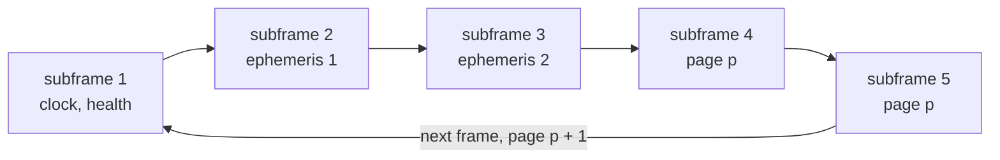

# LNAV (L1 C/A)

LNAV is the message of L1 C/A.
Pharos builds every subframe, and every page of subframes 4 and 5 that IS-GPS-200 defines.
Pages without content carry filler, dummy or default data.

## Message structure

| Carrier | Component | Subframe period | Bit rate | Coding | ICD |
|---|---|---|---|---|---|
| L1 | C/A | 6 s | 50 bps | 6 parity bits per word | IS-GPS-200N 20.3 |

| Word | Bits | Content |
|---|---|---|
| 1 | 1 to 30 | TLM: preamble, TLM message, integrity status flag, a reserved bit |
| 2 | 31 to 60 | HOW: TOW count, alert flag, anti-spoof flag, subframe ID |
| 3 to 10 | 61 to 300 | 192 content bits of the subframe or page |

## Implementation matrix

| Subframe, page | SV ID | Content | Sent when | Content from | IS-GPS-200N |
|---|---|---|---|---|---|
| 1 | | WN, L2 codes, URA index, health, IODC, L2 P data flag, T_GD, clock | every frame | LNAV record | 20.3.3.3 |
| 2 | | IODE, Crs, delta n, M0, Cuc, e, Cus, sqrt A, toe, fit interval flag, AODO | every frame | LNAV record | 20.3.3.4 |
| 3 | | Cic, Omega0, Cis, i0, Crc, omega, Omega dot, IODE, IDOT | every frame | LNAV record | 20.3.3.4 |
| 4: 1, 6, 11, 16, 21 | 57 | reserved in the ICD | filler page | none | Table 20-V |
| 4: 2 to 5 | 25 to 28 | almanac of SV 25 to 28 | an almanac entered, else a dummy page | almanac file or reduced ephemeris | 20.3.3.5 |
| 4: 7 to 10 | 29 to 32 | almanac of SV 29 to 32 | as pages 2 to 5 | almanac file or reduced ephemeris | 20.3.3.5 |
| 4: 12 | 62 | reserved in the ICD | filler page | none | Table 20-V |
| 4: 13 | 52 | NMCT | always, declared not available | none | 20.3.3.5.1.9 |
| 4: 14, 15 | 53, 54 | reserved for system use | filler page | none | Table 20-V |
| 4: 17 | 55 | special message, 22 characters | a `text` publication, else default data | scenario | 20.3.3.5.1.8 |
| 4: 18 | 56 | Klobuchar set and UTC | usable UTC, else default data | ionosphere set, `GPUT`, the run's leap seconds | 20.3.3.5.2.4, 20.3.3.5.2.5 |
| 4: 19, 20 | 58, 59 | reserved in the ICD | filler page | none | Table 20-V |
| 4: 22, 23 | 60, 61 | reserved in the ICD | filler page | none | Table 20-V |
| 4: 24 | 62 | reserved in the ICD | filler page | none | Table 20-V |
| 4: 25 | 63 | A-S flags and configurations of SV 1 to 32, health of SV 25 to 32 | always | allocation or `configuration`, almanacs | 20.3.3.5.1.4 |
| 5: 1 to 24 | 1 to 24 | almanac of SV 1 to 24 | an almanac entered, else a dummy page | almanac file or reduced ephemeris | 20.3.3.5 |
| 5: 25 | 51 | toa, WNa, health of SV 1 to 24 | always | almanacs | 20.3.3.5 |

Subframes 1 to 3 carry the selected LNAV reference's orbit, clock and issue fields.
They use the interval's LNAV attributes and common delay table.
The transmitted T_GD is the resolved L1 C/A delay, T_GD - ISC_L1CA when that ISC is present.
That difference can exceed the LNAV field even when both raw terms pass their checks.
WN is the week of transmission, modulo 1024.
The publications come from the scenario's `messages.gps` block ([navigation data](data.md)).

## Schedule

| Quantity | Rule |
|---|---|
| subframe index n | 6 s steps from the start of the GPS week, 0 to 100799 |
| subframe ID | n mod 5 + 1 |
| page of subframes 4 and 5 | (n div 5) mod 25 + 1 |
| TOW count in the HOW | n + 1, the next subframe's start |
| superframe | 125 subframes, 750 s; page 1 starts each week |
| special message | the next 22 characters of the text each superframe, then round again |

A text of 288 characters takes 14 superframes.
The last page of a text is padded with spaces.

## TLM and HOW

| Field | Bits | Value |
|---|---|---|
| preamble | 8 | 10001011 |
| TLM message | 14 | zero |
| integrity status flag | 1 | the publication's `isf`, else 0 |
| reserved | 1 | zero |
| TOW count | 17 | the next subframe's, in 6 s units |
| alert flag | 1 | 1 when the publication's `alert` names the PRN, else 0 |
| anti-spoof flag | 1 | always 1 |
| subframe ID | 3 | 1 to 5 |
| last two bits | 2 | solved so that parity bits 29 and 30 are zero |

## UTC and ionosphere page

Page 18 needs usable UTC.
Without it the page carries default data, and LNAV carries no Klobuchar set.

| Condition | Rule |
|---|---|
| UTC record | a `GPUT` record with a reference epoch ([navigation data](data.md)) |
| leap seconds | the run's schedule: the announced event, else the built-in history's last insertion ([leap seconds](../../guide/navigation-data.md#leap-seconds)) |
| A2 | zero, since the page has no field for it |
| tot | on the 4096 s grid |
| every field | fits its page field; WNt and WNLSF are sent modulo 256 |

## Almanac entries

One reference time serves every almanac page.

| Rule | Effect |
|---|---|
| order | the `almanac` files first, then ephemerides reduced to the common toa |
| fields | an almanac outside the page fields is left out |
| toa | whole milliseconds on the 4096 s grid, else left out |
| one toa | the first almanac entered sets it; one with another toa is left out |
| page 25 of subframe 5 | toa in 4096 s units, WNa modulo 256, both from that toa |
| no almanac at all | toa and WNa are sent as zero |

## Health words

| Where | Bits | Value |
|---|---|---|
| subframe 1 | 6 | the interval's LNAV health word |
| almanac page | 8 | the almanac's health word, its low 8 bits |
| page 25 of subframes 4 and 5, per SV | 6 | a summary bit, set if any of the 3 data bits is, then the 5 signal bits |
| the same, SV without an almanac | 6 | 111111 |

What each health code does to the signals is on the [navigation data](data.md) page.

## Parity

Each word ends with six parity bits (Table 20-XIV).
They cover its 24 data bits and bits 29 and 30 of the previous word, D29* and D30*.
The data bits go on the air inverted when D30* is one.
Words 2 and 10 end with two bits solved to make bits 29 and 30 zero.
So every subframe starts from D29* = D30* = 0.

## Where Pharos departs from the ICD default

| Case | What is sent |
|---|---|
| the selected reference is a raw CNAV or CNV2 record | no LNAV frames: L1 C/A gets no channel, the observation file still lists it |
| the projected effective T_GD exceeds its LNAV field | no LNAV frames; correction services also suppress this LNAV reference |
| reserved pages | data ID 01, the page's SV ID, then alternating bits starting with a zero |
| no almanac for the page's SV | a dummy page: SV ID 0 and the same filler |
| page 17 without a `text` publication | default data |
| page 18 without usable UTC | default data |
| default data (20.3.2) | bits 61 to 298 alternate from a one, parity left invalid, bits 299 and 300 zero |
| NMCT | availability indicator 10, every ERD 100000 |
| AODO | 31 |
| ISF and alert without a publication | 0 |
| A-S flags | always 1, in the HOW and in page 25 |
| configuration codes | the allocation at the run start, unless a publication declares them |
| reserved bits | zero |
