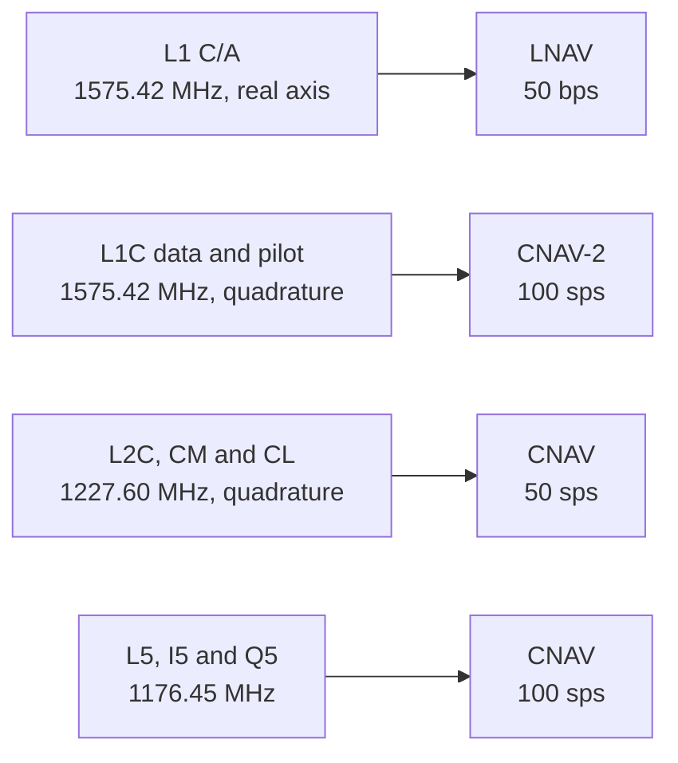

# GPS signals

Pharos generates L1 C/A, L1C, L2C and L5.
This page gives their codes, components, modulation and phases.
It ends with the observation codes and the group delay each code flies with.

## Signal matrix

| | L1 C/A | L1C | L2C | L5 |
|---|---|---|---|---|
| `signals` word | `L1CA` | `L1C` | `L2C` | `L5` |
| Carrier | 1575.42 MHz | 1575.42 MHz, L1 C/A's carrier | 1227.60 MHz | 1176.45 MHz |
| Components | data | data, pilot | CM data, CL pilot | I5 data, Q5 pilot |
| Primary code | Gold, 1023 chips | Weil, 10230 chips each | CM 10230 chips, CL 767250 chips | Gold, 10230 chips each |
| Chip rate | 1.023 MHz | 1.023 MHz | 511.5 kHz each, 1.023 MHz together | 10.23 MHz |
| Code period | 1 ms | 10 ms | CM 20 ms, CL 1.5 s | 1 ms |
| Modulation | BPSK | data BOC(1,1), pilot TMBOC(6,1,4/33) | BPSK, CM and CL alternate chip by chip | QPSK |
| Power split | data only | data 25%, pilot 75% | CM and CL half the chips each | I5 50%, Q5 50% |
| Secondary code | none | pilot: overlay code, 1800 chips, one per PRN | none | I5 NH10, Q5 NH20 |
| Symbol rate | 50 bps, uncoded | 100 sps | 50 sps | 100 sps |
| Message | [LNAV](lnav.md) | [CNAV-2](cnav2.md) | [CNAV](cnav.md) | [CNAV](cnav.md) |
| Blocks | IIR, IIR-M, IIF, III | III | IIR-M, IIF, III | IIF, III |
| Observation codes | 1C | 1S data, 1L pilot | 2L | 5I data, 5Q pilot |
| ANTEX frequency | G01 | G01 | G02 | G05 |
| ICD | IS-GPS-200N 3.3.2.3 | IS-GPS-800J 3.2.1.3, 3.2.2.1.4, 3.3 | IS-GPS-200N 3.3.2.3 | IS-GPS-705J 3.2.1.1 |

Each signal has unit power, split between its components as the table shows.
The scenario's `power` block sets the C/N0.
The L1C pilot uses BOC(6,1) on chips 0, 4, 6 and 29 of every 33 chips, and BOC(1,1) on the rest.
The samples resolve the L1C subcarriers at 12 steps per chip.

## Codes

| Code | Generator | Chosen per PRN by | ICD |
|---|---|---|---|
| L1 C/A | two 10-stage registers, G1 and G2 | the G2 tap pair | IS-GPS-200N Table 3-Ia |
| L2 CM, L2 CL | one 27-stage modular register | its initial state | IS-GPS-200N Table 3-II |
| L5 I5, Q5 | 13-stage registers XA and XB, XA reset at chip 8190 | the XB initial state | IS-GPS-705J Table 3-I |
| L1C data, pilot | Weil code over the Legendre sequence of length 10223, with a 7-chip insertion | the Weil index and the insertion point | IS-GPS-800J Table 3.2-1 |
| L1C overlay | an 11-stage register | its polynomial and initial state | IS-GPS-800J Table 3.2-2 |
| L5 NH10, NH20 | fixed sequences, 0000110101 and 00000100110101001110 | the same for every PRN | IS-GPS-705J |

The codes exist for PRNs 1 to 32.
The NH10 code runs over each 10 ms I5 symbol.
The NH20 code and the L1C overlay code run over the pilot's code periods.

## Phases

Each band has a real axis and an axis in quadrature.
A chip 0 is +1 on the real axis and -j on the negative imaginary axis.
So a component on the negative imaginary axis lags its band's real axis by 90 degrees.

| Band | Real axis | Negative imaginary axis | ICD |
|---|---|---|---|
| L1 | L1 C/A | L1C data and pilot | IS-GPS-200N 3.3.1.5.1, IS-GPS-800J 3.2.1.6.1 and 3.3 |
| L2 | nothing | L2C, CM and CL | IS-GPS-200N 3.3.1.5.1 |
| L5 | I5 | Q5 | IS-GPS-705J 3.3.1.5 |

## Observation codes and group delays

Each observation code gets its own pseudorange with its own group delay.
A signal has one carrier phase, Doppler and C/N0.
The carrier flies the delay of its band's reference: L1 C/A on L1, L2C on L2, I5 on L5.

| Code | Signal, component | Delay flown | Without the ISC |
|---|---|---|---|
| 1C | L1 C/A | T_GD - ISC_L1CA | T_GD |
| 1S | L1C data | T_GD - ISC_L1CD | T_GD |
| 1L | L1C pilot | T_GD - ISC_L1CP | T_GD |
| 2L | L2C | T_GD - ISC_L2C | gamma12 x T_GD |
| 5I | L5 I5 | T_GD - ISC_L5I5 | gamma15 x T_GD |
| 5Q | L5 Q5 | T_GD - ISC_L5Q5 | gamma15 x T_GD |

Here gamma12 = (1575.42 / 1227.60)^2 and gamma15 = (1575.42 / 1176.45)^2 (IS-GPS-200N 30.3.3.3.1.1).
A plan interval has one common delay table, starting with the selected record's terms and filling gaps from eligible donors within the time window ([navigation data](data.md#delays-and-family-attributes)).
The fallback column applies when that table still lacks the ISC.
A signal without its required base delay stays off the air; the raw record and other usable signals remain available.
LNAV broadcasts the resulting L1 C/A delay as T_GD; CNAV and CNAV-2 broadcast the ISCs implied by the same table.
The messages and signal generation derive those delays from the same table.
Changes to the table blend the signal delays even when the orbit and clock reference stays the same.

The L1C and L5 data and pilot codes can differ in delay.
The samples shift each component by its own delay.

Under a `precise` product the GPS codes keep these delays.
The product's GPS clock refers to the P1P2 pair, whose offset from the broadcast clock is zero.
