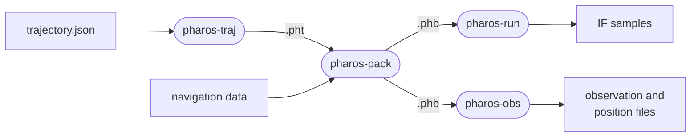

# User guide

This guide says how to use Pharos. It covers building, trajectories and
scenarios, the four tools and their files, and the C API. How Pharos
works inside is in [design](../design/README.md).

| Page | Content |
|---|---|
| [Overview](overview.md) | what Pharos is, the four tools and their files, the sixteen signals, the console and option conventions, reproducibility |
| [Quick start](quick-start.md) | building, then one run to a sample file and one to an observation file |
| [Trajectories](trajectories.md) | `pharos-traj`: trajectory plans, their segments and limits, the stored path and its `.pht` file, `build`, `static`, `info`, `check`, `export` |
| [Scenarios](scenarios.md) | `pharos-pack`: the command line, every scenario key, the diagnostics, the bundle |
| [Navigation data](navigation-data.md) | file kinds, record checks and selection, health, time offsets, leap seconds, ionosphere sets, antennas, precise products |
| [Samples](samples.md) | `pharos-run`: the run, seeking, the sample file, the `.tag` sidecar, the manifest, dumps, gain, noise |
| [Observations](observations.md) | `pharos-obs`: the RINEX observation file and the ECEF, LLA and KML position files |
| [C API](c-api/README.md) | the rules every header follows, an example, one page per library, and the WebAssembly modules |
| [Examples](examples.md) | the nineteen example scenarios, their trajectories and data |

| C API page | Library |
|---|---|
| [pharos_traj.h](c-api/traj.md) | trajectories: build a plan, inspect its path, read and check `.pht`, export KML, describe guides |
| [pharos_pack.h](c-api/pack.md) | a scenario packed into bundle bytes, from files or from memory |
| [pharos_run.h](c-api/run.md) | the IF samples of a bundle, pulled block by block from any epoch |
| [pharos_obs.h](c-api/obs.md) | one bundle source for observation or position output in batches and the run's truth at any epoch |
| [WebAssembly](c-api/webassembly.md) | separate trajectory, pack and observation modules for a JavaScript host |

Each page on a tool or a library ends with its limits and messages: the
ranges, the edge rules, the console lines and the error messages. The
signals and messages against their ICDs are in [GNSS](../gnss/README.md).
The propagation and satellite models are in [models](../models/README.md).
