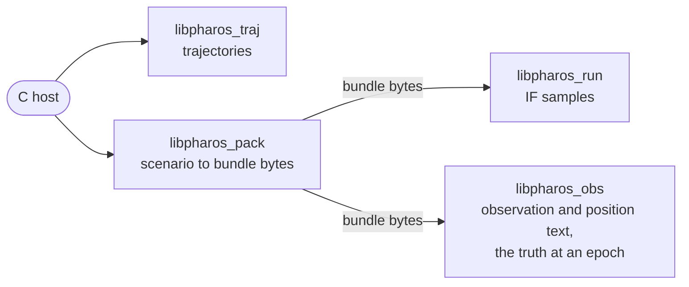

# C API

A C program does what the four tools do, but for the four things the
table below lists, through four static libraries and their headers
([build](../quick-start.md#build)). It can build and read trajectories,
and pack a scenario into a bundle. It can pull the IF samples of a
bundle while steering the run, pull the bundle's observation or
position file piece by piece, or ask what the run's receiver sees at any
epoch. A JavaScript host builds trajectories, packs scenarios, writes
observation files and asks for that truth through three WebAssembly modules
([WebAssembly](webassembly.md)).



| Only a tool | What C has instead |
|---|---|
| `pharos-traj static --ecef` | `pharos_traj_static` places a receiver by latitude, longitude and altitude |
| `--name` of `pharos-traj static` | `pharos_traj_static` leaves the trajectory unnamed |
| `pharos-run --dump` | no stage dumps |

| Header | Library | ABI version | Page |
|---|---|---|---|
| `pharos_traj.h` | `libpharos_traj.a` | `PHAROS_TRAJ_ABI_VERSION` = `0x00010000u` | [traj](traj.md) |
| `pharos_pack.h` | `libpharos_pack.a` | `PHAROS_PACK_ABI_VERSION` = `0x00010000u` | [pack](pack.md) |
| `pharos_run.h` | `libpharos_run.a` | `PHAROS_RUN_ABI_VERSION` = `0x00010000u` | [run](run.md) |
| `pharos_obs.h` | `libpharos_obs.a` | `PHAROS_OBS_ABI_VERSION` = `0x00010000u` | [obs](obs.md) |
| `pharos_traj.h` | `pharos_traj.wasm` | that of `libpharos_traj.a` | [WebAssembly](webassembly.md) |
| `pharos_pack.h` | `pharos_pack.wasm` | that of `libpharos_pack.a` | [WebAssembly](webassembly.md) |
| `pharos_obs.h` | `pharos_obs.wasm` | that of `libpharos_obs.a` | [WebAssembly](webassembly.md) |

Each library also returns its version from a function:
`pharos_traj_abi_version()`, `pharos_pack_abi_version()`,
`pharos_run_abi_version()` and `pharos_obs_abi_version()`. The rest of
this page gives the rules every header follows, then an example.

## Objects and threads

| Rule | Detail |
|---|---|
| objects | opaque: `pharos_traj`, `pharos_pack`, `pharos_run`, `pharos_obs_source`, `pharos_obs_output`, `pharos_obs_truth`, `pharos_pack_nav_description` |
| making one | one creation call; its destroy function releases the host's ownership |
| `pharos_traj_build`, `pharos_traj_read`, `pharos_pack_create`, `pharos_pack_create_from_memory` | hand out an object on every status but `E_ARG` and `E_NOMEM` |
| the other creation calls | hand out none on a failure; the message waits in the thread's buffer |
| use | one caller thread at a time per object |
| stack | a call of a release build needs at most 128 KiB of the calling thread's stack |
| callbacks | none: no function calls back into the host |
| memory | each library allocates from its own allocator |
| C library | the libraries request none of their own |
| signal handlers | none installed: a host writing into a pipe handles SIGPIPE itself |
| a buffer passed to a creation call | may be freed after the call |
| each WebAssembly instance | one thread and its own memory; the host places its arguments in memory from that instance's `pharos_alloc` and frees it with its `pharos_free`, which no header declares ([WebAssembly](webassembly.md)) |

The trajectory build and read calls and the two pack creation
calls hand out an object on `PHAROS_TRAJ_E_INPUT`,
`PHAROS_PACK_E_INPUT` and `PHAROS_PACK_E_IO` too. The diagnostics can
then be read, and the host destroys the object in every case.
`pharos_traj_static`, `pharos_run_create`, `pharos_obs_source_create`,
`pharos_obs_output_create`, `pharos_obs_output_create_dated` and
`pharos_obs_truth_create` hand out none on a failure.

`pharos_obs_source_create` loads a bundle once. Output and truth creation
take that source and each retain it. The host may call
`pharos_obs_source_destroy` after creating its output and truth handles;
the last owner releases the source's storage. Each child has its own
mutable state ([observation API](obs.md)).

`pharos_traj_build(json, len, out)` builds one trajectory plan. A path
that leaves the receiver's domain or breaks a limit of its plan stays
with its object: inspection and KML remain available, while its `.pht`
text is refused ([trajectory API](traj.md)).

## Statuses

Every function that can fail returns a status enum. Codes 0 to 4 are the
same in the four libraries. Each library numbers its own from 5.

| Code | Status | Meaning |
|---|---|---|
| 0 | `OK` | done |
| 1 | `END` | the run or the file is complete |
| 2 | `E_ARG` | a bad argument, or a buffer too small |
| 3 | `E_NOMEM` | out of memory |
| 4 | `E_INTERNAL` | a failure no input explains |

Each name carries its library's prefix, as `PHAROS_RUN_E_ARG`. `E_ARG`
is permanent for the arguments of that call, so a host does not retry
the same call. `PHAROS_RUN_E_BUSY` is the one status a host retries
unchanged.

## Enums

A kind, a unit, a system, a signal, a severity or a diagnostic code is
an integer. Each header gives its integer type and named constants,
generated from the owning Zig enum. Each page names those constants at
its fields; fields declared `uint32_t` retain that explicit width.

## Messages

| Rule | Detail |
|---|---|
| a failure's message | on the object: `pharos_traj_error`, `pharos_pack_error`, `pharos_run_error`, `pharos_obs_output_error`, `pharos_obs_truth_error` |
| a call without an object: a creation call or `pharos_pack_describe_nav` | in the thread-local buffer of `pharos_traj_last_error` and its kin |
| validity | until the next call on that thread |
| length | at most 255 bytes |
| a path in a message | whole up to 128 bytes, its middle elided with `...` beyond |
| a call that can write a message | empties the buffer first |
| `OK` | leaves the buffer empty |
| a NULL pointer argument | `E_ARG` without a message |
| a bad argument to a getter on a const object | `E_ARG` without a message; the getter writes and clears nothing |
| `pharos_traj_info_get` | no such getter: it keeps what it finds in its object, and clears the object's error first, as the calls that hand out a text do |

The thread-local functions are `pharos_traj_last_error`,
`pharos_pack_last_error`, `pharos_run_last_error` and
`pharos_obs_last_error`. What a host reads after a call belongs to the
status that call returned.

## Records

Headers are generated from the current Zig C adapter declarations. Build
and use each header with the library from the same source. Every input
record supplies all its fields; every successful getter fills its complete
output record. A NULL options pointer selects the documented defaults.

Record fields and function signatures have one declaration source. The
build emits C types and constants from it, and each WebAssembly module
exposes its product's compiler-derived layouts ([layout](webassembly.md#layouts)).

## Buffers

| Rule | Detail |
|---|---|
| manifests and tags | the function takes a buffer, its `cap` and `size_t *len` |
| a copy-out `cap` too small, or the buffer NULL | `E_ARG`, with the needed size in `*len` or `*count`; nothing written |
| copy-out `len` | may be NULL |
| retained-view outputs | the output record or pointer and count slots are required unless that function explicitly permits NULL |
| pointers a library hands out | valid until the object is destroyed, unless a shorter lifetime is listed below |
| trajectory inspection JSON | valid until the next inspection on that trajectory that passes its argument checks, or its destruction |
| the applied commands of a block | valid until the next pull |
| observation or position batch bytes | borrowed from the output; valid until its next operation or destruction |
| the satellites and signals of a truth epoch | borrowed from the truth; valid until its next operation or destruction |
| truth inspection JSON | returned in `pharos_obs_bytes`; valid until the truth's next operation or destruction |

Retained views include bundle bytes, trajectory PHT/KML bytes and navigation
coverage. A trajectory serializes its PHT and KML formats once. Navigation
description parses once and owns its coverage until `pharos_pack_nav_destroy`.
Copy a view before its lifetime ends.

`pharos_obs_output_pull(output, max_epochs, &batch)` fills a
`pharos_obs_output_batch` with borrowed bytes and progress. The host
requests 1 to 64 output epochs and allocates only the batch record.
Consume or copy its bytes before the next operation on that output.

## Example

A scenario packed and its samples written to a file:

```c
#include <stdio.h>
#include <stdlib.h>
#include "pharos_pack.h"
#include "pharos_run.h"

int main(int argc, char **argv) {
    if (argc != 3) return 2; /* scenario.json out.bin */
    FILE *f = fopen(argv[1], "rb");
    if (!f) return 1;
    fseek(f, 0, SEEK_END);
    long n = ftell(f);
    fseek(f, 0, SEEK_SET);
    uint8_t *json = malloc(n);
    fread(json, 1, n, f);
    fclose(f);

    pharos_pack *pack = NULL;
    pharos_pack_status ps = pharos_pack_create(json, n, ".", &pack);
    free(json);
    if (ps != PHAROS_PACK_OK) {
        for (size_t i = 0; i < pharos_pack_diag_count(pack); i++) {
            pharos_pack_diag d;
            pharos_pack_diag_get(pack, i, &d);
            if (d.source[0]) fprintf(stderr, "%s", d.source);
            if (d.line) fprintf(stderr, "%s%u", d.source[0] ? ":" : "line ", d.line);
            if (d.column) fprintf(stderr, ":%u", d.column);
            if (d.source[0] || d.line) fprintf(stderr, ": ");
            if (d.path[0]) fprintf(stderr, "%s: ", d.path);
            fprintf(stderr, "%s\n", d.message);
        }
        if (!pack) fprintf(stderr, "%s\n", pharos_pack_last_error());
        pharos_pack_destroy(pack);
        return 1;
    }
    const uint8_t *bundle;
    size_t len;
    pharos_pack_bytes(pack, &bundle, &len);

    pharos_run_options opt = { .workers = 0, .seed = 0 };
    pharos_run *run = NULL;
    pharos_run_status st = pharos_run_create(bundle, len, &opt, &run);
    pharos_pack_destroy(pack); /* the run keeps its own copy */
    if (st != PHAROS_RUN_OK) {
        fprintf(stderr, "%s\n", pharos_run_last_error());
        return 1;
    }
    pharos_run_info info;
    pharos_run_info_get(run, &info);
    size_t cap = (size_t)info.bytes_per_epoch * 100;
    void *buf = malloc(cap);
    FILE *out = fopen(argv[2], "wb");
    int failed = 0;
    for (;;) {
        pharos_run_block block;
        st = pharos_run_pull(run, buf, cap, 100, &block);
        if (st == PHAROS_RUN_END || st == PHAROS_RUN_E_ARG) break;
        fwrite(buf, 1, block.bytes, out);
        if (st != PHAROS_RUN_OK) {
            fprintf(stderr, "%s\n", pharos_run_error(run));
            failed = 1;
            break;
        }
        pharos_run_event ev;
        while (pharos_run_next_event(run, &ev)) {
            if (ev.kind == PHAROS_RUN_EVENT_AGC) fprintf(stderr, "AGC gain %.3f\n", ev.a);
        }
    }
    fclose(out);
    free(buf);
    pharos_run_destroy(run);
    return failed;
}
```

Any C compiler builds it against the installed libraries, and the
system's C and C++ toolchains link the archives:

```bash
zig build -Doptimize=ReleaseFast
cc -std=c11 -I zig-out/include example.c zig-out/lib/libpharos_pack.a zig-out/lib/libpharos_run.a -o example
```

On x86_64, the archives of a Debug or ReleaseSafe build can call
`__zig_probe_stack`, Zig's stack probe, which `zig cc` links in and
other toolchains lack. A Debug build keeps every temporary in a stack
slot of its own, so its calls can need more than 128 KiB of stack.

A build that depends on Pharos takes the archives as named lazy paths
([build](../quick-start.md#build)).

## Limits and messages

| Limit | Value |
|---|---|
| a message | at most 255 bytes |
| a path inside a message | 128 bytes whole; longer ones lose their middle to `...` |
| stack | 128 KiB of the calling thread's stack per call, in a release build: `ReleaseFast`, `ReleaseSafe` or `ReleaseSmall` |
| the command queue of a run | 256 commands |
| the event ring of a run | 1024 events |

The messages each function writes are on its library's page.
