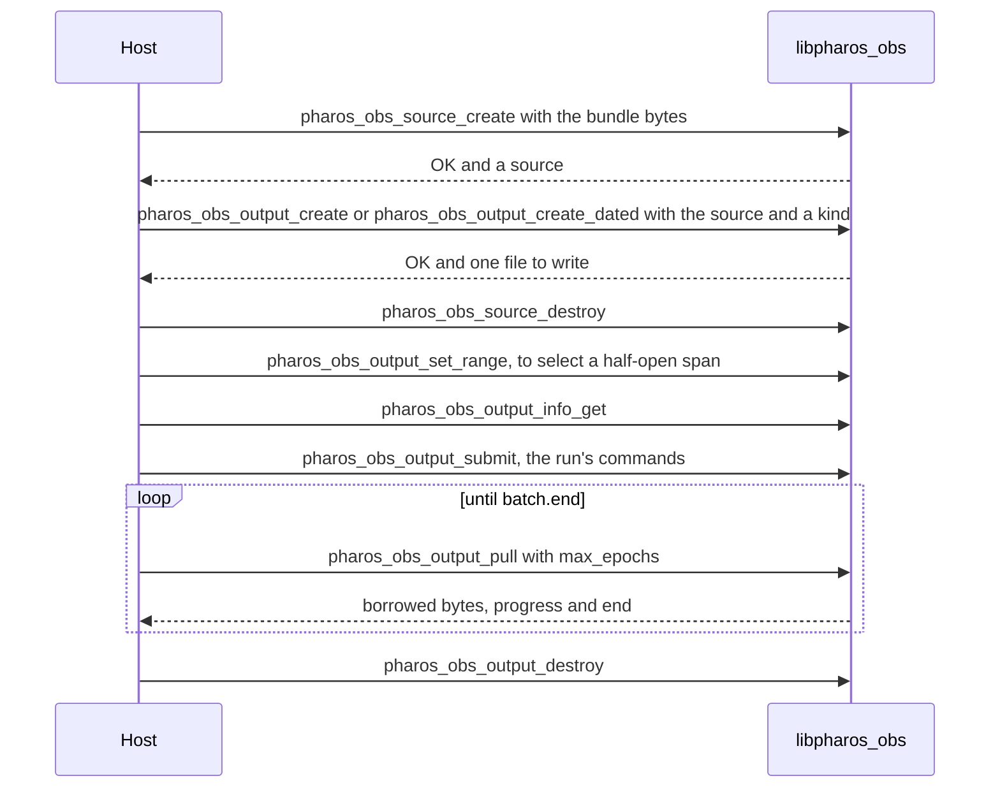
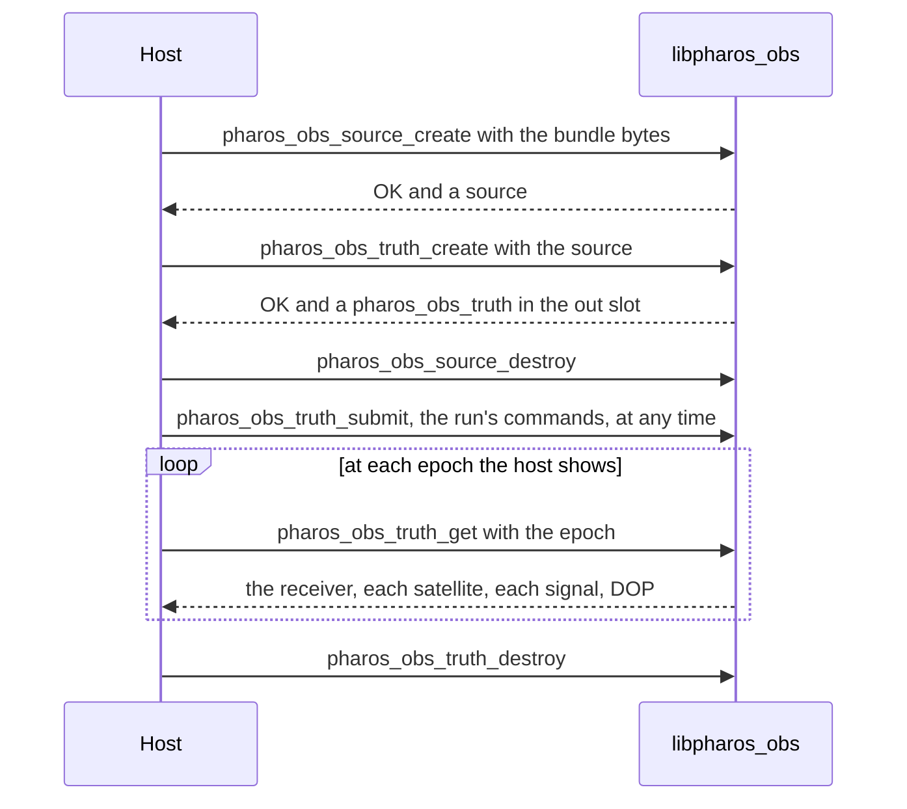

# pharos_obs.h

`libpharos_obs.a` writes the observation or position file of a bundle
([observations](../observations.md)) as UTF-8 batches, and tells what the
run's receiver sees at any epoch. A `pharos_obs_source` owns one parsed
bundle. It can create independent `pharos_obs_output` files and
`pharos_obs_truth` query objects. Each retains the source, so the host
may release its source handle after creating them. The host writes the
borrowed file bytes where it wants them, and may give the observation
file's creation time. Outputs and truths take separate copies of the
run's epoch-bound commands to model the receiver over the requested span
([commands](#commands)).



Each pull emits at most `max_epochs` complete epochs, with a limit of
64. The first batch includes the header; the final batch includes the
KML footer when needed. The RINEX header includes the epoch-flag-2 line
of a moving receiver. A nonempty final batch returns `OK` with `end` 1;
a later pull returns `END` with no bytes.

## Statuses

| Code | `pharos_obs_status` | Meaning |
|---|---|---|
| 0 | `PHAROS_OBS_OK` | done |
| 1 | `PHAROS_OBS_END` | the file is complete |
| 2 | `PHAROS_OBS_E_ARG` | a bad argument, a `kind` the library does not define, a creation time out of range, an epoch beyond the scenario, an invalid or empty range, a range after the first pull, a command refused, or `max_epochs` outside 1 through 64 |
| 3 | `PHAROS_OBS_E_NOMEM` | out of memory |
| 4 | `PHAROS_OBS_E_INTERNAL` | not returned by this library |
| 5 | `PHAROS_OBS_E_BUNDLE` | the bytes are no bundle of this build; it declares no such file; for a truth's get, it has no samples block, or its message content cannot be encoded |
| 6 | `PHAROS_OBS_E_NAV` | a truth's re-plan lacks auxiliary data |

## Enums and structs

| Enum | Members |
|---|---|
| `pharos_obs_kind` | `PHAROS_OBS_KIND_OBSERVATION` = 0, `PHAROS_OBS_KIND_POSITION` = 1 |
| `pharos_obs_system` | `PHAROS_OBS_SYSTEM_GPS` = 0, `_BDS` = 1, `_GAL` = 2, `_GLO` = 3 |
| `pharos_obs_signal` | `PHAROS_OBS_SIGNAL_L1CA` = 0, `_L1C`, `_L2C`, `_L5`, `_B1C`, `_B1I`, `_B2I`, `_B3I`, `_B2A`, `_B2B`, `_E1`, `_E5A`, `_E5B`, `_E6`, `_G1`, `_G2` = 15, in this order |
| `pharos_obs_channel` | `PHAROS_OBS_CHANNEL_HELD` = 0, `_MASKED_OUT` = 1, `_NOT_BROADCAST` = 2, `_NO_RECORD` = 3, `_BELOW_MASK` = 4, `_OUTSIDE_BAND` = 5, `_NO_FRAMES` = 6 ([channels](#channels)) |
| `pharos_obs_inspect_group` | `PHAROS_OBS_INSPECT_ALL` = 0, `_MODEL` = 1, `_NAVIGATION` = 2, `_MESSAGES` = 4, `_SERVICE` = 8; combine nonzero values as a bit mask |
| `pharos_obs_command_kind` | `PHAROS_OBS_CMD_NOISE_FLOOR_DBM_HZ` = 0, `PHAROS_OBS_CMD_ELEVATION_MASK` = 1, `PHAROS_OBS_CMD_SIGNAL_POWER` = 2 |
| `pharos_obs_power_unit` | `PHAROS_OBS_POWER_DBHZ` = 0, `PHAROS_OBS_POWER_DBM` = 1, `PHAROS_OBS_POWER_DBW` = 2 |

A `pharos_obs_signal` member is the scenario's signal word in capitals:
`_B2A` is `B2a`, `_E5A` is `E5a`. Its values follow the order of the
`signals` words in the scenario schema
([JSON Schemas](../../design/formats.md#the-json-schemas)), whose
`x-system` gives each word's system.

| `pharos_obs_output_info` field | Meaning |
|---|---|
| `uint32_t kind` | a `pharos_obs_kind` |
| `uint64_t epochs` | the number of selected output epochs, including `first_epoch` and `last_epoch` |
| `uint32_t interval_ms` | the interval |
| `uint32_t tracked` | the satellites tracked by an observation file; 0 for a position file |
| `uint64_t first_epoch` | the first epoch the file emits, in scenario-relative ms |
| `uint64_t last_epoch` | the last epoch the file emits, in scenario-relative ms |

These are what `pharos-obs` prints before writing, so a host can report
the selected range and progress. The command struct is in
[commands](#commands), the truth's structs in
[the truth at an epoch](#the-truth-at-an-epoch).

| `pharos_obs_output_batch` field | Meaning |
|---|---|
| `const uint8_t *data`, `size_t len` | borrowed UTF-8 bytes, without a NUL terminator; `data` is NULL when `len` is 0 |
| `uint64_t completed_epochs` | cumulative epochs generated within the selected range, including this batch |
| `uint64_t generated_through` | the last generated epoch in scenario-relative milliseconds, meaningful when `has_generated` is 1 |
| `uint32_t has_generated` | 1 after any output epoch has been generated |
| `uint32_t end` | 1 when the file, including any footer, is complete |

`pharos_obs_bytes` has `const uint8_t *data` and `size_t len`. It carries
the borrowed JSON bytes from an inspection. Copy borrowed bytes before
the owning output or truth's next operation, or its destruction.

All records are complete records from the generated header. Pass the
whole declared type; getters assign every field. The compiler determines
padding and array stride.

## Functions

| Function | Does | Statuses |
|---|---|---|
| `uint32_t pharos_obs_abi_version(void)` | returns `PHAROS_OBS_ABI_VERSION` | |
| `const char *pharos_obs_last_error(void)` | the thread's message of the last creation call without an object | |
| `pharos_obs_status pharos_obs_source_create(const uint8_t *bundle, size_t len, pharos_obs_source **out)` | reads the bundle into a shared source | `OK`; `E_BUNDLE`, `E_NOMEM`, `E_ARG` |
| `void pharos_obs_source_destroy(pharos_obs_source *source)` | releases the host's reference; NULL is a no-op | |
| `pharos_obs_status pharos_obs_output_create(pharos_obs_source *source, uint32_t kind, pharos_obs_output **out)` | retains the source and prepares the file `kind` names | `OK`; `E_BUNDLE`, `E_NOMEM`, `E_ARG` |
| `pharos_obs_status pharos_obs_output_create_dated(pharos_obs_source *source, uint32_t kind, int64_t created_unix_s, pharos_obs_output **out)` | the same, with the creation time `created_unix_s` | `OK`; `E_BUNDLE`, `E_NOMEM`, `E_ARG` |
| `pharos_obs_status pharos_obs_output_info_get(const pharos_obs_output *o, pharos_obs_output_info *out)` | the file's kind, selected epoch count, interval, tracked satellites and actual first and last epochs | `OK`; `E_ARG` for a NULL argument |
| `pharos_obs_status pharos_obs_output_set_range(pharos_obs_output *o, uint64_t first_epoch, uint64_t end_epoch)` | selects the scenario-relative half-open span `[first_epoch, end_epoch)` before the first pull ([ranges](#ranges)) | `OK`; `E_ARG` |
| `pharos_obs_status pharos_obs_output_submit(pharos_obs_output *o, const pharos_obs_command *c)` | adds a command of the run to the file | `OK`; `E_ARG`, `E_NOMEM` |
| `pharos_obs_status pharos_obs_output_pull(pharos_obs_output *o, uint32_t max_epochs, pharos_obs_output_batch *out)` | generates the next batch, borrowing the output's UTF-8 storage | `OK`, `END`; `E_ARG` |
| `const char *pharos_obs_output_error(const pharos_obs_output *o)` | the output's last message | |
| `void pharos_obs_output_destroy(pharos_obs_output *o)` | frees the output and releases its source reference; NULL is a no-op | |
| `pharos_obs_status pharos_obs_truth_create(pharos_obs_source *source, pharos_obs_truth **out)` | retains the source and prepares query storage; channel replay is lazy | `OK`; `E_NOMEM`, `E_ARG` |
| `pharos_obs_status pharos_obs_truth_get(pharos_obs_truth *t, uint64_t epoch, pharos_obs_truth_epoch *out)` | the truth at `epoch`, in ms from the run start | `OK`; `E_ARG`, `E_BUNDLE`, `E_NAV`, `E_NOMEM` |
| `pharos_obs_status pharos_obs_truth_sky(pharos_obs_truth *t, uint64_t epoch, pharos_obs_truth_epoch *out)` | the receiver and the satellites at `epoch`, with no channel plan | `OK`; `E_ARG`, `E_NOMEM` |
| `pharos_obs_status pharos_obs_truth_inspect(pharos_obs_truth *t, const pharos_obs_inspect_query *query, pharos_obs_bytes *out)` | effective values for one satellite and signal as borrowed JSON ([effective values](#effective-values)) | `OK`; `E_ARG`, `E_BUNDLE`, `E_NAV`, `E_NOMEM` |
| `pharos_obs_status pharos_obs_truth_visible_counts(pharos_obs_truth *t, const uint64_t *epochs, size_t count, uint32_t *counts)` | writes one usable-sky satellite count per requested epoch, without channel replay | `OK`; `E_ARG`, `E_NOMEM` |
| `pharos_obs_status pharos_obs_truth_submit(pharos_obs_truth *t, const pharos_obs_command *c)` | adds a command of the run to the truth | `OK`; `E_ARG`, `E_NOMEM` |
| `const char *pharos_obs_truth_error(const pharos_obs_truth *t)` | the truth's last message | |
| `void pharos_obs_truth_destroy(pharos_obs_truth *t)` | frees the truth and releases its source reference; NULL is a no-op | |

| Function | Rule |
|---|---|
| creation calls | `*out` is set to NULL at entry; the message is in `pharos_obs_last_error`, except for a NULL pointer |
| `pharos_obs_source_create` | the bundle buffer may be freed after the call |
| output and truth creation | each child retains its source until the child is destroyed; their cursors, commands and query buffers are independent |
| `pharos_obs_output_create` | the observation header's creation time is the wall clock at this call |
| `pharos_obs_output_create` | absent from `pharos_obs.wasm`, which has no clock ([WebAssembly](webassembly.md)) |
| `pharos_obs_output_create_dated` | the creation time is `created_unix_s`: seconds since 1970-01-01 00:00:00 UTC without leap seconds, 0 to 253402300799, the end of 9999 |
| `pharos_obs_output_create_dated` | the same bundle, kind, time, selected range and commands give the same text |
| a position file | carries no creation time |
| `pharos_obs_output_set_range` | before the first successful pull, any number of times |
| `pharos_obs_output_set_range` | the interval, re-plans and commands still count from the scenario start; submit commands before the selected first epoch too, so they establish its state |
| `pharos_obs_output_pull` | `out` is required; a valid call needs `max_epochs` from 1 through 64 and performs no allocation |
| `pharos_obs_output_pull` | each returned epoch is complete; `completed_epochs` is cumulative, not the size of this batch |
| `pharos_obs_output_pull` | copy or consume the bytes before the output's next operation or destruction; byte consumption does not control the generation cursor |
| `pharos_obs_output_pull` | the final nonempty batch returns `OK` with `end` 1; later pulls return `END` with `len` 0 and unchanged progress |
| `pharos_obs_truth_create` | prepares geometry and query buffers; the first full get or channel inspection initializes replay and can report planning errors |
| `pharos_obs_truth_create` | a bundle without a samples block supports `pharos_obs_truth_sky` and `pharos_obs_truth_inspect`; channel planning remains unavailable |
| `pharos_obs_truth_get`, `pharos_obs_truth_sky` | `epoch` 0 to the run's epochs, the end included |
| `pharos_obs_truth_get`, `pharos_obs_truth_sky` | the arrays `out` points to are borrowed until the truth's next operation or destruction |
| `pharos_obs_truth_get`, `pharos_obs_truth_sky` | any order of epochs and commands: the same epoch and commands give the same answer |
| `pharos_obs_truth_get`, `pharos_obs_truth_sky` | after `E_NOMEM`, completed planning and geometry checkpoints remain valid; queries can be retried in any epoch order |
| `pharos_obs_truth_sky` | the receiver, mask and satellites as `pharos_obs_truth_get` gives them, `signal_count` 0 and DOP 0; it never plans |
| `pharos_obs_truth_inspect` | `out` is required; its JSON is not NUL-terminated and is borrowed until the truth's next operation or destruction |
| `pharos_obs_truth_inspect` | malformed selectors, unknown group bits and epochs beyond the scenario return `E_ARG`; failures leave `out.data` NULL and `out.len` 0 |
| `pharos_obs_truth_visible_counts` | each count includes satellites with a record, at or above the mask, and outside `maskOut`; it does not count held channels |
| `pharos_obs_truth_visible_counts` | epochs may arrive in any order; `count` 0 accepts NULL arrays, otherwise both arrays must hold `count` elements |
| `pharos_obs_truth_visible_counts` | an error may leave a written prefix; discard the whole counts array on failure |

## Effective values

`pharos_obs_truth_inspect` uses the same bundle, scenario-relative clock
and submitted commands as the truth's other queries. Use a truth made
from the current preview bundle to inspect a draft, or one made from a
run's committed bundle and given its applied commands to inspect that
run. The function does not create another bundle or save a report.

| `pharos_obs_inspect_query` field | Meaning |
|---|---|
| `uint64_t epoch` | milliseconds from the scenario start; 0 through the scenario's duration, inclusive |
| `uint32_t system` | a `pharos_obs_system` |
| `uint32_t svid` | the satellite's PRN, starting at 1 and within its system's range |
| `uint32_t signal` | a `pharos_obs_signal` of the selected system |
| `uint32_t groups` | 0 for all groups, or the bitwise OR of `pharos_obs_inspect_group` values |

The version-1 JSON response identifies the target and query epoch, then
gives the requested effective model, navigation, message and service
groups. `epochMs` is a decimal string so a JavaScript host can preserve
the full integer epoch. Values include units, their validity interval
when one is available, and an availability state. Unsupported or
unavailable values remain explicit; they are not filled from a different
satellite or signal. Unrequested groups and absent optional fields are
omitted; use each group's availability and reason to interpret missing
values.

Every absolute instant uses `gps_ms`, a decimal string of milliseconds
since the GPS epoch, and `sub_ms`, a numeric fraction in `[0, 1)`.
Validity intervals use `from_epoch_ms`, `until_epoch_ms`,
`from_epoch_sub_ms` and `until_epoch_sub_ms`, relative to the scenario
start. The whole milliseconds are signed decimal strings, so a
publication before the scenario can have a negative bound. Integer
milliseconds remain exact through JSON serialization.

`navigation.kepler.orbit` and `messages.orbit` share the same orbital and
clock fields, in snake case, with their units. The navigation orbit is
the adopted record's; the message orbit is the family's prepared value,
including any fitting, epoch alignment or clock-reference conversion.
Likewise, `navigation.glonass.orbit` and `messages.glonassOrbit` share the
same GLONASS orbit fields. Issue numbers, group delays and other
family-specific values remain with their enclosing records. Availability
and reason values use one typed vocabulary across the response.

Model values describe the provider evaluated at the requested receiver
epoch; navigation values describe its adopted navigation reference.
Message values describe the prepared navigation parameters under the
existing planning and refresh rules. They do not identify the exact
frame or bit currently on air. Source provenance is not part of this
response. A bundle without samples still exposes model and navigation
values, with the channel and message availability reported explicitly.

One call evaluates the requested target and groups, serializes the
result, and returns its borrowed `pharos_obs_bytes`. Copy or decode the
JSON before another operation on the truth. A channel inspection still
replays the history needed to determine that target's held state. Message
queries reuse prepared content within each family's publication window;
the requested signal selects its carrier-specific projection.

## Ranges

`pharos_obs_output_set_range` selects `[first_epoch, end_epoch)` in integer
milliseconds from the scenario start. It keeps only epochs on the
output's original grid: at interval `d`, the first selected index is
`ceil(first_epoch / d)` and the excluded end index is
`ceil(end_epoch / d)`. For a 1000 ms interval,
`[1250, 3250)` emits 2000 and 3000 ms. `pharos_obs_output_info` and the RINEX
header report these actual first and last emitted epochs; the
approximate position is evaluated at the first one.

The full prediction has extent `[0, duration_ms + 1)`, preserving the
terminal position at `duration_ms` when it lies on the grid. Omitting
`pharos_obs_output_set_range` selects this full prediction. Each range is
validated against that original extent, so a later valid call may
expand a previous selection. Reversed or empty spans, endpoints outside
the extent, and spans containing no grid epoch return `E_ARG` without
changing the selection. The first pull freezes the range. Pulling ends
at its selected last epoch, followed by a footer for KML.

A host exporting modeled truth for a run freezes the reported inclusive
first and last sent epochs and calls this function with
`[first, last_sent + 1)`. It also submits the run's applied commands,
including commands before `first`, before evaluation. The file models
epochs in that span; the bounds alone do not record reception, recovery
gaps or whether every epoch aired.

## The truth at an epoch

`pharos_obs_truth_get` replays the run's channel plan
([the run](../samples.md#the-run)) and evaluates the geometry and power
at the epoch asked. It needs the bundle's samples block, whose band is
one of the rules. `pharos_obs_truth_sky` evaluates the receiver and the
satellites alone, with no plan, with or without a samples block.
`pharos_obs_truth_visible_counts` provides just the usable-sky count for
each requested epoch, for a lane or summary ([cost](#cost)).



| `pharos_obs_truth_epoch` field | Meaning |
|---|---|
| `double pos[3]`, `vel[3]` | the receiver's ECEF position in m and velocity in m/s |
| `double lat_deg`, `lon_deg`, `altitude_m` | the position as latitude, longitude and height above the EGM96 geoid |
| `double elevation_mask_deg` | the mask of the last re-plan at or before the epoch: the scenario's, or the last elevation-mask command at or before that re-plan; rounded to 1e-9 degree, so a mask given as 15 reads 15 |
| `double pdop`, `hdop`, `vdop` | the dilutions of precision ([DOP](#dop)); 0 when they are undefined, and from `pharos_obs_truth_sky` |
| `const pharos_obs_truth_satellite *satellites` | one per satellite that transmits a listed signal on the run's date, `maskOut` included, in system and PRN order |
| `size_t satellite_count` | their count, the same at every epoch |
| `const pharos_obs_truth_signal *signals` | one per satellite and listed signal of its system, in the satellites' order and signal order |
| `size_t signal_count` | their count, the same at every epoch; 0 from `pharos_obs_truth_sky` |

| `pharos_obs_truth_satellite` field | Meaning |
|---|---|
| `uint32_t system` | a `pharos_obs_system` |
| `uint32_t svid` | the PRN, or the GLONASS slot |
| `uint32_t record` | 1 when it flies a record at the epoch; 0 otherwise, with both angles 0 |
| `uint32_t above_mask` | 1 when it has a record and lies at or above `elevation_mask_deg`; this geometric predicate is independent of `masked_out` |
| `uint32_t masked_out` | 1 when the canonical scenario excludes this satellite through `maskOut`; static across epochs and present in both get and sky results |
| `double azimuth_deg` | from north through east, in [0, 360) |
| `double elevation_deg` | above the receiver's horizon, in [-90, 90] |

| `pharos_obs_truth_signal` field | Meaning |
|---|---|
| `uint32_t system`, `svid` | the satellite |
| `uint32_t signal` | a `pharos_obs_signal` |
| `uint32_t channel` | a `pharos_obs_channel`: `HELD`, or the rule that keeps it off ([channels](#channels)) |
| `uint32_t commanded` | 1 while the satellite's level is one a signal-power command set ([commands](#commands)) |
| `double cn0_dbhz` | while `HELD`, the C/N0 the signal realises, the observation file's `S` for it; 0 otherwise |

Index each array with its declared element type and `sizeof`, or the
module's generated layout metadata in WebAssembly. Both counts are known
after the first get, and never change. A satellite can have both
`above_mask` and `masked_out` set; a host drawing usable sky visibility
checks the geometric predicate and the static exclusion separately.

### Channels

A signal holds a channel exactly when the run, given the same commands,
holds one at that epoch. The run re-plans at every multiple of 1000
epochs, with no cap on the count. The truth drives the run's own
sequencer from re-plan to re-plan: the message sets rebuilt at each leg
boundary, then the channel rules under the mask the commands give.
Between re-plans the answer is that of the last re-plan at or before the
epoch.

| `channel` | The rule it names | At a re-plan |
|---|---|---|
| `MASKED_OUT` | mask-out | the satellite is in `maskOut` |
| `NOT_BROADCAST` | allocation, record | its PRN does not carry the signal on the run's date, or its record declares the signal gone |
| `NO_RECORD` | record | it flies no record |
| `BELOW_MASK` | elevation | a new channel: below the mask; a held one: more than 0.5 degrees below it |
| `OUTSIDE_BAND` | band | the carrier lies outside the sampled band |
| `NO_FRAMES` | message | its family's message set has no frames for it |

At a re-plan the held channels come first: one is kept until it fails
one of record, the record's signal, elevation and message, checked in
that order. Every other signal, a channel just dropped included, then
takes `HELD` or the first rule it fails in the table's order, which is
the `channel` it shows. The elevation is the satellite's at the re-plan,
while the answer's angles are those at the epoch asked: a satellite can
show above the mask without a channel, or below it with one, until the
next re-plan.

### DOP

The set is every satellite with a record at the epoch and a `HELD`
channel on at least one listed signal, whatever its system. Each gives
one row of the geometry matrix `G`, from its azimuth `az` and elevation
`el` at the epoch in the receiver's east, north and up frame:

```
[ cos(el) sin(az),  cos(el) cos(az),  sin(el),  1 ]
```

The fourth column is the receiver clock: one unknown common to every
system, with no inter-system offset. With `Q = (GᵀG)⁻¹`:

| Value | Formula |
|---|---|
| `pdop` | `sqrt(Q_ee + Q_nn + Q_uu)` |
| `hdop` | `sqrt(Q_ee + Q_nn)` |
| `vdop` | `sqrt(Q_uu)` |

Fewer than four satellites, or a matrix that cannot be inverted, give 0
for all three.

### Cost

The truth creates replay state on the first query that needs channels.
Sky queries and visible counts prepare geometry without initializing
channel replay. A full get retains its most recent result until its
epoch or commands change. An inspection evaluates its target and
requested groups without assembling the full signal array or DOP.

The replay keeps channel changes and a snapshot every 10 minutes; sky
geometry keeps provider checkpoints at the same interval. Both extend
to the furthest epoch requested. Earlier queries restore these records
as needed. A new elevation-mask command invalidates replay from its
first affected re-plan, while a power command invalidates the affected
power cursor and query result. Prepared message views retain one query
window per family, independently of the run sequencer's current sets.

| Query | Work |
|---|---|
| a full get beyond the furthest planned epoch | every re-plan up to the requested epoch, then full geometry, signal levels and DOP |
| an earlier full get | channel changes from the nearest snapshot and geometry from the appropriate checkpoint |
| a target inspection | required channel history, target geometry and selected projections |
| a sky or visible-count query | receiver and satellite geometry; no message or channel plan |
| another message query within a cached family window | reuse the prepared family content and project the requested signal |

The initial distant channel query still depends on the elapsed run and
satellite count. Geometry propagation, including GLONASS integration,
remains part of sky and visible-count queries.

## Commands

A host passes each command the run applied, with the epoch it applied at:
the `epoch` of a `pharos_run_applied` in `apply_at_epoch`, and its
`command` otherwise unchanged, since the two structs share one layout.
The observation file and the truth then model the channels, mask and
C/N0 under those applied commands. For a run export, the host also
selects the frozen reported span ([ranges](#ranges)).

| `pharos_obs_command` field | Meaning |
|---|---|
| `uint64_t apply_at_epoch` | the epoch it applies at; 0 is epoch 0 |
| `double value` | the command's value |
| `uint32_t kind` | a `pharos_obs_command_kind` |
| `uint32_t system` | a `pharos_obs_system`, for a signal-power command |
| `uint32_t svid` | the satellite; 0: every satellite of the system |
| `uint32_t unit` | a `pharos_obs_power_unit` |
| `uint32_t use_default` | 1: restore the scenario's value and the fade |

| `kind` | Applies | Value |
|---|---|---|
| 0 `NOISE_FLOOR_DBM_HZ` | at its epoch: every C/N0 shifts by the opposite amount | dBm/Hz, [-250, 0] |
| 1 `ELEVATION_MASK` | at the first re-plan at or after its epoch | degrees, [-90, 90] |
| 2 `SIGNAL_POWER` | at its epoch | `value` in `unit`, or `use_default`; the ranges of `pharos_run_command` ([run](run.md#commands)) |

| Rule | Detail |
|---|---|
| order | by epoch; at one epoch the scenario's `signalPower` entries apply first, then the commands in the order submitted |
| the log | the run, the observation file and the truth keep the commands in one log type, which power replays and each re-plan takes its mask from |
| the plan at epoch 0 | made twice, as a run makes it: an initial plan before commands, then the first epoch-0 re-plan with commands; the truth builds both lazily when replay is first needed, preserving the run's creation and first-pull semantics and its 0.5-degree hysteresis |
| an epoch beyond the run's end | accepted, never applied |
| a file | refuses a command at or before `generated_through`: `EpochPassed`, even if the host has not yet consumed the bytes; a position file takes later commands and is the same without them |
| an observation file's mask | the satellites listed at an epoch are those at or above the mask of the last re-plan at or before it ([observations](../observations.md#commands)) |
| a truth | takes a command at any epoch; an elevation-mask command at or before the furthest re-plan planned sends the plan back to the snapshot before its first re-plan, and the next get that reaches them makes the re-plans from there again |
| `commanded` | set by a signal-power command with a level; cleared by a later schedule entry for the satellite or its system, and by a `use_default` command; a noise-floor command shifts the level and keeps it |

## Limits and messages

| Message | Function and case |
|---|---|
| `output kind <n> is not defined (0 observation, 1 position)` | a creation call: `E_ARG` |
| `created_unix_s must lie within 0..253402300799, got <n>` | `pharos_obs_output_create_dated`: `E_ARG` |
| `the wall clock reads <n> s, outside 0..253402300799` | `pharos_obs_output_create`: `E_ARG`, from a clock before 1970 or after 9999 |
| `<message>` | `pharos_obs_source_create`: `E_BUNDLE`, with the bundle decoder's reason; `out of memory` for `E_NOMEM` ([the bundle](../scenarios.md#the-bundle)) |
| `cannot create the <kind> file: NoSuchOutput` | a creation call: the bundle declares no such file, `E_BUNDLE`; `<kind>` is `observation` or `position` |
| `cannot create the <kind> file: OutOfMemory` | a creation call: `E_NOMEM` |
| `the bundle has no samples block: no run to replay` | `pharos_obs_truth_get`: `E_BUNDLE` |
| `max_epochs must lie within 1..64, got <n>` | `pharos_obs_output_pull`: `E_ARG` |
| `epoch <n> lies beyond the run's <m> epochs` | `pharos_obs_truth_get`, `pharos_obs_truth_sky`, `pharos_obs_truth_inspect`, `pharos_obs_truth_visible_counts`: `E_ARG` |
| `malformed inspect query` | `pharos_obs_truth_inspect`: `E_ARG` for an invalid system, PRN, signal, system/signal combination, or unknown group bit |
| `malformed command` | `pharos_obs_output_submit`, `pharos_obs_truth_submit`: an unknown kind, system, satellite or unit |
| `submit rejected: InvalidValue` | `pharos_obs_output_submit`, `pharos_obs_truth_submit`: a value out of range |
| `submit rejected: EpochPassed` | `pharos_obs_output_submit`: an epoch at or before the file's generation cursor, observation or position |
| `the file has begun: a range comes before the first pull` | `pharos_obs_output_set_range`: `E_ARG` after the first successful pull |
| `range [<first>, <end>) lies outside the model extent [0, <extent>)` | `pharos_obs_output_set_range`: `E_ARG` for bounds outside the original full prediction |
| `range [<first>, <end>) is empty or reversed` | `pharos_obs_output_set_range`: `E_ARG` when `first >= end` |
| `range [<first>, <end>) contains no output epoch` | `pharos_obs_output_set_range`: `E_ARG` for a span with no epoch on the output grid |
| `epoch <n> of <m> could not be planned: <error> (<reason>)` | `pharos_obs_truth_get`, `pharos_obs_truth_inspect`: a re-plan failed; `E_BUNDLE` for `MessageSet`, `E_NAV` for missing auxiliary data, as a run fails ([samples](../samples.md#limits-and-messages)) |
| `out of memory` | any other call that returns `E_NOMEM` |

When ionosphere is active, the bundle contains the applied model,
coefficients and source for each enabled constellation. These are
resolved while packing, including an `auto` request, and reused by
samples, observations and truth. An incomplete resolved table is
rejected when reading the bundle (`E_BUNDLE`). A bundle with only
position output keeps ionosphere inactive and needs no coefficients.
Range rejection details are available through
`pharos_obs_output_error`.
