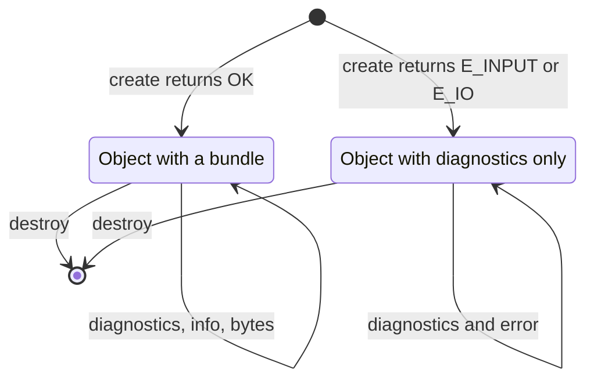
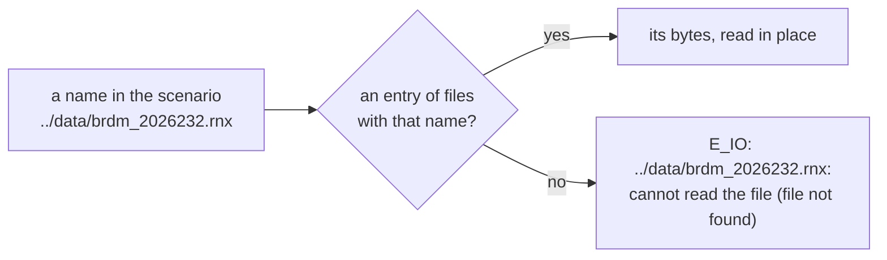

# pharos_pack.h

`libpharos_pack.a` packs a scenario into a bundle
([scenarios](../scenarios.md)). It reads the files the scenario names
from the file system, or takes them from a table the host passes
([files from memory](#files-from-memory)). A `pharos_pack` object
carries the diagnostics of the scenario and, when it packed, the bundle
bytes with the canonical time, sample and output summary. A host hands the
bytes to `pharos_run_create` or `pharos_obs_source_create`, or writes them to a
`.phb` file for the command-line tools. It also describes a navigation
file on its own: the satellites of each system that fly its records, and
when ([describing a navigation file](#describing-a-navigation-file)).

Packing resolves the applied ionosphere model and coefficients at the
scenario start. With `model: "auto"`, each enabled constellation gets
its own model; an explicit concrete model applies to all systems.
Missing required coefficients are scenario diagnostics at packing time.
The bundle keeps the request, the per-system coefficients and their
sources, and the separate sets carried by navigation messages
([ionosphere](../../models/ionosphere.md)).
An `auto` request rejects a `parameters` array, even when empty.
A scenario with only position output keeps ionosphere inactive and
requires no coefficients; JSON validation still applies.



`pharos_pack_create` and `pharos_pack_create_from_memory` hand out no
object on `E_NOMEM` or `E_ARG`. The object holds the warnings of a
scenario that packed, and the warnings gathered before a load failed.

## Statuses

| Code | `pharos_pack_status` | Meaning |
|---|---|---|
| 0 | `PHAROS_PACK_OK` | done |
| 1 | `PHAROS_PACK_END` | not returned by this library |
| 2 | `PHAROS_PACK_E_ARG` | a bad argument |
| 3 | `PHAROS_PACK_E_NOMEM` | out of memory |
| 4 | `PHAROS_PACK_E_INTERNAL` | not returned by this library |
| 5 | `PHAROS_PACK_E_INPUT` | the scenario or a loaded file has invalid content: the object carries the diagnostics |
| 6 | `PHAROS_PACK_E_IO` | a named trajectory, navigation, antenna or product file could not be read |
| 7 | `PHAROS_PACK_E_BUNDLE` | the bytes passed to `pharos_pack_summary_from_memory` are not a readable bundle of this build |

## Enums and structs

| Enum | Members |
|---|---|
| `pharos_pack_diag_code` | `PHAROS_PACK_DIAG_INVALID_JSON` = 0 to `PHAROS_PACK_DIAG_IO_ERROR` = 19 |
| `pharos_pack_severity` | `PHAROS_PACK_SEVERITY_ERR` = 0, `PHAROS_PACK_SEVERITY_WARNING` = 1 |
| `pharos_pack_system` | `PHAROS_PACK_SYSTEM_GPS` = 0, `_BDS` = 1, `_GAL` = 2, `_GLO` = 3 |
| `pharos_pack_iq_format` | `PHAROS_PACK_FORMAT_IQ2` = 0, `_IQ4` = 1, `_IQ8` = 2, `_IQ16` = 3 |
| `pharos_pack_position_format` | `PHAROS_PACK_POSITION_ECEF` = 0, `_LLA` = 1, `_KML` = 2 |

The diagnostic codes are in the order of the scenario's table
([diagnostics](../scenarios.md#diagnostics)).

| `pharos_pack_diag` field | Meaning |
|---|---|
| `uint32_t code` | a `pharos_pack_diag_code` |
| `uint32_t severity` | a `pharos_pack_severity` |
| `const char *source` | the input file name; empty when unnamed |
| `const char *path` | the field path; empty when absent |
| `uint32_t line` | one-based physical line; 0 when absent |
| `uint32_t column` | one-based column; 0 when absent |
| `const char *message` | the message |

| `pharos_pack_file` field | Meaning |
|---|---|
| `const char *name` | a name as the scenario spells it |
| `const uint8_t *bytes` | the file's content; may be NULL when `len` is 0 |
| `size_t len` | its length in bytes |

All records are complete records from the generated header. Pass the
whole declared type; getters assign every field. The compiler determines
padding and array stride.

| `pharos_pack_info` field | Meaning |
|---|---|
| `uint64_t duration_ms` | the length of the run in milliseconds |
| `int64_t start_gps_ms` | the GPS time of the start, in whole milliseconds since 1980-01-06 00:00:00 GPS time |
| `double start_gps_sub_ms` | its fraction of a millisecond, in [0, 1) |
| `int64_t leap_change_gps_ms` | the GPS millisecond from which GPS - UTC changes, when an epoch of the run starts there or later; else 0 |
| `int32_t leap_seconds` | GPS - UTC in seconds at the start |
| `int32_t leap_seconds_after` | GPS - UTC from `leap_change_gps_ms` on; `leap_seconds` without a change |
| `uint32_t has_samples` | 1 when the bundle has a samples block, else 0 |
| `uint32_t sample_format` | a `pharos_pack_iq_format`; meaningful when `has_samples` is 1 |
| `uint64_t sample_rate_hz` | the resolved sample rate in Hz; meaningful when `has_samples` is 1 |
| `int64_t center_hz` | the resolved center frequency in Hz; meaningful when `has_samples` is 1 |
| `double elevation_mask_deg` | the canonical scenario elevation mask in degrees |
| `uint32_t observation_interval_ms` | the observation interval in ms; 0 when no observation output is declared |
| `uint32_t position_interval_ms` | the position interval in ms; 0 when no position output is declared |
| `uint32_t position_format` | a `pharos_pack_position_format`; meaningful when `position_interval_ms` is nonzero |

A bundle without `samples` has the same time fields. For a run of the
bundle they equal `pharos_run_info`'s, with `duration_ms` as its
`total_epochs` ([time](run.md#options-and-info)). Keep
`start_gps_sub_ms` when converting the start time.

The summary comes from the resolved scenario and its time span while
packing. It includes rounded rates, resolved formats and output
presence. A host uses these values when deciding which outputs or sample
bands are available. `pharos_pack_summary_from_memory` recovers the same
summary from saved bundle bytes; it does not require the source JSON.

## Files from memory

`pharos_pack_create_from_memory` packs as `pharos_pack_create` does, but
touches no file system. Each file the scenario names comes from the
entry of `files` whose name is the same text.



| Rule | Detail |
|---|---|
| a name | matched byte for byte: no directory is joined, no `.` or `..` is resolved |
| the names | the trajectory, and the `ephemeris`, `almanac`, `antenna` and `precise` files |
| an entry no name matches | ignored |
| two entries of one name | `E_ARG`, no object |
| an entry's size | a file's limit: 1 GiB for the trajectory, 256 MiB for the others |
| a UTF-8 byte-order mark | ignored, as in a file |
| `files` and the bytes | read during the call only; the host may free them after it |
| `files` | may be NULL when `count` is 0 |

The example `gps_l1ca_minimal.json` names two files, so a host passes
them under the scenario's own spelling:

```c
pharos_pack_file files[] = {
    { "../trajectories/wuhan_static.pht", pht, pht_len },
    { "../data/brdm_2026232.rnx", nav, nav_len },
};
pharos_pack *pack = NULL;
pharos_pack_status st = pharos_pack_create_from_memory(json, json_len, files, 2, &pack);
```

## Describing a navigation file

`pharos_pack_describe_nav` reads one ephemeris file as a scenario's
`ephemeris` entry would be read: a RINEX navigation file, of any system
mix. An almanac, a precise product, a clock or an antenna file is
refused ([limits and messages](#limits-and-messages)). It then selects
its records by the timing rules of
a run ([record selection](../navigation-data.md#record-selection)) on
each system's leg grid, over every instant where one of them could fly.
The query has no scenario signal list, so it uses the default source
order rather than favouring families carried by enabled signals.
It gives one entry per stretch of a system over which some satellite
flies a record at every leg boundary, in system and time order.


| `pharos_pack_coverage` field | Meaning |
|---|---|
| `uint32_t system` | a `pharos_pack_system` |
| `int32_t leap_seconds` | GPS - UTC at `from_gps_ms`, in seconds, from the file's declaration, else the built-in history: a window in UTC, BDT or GLONASS time converts with it |
| `uint64_t satellites` | bit n - 1 set for PRN n, or GLONASS slot n, when that satellite flies a record in the stretch |
| `int64_t from_gps_ms` | the stretch's first leg boundary, in whole ms since 1980-01-06 00:00:00 GPS time |
| `int64_t until_gps_ms` | the end of its last leg: the next leg boundary |

| Rule | Detail |
|---|---|
| a stretch | at each of its leg boundaries, from `from_gps_ms` up to `until_gps_ms` excluded, some satellite of the system flies a record |
| a run inside it | the stretch gives record coverage on the default source order; a scenario's enabled signals and their health can narrow its usable coverage |
| a start between boundaries | sampled at itself, where the leg's record may already have gone |
| a run past the end | warned of, from `until_gps_ms` on ([limits and messages](../navigation-data.md#limits-and-messages)) |
| a satellite | counted in the stretches where it flies, whatever the signals a scenario lists |
| the leap seconds | the file's declaration, else the built-in history; they place the GLONASS legs and records |
| entries | at most one per system for a file without gaps; a system without records has none |
| `pharos_pack_describe_nav` | parses once and returns an owned `pharos_pack_nav_description`; `*out` is set to NULL at entry |
| `pharos_pack_nav_coverage` | returns a const view of the description's converted coverage array; both `entries` and `count` output pointers are required |
| an empty description | succeeds with count 0 |
| the coverage view | valid through repeated getters until `pharos_pack_nav_destroy`; the host must not free it |
| a creation failure | no description is returned; the message is in `pharos_pack_last_error`, except for a NULL argument |
| the file name and bytes | read during creation only; the description retains only its coverage array |

```c
pharos_pack_nav_description *description = NULL;
pharos_pack_status st = pharos_pack_describe_nav(&file, &description);
if (st == PHAROS_PACK_OK) {
    const pharos_pack_coverage *entries = NULL;
    size_t count = 0;
    st = pharos_pack_nav_coverage(description, &entries, &count);
    if (st == PHAROS_PACK_OK) {
        /* Read or copy entries[0..count) here. */
    }
    pharos_pack_nav_destroy(description);
}
```

## Functions

| Function | Does | Statuses |
|---|---|---|
| `uint32_t pharos_pack_abi_version(void)` | returns `PHAROS_PACK_ABI_VERSION` | |
| `const char *pharos_pack_last_error(void)` | the thread's message of the last call without an object: a creation call, `pharos_pack_describe_nav` or `pharos_pack_summary_from_memory` | |
| `pharos_pack_status pharos_pack_create(const uint8_t *json, size_t len, const char *base_dir, pharos_pack **out)` | parses, validates, loads and packs | `OK`, `E_INPUT`, `E_IO`; `E_NOMEM`, `E_ARG` without an object |
| `pharos_pack_status pharos_pack_create_from_memory(const uint8_t *json, size_t len, const pharos_pack_file *files, size_t count, pharos_pack **out)` | the same, with the files from `files` ([files from memory](#files-from-memory)) | `OK`, `E_INPUT`, `E_IO`; `E_NOMEM`, `E_ARG` without an object |
| `pharos_pack_status pharos_pack_describe_nav(const pharos_pack_file *file, pharos_pack_nav_description **out)` | creates the owned navigation coverage description ([describing a navigation file](#describing-a-navigation-file)) | `OK`; `E_INPUT`, `E_IO`, `E_NOMEM`, `E_ARG` |
| `pharos_pack_status pharos_pack_nav_coverage(const pharos_pack_nav_description *description, const pharos_pack_coverage **entries, size_t *count)` | a view of the description's coverage array | `OK`; `E_ARG` for a NULL argument |
| `void pharos_pack_nav_destroy(pharos_pack_nav_description *description)` | frees the description and its coverage array; NULL is a no-op | |
| `size_t pharos_pack_diag_count(const pharos_pack *p)` | the number of diagnostics | |
| `pharos_pack_status pharos_pack_diag_get(const pharos_pack *p, size_t index, pharos_pack_diag *out)` | one diagnostic | `OK`; `E_ARG` for an index out of range |
| `int pharos_pack_has_bundle(const pharos_pack *p)` | 1 while the object holds a bundle, else 0 | |
| `pharos_pack_status pharos_pack_info_get(const pharos_pack *p, pharos_pack_info *out)` | the complete canonical summary | `OK`; `E_ARG` for a NULL argument or without a bundle |
| `pharos_pack_status pharos_pack_summary_from_memory(const uint8_t *bytes, size_t len, pharos_pack_info *out)` | reads a saved bundle and returns its complete canonical summary | `OK`; `E_BUNDLE`, `E_NOMEM`, `E_ARG` |
| `pharos_pack_status pharos_pack_bytes(pharos_pack *p, const uint8_t **bytes, size_t *len)` | the bundle bytes | `OK`; `E_ARG` with a message when there are none |
| `const char *pharos_pack_error(const pharos_pack *p)` | the object's last message | |
| `void pharos_pack_destroy(pharos_pack *p)` | frees the object | |

| Rule | Detail |
|---|---|
| `pharos_pack_create` | reads the trajectory, the navigation files, the antenna file and the precise product |
| `pharos_pack_create` | absent from `pharos_pack.wasm`, which has no file system ([WebAssembly](webassembly.md)) |
| a relative name | against `base_dir`, then, when not found there, against the working directory |
| `base_dir` | may be NULL |
| the scenario text | may be freed after the call |
| the bundle bytes | valid until `pharos_pack_destroy`; `len` may be NULL |
| `pharos_pack_summary_from_memory` | `bytes` and `out` are required; the input bytes are read during the call only, and the returned summary contains no borrowed pointers |
| `pharos_pack_has_bundle` | 0 when the scenario had errors or a file failed to load |
| an `E_ARG` | no message for a NULL argument; a message in `pharos_pack_last_error` for a bad entry of `files` |

## Limits and messages

| Message | Case |
|---|---|
| `<source>:<line>:<column>: <path>: <message>` | `E_INPUT` or `E_IO`: the first error, in `pharos_pack_error`; absent locations are omitted |
| `<file>: cannot read the file (<error>)` | `E_IO`: a file could not be read or a name has no entry in `files` |
| `<file>: a file loaded by name may be at most <n> MiB` | `E_IO`: a file or an entry over its size limit |
| `<message>` | `pharos_pack_summary_from_memory`: `E_BUNDLE`, with the bundle decoder's reason |
| `the object holds no bundle: its scenario had errors or a file failed to load` | `pharos_pack_bytes` without a bundle |
| `out of memory` | `E_NOMEM`, in `pharos_pack_last_error` |
| `files[<i>] has no name` | `E_ARG`: an entry with a NULL `name`, in `pharos_pack_last_error` |
| `the file has no name`, `the file has no bytes` | `pharos_pack_describe_nav`: `E_ARG`, as for an entry of `files` |
| `<name>:<line>: <message>` | `pharos_pack_describe_nav`: `E_INPUT`, invalid or unsupported navigation content or a refused leap-second declaration |
| `files[<i>] has no bytes` | `E_ARG`: an entry with NULL `bytes` and a `len` above 0 |
| `the name <name> is given twice` | `E_ARG`: two entries of one name |

Duplicate-name argument errors elide names beyond 128 bytes in the middle.
Object error buffers contain the first diagnostic, truncated to 255 bytes;
the diagnostic array retains full source names and messages. The content
errors are described in [navigation data](../navigation-data.md#limits-and-messages)
and [trajectories](../trajectories.md#limits-and-messages).
