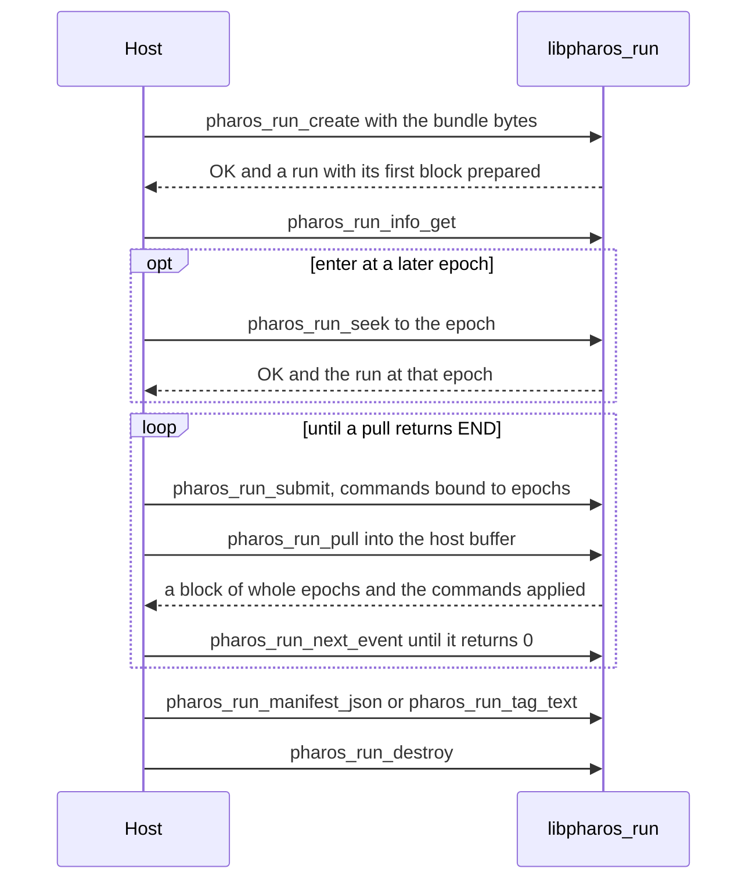
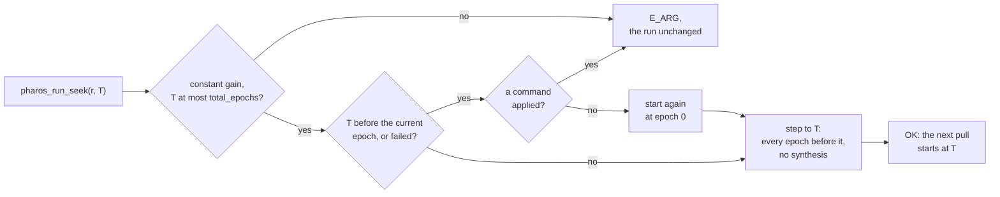

# pharos_run.h

`libpharos_run.a` generates the IF samples of a bundle
([samples](../samples.md)). A `pharos_run` object is one run: a host
pulls whole 1 ms epochs into its own buffer, can enter the run at any
epoch, and submits epoch-bound commands. It drains events, and can
render the manifest and the `.tag` text.

`pharos_run_to_file` runs the loop itself and writes a file. The bytes
are a function of the bundle, the seed, the noise mode, the gain and the
epoch-bound commands. Pull sizes and thread counts cannot change them,
and a seek lands on the same bytes ([seeking](#seeking)).

## Statuses

| Code | `pharos_run_status` | Meaning |
|---|---|---|
| 0 | `PHAROS_RUN_OK` | done |
| 1 | `PHAROS_RUN_END` | the run is complete: a pull with zero epochs |
| 2 | `PHAROS_RUN_E_ARG` | a bad argument, a value out of range, an epoch already produced or beyond the run, a seek the run refuses ([seeking](#seeking)), or a buffer too small |
| 3 | `PHAROS_RUN_E_NOMEM` | out of memory |
| 4 | `PHAROS_RUN_E_INTERNAL` | a failure no input explains, or a worker thread that could not start |
| 5 | `PHAROS_RUN_E_BUNDLE` | the bytes are no bundle of this build, or its content does not hold |
| 6 | `PHAROS_RUN_E_NAV` | a required auxiliary record is missing from the navigation data |
| 7 | `PHAROS_RUN_E_IO` | the file of `pharos_run_to_file` cannot be created, written or flushed |
| 8 | `PHAROS_RUN_E_BUSY` | `pharos_run_submit` found the command queue full: pull, then submit again |

| Status | Cases |
|---|---|
| `PHAROS_RUN_E_BUNDLE` | another layout or version; cross-references or ranges that do not hold |
| | no `samples` block; message content the listed signals' sets cannot encode |
| `PHAROS_RUN_E_NAV` | an EOP record, the GLONASS time offsets, BDT-UTC parameters |

`pharos-pack` refuses a scenario that would miss auxiliary data, and it
checks the message content at every leg boundary. A bundle it wrote
therefore returns neither case.

## Enums

| Enum | Members |
|---|---|
| `pharos_run_noise` | `PHAROS_RUN_NOISE_COUNTER` = 0, `PHAROS_RUN_NOISE_OFF` = 1 |
| `pharos_run_gain` | `PHAROS_RUN_GAIN_ADAPTIVE` = 0, `PHAROS_RUN_GAIN_CONSTANT` = 1 |
| `pharos_run_system` | `PHAROS_RUN_SYSTEM_GPS` = 0, `PHAROS_RUN_SYSTEM_BDS` = 1, `PHAROS_RUN_SYSTEM_GAL` = 2, `PHAROS_RUN_SYSTEM_GLO` = 3 |
| `pharos_run_command_kind` | `PHAROS_RUN_CMD_NOISE_FLOOR_DBM_HZ` = 0, `PHAROS_RUN_CMD_ELEVATION_MASK` = 1, `PHAROS_RUN_CMD_SIGNAL_POWER` = 2 |
| `pharos_run_power_unit` | `PHAROS_RUN_POWER_DBHZ` = 0, `PHAROS_RUN_POWER_DBM` = 1, `PHAROS_RUN_POWER_DBW` = 2 |
| `pharos_run_event_kind` | `PHAROS_RUN_EVENT_AGC` = 1 to `PHAROS_RUN_EVENT_EPHEMERIS_SWITCHED` = 5 |

| `pharos_run_signal` | Value | `pharos_run_signal` | Value |
|---|---|---|---|
| `PHAROS_RUN_SIGNAL_L1CA` | 0 | `PHAROS_RUN_SIGNAL_B2A` | 8 |
| `PHAROS_RUN_SIGNAL_L1C` | 1 | `PHAROS_RUN_SIGNAL_B2B` | 9 |
| `PHAROS_RUN_SIGNAL_L2C` | 2 | `PHAROS_RUN_SIGNAL_E1` | 10 |
| `PHAROS_RUN_SIGNAL_L5` | 3 | `PHAROS_RUN_SIGNAL_E5A` | 11 |
| `PHAROS_RUN_SIGNAL_B1C` | 4 | `PHAROS_RUN_SIGNAL_E5B` | 12 |
| `PHAROS_RUN_SIGNAL_B1I` | 5 | `PHAROS_RUN_SIGNAL_E6` | 13 |
| `PHAROS_RUN_SIGNAL_B2I` | 6 | `PHAROS_RUN_SIGNAL_G1` | 14 |
| `PHAROS_RUN_SIGNAL_B3I` | 7 | `PHAROS_RUN_SIGNAL_G2` | 15 |

## Options and info

| `pharos_run_options` field | Meaning | Default |
|---|---|---|
| `uint32_t workers` | the threads of a pull, the calling one among them; no upper bound | 0: one per hardware thread |
| `uint64_t seed` | the noise seed | 0 |
| `uint32_t noise` | a `pharos_run_noise` | `PHAROS_RUN_NOISE_COUNTER` |
| `uint32_t gain` | a `pharos_run_gain` | `PHAROS_RUN_GAIN_ADAPTIVE` |
| `double gain_db` | the constant gain in dB, [-60, 60]; 0 under the adaptive gain | 0 |

| `workers` | A pull runs on |
|---|---|
| 0 | one thread per hardware thread, the calling one among them |
| 1 | the calling thread alone; the run starts no thread |
| N | the calling thread and N - 1 threads the run starts |

The thread count changes no byte ([workers](../samples.md#workers)). A
thread the system cannot start is `E_INTERNAL`.

| `gain` | The quantiser's gain ([gain](../samples.md#gain)) |
|---|---|
| `PHAROS_RUN_GAIN_ADAPTIVE` | the AGC: 1.0 at the start, adjusted every 100 epochs by the clip rate; a `PHAROS_RUN_EVENT_AGC` for each adjustment |
| `PHAROS_RUN_GAIN_CONSTANT` | 10^(`gain_db` / 20) on every epoch; 0 dB is the AGC's starting 1.0; no AGC event |

| `pharos_run_info` field | Meaning |
|---|---|
| `uint32_t format_bits` | the bits per IQ component: 2, 4, 8 or 16 |
| `uint64_t sample_rate_hz` | the sample rate |
| `int64_t center_hz` | the centre frequency |
| `uint32_t samples_per_epoch` | the samples per 1 ms epoch |
| `uint32_t workers` | the threads of a pull, the calling one among them |
| `uint64_t bytes_per_epoch` | the bytes per epoch |
| `uint64_t total_epochs` | the epochs of the run |
| `int64_t start_gps_ms` | the GPS time of epoch 0, in whole milliseconds since 1980-01-06 00:00:00 GPS time |
| `double start_gps_sub_ms` | its fraction of a millisecond, in [0, 1) |
| `int64_t leap_change_gps_ms` | the GPS millisecond from which GPS - UTC changes, when an epoch of the run starts there or later; else 0 |
| `int32_t leap_seconds` | GPS - UTC in seconds at the start |
| `int32_t leap_seconds_after` | GPS - UTC from `leap_change_gps_ms` on; `leap_seconds` without a change |

| Time | Rule |
|---|---|
| epoch k | starts at GPS time `start_gps_ms + k + start_gps_sub_ms` milliseconds |
| UTC | GPS time less the leap seconds in force: `leap_seconds`, and `leap_seconds_after` from `leap_change_gps_ms` on |
| an inserted second | `leap_seconds` holds; UTC reads 23:59:60 |
| the leap seconds | the navigation data's schedule, else the built-in history ([leap seconds](../navigation-data.md#leap-seconds)) |

## Commands

| `pharos_run_command` field | Meaning |
|---|---|
| `uint64_t apply_at_epoch` | the epoch it applies at; 0: the first epoch of the next pull |
| `double value` | the command's value |
| `uint32_t kind` | a `pharos_run_command_kind` |
| `uint32_t system` | a `pharos_run_system`, for a signal-power command |
| `uint32_t svid` | the satellite; 0: every satellite of the system |
| `uint32_t unit` | a `pharos_run_power_unit` |
| `uint32_t use_default` | 1: restore the scenario's value and the fade |

| `kind` | Command | Rule |
|---|---|---|
| 0 `PHAROS_RUN_CMD_NOISE_FLOOR_DBM_HZ` | noise floor | `value` in dBm/Hz, [-250, 0] |
| 1 `PHAROS_RUN_CMD_ELEVATION_MASK` | elevation mask | `value` in degrees, [-90, 90]; effective at the next re-plan, at most 1 s later |
| 2 `PHAROS_RUN_CMD_SIGNAL_POWER` | signal power | `value` in `unit`, or `use_default` |

| Rule | Detail |
|---|---|
| a new noise floor | every C/N0 shifts by the opposite amount, explicit dBHz values included |
| so | received powers hold |
| a `PHAROS_RUN_POWER_DBM` or `PHAROS_RUN_POWER_DBW` value | against the noise floor in force when it applies |
| an accepted power | a C/N0 in [-100, 100] dB-Hz for some noise floor in [-250, 0] |
| hence | dBHz in [-100, 100], dBm in [-350, 100], dBW in [-380, 70] |
| when it applies | the C/N0 it gives is clamped to [-100, 100] |
| an `apply_at_epoch` beyond the run's end | accepted, never applied, holding one of the 256 queue slots |
| at one epoch | the scenario's `signalPower` entries apply first, so a host command overrides |
| the commands applied | `pharos_obs_output_submit` and `pharos_obs_truth_submit` take them in the same layout, so the observation file and the truth follow what aired ([commands](obs.md#commands)) |

`pharos_run_applied` holds a command and the epoch it applied at:
`uint64_t epoch` and `pharos_run_command command`.

## Blocks and events

| `pharos_run_block` field | Meaning |
|---|---|
| `uint64_t epoch_first` | the first epoch of the pull |
| `uint32_t epochs` | the epoch count |
| `size_t bytes` | the bytes written into the buffer |
| `uint64_t clipped` | the clipped components, I and Q counted apart |
| `const pharos_run_applied *applied` | the commands applied during the pull, valid until the next pull |
| `size_t applied_count` | their count |
| `uint32_t failed` | 0, or the status of a failure inside the pull |

After a failure the block holds the epochs generated before the failing
one.

| `pharos_run_event` field | Meaning |
|---|---|
| `uint64_t epoch` | the epoch of the event |
| `double a`, `b`, `c` | values, by kind |
| `uint32_t kind` | a `pharos_run_event_kind` |
| `uint32_t code` | an index, by kind |
| `uint32_t system`, `svid`, `signal` | a `pharos_run_system`, a satellite and a `pharos_run_signal` |

| `kind` | Event | Fields |
|---|---|---|
| 1 `PHAROS_RUN_EVENT_AGC` | AGC adjustment, under the adaptive gain | `epoch`; `a` the gain; `b` the clip rate; `c` 1 when reduced |
| 2 `PHAROS_RUN_EVENT_COMMAND_APPLIED` | command applied | `epoch`; `code` its index in the block's `applied` |
| 3 `PHAROS_RUN_EVENT_CHANNEL_ADDED` | channel added | `epoch`, `system`, `svid`, `signal` |
| 4 `PHAROS_RUN_EVENT_CHANNEL_REMOVED` | channel removed | `epoch`, `system`, `svid`, `signal` |
| 5 `PHAROS_RUN_EVENT_EPHEMERIS_SWITCHED` | ephemeris switched | `epoch`, `system`, `svid` |

An ephemeris switch may be queued up to 200 epochs, two geometry blocks,
before the pull that generates its epoch. Create queues a
`PHAROS_RUN_EVENT_CHANNEL_ADDED` for each channel of the first plan, and
a seek one for each channel the run holds when it returns
([seeking](#seeking)). The pulls give the progress: a block ends at
`epoch_first + epochs` of `total_epochs`, and the pull after the last
epoch returns `END`.

| `pharos_run_manifest_fields` field | Meaning |
|---|---|
| `const char *start_time_iso` | the manifest's `start_time` |
| `const char *run_id` | the manifest's `run_id` |
| `const char *output_path` | the manifest's `output.file` |

A NULL field, or a NULL pointer to the struct, names nothing. The
manifest's keys are on the [samples](../samples.md#the-manifest) page.
Its `ionosphere` object reports the requested model and a `systems`
array of applied models, coefficients and sources. An `auto` request
has an empty top-level `parameters` array; read each system's entry for
the coefficients used by its satellites. The bundle fixes these choices
when it is packed.
An incomplete resolved ionosphere table is rejected when reading the
bundle (`E_BUNDLE`).

## Seeking

`pharos_run_seek` enters the run at an epoch: the next pull starts there.

After an `OK` seek to T, every byte pulled equals what a run with the
same bundle, options and commands pulls from T on when it runs from
epoch 0. The seek passes every epoch before T, and the next pull takes T
as a pull that reaches it does. The commands whose epochs the seek
passes apply on the way, in order, as in a pull; those due at T apply
in the next pull. A seek before the run's epoch, or of a failed run,
starts the run again, which would drop the commands already applied.
Once a command has applied, that seek returns `E_ARG` and leaves the run
as it was; a host that needs the earlier epoch creates the run again,
submits its commands and seeks.

| After a seek to T | Rule |
|---|---|
| the channels the run holds | at 0, the first plan, as after a create; otherwise the plan of the last re-plan before T |
| a re-plan at T | at a multiple of 1000 after 0, by the next pull, which raises the channels it removes and adds, stamped T |
| events | the ephemeris switches already queued for T or later, then one `CHANNEL_ADDED`, stamped T, per channel the run holds; every other event not yet taken is dropped |
| `pharos_run_events_dropped` | counts none of the events the seek drops |
| the next block | `epoch_first` is T; T = `total_epochs` leaves `END` |
| `pharos_run_tag_text` | `TIME` is the GPS calendar time of T |
| `pharos_run_manifest_json` | `first_epoch` is T, `duration_ms` runs from T to the end, `size_bytes` counts from T, and `signals` lists those with a channel in force from T on; before the next pull, those of the channels the run holds |
| `pharos_run_to_file` | writes from T |
| `pharos_run_submit` | refuses an epoch before T; 0 binds a command to T |
| cost | the geometry, the parameters and the symbol masks of every epoch passed, on the pull's threads, without synthesis: the time grows with the epochs passed; starting again adds the message sets and the first block of epoch 0 |

## Functions

| Function | Does | Statuses |
|---|---|---|
| `uint32_t pharos_run_abi_version(void)` | returns `PHAROS_RUN_ABI_VERSION` | |
| `const char *pharos_run_last_error(void)` | the thread's message of the last creation call without an object | |
| `pharos_run_status pharos_run_create(const uint8_t *bundle, size_t len, const pharos_run_options *options, pharos_run **out)` | reads the bundle; prepares the first block and the channel table | `OK`; `E_BUNDLE`, `E_NAV`, `E_INTERNAL`, `E_NOMEM`, `E_ARG` |
| `pharos_run_status pharos_run_info_get(const pharos_run *r, pharos_run_info *out)` | the run's parameters, start instant and leap seconds | `OK`; `E_ARG` |
| `pharos_run_status pharos_run_pull(pharos_run *r, uint8_t *buf, size_t cap, uint32_t max_epochs, pharos_run_block *out)` | fills whole epochs into `buf`, at most `max_epochs` | `OK`, `END`; `E_ARG`; a failure |
| `pharos_run_status pharos_run_seek(pharos_run *r, uint64_t epoch)` | enters the run at `epoch`: the next pull starts there | `OK`; `E_ARG`; a failure |
| `pharos_run_status pharos_run_submit(pharos_run *r, const pharos_run_command *c)` | queues a command | `OK`; `E_ARG`, `E_BUSY` |
| `int pharos_run_next_event(pharos_run *r, pharos_run_event *out)` | 1 with an event, 0 when the ring is empty | |
| `uint32_t pharos_run_events_dropped(const pharos_run *r)` | the events the ring could not hold | |
| `pharos_run_status pharos_run_manifest_json(pharos_run *r, const pharos_run_manifest_fields *fields, uint8_t *buf, size_t cap, size_t *len)` | the manifest of the bytes pulled since create or the last seek | `OK`; `E_ARG` |
| `pharos_run_status pharos_run_tag_text(pharos_run *r, uint8_t *buf, size_t cap, size_t *len)` | the `.tag` text | `OK`; `E_ARG` |
| `pharos_run_status pharos_run_to_file(pharos_run *r, const char *path, uint64_t *bytes_written)` | runs to the end into `path` | `OK`; `E_IO`; a pull's failure |
| `const char *pharos_run_error(const pharos_run *r)` | the object's last message | |
| `void pharos_run_destroy(pharos_run *r)` | frees the run | |

| Function | Rule |
|---|---|
| `pharos_run_create` | `options` may be NULL; the bundle buffer may be freed after the call |
| `pharos_run_create` | `E_ARG` for an undefined `gain` or `noise`, a constant gain whose `gain_db` is not in [-60, 60], or an adaptive gain with a nonzero `gain_db` |
| `pharos_run_pull` | `END` with zero epochs once the run is complete, before `max_epochs` and `cap` are checked |
| `pharos_run_pull` | `E_ARG` when `max_epochs` is 0 or `buf` holds no epoch; the run goes on and `out` is untouched |
| `pharos_run_pull` | any other failure fills `out` with the epochs before the failing one and sets `failed` |
| `pharos_run_pull` | after a failure every later pull returns that status with an empty block, until a seek starts the run again |
| `pharos_run_seek` | `E_ARG` for an `epoch` beyond `total_epochs`, for a run under the adaptive gain, and for a start again once a command has applied; the run is unchanged |
| `pharos_run_seek` | any other failure: the status and message of a failed pull; the run is failed until the next seek |
| `pharos_run_submit` | `E_ARG` for a malformed command, a value out of range or a past epoch |
| `pharos_run_submit` | `E_BUSY` when 256 commands are pending |
| `pharos_run_next_event` | drain after every create, seek and pull; the ring holds 1024 events |
| `pharos_run_manifest_json` | the text is not NUL-terminated; a field that is not UTF-8 is `E_ARG` |
| `pharos_run_tag_text` | not NUL-terminated; `E_ARG` for IQ2 and IQ4, which the format cannot name |
| `pharos_run_to_file` | from the run's current epoch, in 100-epoch blocks; `path` against the working directory |
| `pharos_run_to_file` | drops the events its pulls produce |
| `pharos_run_to_file` | on a failed pull, the epochs before the failing one are written first |
| `pharos_run_to_file` | `bytes_written` is what the file holds, in every case |

## Limits and messages

| Message | Function and case |
|---|---|
| `noise mode <n> is not defined (0 counter, 1 off)` | `pharos_run_create` |
| `gain mode <n> is not defined (0 adaptive, 1 constant)` | `pharos_run_create` |
| `gain_db must be from -60 to 60, got <v>` | `pharos_run_create`: a constant gain; NaN and the infinities among them |
| `gain_db must be 0 under the adaptive gain, got <v>` | `pharos_run_create` |
| `<message>` | `pharos_run_create`: `E_BUNDLE`, with the bundle decoder's reason; `out of memory` for `E_NOMEM` ([the bundle](../scenarios.md#the-bundle)) |
| `the bundle has no samples block: nothing to generate` | `pharos_run_create`: `E_BUNDLE` |
| `cannot create the run: <reason>` | `pharos_run_create`: another failure; `E_NOMEM` for `out of memory` |
| `max_epochs is 0 or the buffer holds no epoch of <n> bytes` | `pharos_run_pull`: `E_ARG` |
| `epoch <n> lies beyond the run's <m> epochs` | `pharos_run_seek`: `E_ARG` |
| `seeking needs a constant gain: the adaptive AGC depends on every epoch before the target` | `pharos_run_seek`: `E_ARG` |
| `seeking to epoch <n> is refused: the seek starts the run over, which would drop the commands it has applied` | `pharos_run_seek`: `E_ARG` |
| `epoch <n> of <m> could not be generated: <reason>` | `pharos_run_pull`, `pharos_run_seek`, `pharos_run_to_file`: a failed epoch |
| `malformed command` | `pharos_run_submit`: an unknown kind, system, satellite or unit |
| `submit rejected: the command's value is out of range` | `pharos_run_submit`: a value out of range |
| `submit rejected: the command's epoch has passed` | `pharos_run_submit`: an epoch already produced |
| `the command queue holds 256 pending commands: pull, then submit again` | `pharos_run_submit`: `E_BUSY` |
| `<field> is not UTF-8` | `pharos_run_manifest_json` |
| `the .tag format has no <format> format` | `pharos_run_tag_text` |
| `cannot write <path>: <error>` | `pharos_run_to_file`: `E_IO`, the file cannot be created, written or flushed; a long path elided |
| `out of memory` | any other call that returns `E_NOMEM` |

The reasons of a failed epoch are those of `pharos-run`
([samples](../samples.md#limits-and-messages)).
