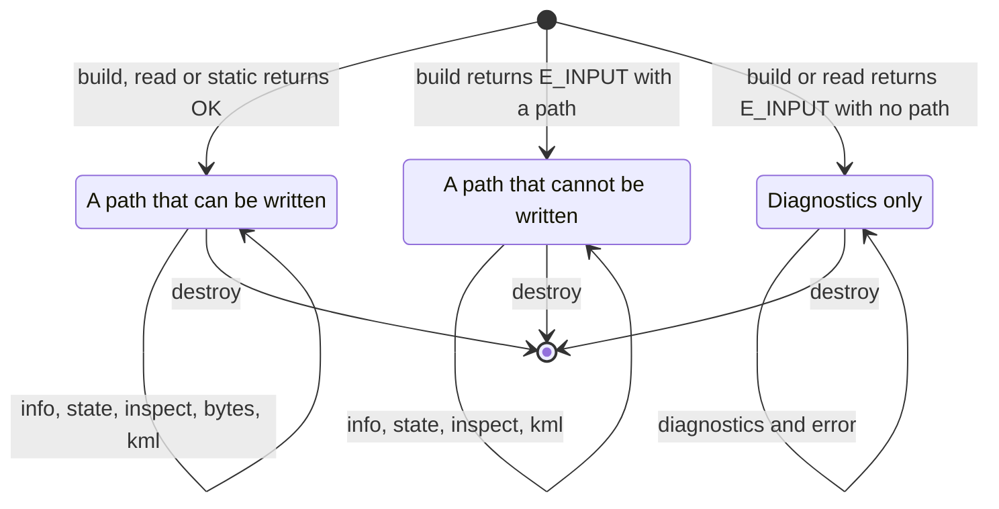

# pharos_traj.h

`libpharos_traj.a` builds trajectory plans, reads `.pht` files, makes a
receiver at rest, and inspects and exports what it holds
([trajectories](../trajectories.md)). A `pharos_traj` object holds a path
that can be written, a path that left the receiver's domain or broke a
limit of its plan, which can be inspected but not written, or only the
diagnostics of a source that could not be read or built. The trajectory
C ABI is `0x00010000`.



`build` and `read` hand out an object on `E_INPUT`, with its diagnostics
and its first error rendered. `has_path` tells whether it holds a path:
a plan refused when read has none; a path that leaves the domain or
breaks a limit has one, and `bytes` refuses it. Argument and allocation
failures hand out no object, and `static` none on any failure; their
reason is in `pharos_traj_last_error()`. Destroy every object handed out,
one returned with `E_INPUT` too.

## Statuses

| Code | `pharos_traj_status` | Meaning |
|---|---|---|
| 0 | `PHAROS_TRAJ_OK` | done |
| 1 | `PHAROS_TRAJ_END` | not returned by this library |
| 2 | `PHAROS_TRAJ_E_ARG` | an argument out of range, or an object with no path |
| 3 | `PHAROS_TRAJ_E_NOMEM` | allocation failed |
| 4 | `PHAROS_TRAJ_E_INTERNAL` | not returned by this library |
| 5 | `PHAROS_TRAJ_E_INPUT` | a plan or `.pht` refused, a path out of the domain or that breaks a limit, or a `.pht` that cannot be written |

## Enums

| Enum | Members |
|---|---|
| `pharos_traj_diag_code` | `PHAROS_TRAJ_DIAG_INVALID_JSON` = 0 through `PHAROS_TRAJ_DIAG_IO_ERROR` = 19 |
| `pharos_traj_severity` | `PHAROS_TRAJ_SEVERITY_ERR` = 0, `PHAROS_TRAJ_SEVERITY_WARNING` = 1 |

The diagnostic codes are shared with scenarios
([diagnostics](../scenarios.md#diagnostics)). A plan's faults are
`unknown_key`, `missing_field`, `wrong_type`, `unknown_name`, `duplicate`
and `out_of_range` as it is read, `invalid_segment` where a segment cannot
be built or the path leaves the domain, and `out_of_range` at
`limits[i]` for a broken limit.

## Structs

| `pharos_traj_diag` field | Meaning |
|---|---|
| `uint32_t code` | a `pharos_traj_diag_code` |
| `uint32_t severity` | a `pharos_traj_severity` |
| `const char *source` | source name, or an empty string |
| `const char *path` | the field's path in the plan, such as `segments[1].turn.by`, or an empty string |
| `uint32_t line`, `column` | one-based text position; zero when absent |
| `const char *message` | the sentence |

| `pharos_traj_info` field | Meaning |
|---|---|
| `uint32_t velocity_steps` | the velocity steps: two knots at one time with different velocities |
| `uint64_t knots` | the knots |
| `double duration_s` | the duration in seconds |
| `double max_speed_mps` | the greatest 3D speed |
| `double max_acceleration_mps2` | the greatest 3D acceleration |
| `double max_jerk_mps3` | the greatest 3D jerk, within pieces |
| `double min_altitude_m`, `max_altitude_m` | the least and greatest altitude above EGM96 |
| `uint32_t acceleration_steps` | the acceleration steps: two knots at one time with one velocity and different accelerations |
| `double largest_acceleration_step_mps2` | the largest acceleration step's size |
| `double largest_acceleration_step_s` | its time; 0 without one |
| `double largest_velocity_step_mps` | the largest velocity step's size |
| `double largest_velocity_step_s` | its time; 0 without one |

The extremes are the stored path's own, read as the limits read it
([limits](../trajectories.md#limits)). They are found at the first
`info_get` on an object and kept: a later call costs nothing.
`pharos-traj check` prints the same numbers.

| `pharos_traj_state` field | Meaning |
|---|---|
| `double pos[3]` | WGS84 ECEF position in metres |
| `double vel[3]` | ECEF velocity in m/s |
| `double acc[3]` | ECEF acceleration in m/s^2 |
| `double lat_deg`, `lon_deg` | WGS84 latitude and longitude in degrees |
| `double altitude_m` | altitude above EGM96 in metres |
| `double speed_mps` | 3D speed in m/s |
| `double course_deg` | the direction of travel, in [0, 360) clockwise from north; NaN below a horizontal speed of 1 mm/s |

## Functions

| Function | Result | Statuses |
|---|---|---|
| `uint32_t pharos_traj_abi_version(void)` | `PHAROS_TRAJ_ABI_VERSION` | |
| `const char *pharos_traj_last_error(void)` | the calling thread's error from a call with no object | |
| `pharos_traj_status pharos_traj_build(const uint8_t *json, size_t len, pharos_traj **out)` | builds one trajectory plan | `OK`, `E_INPUT`; `E_ARG`, `E_NOMEM` without an object |
| `pharos_traj_status pharos_traj_read(const uint8_t *bytes, size_t len, pharos_traj **out)` | reads `.pht` bytes, at most 1 GiB | `OK`, `E_INPUT`; `E_ARG`, `E_NOMEM` without an object |
| `pharos_traj_status pharos_traj_static(double lat_deg, double lon_deg, double altitude_m, double duration_s, pharos_traj **out)` | a receiver at rest, its altitude above EGM96 | `OK`; `E_ARG`, `E_NOMEM` without an object |
| `size_t pharos_traj_diag_count(const pharos_traj *t)` | the diagnostics; zero for null | |
| `pharos_traj_status pharos_traj_diag_get(const pharos_traj *t, size_t index, pharos_traj_diag *out)` | one diagnostic | `OK`; `E_ARG` |
| `int pharos_traj_has_path(const pharos_traj *t)` | 1 where the object holds a path, else 0 | |
| `pharos_traj_status pharos_traj_info_get(pharos_traj *t, pharos_traj_info *out)` | the path's statistics, found once and kept in the object | `OK`; `E_ARG`, `E_NOMEM` |
| `pharos_traj_status pharos_traj_state_get(const pharos_traj *t, double t_s, pharos_traj_state *out)` | the state at a time | `OK`; `E_ARG` |
| `pharos_traj_status pharos_traj_bytes(pharos_traj *t, const uint8_t **bytes, size_t *len)` | the `.pht` text | `OK`; `E_ARG`, `E_INPUT`, `E_NOMEM` |
| `pharos_traj_status pharos_traj_kml(pharos_traj *t, const uint8_t **bytes, size_t *len)` | the path as a KML line, of any path | `OK`; `E_ARG`, `E_NOMEM` |
| `pharos_traj_status pharos_traj_inspect(pharos_traj *t, size_t sample_count, const uint8_t **bytes, size_t *len)` | a built path read for a caller, as JSON ([inspection](#inspection)) | `OK`; `E_ARG`, `E_NOMEM` |
| `const char *pharos_traj_error(const pharos_traj *t)` | the object's latest error; an empty string for null | |
| `void pharos_traj_destroy(pharos_traj *t)` | destroys the object; null is allowed | |
| `pharos_traj_status pharos_traj_describe_geometry(const uint8_t *json, size_t len, size_t subdivisions, pharos_traj_geometry **out)` | the guides of a plan being written ([geometry](#geometry)) | `OK`; `E_ARG`, `E_INPUT`, `E_NOMEM` without an object |
| `pharos_traj_status pharos_traj_geometry_bytes(const pharos_traj_geometry *g, const uint8_t **bytes, size_t *len)` | the description's JSON | `OK`; `E_ARG` |
| `void pharos_traj_geometry_destroy(pharos_traj_geometry *g)` | destroys the description; null is allowed | |

`static` takes a latitude in [-90, 90], a longitude in [-180, 180], a
position in the receiver's domain and a duration from 0 to 10^7 s; a
refusal reads like `lat_deg must be from -90 to 90, got 95`. A duration
of 0 is one knot. `state_get` takes times from -10^7 s to the path's
duration plus 10^7 s; outside the stored path, the end knot's
acceleration goes on.

`read` refuses more than 1 GiB with `a PHT must be at most 1073741824
bytes, got <len>`, code `out_of_range`, at no path. `bytes` refuses with
`E_INPUT` and one of `the path breaks a limit of its plan, so no PHT is
written of it`, `the path leaves the receiver's domain, so no PHT is
written of it` and `the path takes more than the 1073741824 bytes a PHT
holds, so no PHT is written of it`. `info_get`, `bytes`, `kml` and
`inspect` clear the object's error first; on an object with no path they
answer `E_ARG` and `the object holds no trajectory: its source has
errors`.

The KML line is the one `pharos-traj export` writes
([trajectories](../trajectories.md#limits-and-messages)), named after the
trajectory or `Pharos trajectory`.

## Inspection

`inspect` reads a built path for a caller: its events with where in the
plan each comes from, its segments in the plan's terms, each limit's
check, and samples of the motion. `sample_count`, at least 2, is the
number of even samples over the path, its ends included; besides them,
each knot gives a sample on each side, and a sample equal to the one
before is left out. An object made by `read` or `static` has no plan:
`inspect` answers `OK` with a null pointer and a length of 0.

| Key | Content |
|---|---|
| `distance3d` | the path's length in space, at its height, m |
| `duration` | s |
| `events` | an object a named instant: the start, each segment with an `id` at its end, each place of a through |
| `segments` | an object a segment of the plan |
| `checks` | an object a limit, in the plan's order |
| `samples` | an object a sample, in the order of time |

| Event key | Content |
|---|---|
| `id` | its name |
| `time` | s |
| `segment` | its segment's position in `segments`; null for the start |
| `place` | for a place of a through, the place's position in its `places`; else null |
| `latitude`, `longitude` | degrees |
| `altitude` | m, in the plan's reference |
| `speed3d` | m/s |
| `course` | degrees in [0, 360), null below 1 mm/s |
| `velocityEcef`, `accelerationEcef` | the knot's, in m/s and m/s^2 |

| Segment key | Content |
|---|---|
| `kind` | `stay`, `straight`, `turn`, `along` or `through` |
| `id` | its id, or null |
| `start`, `end` | s |
| `length` | m over the ground, in the plan's terms: a run's as stated or as its shape fixes it, a through's as told ([the stored path](../trajectories.md#the-stored-path)), a stay's 0 |
| `endSpeed` | m/s over the ground |
| `endCourse` | degrees in [0, 360), null below 1 mm/s |

| Check key | Content |
|---|---|
| `limit` | its position in `limits` |
| `id`, `quantity`, `max`, `min` | as the plan states them; null where absent |
| `holds` | whether the limit holds |
| `worst` | `{ "value", "time", "segment" }`: the value farthest past the bounds, or nearest them where the limit holds, with its sign; null where the quantity has no value over the limit's segments (a direction of travel at rest) |
| `broken` | `[{ "from", "to" }]`: the stretches of time where it is broken, ends included, in order; a single instant has `from` = `to` |

| Sample key | Content |
|---|---|
| `time` | s |
| `distance3d` | m in space from the start, told as [the stored path](../trajectories.md#the-stored-path) says |
| `latitude`, `longitude` | degrees |
| `altitude` | m, in the plan's reference |
| `speed3d`, `horizontalSpeed`, `climbRate` | m/s; the climb rate in the plan's reference |
| `acceleration3d`, `verticalAcceleration` | m/s^2; the vertical in the plan's reference |
| `forwardAcceleration`, `lateralAcceleration` | m/s^2: a·ĥ and a·(ĥ × up), + to the right; null below 1 mm/s |
| `jerk3d`, `forwardJerk` | m/s^3; the forward null below 1 mm/s |
| `course` | degrees in [0, 360), null below 1 mm/s |
| `turnRate` | deg/s: the lateral acceleration over the horizontal speed, null below 1 mm/s |

The samples are physical: the motion at the path's height, as the limits
read it, where the segments' lengths and end speeds are over the ground,
as the plan states them. A straight reads a lateral acceleration and a
turn rate of 0. Over EGM96 a sample is read in the geoid's cell it lies
in, a sample at a knot in its own piece's. On a piece shorter than 10 ms
a sample's velocity and acceleration go evenly from one knot's to the
other's, and its jerk is their change over the piece's time. Two samples
at one time are the two sides of a step, in order.

The text is counted first and then written into a block of its size; the
lengths to each knot and each sample are told once for both, 8 bytes each
while the call runs. A through of 100,000 places takes 147 MB of JSON. A
text that would pass 4 GiB in a WebAssembly instance answers `E_NOMEM`.

## Geometry

`describe_geometry` describes the guides of a plan being written, each in
the plan's order: the plan's own keys, of which it reads `coordinates`,
`places` and `guides`, none of them needing to be complete. A guide whose
kind, places and their coordinates are given and right is whole, and its
positions are given; a guide with any fault is not whole, with `positions`
null, and the others are still described. Text that is not JSON, a root
that is not an object, or an unknown key at the plan's top level refuse
the description: `E_INPUT`, no description, the reason in
`pharos_traj_last_error()`.

```json
{"guides":[{"id":"road","whole":true,"positions":[{"latitude":29.999999999999996,"longitude":114.00000000000001}, …]},{"id":"broken","whole":false,"positions":null}]}
```

Each piece of a whole guide is traced in steps of its parameter, each
halved until, drawn as a straight line in latitude and longitude between
its positions as a map draws it, it keeps within 0.1 m of the path at its
middle and quarters, and in at most `subdivisions` steps a piece (in
halvings: 1000 allows 512); a short leg is one step. `subdivisions` is at
least 1: `subdivisions must be at least 1, got 0`. The id is the one
given, where it is text.

## Ownership and errors

The input bytes are borrowed for the call. The object owns its plan, its
path, its diagnostics and the texts it hands out; the diagnostics' strings
and the error stay the object's. Do not free a pointer it hands out.

| Text | Valid until |
|---|---|
| `bytes`, `kml` | the object is destroyed; each is written once |
| `inspect` | the next `inspect` on the object that passes its argument checks, which frees it first, or the object's destruction |
| `geometry_bytes` | the description is destroyed |

A call that hands out a text first sets its pointer to null and its
length to 0. The texts have a length and no NUL.

`info_get` keeps what it finds in the object, which it therefore writes:
two threads must not call it on one object at once. Every other call
taking a `const pharos_traj *` only reads it.
