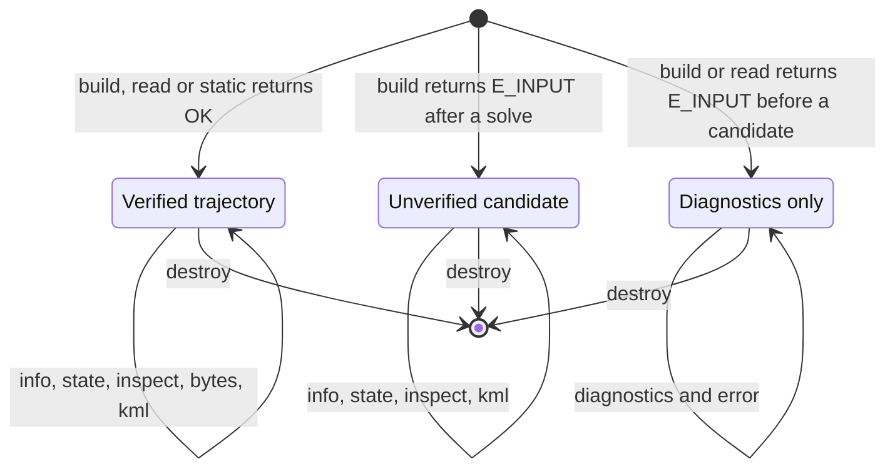

# pharos_traj.h

`libpharos_traj.a` solves trajectory plans and reads, inspects and
exports internal trajectory products ([trajectories](../trajectories.md)).
A `pharos_traj` object holds a verified trajectory, an unverified solve
candidate, or diagnostics from a source that could not be parsed.
The current trajectory C ABI is `0x00010000`.

`build` and `read` retain an object on `E_INPUT`, with structured
diagnostics and a rendered error. A solve that did not pass verification
retains its candidate for inspection. `has_path` tests for a candidate,
not successful verification. The inspection's `solve.verified` field
identifies a verified plan result; `.pht` serialization rejects an
unverified candidate.

Argument and allocation failures produce no object. Their reason is
available through `pharos_traj_last_error()` where supplied. A failed
`static` also produces no object. Always destroy a non-null object,
including one returned with `E_INPUT`.

## Statuses

| Code | `pharos_traj_status` | Meaning |
|---|---|---|
| 0 | `PHAROS_TRAJ_OK` | operation completed |
| 1 | `PHAROS_TRAJ_END` | not returned by this library |
| 2 | `PHAROS_TRAJ_E_ARG` | invalid argument or missing trajectory |
| 3 | `PHAROS_TRAJ_E_NOMEM` | allocation failed |
| 4 | `PHAROS_TRAJ_E_INTERNAL` | not returned by this library |
| 5 | `PHAROS_TRAJ_E_INPUT` | invalid plan or `.pht`, unsuccessful solve, or unverified `.pht` serialization |

## Enums

| Enum | Members |
|---|---|
| `pharos_traj_diag_code` | `PHAROS_TRAJ_DIAG_INVALID_JSON` = 0 through `PHAROS_TRAJ_DIAG_IO_ERROR` = 19 |
| `pharos_traj_severity` | `PHAROS_TRAJ_SEVERITY_ERR` = 0, `PHAROS_TRAJ_SEVERITY_WARNING` = 1 |

The diagnostic codes are shared with scenarios
([diagnostics](../scenarios.md#diagnostics)). Trajectory authoring uses
one plan model and one build function.

## Structs

| `pharos_traj_diag` field | Meaning |
|---|---|
| `uint32_t code` | a `pharos_traj_diag_code` |
| `uint32_t severity` | a `pharos_traj_severity` |
| `const char *source` | source name, or an empty string |
| `const char *path` | logical field path, or an empty string |
| `uint32_t line`, `column` | one-based text position; zero when absent |
| `const char *message` | message text |

| `pharos_traj_info` field | Meaning |
|---|---|
| `uint32_t velocity_steps` | number of velocity steps |
| `uint64_t knots` | knot count |
| `double duration_s` | duration in seconds |
| `double max_speed_mps` | largest sampled speed |
| `double max_acceleration_mps2` | largest sampled acceleration |
| `double max_jerk_mps3` | largest sampled jerk |
| `double min_altitude_m`, `max_altitude_m` | sampled altitude range above EGM96 |
| `uint32_t acceleration_steps` | number of acceleration steps |
| `double largest_acceleration_step_mps2` | largest acceleration step |
| `double largest_acceleration_step_s` | its elapsed time; zero if absent |

These dynamics are the sampled statistics printed by `pharos-traj check`.
They are not the independent plan verification report.

| `pharos_traj_state` field | Meaning |
|---|---|
| `double pos[3]` | WGS84 ECEF position in metres |
| `double vel[3]` | ECEF velocity in m/s |
| `double acc[3]` | ECEF acceleration in m/s^2 |
| `double lat_deg`, `lon_deg` | WGS84 latitude and longitude in degrees |
| `double altitude_m` | altitude above EGM96 in metres |
| `double speed_mps` | 3D speed in m/s |
| `double course_deg` | travel direction clockwise from north, or NaN without horizontal motion |

The `altitude_m` state field always uses EGM96. Plan inspection uses the
plan's declared altitude datum.

## Functions

| Function | Result | Statuses |
|---|---|---|
| `uint32_t pharos_traj_abi_version(void)` | `PHAROS_TRAJ_ABI_VERSION` | |
| `const char *pharos_traj_last_error(void)` | calling thread's creation error | |
| `pharos_traj_status pharos_traj_build(const uint8_t *json, size_t len, pharos_traj **out)` | solves one TrajectoryPlan | `OK`, `E_INPUT`; `E_ARG`, `E_NOMEM` without an object |
| `pharos_traj_status pharos_traj_read(const uint8_t *bytes, size_t len, pharos_traj **out)` | reads internal `.pht` bytes | `OK`, `E_INPUT`; `E_ARG`, `E_NOMEM` without an object |
| `pharos_traj_status pharos_traj_static(double lat_deg, double lon_deg, double altitude_m, double duration_s, pharos_traj **out)` | creates a stationary trajectory using EGM96 altitude | `OK`; `E_ARG`, `E_NOMEM` |
| `size_t pharos_traj_diag_count(const pharos_traj *t)` | diagnostic count, or zero for null | |
| `pharos_traj_status pharos_traj_diag_get(const pharos_traj *t, size_t index, pharos_traj_diag *out)` | one diagnostic | `OK`; `E_ARG` |
| `int pharos_traj_has_path(const pharos_traj *t)` | one when a trajectory or candidate is present, otherwise zero | |
| `pharos_traj_status pharos_traj_info_get(const pharos_traj *t, pharos_traj_info *out)` | trajectory or candidate statistics | `OK`; `E_ARG` |
| `pharos_traj_status pharos_traj_state_get(const pharos_traj *t, double t_s, pharos_traj_state *out)` | interpolated state at elapsed time | `OK`; `E_ARG` |
| `pharos_traj_status pharos_traj_inspect(pharos_traj *t, size_t sample_count, const uint8_t **bytes, size_t *len)` | plan solve report and samples as retained UTF-8 JSON | `OK`; `E_ARG`, `E_NOMEM` |
| `pharos_traj_status pharos_traj_bytes(pharos_traj *t, const uint8_t **bytes, size_t *len)` | verified internal `.pht` text | `OK`; `E_ARG`, `E_NOMEM`, `E_INPUT` |
| `pharos_traj_status pharos_traj_kml(pharos_traj *t, const uint8_t **bytes, size_t *len)` | KML visualization, including an unverified candidate | `OK`; `E_ARG`, `E_NOMEM` |
| `const char *pharos_traj_error(const pharos_traj *t)` | object's latest error, or an empty string for null | |
| `void pharos_traj_destroy(pharos_traj *t)` | destroys the object; null is allowed | |
| `pharos_traj_status pharos_traj_describe_geometry(const uint8_t *json, size_t len, size_t subdivisions, pharos_traj_geometry **out)` | samples authored geometry without solving a trajectory | `OK`; `E_ARG`, `E_INPUT`, `E_NOMEM` without an object |
| `pharos_traj_status pharos_traj_geometry_bytes(const pharos_traj_geometry *g, const uint8_t **bytes, size_t *len)` | retained geometry inspection JSON | `OK`; `E_ARG` |
| `void pharos_traj_geometry_destroy(pharos_traj_geometry *g)` | destroys the geometry description; null is allowed | |

`static` accepts latitude in [-90, 90], longitude in [-180, 180] and
nonnegative duration through 10^7 seconds. Position must lie within the
shared receiver domain. `state_get` accepts times from -10^7 seconds
through the trajectory's duration plus 10^7 seconds. Outside the stored
interval, the endpoint state continues with constant acceleration.

## Geometry inspection

`describe_geometry` reads an object containing `coordinates` and `geometry`
with the same syntax and validation as a trajectory plan. Events, sections,
rules and a solved path are not required. Empty geometry is valid. Invalid
geometry produces no description and its reason is available through
`pharos_traj_last_error()`.

The positive `subdivisions` value specifies intervals per Bezier piece,
polyline segment or polygon edge. A circle uses twice that many samples.
Curves use the plan's ECEF geometry and altitude datum. Region boundaries
use the same local ENU planes as their containment rules.

| JSON field | Content |
|---|---|
| `curves` | `{ id, positions }` for each guide curve, including both endpoints |
| `regions` | `{ id, positions, radiusPoint }` for each region; boundaries close from the last point to the first |
| `positions` | ordered `{ latitude, longitude }` values in degrees |
| `radiusPoint` | the circle's east boundary point, or null for a polygon |

The returned UTF-8 bytes belong to the description until
`pharos_traj_geometry_destroy`. Copy or parse them before destruction.

## Source inspection

`sample_count` is at least two. It specifies the number of uniform time
samples, including the endpoints. Inspection adds both sides of every
event and every emitted knot, then removes identical duplicate samples.
The returned sample count can exceed the requested count. Altering the
inspection density does not solve again or change the candidate.
Samples with the same time can represent different incoming and outgoing
states. Preserve their order and interpolate only within each side of an
event; an exact event time selects the outgoing sample.

A plan object returned by `build` has this JSON shape:

| Field | Content |
|---|---|
| `distance` | integrated 3D travel distance in metres |
| `duration` | elapsed seconds |
| `solve` | the numerical and verification report |
| `events` | event states and solved times |
| `sections` | section identifiers and solved intervals |
| `samples` | candidate states and physical quantities |
| `rules` | rule residuals and verification results |

| `solve` field | Meaning |
|---|---|
| `status` | `converged`, `iterationLimit`, `infeasible`, `numericalFailure` or `verificationFailed` |
| `feasible` | independent hard-rule and receiver-domain checks accepted the candidate |
| `verified` | solver convergence and independent checks both passed |
| `iterations` | accumulated inner iterations |
| `objective` | normalized soft objective |
| `maxViolation` | maximum normalized hard-rule violation |
| `stationarity` | final projected stationarity measure |

A local solve's `infeasible` status does not prove that the authored
plan has no solution. `converged` does not establish a global optimum.

| Array entry | Fields |
|---|---|
| `events` | `id`, zero-based `index`, `time`, `latitude`, `longitude`, `altitude`, `speed`, `course`, `velocityEcef`, `accelerationEcef` |
| `sections` | `id`, event IDs `from` and `to`, `start`, `end` |
| `samples` | `time`, `distance`, `latitude`, `longitude`, `altitude`, `speed`, `horizontalSpeed`, `forwardSpeed`, `up`, `acceleration`, `forwardAcceleration`, `jerk`, `forwardJerk`, `course`, `turnRate`, `lateralAcceleration` |
| `rules` | `id`, `kind`, `violation`, `residual`, `active` |

Times use seconds and distances use metres. Latitude, longitude and
course use degrees; turn rate uses degrees/s. Speeds use m/s,
accelerations m/s^2 and jerks m/s^3. `speed`, `acceleration` and `jerk`
are 3D magnitudes. Forward quantities and lateral acceleration are
signed. `altitude` and `up` use the plan's altitude datum. Event entries
use the outgoing side where one exists; samples retain either side when
the values differ.

When the plan uses heading or forward/lateral quantities, or supplies an
initial course, inspection uses its solved orientation state. Otherwise
course and turn rate are derived from nonzero horizontal velocity; at
rest the initialized course state is retained.

Rule `kind` is `hard`, `target` or `objective`. `violation` and
`residual` are normalized using the rule's scale. Hard-rule violations
are required to pass verification; targets may retain residuals. See
[the solver design](../../design/trajectories.md) for numerical limits.

Objects made by `read` or `static` have no authored plan. `inspect`
returns `OK` with a null byte pointer and zero length for those objects.
An object with no trajectory returns `E_ARG`.

## Ownership and errors

The input byte spans are borrowed for the call. The object owns its
parsed plan, trajectory, diagnostics and retained output buffers.
Diagnostic strings and the error pointer remain borrowed from the
object. Do not free returned pointers.

`.pht` and KML buffers are retained until object destruction. Inspection
bytes are retained until the next successful `inspect` call or object
destruction. Copy a view before that lifetime ends if it is needed later.
Output text has an explicit byte length and need not be NUL-terminated.

Each serialization or inspection call clears the output byte pointer
and length before performing the operation. An unverified `.pht`
request returns `E_INPUT`, a null pointer and zero length, with
`the trajectory candidate has not passed verification` as its error.
The object's error text describes the latest failing operation; the
structured solve diagnostics remain available separately.
