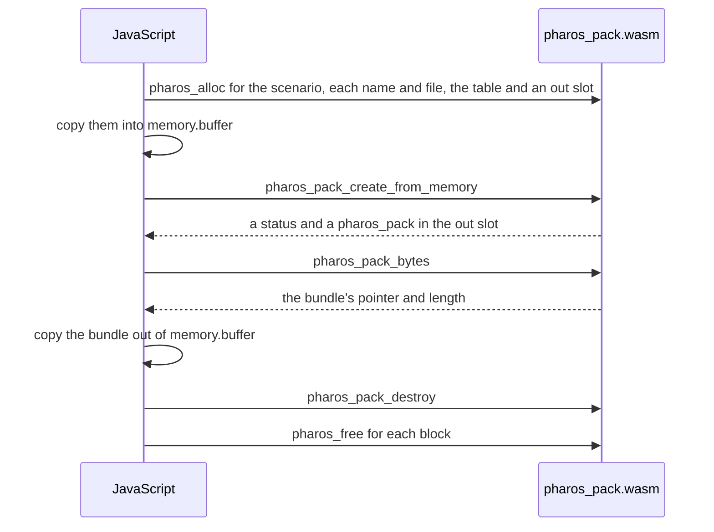
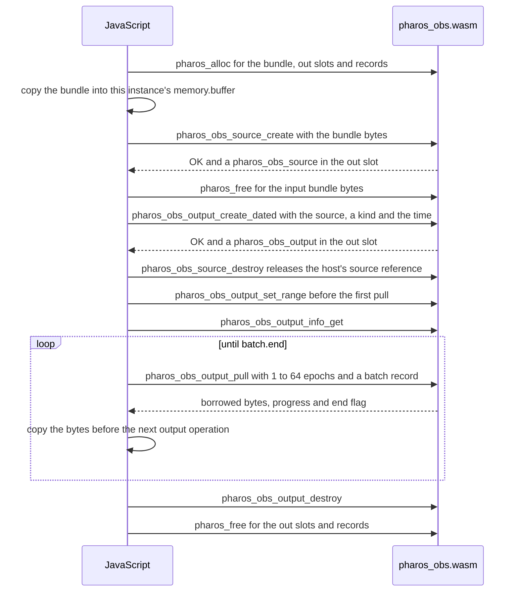

# WebAssembly

Pharos supplies three independent WebAssembly modules for a JavaScript
host. Each imports nothing and exposes one product's C API.

| Module | Does |
|---|---|
| `pharos_traj.wasm` | solves trajectory plans, reads internal `.pht` products and describes draft geometry |
| `pharos_pack.wasm` | packs a scenario from files the host holds in memory and describes navigation files |
| `pharos_obs.wasm` | writes a bundle's observation and position files and tells what the run's receiver sees at any epoch |

The host loads the products it needs. Products exchange `.pht` and `.phb`
bytes through the host; handles and pointers belong to one instance.
A bundle from `pharos_pack.wasm` is read by every build of the same source
([the bundle](../scenarios.md#the-bundle)).





## Build

```bash
zig build wasm -Doptimize=ReleaseFast
```

The target is `wasm32-freestanding` with SIMD128 enabled. The host's
WebAssembly engine must support SIMD128 to compile and instantiate it.

This installs `pharos_traj.wasm`, `pharos_pack.wasm` and
`pharos_obs.wasm` under `zig-out/lib`. Each includes the embedded physical
models used by its product. Beside them go `trajectory.schema.json` and
`scenario.schema.json`, the JSON Schemas of the two JSON inputs
([JSON Schemas](../../design/formats.md#the-json-schemas)). A build that
depends on Pharos takes each module and schema by its file name as a named
lazy path and installs the files it needs:

```zig
const pharos = b.dependency("pharos", .{ .optimize = .ReleaseFast });
for ([_][]const u8{
    "pharos_traj.wasm",
    "pharos_pack.wasm",
    "pharos_obs.wasm",
    "trajectory.schema.json",
    "scenario.schema.json",
}) |name| {
    b.getInstallStep().dependOn(&b.addInstallFile(pharos.namedLazyPath(name), b.pathJoin(&.{ "web", name })).step);
}
```

## Exports

| Module | Product exports |
|---|---|
| `pharos_traj.wasm` | the functions of [pharos_traj.h](traj.md) |
| `pharos_pack.wasm` | the functions of [pharos_pack.h](pack.md) except `pharos_pack_create`; the files come through `pharos_pack_create_from_memory`, as there is no file system |
| `pharos_obs.wasm` | the functions of [pharos_obs.h](obs.md) except `pharos_obs_output_create`; the creation time comes through `pharos_obs_output_create_dated`, as there is no clock |

Every module also exports:

| Export | Is |
|---|---|
| `memory` | the instance's memory; every pointer is an offset into it |
| `void *pharos_alloc(size_t len)` | `len` bytes aligned to 16 from the module's allocator; NULL for 0 or when the memory cannot grow |
| `void pharos_free(void *ptr, size_t len)` | frees what `pharos_alloc` gave, with its `len`; NULL does nothing |
| `const char *pharos_wasm_layout(void)` | immutable JSON layouts and enum values from this module |

`pharos_alloc`, `pharos_free` and `pharos_wasm_layout` operate on the instance
whose exports the host calls. Each module is instantiated with an empty import object:
`WebAssembly.instantiate(bytes, {})`.

## Memory and numbers

| Rule | Detail |
|---|---|
| a pointer | a 32-bit offset into `memory`; NULL is 0 |
| a pointer, `size_t`, `int`, `uint32_t` or `double` | a JavaScript number |
| a `uint64_t` or `int64_t` argument | a `BigInt`: the `created_unix_s` of `pharos_obs_output_create_dated`, the bounds of `pharos_obs_output_set_range` and the `epoch` of `pharos_obs_truth_get` and `pharos_obs_truth_sky` |
| a pointer or `size_t` a function returns | read with `>>> 0`: above 2 GiB it arrives negative |
| a handle or pointer out parameter | 4 bytes the host allocates, such as the `pharos_pack **` of a creation call |
| a record out parameter | memory the host allocates using that record's reported layout size |
| `memory.buffer` | replaced when the memory grows, which any call may do; views are taken again after each call, and offsets stay valid |
| `uint64_t`, `int64_t` and `double` fields | 8 bytes, little-endian: `getBigUint64`, `getBigInt64`, `getFloat64`, and their `set` forms for a command |
| memory the host allocated | the host's to free; a call reads it during the call only |
| memory the module hands out | valid as in C: bundle bytes until `pharos_pack_destroy`; output batch bytes and truth arrays or JSON until the next operation on their owner or its destruction |

Copy a product's result bytes into JavaScript while their owner is alive.
Allocate input storage with the receiving instance's `pharos_alloc` and
copy the bytes into that instance's memory. Free that input storage with
the same instance's `pharos_free` after its creation call returns. An
`obs` source and its output or truth handles all belong to the same
instance, where they share the decoded bundle.

Each instance runs on its caller's thread. The host chooses workers and
schedules calls; splitting the modules does not change the dependencies
between a trajectory, its packed scenario and the bundle's outputs.

## Strings

| String | Direction | Form |
|---|---|---|
| the `json` of `pharos_traj_build`, `pharos_traj_describe_geometry` and `pharos_pack_create_from_memory` | in | UTF-8 bytes and their length; no NUL |
| the bytes of `pharos_traj_read` and the bundle of `pharos_obs_source_create` | in | bytes and their length; no NUL |
| `pharos_pack_file.name` | in | UTF-8, NUL-terminated |
| `pharos_pack_file.bytes` | in | bytes and `len` |
| `pharos_traj_bytes`, `pharos_traj_kml` | out | retained UTF-8 pointer and length, no NUL |
| `pharos_traj_inspect` | out | retained UTF-8 JSON pointer and length, no NUL; valid until the next inspection on the trajectory, or its destruction |
| `pharos_traj_geometry_bytes` | out | retained UTF-8 JSON pointer and length, no NUL; valid until the geometry description is destroyed |
| `pharos_obs_output_pull` | out | borrowed UTF-8 `data` and `len` in `pharos_obs_output_batch`, no NUL; consume or copy before the output's next operation or destruction |
| `pharos_obs_truth_inspect` | out | borrowed UTF-8 JSON `data` and `len` in `pharos_obs_bytes`, no NUL; consume or copy before the truth's next operation or destruction |
| `pharos_pack_bytes` | out | a pointer into the module's memory and a length |
| a diagnostic's `source`, `path` and `message`, `pharos_*_error`, `pharos_*_last_error` | out | UTF-8 in the module's memory, NUL-terminated |

`pharos_traj_build(json, len, out)` solves one trajectory plan. The
trajectory ABI version is `0x00010000`. A failed solve can retain an
inspectable candidate; `.pht` serialization requires verification, while
KML can visualize the candidate.

`pharos_traj_inspect(t, sample_count, bytes, len)` takes a JavaScript
number of at least 2 regular time samples, including both endpoints.
It also samples both sides of events and knots, so the result may have
more samples. It returns the solve report, events, sections, samples
and rule reports ([trajectory inspection](traj.md#source-inspection)).
Copy or parse the result before requesting another inspection. A
trajectory created by `pharos_traj_read` or `pharos_traj_static` returns
`OK` with a NULL pointer and zero length; check those before parsing JSON.

`pharos_traj_describe_geometry(json, len, subdivisions, out)` samples
draft guide curves and region boundaries without solving. Its input
contains only `coordinates` and `geometry`. Read its JSON through
`pharos_traj_geometry_bytes` and destroy the short-lived description
through `pharos_traj_geometry_destroy` ([geometry inspection](traj.md#geometry-inspection)).

## Layouts

`pharos_wasm_layout()` returns a NUL-terminated JSON string owned by the
module for its whole lifetime. It describes only that module's product.
The compiler derives it from the same records and enums that generate
the product's C header.

| Member | Content |
|---|---|
| `pointerSize`, `sizeSize` | pointer and `size_t` storage widths |
| `types[name].size`, `.align` | each public record's size and alignment on this target |
| `types[name].fields[field].offset`, `.size` | the named field's byte offset and width |
| an array field's `elementSize` | its element width |
| `enums[name]` | owning enum tags mapped to their integer values |

Read this metadata from the instance being used. Allocate each record by
its reported size and address fields by name. There are no size fields to
initialize and no separate layout file to keep in sync.

## Example

After instantiating `pharos_traj.wasm`, read its layouts and an existing
trajectory handle's duration:

```js
const { instance } = await WebAssembly.instantiate(bytes, {});
const x = instance.exports;
const decoder = new TextDecoder();
function stringAt(pointer) {
  const memory = new Uint8Array(x.memory.buffer);
  const start = pointer >>> 0;
  return decoder.decode(memory.subarray(start, memory.indexOf(0, start)));
}
const layout = JSON.parse(stringAt(x.pharos_wasm_layout()));
function duration(t) {
  const type = layout.types.pharos_traj_info;
  const out = x.pharos_alloc(type.size) >>> 0;
  if (out === 0) throw new Error("out of memory");
  try {
    const status = x.pharos_traj_info_get(t, out);
    if (status !== layout.enums.pharos_traj_status.ok) throw new Error(`status ${status}`);
    return new DataView(x.memory.buffer).getFloat64(out + type.fields.duration_s.offset, true);
  } finally {
    x.pharos_free(out, type.size);
  }
}
```

Trajectory serialization and navigation description return owned views.
Copy bytes or coverage into JavaScript before destroying their owner.
Recreate memory views after any call that can grow memory.

`pharos_obs_source_create(bundle, len, source_out)` loads a bundle once.
Pass that source handle to `pharos_obs_output_create_dated` and
`pharos_obs_truth_create`. Each child retains the source, so the host may
call `pharos_obs_source_destroy` after creating its children. The input
bundle bytes may be freed after source creation. The observation ABI
version is `0x00010000`.

For a bounded file, call `pharos_obs_output_set_range(o, BigInt(first), BigInt(end))`
before its first pull. The range is in scenario-relative milliseconds,
with `end` excluded. Submit the frozen applied-command list with
`pharos_obs_output_submit` before pulling, including commands before
`first` that establish its initial state.

`pharos_obs_output_pull(o, max_epochs, batch)` takes a JavaScript number
from 1 to 64 and the address of a `pharos_obs_output_batch` record. Allocate
that record from its layout and read its fields after each call:

| Field | Meaning |
|---|---|
| `data`, `len` | borrowed bytes for this batch, read as a pointer and `size_t`; the host supplies no byte buffer |
| `completed_epochs` | cumulative output epochs produced in the selected range, read with `getBigUint64` |
| `generated_through` | the latest generated scenario-relative millisecond epoch, read with `getBigUint64` when `has_generated` is nonzero |
| `has_generated` | a `uint32_t` flag: at least one output epoch has been generated |
| `end` | a `uint32_t` flag: this batch completes the file |

Copy the `len` bytes at `data` into JavaScript before another operation on
the output. The final nonempty batch returns `OK` with `end` set; a later
pull returns `END` with no bytes. `pharos_obs_truth_inspect(truth, query,
out)` likewise returns a borrowed view through a `pharos_obs_bytes`
record, which the host copies or parses before the next truth operation.

## Limits

| Limit | Value |
|---|---|
| stack | 1 MiB per instance at the start of its memory; a call needs at most 128 KiB of it |
| a stack overflow | traps with a memory access out of bounds |
| after a trap | the instance is unusable: the host instantiates the module again |
| threads | one caller at a time per instance; its per-thread message buffers are plain globals |
| memory | independent per instance; grows on demand up to the 4 GiB of wasm32, as far as the engine allows; it never shrinks |
| values | the module computes sines, cosines and the like with its own functions: a double may differ from a native build's in its last bits, and a numerical solve can amplify those differences |
| bundles | one from `pharos_pack.wasm` may differ from a native pack's in a few bytes; every build of the same source reads it |
| observation files | the last digit of a few Doppler values may differ from `pharos-obs`'s; position files are the same |
| the files of a bundle | only those it declares: otherwise `E_BUNDLE`, `cannot create the <kind> file: NoSuchOutput`; a bundle's start and length come from `pharos_pack_info_get` |
