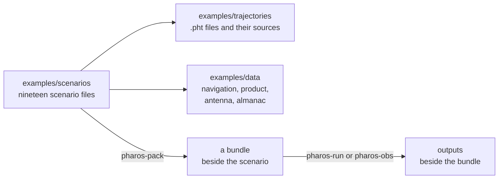

# Examples

`examples/` holds nineteen runnable scenarios, one per feature, with the
trajectories they fly and windows of public navigation data. They are
the quickest way to see what a scenario looks like and what each tool
writes.



## Running them

Every scenario runs from a clone after the [build](quick-start.md#build).
Names in a scenario resolve against the scenario file's directory, so the
working directory does not matter.

```bash
./zig-out/bin/pharos-pack examples/scenarios/gps_l1ca_minimal.json
./zig-out/bin/pharos-run examples/scenarios/gps_l1ca_minimal.phb -t
./zig-out/bin/pharos-pack examples/scenarios/observation_rinex_multi_gnss.json
./zig-out/bin/pharos-obs examples/scenarios/observation_rinex_multi_gnss.phb
```

| Scenario kind | Files beside the bundle `<name>.phb` |
|---|---|
| IF | `<name>.bin`, and `<name>.bin.tag` with `-t` for an IQ8 scenario |
| observation | `<name>.obs` |
| position | `<name>.lla` or `<name>.kml` |

The IQ8 scenarios are `gps_l1ca_minimal`, `gps_l1ca_power_schedule` and
`glonass_g1_fdma`. An IQ2 or IQ4 scenario with `-t` warns
`The .tag format has no <format> format: no tag file written`.

An IF scenario writes seconds × samples per millisecond × 1000 × bytes
per sample. That is 40.92 MB for `gps_l1ca_yuma_almanac`, and 125 MB for
`l2_band_gps_l2c_glonass_g2`, `l5_band_gps_galileo_bds` and
`e5b_b2b_b2i_band`, the largest. The console's `Samples written` counts
MiB of 1024^2 bytes. The observation and position scenarios write small
text files.

| Start | Scenarios |
|---|---|
| 2026-08-20 18:00 UTC | all but the three below; the receiver is in Wuhan |
| 2026-08-20 17:59:32 UTC | `bds_b1i_d2_augmentation`, to span a BDS ephemeris change |
| 2026-03-20 02:00 UTC | `bds_b2b_ppp_b2b`, on the older window |
| 2026-03-20 02:12 UTC | `e5b_b2b_b2i_band`, on the older window |

The older window lies before the April 2026 restructuring of the BDS
PRNs.

## Scenarios

| Scenario | Shows |
|---|---|
| `gps_l1ca_minimal` | the smallest scenario: GPS `L1CA` from a RINEX 3 file, a static receiver, other keys at their defaults |
| `gps_l1ca_yuma_almanac` | the `almanac` key: LNAV subframes 4 and 5 carry the YUMA almanac file |
| `gps_l1ca_power_schedule` | the `power` block: noise floor, a default C/N0 in dBm, the fade, timed steps and their restoration |
| `l1_band_gps_galileo_bds` | `L1CA`, `L1C`, `E1`, `B1C` and `B1I` in one 20 MHz IQ4 stream, from a driving receiver |
| `glonass_g1_fdma` | GLONASS `G1`: the FDMA channels around 1602 MHz, GNAV with the RINEX 4 time offsets |
| `l2_band_gps_l2c_glonass_g2` | `L2C` with CNAV from native RINEX 4 records, and `G2`, in one 25 MHz stream |
| `l5_band_gps_galileo_bds` | `L5`, `E5a` and `B2a` at 1176.45 MHz |
| `e5b_b2b_b2i_band` | `E5b`, `B2b` and `B2I` at 1207.14 MHz |
| `galileo_e6_has_precise` | `antenna`, `precise` and `has`: E6 pages with HAS MT1 over the precise orbits and clocks |
| `bds_b2b_ppp_b2b` | `pppB2b`: PPP-B2b on the BDS-3 GEO satellites, B-CNAV3 on the others, IQ2 output |
| `gps_l1c_cnav2_messages` | `messages.gps` on `L1C`: an integrity declaration, a text and an integrity support message |
| `galileo_e1_inav_ism` | `messages.galileo.inav`: a horizontal-service ISM, then a test message |
| `bds_b1i_d2_augmentation` | `messages.bds.d2`: the integrity, correction and grid pages of D2 on `B1I` |
| `observation_rinex_multi_gnss` | a RINEX 3.04 observation file: twelve signals, an elevation mask, masked-out satellites |
| `observation_nequick_precise` | dual-frequency observations on the precise product, per-band phase centres, NeQuick G |
| `observation_bdgim` | BDS observations with BDGIM, from the RINEX 4 coefficients |
| `observation_bds_klobuchar` | `B1I` and `B3I` observations with the BDS Klobuchar model, from the RINEX 4 D1D2 coefficients |
| `position_kml_trajectory` | a plan of a through, a stay and a through (`wuhan_segments`), written as a KML line |
| `position_lla_plan` | a northbound plan (`wuhan_north`), written as an LLA position file |

In `l2_band_gps_l2c_glonass_g2`, a satellite whose record has no CNAV
flag word, and no `messages.gps` integrity declaration, sends message
type 0 ([CNAV](../gnss/gps/cnav.md)). In `gps_l1c_cnav2_messages`, page
7 carries the configuration codes of the PRN allocation, which no
publication declares. In `bds_b2b_ppp_b2b`, PPP-B2b corrects the
B-CNAV1 of the MEO and IGSO satellites.

## Trajectories

The JSON files in `examples/trajectories/` are trajectory plans, and
each `.pht` beside one is what `pharos-traj build` writes of it
([trajectories](trajectories.md)). The static scenarios fly the first
seconds of `wuhan_static.pht` with `duration`.

| File | Made by | Content |
|---|---|---|
| `wuhan_static.pht` | `pharos-traj static --lla 30.5292,114.3642,40 --duration 600 --name wuhan_static -o wuhan_static.pht` | a receiver at rest for 600 s |
| `wuhan_drive.pht` | `pharos-traj build wuhan_drive.json` | a through from rest at A to rest at B, 47.27 m north-east, in 5 s |
| `wuhan_segments.pht` | `pharos-traj build wuhan_segments.json` | a through from rest to rest at B, 110.86 m north, at 15 s; a stay to 20 s; a through to rest at C, 110.86 m on, at 35 s |
| `wuhan_north.pht` | `pharos-traj build wuhan_north.json` | a through from a free start to B, 1.8 km north, at 60 s: 30 m/s |
| `wuhan_route.pht` | `pharos-traj build wuhan_route.json` | an along a Bezier guide, 160.41 m, in 40 s from a free start: 4.01 m/s |

Each plan holds places, a start and segments; `wuhan_route` adds a
guide. LLA and KML files are observation outputs.

## Data

`examples/data/` holds windows of public products for 2026-08-20: day of
year 232, GPS week 2432. A scenario can start from 17:00 to 19:00 UTC on
the broadcast files. On the precise product, whose clock window is 40
minutes, it can start from 17:55 to 18:35 UTC. One older window covers
2026-03-20.

| File | Content |
|---|---|
| `brdm_2026232.rnx` | a merged RINEX 3.04 broadcast file: GPS, Galileo, BDS and GLONASS records, 16:00 to 20:00 UTC |
| `brd4_2026232.rnx` | the RINEX 4.02 file of the day: records 16:00 to 20:00 UTC |
| `esa_2026232.sp3` | ESA's final multi-GNSS orbits, SP3-d: 5-minute epochs, 16:00 to 20:00 UTC |
| `esa_2026232.clk` | the matching 30-second clocks, RINEX clock: the `AS` records, 17:55 to 18:35 UTC |
| `igs20_2026232.atx` | the IGS igs20 ANTEX file: the satellite antennas of the four systems |
| `yuma_2026232.alm` | the YUMA almanac of the day |
| `brd4_2026079_0200.rnx` | a RINEX 4.02 file of 2026-03-20: records 01:25 to 03:59 UTC, Galileo from 02:00 |

| File | Original | Issued by |
|---|---|---|
| `brdm_2026232.rnx` | `BRDM00DLR_S_20262320000_01D_MN.rnx` | DLR, merged broadcast navigation (`igs.bkg.bund.de/root_ftp/IGS/BRDC/2026/232/`) |
| `brd4_2026232.rnx` | `BRD400DLR_S_20262320000_01D_MN.rnx` | DLR, the same directory |
| `esa_2026232.sp3` | `ESA0OPSFIN_20262320000_01D_05M_ORB.SP3` | ESA/ESOC final products (`navigation-office.esa.int/products/gnss-products/2432/`) |
| `esa_2026232.clk` | `ESA0OPSFIN_20262320000_01D_30S_CLK.CLK` | ESA/ESOC, the same directory |
| `igs20_2026232.atx` | `igs20.atx` | IGS (`files.igs.org/pub/station/general/`) |
| `yuma_2026232.alm` | `232.alm` | U.S. Coast Guard Navigation Center |
| `brd4_2026079_0200.rnx` | `BRD400DLR_S_20260790000_01D_MN.rnx` | DLR |

| Note | Consequence |
|---|---|
| `brdm_2026232.rnx` carries the header's ionosphere and time-system corrections | the RINEX 3 scenarios take their sets from it |
| `brd4_2026232.rnx` carries LNAV, CNAV, FNAV, INAV, D1, D2, CNV1, CNV2, CNV3 and FDMA blocks | no GPS `CNV2` block |
| `brd4_2026232.rnx` carries 106 `> STO`, 3 `> EOP` and 33 `> ION` records | the auxiliary data of the RINEX 4 scenarios |
| every kind of RINEX 4 record CNAV, B-CNAV and GNAV need is transmitted before 17:00 UTC | the RINEX 4 scenarios pack from 17:00 |
| the GST-UTC record F/NAV page 4 needs is in all three broadcast files | the `E5a` scenarios pack |
| the GPS `> ION` records of the RINEX 4 files are transmitted after 23:00 UTC | the RINEX 4 scenarios use the built-in Klobuchar set |
| the older window's only NeQuick set is transmitted after its scenarios start | none is available there |
| the precise product carries no BDS GEO satellite | a scenario on the product has no channel for them |
| `brd4_2026079_0200.rnx` | used by `bds_b2b_ppp_b2b` and `e5b_b2b_b2i_band` |
