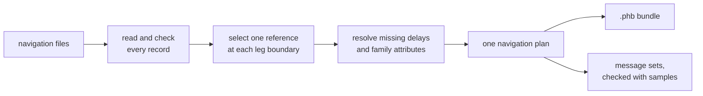
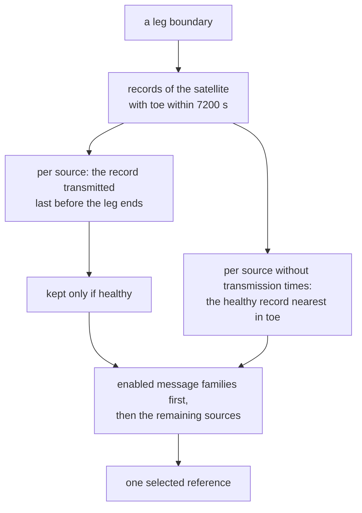
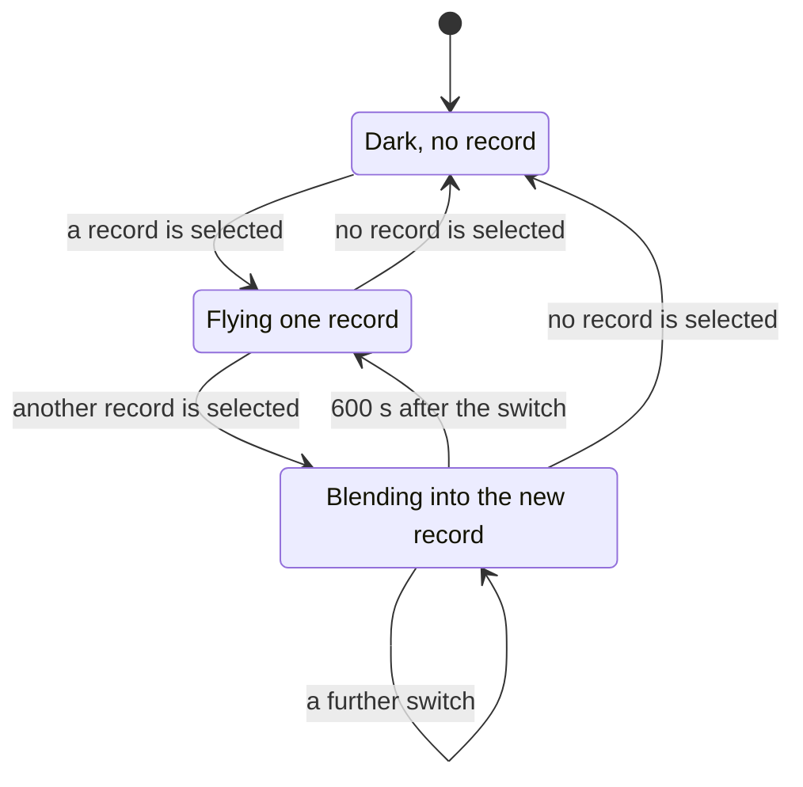

# Navigation data

The navigation files of a scenario give a run its orbits, clocks, group
delays, health, time offsets, ionosphere sets and leap seconds.
`pharos-pack` reads them once, and packs the records the run needs with
a plan of one reference, common group delays and message attributes per
satellite and interval. `pharos-run` and
`pharos-obs` follow that plan.

The mechanism behind these rules is in
[design: navigation](../design/navigation.md).

## File kinds

| Scenario key | File | Gives |
|---|---|---|
| `ephemeris` | RINEX 3.0x navigation | ephemerides and clocks; header ionosphere sets, time offsets and leap seconds |
| `ephemeris` | RINEX 4.0x navigation | `> EPH` blocks; `> ION`, `> STO` and `> EOP` records with transmission times |
| `almanac` | YUMA, BDS text, Galileo XML or GLONASS AGL | the almanacs the messages carry |
| `antenna` | ANTEX | phase-centre offsets per band; the antenna type, which picks the yaw law |
| `precise.orbit` | SP3-c or SP3-d | precise positions and clocks on the file's epoch grid |
| `precise.clock` | RINEX clock | precise clocks, the `AS` records |

| RINEX content | Read |
|---|---|
| records of version 3 | `G`, `C`, `E` and `R` records |
| `IONOSPHERIC CORR` | `GPSA` and `GPSB`, `BDSA` and `BDSB`, `GAL` |
| `TIME SYSTEM CORR` | `GPUT`, `GAUT`, `BDUT`, `GLUT`, `GLGP`, `GAGP`, `GPGA` |
| `LEAP SECONDS` | the count and an announced change |
| `> EPH` of GPS | `LNAV`, `CNAV`, `CNV2` |
| `> EPH` of Galileo | `INAV`, `FNAV` |
| `> EPH` of BDS | `D1`, `D2`, `CNV1`, `CNV2`, `CNV3` |
| `> EPH` of GLONASS | `FDMA` |
| `> STO` | `GPUT`, `GAUT`, `BDUT`, `GLUT`, `GAGP`, `GLGP`, `BDGP`, `BDGA`, `BDGL` |
| `> EOP` | records of `LNAV`, `CNVX`, `D1D2`, `IFNV` and `FDMA` sources |
| `> ION` | GPS and Galileo records; BDS `D1D2` and `CNVX` records |

SBAS, QZSS and NavIC records are skipped. Which record feeds which
message family is on each system's data page:
[GPS](../gnss/gps/data.md), [Galileo](../gnss/galileo/data.md),
[BDS](../gnss/bds/data.md), [GLONASS](../gnss/glonass/data.md).

## Paths and loading

| Rule | Detail |
|---|---|
| an absolute path | read as given |
| a relative path | the scenario file's directory first |
| not found there | the working directory |
| from memory | the scenario's name, matched exactly against the host's table |
| a file's size | at most 256 MiB |
| a UTF-8 byte-order mark | ignored |
| a file that fails to load | stops the pack, naming the file and the line |
| a file that gives no record | a warning (`no_record`) |

The trajectory resolves the same way, at its 1 GiB limit. A C host
passes the scenario's directory as `base_dir`, or the files themselves
in a table of names and bytes ([pack](c-api/pack.md#files-from-memory)).

A record, header line or block that does not read is skipped with a
warning. Only a file the reader cannot follow fails the load
([limits and messages](#limits-and-messages)).

## Record checks

Every field is checked on input. A record must fit what its own message
family carries. One that does not is skipped, with an
`implausible_record` warning on the file's key.

| Check | Records |
|---|---|
| every field within its field in the family's messages | all |
| clock and orbit within the propagator's domain | Keplerian |
| `toe`, `toc` and `top` on the family's epoch grid | Keplerian |
| `toc` and `top` within half a week of `toe` | Keplerian |
| every group delay below 2^-23 s in magnitude | Keplerian |
| T_GD1 and T_GD2 below 51.2 ns, the range of their 10-bit fields | D1/D2 |
| no A-dot and no delta-n-dot | LNAV, I/NAV, F/NAV, D1/D2 |
| a satellite type | B-CNAV |
| a frequency number in -7 to 13 | GLONASS |
| `tb` on the 15-minute Moscow grid, N4 in 1 to 31 | GLONASS |
| a plausible orbit | GLONASS |
| coefficients within their broadcast fields | `TIME SYSTEM CORR`, `> STO`, `> EOP`, `> ION` |
| no rate on a `GLUT` or `GLGP` offset | `TIME SYSTEM CORR`, `> STO` |
| dUT1 below 1 s (UT1-UTC) or below -1 s (UT1-GPST) | `> EOP` |
| a transmission within four weeks of the reference epoch | `> STO`, `> EOP` |

A record whose PRN, week or `toe` is outside its range is skipped
silently. The `navigation records skipped` line counts it, with the
SBAS, QZSS and NavIC records and the RINEX 4 blocks not modelled.

| Blank field | Result |
|---|---|
| any field | absent, never zero |
| an accuracy index: URA, URA_ED, URA_NED0, SISA | the family's "no accuracy prediction" index |
| a group-delay term | absent in the raw record; resolved by the plan from time-eligible records of the same satellite |
| any other required field | the record is skipped |

URA_NED1, URA_NED2, SISAI and SISMAI are among the other required
fields. The indices are on each system's data page.

## Record selection

A record is chosen for each satellite at the run start and at every leg
boundary. The leg boundary is every GPS minute. For a GLONASS satellite
it is every superframe boundary: 150 s from the start of the Moscow day.

| Rule | Detail |
|---|---|
| a record flies from | the start of the GPS minute in which it is transmitted |
| it flies until | a later record of the same satellite and source is transmitted |
| and while | `abs(t - toe) <= 7200 s` |
| the transmission time | the record's own, on the last line of a RINEX record |
| a GPS record without one | the start of its ICD interval: 2 h before `toe` for LNAV |
| | 1.5 h before `toe` for CNAV and CNAV-2 |
| Galileo or BDS without one | the healthy record nearest in `toe`, among those that still fly |
| the order of preference | families carried by the satellite's enabled signals first; within that pass and the fallback pass, the default order below |
| exact timing ties | stable order of the raw record contents |
| a latest record declaring every signal gone | its source gives nothing; the next source is tried |
| a host | asks `pharos_pack_describe_nav` which satellites of each system an ephemeris file flies, and over which stretches; without scenario signals this uses the default source order ([pharos_pack.h](c-api/pack.md#describing-a-navigation-file)) |
| a GLONASS record | adopted at the start of its 30-minute `tb` interval |
| until | `tb + 30 min`, or the end of its Moscow day if earlier |
| a satellite without a record | dark |

The enabled signals are the scenario's listed signals that the satellite
carries at the run start. When they exist, a candidate must leave at least
one of them on the air. Degraded and undeclared signals can still qualify;
a declaration that a signal is gone cannot.

| System | Default order | Effect of enabled signals |
|---|---|---|
| GPS | LNAV, CNAV, CNAV-2 | L1 C/A favours LNAV; L2C or L5 favours CNAV; L1C alone favours CNAV-2 |
| BDS | D1/D2, B-CNAV1, B-CNAV2, B-CNAV3 | B1I, B2I or B3I favours D1/D2; modern-only runs try the enabled B-CNAV families in order |
| Galileo | I/NAV, F/NAV | E1 or E5b favours I/NAV; E5a alone favours F/NAV |
| GLONASS | GNAV | unchanged by the signal list |

The remaining sources are tried when the enabled families provide no
eligible reference. Satellites without enabled signals retain a plan with
the default order so that correction services can refer to them. The mask
does not remove satellites from the plan.

A switch of record blends into the new record, so a receiver sees no
jump.

| Rule | Detail |
|---|---|
| the blend | 600 s, linear, of position, clock and group delays |
| its start | the state reached at the switch |
| a switch during a blend | carries the old blend's residual |
| no blend | at the first selection, and after a gap without a record |
| under `precise` | only the group delays blend |
| an effective signal delay or precise clock shift changes | a new delay blend starts without restarting the orbit and clock blend |
| only message attributes change | metadata updates without changing the end time of an active orbit or delay blend |
| the console | `pharos-run` reports `Ephemeris of <sat> switched at <ms> ms` |

`pharos-run` prints no switch under a precise product.

### Common delays and message attributes

The loaded records stay unchanged. Each plan interval holds a binding:
one raw reference, one common group-delay table and attributes for the
message families. Geometry, observations, messages and corrections use
this same binding.

| Delay rule | Detail |
|---|---|
| first choice | the selected reference's own value |
| a missing term | resolved independently from raw records of the same satellite |
| an eligible donor | toe within 7200 s of the selection instant, adopted before the next leg boundary |
| adoption | explicit transmission time, else the GPS ICD lead time, else toe |
| donor order | toe nearest the selected reference, then latest adoption, then stable raw-record order |
| still missing | a signal that requires that base delay is dark; the raw record and other usable signals remain |

Different terms may come from different records. Existing per-signal
fallbacks for optional inter-signal corrections still apply.
The donor gate differs from orbit selection: without transmission times,
Galileo and BDS may select a reference whose toe is in the future. A
secondary donor with that toe waits until its adoption precedes the next
boundary.

The selected reference supplies its own family's attributes. Each other
family's health and attributes come from its latest eligible record.
Its issue and accuracy fields are adjusted to describe the
selected physical parameters; a donor's accuracy for a different orbit
is not carried across. Family metadata cannot change the raw source or
clock basis. A change in these attributes or the resolved delays starts
a new binding interval even when the raw reference stays the same.

Each message family encodes that selected reference per satellite.

| Family | Encodes |
|---|---|
| CNAV, CNAV-2, B-CNAV | the selected reference in the family's form, using the common delays and resolved attributes |
| D1/D2, F/NAV | the same selected reference in the family's form |
| LNAV, I/NAV | the selected reference only while its raw source is their own |
| LNAV, I/NAV | no ephemeris for the satellite while a record of another source flies |

A record a family cannot carry is sent there as unavailable data while
it is selected. For a scenario with `samples`, `pharos-pack` reports
unfit conversions to CNAV, CNAV-2, B-CNAV or D1/D2 as `unfit_record`.
What each family sends then is on its message
page ([GNSS](../gnss/README.md)).

D1/D2 preparation covers each contiguous binding interval. If the same
raw reference returns after another binding or a gap, it gets a separate
fit for that interval. Its message sets and D2 corrections share the
prepared parameters and their decoded broadcast form.

## Message sets

With `samples`, `pharos-pack` builds the message set of every listed
family. It does so at the run start and at every leg boundary of the
family's system, from the data the run will encode. A bundle it writes
therefore never fails on them in `pharos-run`.

| Family | Needs |
|---|---|
| GNAV | an EOP record of any source; constant `GLUT` and `GLGP` time offsets |
| B-CNAV3 of the MEO and IGSO satellites | an EOP record of a BDS source; encodable `BDUT` parameters |
| D1/D2 | encodable `BDUT` parameters |

Data a family cannot encode, and a missing record a family needs, are
errors on `ephemeris`. A publication its family cannot encode is an
error at its entry ([messages](scenarios.md#messages)).

| Coverage | Warning |
|---|---|
| no satellite of a listed system has a record at the start | `no_record` on `ephemeris`, once per system |
| records of a listed system end before the run does | `no_record` on `ephemeris`, once per system |
| no satellite of any listed signal flies a record, from some instant | `pharos-run` and `pharos-obs` warn |

## Health

The declared condition decides. A declaration that a signal is gone
takes it off the air. A declaration that the signal is there but not to
be trusted leaves it on the air, with the flag broadcast. A signal a
declaration does not name stays on the air.

| Case | Result |
|---|---|
| the binding's resolved declaration takes a signal off the air | no channel on it; its observation fields are blank |
| a record declares every signal it describes gone | not selected; another record flies if one qualifies |
| no record qualifies | the satellite is dark |
| a flag without a loss of signal | the signal stays on the air, the flag broadcast |

Which declaration does what is on each system's data page:
[GPS](../gnss/gps/data.md), [Galileo](../gnss/galileo/data.md),
[BDS](../gnss/bds/data.md), [GLONASS](../gnss/glonass/data.md).

## Time offsets

GPS time is the only stored time. BDT, GST, GLONASS time and UTC are
views of it. The Galileo, BDS and GLONASS satellites keep their own
system's time, and the navigation data may declare it off these views by
nanoseconds ([time scales](../gnss/README.md#time-scales)).

| Rule | Detail |
|---|---|
| the records | `GAGP` for Galileo, `BDGP` for BDS, `GLGP` (tau_GPS) for GLONASS |
| the record taken | the one transmitted last at or before the run start |
| its source | the system's own first, then a GPS-sourced record |
| a header line | only when no transmitted record is at or before the start |
| a `GLUT` or `GLGP` offset with a rate | skipped when read, header line and `> STO` alike |
| a broadcast run | the signals and observables carry the offset taken at the start |
| a `precise` run | the product's clock flies as it is |

A receiver applying the broadcast GGTO, BGTO or tau_GPS therefore gets
ranges on GPS time, while the messages carry that same record.

## Leap seconds

The navigation data's `LEAP SECONDS` record is the run's truth. Only
the `ephemeris` files are read for it.

| Rule | Detail |
|---|---|
| several files declaring different schedules | the first in file order flies; a later one warns |
| no declaration | the built-in history: the IERS leap seconds through 2017-01-01 |
| a start inside the built-in history | the history's count flies; another declared count is an error |
| a negative count | an error |
| an announced change | takes effect at UTC midnight after its declared day, before or after the start alike |
| an announced count more than 1 from the current | dropped, with a warning |
| a line marked BDS | converted to the GPS convention |
| across an inserted second | UTC reads 23:59:60 and GLONASS time repeats a second |
| GPS time, BDT and GST | run on |
| a C host | reads the count at the start and the change within the run in `pharos_run_info`, or after packing in `pharos_pack_info` ([run](c-api/run.md#options-and-info), [pack](c-api/pack.md#enums-and-structs)) |
| the tools | `pharos-pack` and `pharos-run` print the count at the start and the change within the run on their `Run:` line ([samples](samples.md#limits-and-messages)) |

An explicit change must fall at UTC midnight when its stored GPS instant
is converted using the new count. After the built-in history, a declared
current count remains valid without a change date.

Every UTC message takes its leap-second fields (delta tLS, WNLSF, DN,
delta tLSF) from this schedule, so the broadcast UTC and the simulated
UTC agree.

| The schedule has | The messages send |
|---|---|
| an announced change | that change |
| a count without a change, or no declaration | the built-in history's last insertion at or before the start, as a past event: delta tLSF equals delta tLS |
| a declared count the history does not reach, without its change | no UTC parameters, with a warning |

After 2017 the second row sends the insertion of 2016-12-31: WNLSF 1929,
DN 7, delta tLSF 18. The satellites broadcast the same while no leap
second is pending.

A BDS message places the change in a BDT week. A change announced for a
GPS week before 1356, the BDT epoch, cannot be encoded. The BDS message
then goes without its BDT-UTC parameters (`MissingUtcParameters`).

## Ionosphere sets

The scenario's `ionosphere` block chooses one delay model for all systems,
or `auto` to choose per constellation. An explicit concrete model may
replace its coefficients ([ionosphere](scenarios.md#ionosphere)).
Otherwise each kind of set comes from the navigation data. Resolution
uses the run start and stays fixed throughout the run.

| Kind | RINEX 3 header | RINEX 4 record |
|---|---|---|
| GPS Klobuchar | `GPSA`, `GPSB` | `> ION` of a GPS source |
| BDS Klobuchar | `BDSA`, `BDSB` | `> ION` of a BDS `D1D2` source |
| NeQuick G | `GAL` | `> ION` of a Galileo source |
| BDGIM | none | `> ION` of a BDS `CNVX` source |

An `> ION` record must supply all coefficients: eight for either Klobuchar
set, three for NeQuick G, or nine for BDGIM. A blank or truncated set is
skipped with a warning; explicit zero coefficients are valid.

| Rule | Detail |
|---|---|
| first choice | the latest `> ION` of the kind transmitted at or before the start |
| ties | file order |
| without one | the first RINEX 3 header whose set fits its broadcast fields |
| a header set outside its fields | dropped, with a warning |
| no Klobuchar set at all | LNAV (page 18), CNAV, CNAV-2 and D1/D2 carry a built-in default set |
| no BDS Klobuchar set | D1/D2 carry the GPS set |
| no NeQuick G set | I/NAV and F/NAV carry zero coefficients |
| no BDGIM set | B-CNAV carries zero coefficients |

These message fallbacks do not make a navigation set available to `auto`.
Automatic delays use GPS Klobuchar for GPS, NeQuick G for Galileo,
BDGIM then BDS Klobuchar for BDS, and a GPS Klobuchar substitute for
GLONASS. Missing Galileo data or both BDS sets fails the pack when that
system has a listed signal; GPS and the GLONASS substitute may use the
built-in GPS set.

The models themselves are in [ionosphere](../models/ionosphere.md).

## Almanacs

An `almanac` file's first non-blank line decides its format. Without an
almanac file, the messages carry reductions of the ephemerides.

| First non-blank line | Format |
|---|---|
| begins with `*` | YUMA (GPS) |
| begins with `<` | Galileo XML |
| a second token `dd.mm.yy` | GLONASS AGL |
| twelve or more numeric tokens | the BDS text format |

| Rule | Detail |
|---|---|
| several almanacs of a satellite in one file | the newest that fits its message's fields is kept; a tie keeps the first |
| a YUMA week | resolved modulo 1024, nearest the run start |
| a Galileo week | resolved modulo 4 against the file's issue date |
| BDS text and AGL almanacs | count as healthy |
| an almanac outside its message's fields | skipped, with a warning naming the field |
| a message set | carries one reference time: that of the first almanac it takes |
| almanacs of another `toa` | left out of that set |

A file mixing epochs thus contributes its first epoch's almanacs alone.
The fields are those of the LNAV page, the I/NAV words, the D1/D2 page
and the GNAV strings. The formats are on each system's data page.

## Antennas

With `antenna`, the point the orbit describes is the phase centre of the
system's reference pair. That pair is `P1P2`, `E1E5a`, `B1IB3I` or
`G1G2`, or the one `precise.clockReference` names. Each signal leaves
from the phase centre of its own band, under the ANTEX code of its
carrier.

| Signal | ANTEX code | Signal | ANTEX code |
|---|---|---|---|
| `L1CA`, `L1C` | `G01` | `B3I` | `C06` |
| `L2C` | `G02` | `B2I`, `B2b` | `C07` |
| `L5` | `G05` | `E1` | `E01` |
| `B1C` | `C01` | `E5a` | `E05` |
| `B1I` | `C02` | `E6` | `E06` |
| `B2a` | `C05` | `E5b` | `E07` |
| `G1` | `R01` | `G2` | `R02` |

| Rule | Detail |
|---|---|
| a band the file gives no offset | the signal keeps the reference point |
| a reference pair the file gives no offset | the satellite keeps its centre of mass; nothing moves |
| an offset beyond 1 km | the load fails: `OutOfRange` |
| several entries of a satellite | the one valid at the selection instant; the latest `VALID FROM` wins |
| the offsets | body-frame triples, turned by the satellite's yaw law |
| the yaw law | a prefix match on the antenna type of `TYPE / SERIAL NO` |
| an unknown antenna type | the nominal yaw-steering law, with a warning |

The yaw laws by antenna type are on each system's page:
[GPS](../gnss/gps/README.md), [Galileo](../gnss/galileo/README.md),
[BDS](../gnss/bds/README.md), [GLONASS](../gnss/glonass/README.md).
The model is in [antennas](../models/antennas.md).

## Precise products

With `precise`, the selection keeps the broadcast binding: its health,
window, source preference, common group delays and GLONASS frequency. The orbit
and clock come from the product.

| Rule | Detail |
|---|---|
| a satellite the product cannot serve over a minute | not selected |
| serving | the orbit from 2.5 s before the instant to 1.5 s after the next |
| | the clock at both ends |
| a position | needs eleven consecutive samples: four before its interval, five after |
| so | the first four and the last five intervals of a series are unavailable |
| a missing sample | an SP3 line with x = y = z = 0; no position across it |
| a clock | linear between its two bracketing samples; at least two needed |
| a clock gap wider than 1800 s | no clock across it |
| an SP3 clock of 999999 µs or more | no clock |
| several files | a later file wins an epoch |

A satellite with a broadcast record at the start that the product does
not serve there transmits nothing until it does. One `no_record` warning
of the pack names these satellites.

| File rule | Detail |
|---|---|
| SP3 version | `#c` or `#d` |
| SP3 interval | from the `##` line, 1 ms to 100 000 s |
| SP3 time system | the first `%c` line: GPS, GAL, BDS, BDT, TAI or UTC |
| RINEX clock header | `RINEX VERSION / TYPE` of type `C`, with a non-zero version, not range-checked |
| RINEX clock time system | `TIME SYSTEM ID`: GPS, GAL, BDS, BDT, TAI or UTC; default GPS |
| RINEX clock records | the `AS` lines |
| RINEX clock calendar | year, month, day, hour and minute are integer tokens; seconds may be fractional |

The product's clock refers to the ionosphere-free combination of the
`clockReference` pair. Each code therefore flies with its resolved group
delay less the pair's offset from the raw reference's own clock. No orbit or
clock blend follows a record change under a product. Only the group
delays take the 600 s transition.

The HAS, PPP-B2b and GPS differential corrections carry the difference
between the state the signals fly with and the broadcast message they
correct. The BDS D2 clock corrections come from the same difference
([GNSS](../gnss/README.md#where-message-content-comes-from)). The GPS
differential corrections need a product. HAS and PPP-B2b are sent with
or without one.

## Limits and messages

| Invalid content | Diagnostic message |
|---|---|
| wrong RINEX navigation header | `expected a RINEX navigation file` |
| RINEX 2, 5 or later | `the RINEX navigation version is unsupported; expected version 3 or 4` |
| missing header terminator | `the RINEX navigation header has no END OF HEADER line`, or the corresponding clock message |
| almanac under `ephemeris` | `an almanac file must be listed under almanac, not ephemeris` |
| other data under `almanac` | `expected an almanac file` |
| malformed record | a message naming the RINEX navigation, clock, SP3, ANTEX or almanac record |
| missing Galileo issue date | `the almanac has no usable issue date` |
| unsupported clock or SP3 time system | a message naming the unsupported time system's file format |
| unsupported SP3 version | `the SP3 version is unsupported; expected version c or d` |
| antenna offset beyond 1 km | `an ANTEX antenna offset is outside its range` |
| SP3 position beyond 5e7 m, or clock at or below -999999 µs | `an SP3 position or clock value is outside its range` |
| RINEX clock beyond 1 s | `a RINEX clock bias is outside its range` |
| SP3 intervals differ | `the SP3 interval <n> s does not match the earlier files' <m> s` |
| SP3 epoch off grid | a message naming the declared or earlier files' sampling grid |
| product without epochs | `the precise product has no orbit samples` |
| more than four slots per satellite sample, plus twenty | `the precise product's orbit samples are too sparse` |

The parser emits an `invalid_format` diagnostic with the source file,
physical line where available, and the scenario field that names it.
The console renders `<file>:<line>: <path>: <message>`. Errors across
files have no line. Errors of the product as a whole use the scenario's
source and the field path `precise`. An unreadable named file emits
`io_error`; allocation failure remains `OutOfMemory` without being
converted into an input diagnostic.

| Warning | Code and path |
|---|---|
| `<n> <System> <MSG> records skipped, <field> outside its ICD range: <records>` | `implausible_record`, the file's key |
| `<n> <System> <MSG> records skipped, <field> blank: <records>` | `implausible_record`, the file's key |
| `<n> <System> <MSG> blocks skipped, the record line naming another satellite: <records>` | `implausible_record`, the file's key |
| `<n> <System> <MSG> records skipped, a line that does not read: <records>` | `implausible_record`, the file's key |
| `the <set> set of the header is dropped, <field> outside its broadcast field` | `implausible_record`, the file's key |
| `declares <n> leap seconds where an earlier file declares <m>: the run flies the first declaration` | `implausible_record`, the file's key |
| `declares <n> leap seconds where the built-in history ends at <m>, without the week and day of the change: the UTC parameters are not broadcast` | `no_record`, the file's key |
| `the file gives no ephemeris record of GPS, Galileo, BDS or GLONASS` | `no_record`, the file's key |
| `the file gives no almanac` | `no_record`, the file's key |
| `the file gives no satellite antenna` | `no_record`, `antenna` |
| `no yaw law is held for the antenna type <type>: its satellites fly the nominal law through their turns` | `no_record`, `antenna` |
| `<sat> <source> record of <date> GPST: <field> outside its <family> field, sent there as unavailable while it is selected` | `unfit_record`, `ephemeris` |
| `<sat> <source> record of <date> GPST: it declares no <signals> signal health for <family>, sent there as unavailable while it is selected` | `unfit_record`, `ephemeris` |
| `<sat>: a record it flies carries no <signal> group delay, which the <pair> clock of the precise product refers to: the satellite is dark while that record is selected` | `no_record`, `ephemeris` |
| `the precise product does not serve <satellites> at the run start, <date> GPST: they transmit nothing until it does` | `no_record`, `ephemeris` |
| `no <System> satellite has a record at the run start, <date> GPST: its signals carry nothing until one does` | `no_record`, `ephemeris` |
| `no <System> satellite has a record from <date> GPST, <n> s into the run` | `no_record`, `ephemeris` |

File warnings carry the external filename in `source`; their field path
identifies the scenario reference, `ephemeris[0].name` for instance. `<date>` is `YYYY-MM-DD hh:mm:ss` and a fraction of the second
when there is one, as the tools print an instant
([conventions](overview.md#conventions)). A skipped-record warning names
up to three records as `<Gnn> <date>`, the date in the file's own time,
then `and <n> more`. `<MSG>` is the message type:
`LNAV`, `CNAV`, `CNV2`, `D1`, `D2`, `CNV1`, `CNV3`, `INAV`, `FNAV` or
`FDMA`. It is `HEADER`, `ION`, `STO`, `EOP` or `ALMANAC` for the other
lines, and empty for a record line that does not read.

| Error | Code and path |
|---|---|
| `declares <n> leap seconds, a count below zero` | `out_of_range`, the file's key |
| `declares <n> leap seconds where <m> were in force at the run start, <date> GPST: inside the built-in history the data cannot declare another count` | `out_of_range`, the file's key |
| `<family> at <n> s into the run: the navigation data cannot be encoded into its message set (<error>)` | `out_of_range`, `ephemeris`; `<error>` is `a value lies outside its range`, `a value does not fit its field` or `a value is missing` |
| `<family> at <n> s into the run: <reason>` | `missing_field`, `ephemeris` |

| `<reason>` | Missing |
|---|---|
| `B-CNAV3 on B2b (a BDS record) and GNAV on G1/G2 (any system's) require an available EOP record in the navigation data` | an EOP record |
| `GLONASS navigation requires available, constant GLUT and GLGP time offsets` | the GLONASS time offsets |
| `the selected BeiDou navigation message requires available, encodable BDUT parameters` | the BDT-UTC parameters |

| Console line | When |
|---|---|
| `<n> navigation records skipped (other systems, RINEX 4 blocks or slots the core does not model, values outside their ranges)` | `pharos-pack`, records not taken |
| `Antenna offsets: <A> satellites with a phase centre per band, <B> without` | every tool, with `antenna`, over every satellite slot |
| `Precise product: <N> satellites at <I> s` | every tool, with `precise` |
| `Ephemeris of <sat> switched at <ms> ms` | `pharos-run`, a record switch |
| `No satellite of a listed signal flies a record from <T> s into the run: nothing is transmitted from there on` | `pharos-run` and `pharos-obs` |
