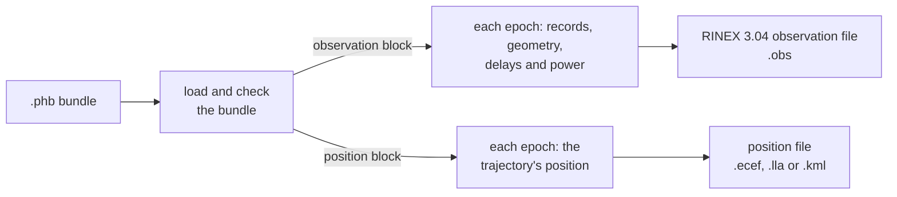

# Observations

`pharos-obs` writes, from a bundle, the files a receiver would produce in
place of the samples. The RINEX 3.04 observation file holds the
measurements of every signal, and the position file the receiver's true
path. Both come from the geometry, record selection and power schedule
of the samples, so they can check a receiver that processes those
samples.



## Command line

```
pharos-obs <bundle.phb> [options]
```

| Option | Meaning |
|---|---|
| `<bundle.phb>` | the bundle, from `pharos-pack` |
| `--observation <FILE>` | the observation file; default: the bundle's name with `.obs` |
| `--position <FILE>` | the position file; default: the bundle's name with `.ecef`, `.lla` or `.kml` |
| `--created <SECONDS>` | the observation file's creation time, in seconds since 1970-01-01 00:00:00 UTC, 0 to 253402300799; default: the wall clock ([header](#header)) |
| `--seek <EPOCH>` | start each file at its first epoch at or after this one, in ms from the run start ([epochs](#epochs)) |
| `--dry-run` | creates each file the bundle declares, prints its report; writes no file |
| `-v`, `--version` | prints `pharos-obs 1.0.0` and exits 0 |
| `-h`, `--help` | prints the usage and exits 0; no argument does the same |

The command line follows the tools' convention
([options](overview.md#options)). `pharos-obs` writes every file the
bundle declares. An option for a file the bundle does not declare is
ignored with a warning: `--observation` and `--created` without an
observation block, `--position` without a position block. A bundle with
neither block is refused. A failed observation file does not stop the
position file.

## Epochs

Both files step from the run start through the last multiple of their
interval at or before the run's length, both ends included.

| Rule | Detail |
|---|---|
| epochs | `floor(duration / interval) + 1` |
| the interval divides the run | the last epoch is the instant the run ends |
| that instant | one millisecond past the last epoch `pharos-run` samples |
| otherwise | the last epoch falls short of the run's end by the remainder |
| record selection | at the same instants as in `pharos-run`, so blends start together |
| the sampled band | not applied: every listed signal is observed |
| `--seek` | starts at the first grid epoch at or after the one given and continues through the full model extent |
| `pharos_obs_output_set_range(output, first, end)` | selects the half-open millisecond span `[first, end)` before the first pull; rounds inward to the original output grid and rejects a span with no output epochs |
| a selected range | preserves the original interval, re-plans and command epochs; `TIME OF FIRST OBS`, `TIME OF LAST OBS` and `APPROX POSITION XYZ` describe the emitted body |

A run that `pharos-run --seek` starts at an epoch pairs with
`pharos-obs --seek` at the same epoch: each file then starts where the
samples do.

In the C API, `pharos_obs_source_create` loads the bundle once.
`pharos_obs_output_create` or `pharos_obs_output_create_dated` creates each
file from that source, and `pharos_obs_truth_create` creates a truth handle
from it. Each child retains the source, so the host may destroy its source
handle after creating the children. `pharos_obs_output_pull` returns
borrowed batches of up to 64 output epochs with cumulative progress;
consume or copy the bytes before the output's next operation
([pharos_obs.h](c-api/obs.md)).

## The RINEX observation file

A satellite is listed at an epoch when all of these hold.

| Condition | Rule |
|---|---|
| allocation | it transmits a listed signal on the run's date |
| mask-out | it is not in `maskOut` |
| record | it flies a record at the epoch; without one it is absent, even above the mask |
| elevation | at or above the mask |

A signal its record declares gone is left blank. A satellite whose record
declares every listed signal gone keeps its line, with the PRN and no
observables.

| Observable | Content |
|---|---|
| pseudorange (`C`) | the code's travel time times c, with the group delay of the code's component |
| carrier phase (`L`) | cycles of the band's carrier, as the IF samples carry it |
| Doppler (`D`) | Hz: the central difference of the carrier-phase model at +-0.5 ms |
| signal strength (`S`) | the C/N0 the signal's components realise, in dB-Hz, to 0.01 dB |

A signal with two observation codes gets a pseudorange per component,
each with its component's group delay. It gets one carrier phase,
Doppler and C/N0 for both. A receiver measuring the carrier phase on the
samples of the same bundle reads the file's value up to whole cycles.
The Doppler includes the troposphere, ionosphere and Sagnac rates.
`B2b` reads 3.01 dB below the set C/N0. The codes of each signal, and
what the observables carry, are in [GNSS](../gnss/README.md).

The ionosphere uses the same models and coefficients as the samples,
resolved once when the bundle is packed. `model: "auto"` resolves a
model per enabled constellation; the default `klobuchar` and explicitly
selected concrete models are shared by all systems. Every frequency of
one satellite uses its constellation's model, with delay scaled by the
inverse square of frequency ([ionosphere](../models/ionosphere.md)).

The Galileo, BDS and GLONASS observables carry their system time's
declared offset from GPS time ([time offsets](navigation-data.md#time-offsets)).

### Header

| Record | Content |
|---|---|
| `RINEX VERSION / TYPE` | 3.04, `OBSERVATION DATA`, and the file's system |
| `PGM / RUN BY / DATE` | `pharos-obs 1.0.0`, `PHAROS`, the creation time in UTC |
| `MARKER NAME` | `PHAROS` |
| `OBSERVER / AGENCY` | `PHAROS`, `PHAROS` |
| `REC # / TYPE / VERS` | a blank number, `PHAROS`, `1.0.0` |
| `ANT # / TYPE` | a blank number, `PHAROS` |
| `APPROX POSITION XYZ` | the receiver at the file's first epoch |
| `ANTENNA: DELTA H/E/N` | zero: the receiver is the phase centre |
| `SYS / # / OBS TYPES` | `C`, `L`, `D`, `S` for every code of the listed signals |
| `SIGNAL STRENGTH UNIT` | `DBHZ` |
| `SYS / PHASE SHIFT` | one record per code |
| `INTERVAL` | the observation interval in seconds |
| `TIME OF FIRST OBS`, `TIME OF LAST OBS` | in GPS time |
| `GLONASS SLOT / FRQ #` | with a GLONASS signal: the slots of the navigation data, with their frequency numbers |
| `GLONASS COD/PHS/BIS` | with a GLONASS signal: biases of zero |
| `LEAP SECONDS` | GPS - UTC at the first epoch, with the time system `GPS` |
| `END OF HEADER` | |

| Rule | Detail |
|---|---|
| the file's system | `G (GPS)`, `R (GLONASS)`, `E (GALILEO)` or `C (BDS)` when all listed signals are of one system |
| otherwise | `M (MIXED)` |
| the creation time | `--created`, seconds since 1970-01-01 00:00:00 UTC without leap seconds, else the wall clock; a C host gives it to `pharos_obs_output_create_dated` ([pharos_obs.h](c-api/obs.md)); the same bundle and time give the same bytes |
| `SYS / # / OBS TYPES` | continuation lines beyond thirteen descriptors |
| `SYS / PHASE SHIFT`, blank correction | `1C` of `L1CA`, `5I`, `1D`, `2I`, `7I`, `6I`, `5D`, `7D`, `1C` of `G1`, `2C` of `G2` |
| `SYS / PHASE SHIFT`, `0.00000` | `1S`, `1L`, `2L`, `5Q` of `L5`, `1P`, `5P`, and every Galileo code |
| the phases | every code of a signal carries the signal's one carrier phase: aligned as simulated |
| `LEAP SECONDS` future fields | blank, unless the count changes within the run |
| a change within the run | the new count, with the GPS week and day of the change |
| `MARKER TYPE` | omitted |

### Epochs of data

| Rule | Detail |
|---|---|
| a receiver that moves in the run | the data open with the event "start moving antenna": epoch flag 2 at the first epoch |
| an epoch line | `> yyyy mm dd hh mm ss.sssssss` in GPS calendar time, flag 0, the satellite count |
| a satellite line | the RINEX letter and PRN, then the observables of its system in the header's order |
| each observable | F14.3, then the LLI and SSI columns; SSI blank |
| a signal the satellite does not transmit | its fields blank |
| trailing blanks | dropped |
| a carrier phase beyond F14.3 | moved into it by whole 10^9 cycles, with LLI bit 0 set |
| any other value beyond F14.3 | left blank |

The moving receiver's event makes the data kinematic.

### Commands

A C host that steered the run submits the commands the run applied, each
at its epoch ([commands](c-api/obs.md#commands)). The observation file
then follows what aired; `pharos-obs` takes none, as `pharos-run` takes
none, so the two tools' files match.

| Command | In the observation file |
|---|---|
| noise floor, signal power | the `S` values from the command's epoch on |
| elevation mask | the satellites listed at an epoch: at or above the mask of the last re-plan at or before it, as the run's channels change at a re-plan |

## Position files

The position file holds the receiver alone at its interval: the truth of
the solved trajectory. ECEF, LLA and KML are observation output formats.
A bundle that declares only position output keeps the ionosphere
inactive and needs no ionosphere coefficients.

| Format | Content |
|---|---|
| `ECEF` | the header `%  GPST                      x-ecef(m)      y-ecef(m)      z-ecef(m)` |
| | per epoch: the stamp and three `%14.4f` metres |
| `LLA` | the header `%  GPST                  latitude(deg) longitude(deg)  height(m)` |
| | per epoch: the stamp, `%14.9f` degrees twice, the altitude in `%10.4f` |
| `KML` | a KML 2.2 document named `Pharos receiver trajectory` |
| | one placemark `Receiver` in the `trajectory` line style, `absolute` altitude mode |
| | one `lon,lat,alt` coordinate per epoch as `%.9f,%.9f,%.4f` |

The stamps are GPS calendar time, `yyyy/mm/dd hh:mm:ss.sss`. The LLA and
KML altitudes are above the EGM96 geoid. The LLA file does not name the
datum.

## The truth of a run

A C host, or the host of `pharos_obs.wasm`, also asks
`libpharos_obs` what the run's receiver sees at any epoch
([the truth at an epoch](c-api/obs.md#the-truth-at-an-epoch));
`pharos-obs` writes the files alone. The truth follows the run where the
observation file does not:

| At an epoch | The observation file | The truth |
|---|---|---|
| a satellite | listed at or above the mask | every one that transmits a listed signal, `maskOut` included, with its angles and whether it is above the mask |
| a signal | observed when the record serves it | a channel exactly as the run holds one, band, frames and the 0.5-degree hysteresis included; otherwise the rule that keeps it off |
| C/N0 | `S` of each signal observed | the same value while the signal holds a channel; 0 otherwise |
| commands | a C host's, as above | a C host's, the same way |
| DOP | none | over the satellites with a channel, with one receiver clock |

The receiver and the satellites alone come from any bundle, with a
samples block or without.

## Limits and messages

| Console line | When |
|---|---|
| `Loading bundle: <path>` | first |
| `Trajectory <name> (<file>): <N> knots over <D> s`, or `Trajectory <file>: <N> knots over <D> s` for an unnamed one | the trajectory; `<file>` as the scenario names it |
| `Navigation data: <K> Keplerian and <G> GLONASS records` | the records in the bundle |
| `Antenna offsets: ...`, `Precise product: ...` | with `antenna` or `precise` |
| `Ionosphere: <requested>` | with an observation file: the requested choice, including `auto` |
| `Ionosphere <system>: <model>, <coefficients> (<origin>)` | with an observation file, one line per enabled constellation; `none` has no coefficients or origin |
| `Observation file: <e> epochs every <i> ms, <n> satellites tracked` | the observation file as `pharos_obs_output_info` reports it ([pharos_obs.h](c-api/obs.md)), before it is written and in a dry run; with `--seek`, `from epoch <f>` follows the interval |
| `Position file: <e> epochs every <i> ms` | the position file, the same way |
| `Observation file written: <path>`, `Position file written: <path>` | a file was written |

The satellites tracked are those outside `maskOut` that transmit a listed
signal by allocation, whatever their records or elevation.
The ionosphere lines use the same models and origins as the
[sample report](samples.md#limits-and-messages), including the
`Klobuchar substitute` label for GLONASS under `auto`.
Missing required coefficients are rejected while packing.

| Message | When |
|---|---|
| `The bundle declares no observation or position file: pharos-run generates its samples` | a bundle without either block |
| `The bundle declares no <kind> file: <option> is ignored` | a warning: `--observation` or `--created` without an observation block, `--position` without a position block |
| `The wall clock reads <n> s, outside 0..253402300799` | no `--created`, and a clock outside the range; no file is created |
| `<path>: <message>` | an invalid bundle's diagnostic ([the bundle](scenarios.md#the-bundle)) |
| `Cannot create the <kind> file: <error>` | the file cannot be prepared: `OutOfMemory` |
| `No satellite of a listed signal flies a record from <T> s into the run: nothing is transmitted from there on` | a warning: the records end before the run |
| `Cannot write <path>: <error>` | the observation or position file cannot be created, written or flushed |
| `<bundle.phb> is required` | no bundle on the command line |
| `<option> requires a path` | `--observation` or `--position` at the end, or before an argument that begins with `-` |
| `<option> requires a value` | `--created` or `--seek` at the end |
| `--created expects 0..253402300799 seconds, got <x>` | a creation time other than decimal digits, or outside the range |
| `--seek expects 0..18446744073709551615, got <x>` | an epoch other than decimal digits |
| `--seek <n> lies beyond the <kind> file's last epoch <m>` | a file's last epoch comes before the one given; that file is not written |

The exit status is 0 on success, a dry run included, and 1 on any
failure.
