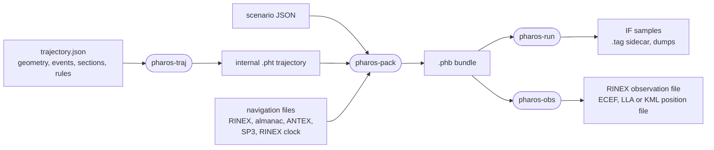
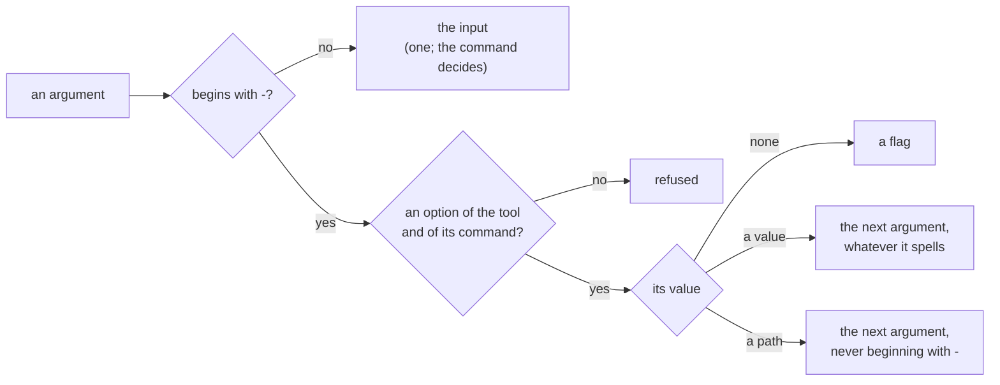

# Overview

Pharos simulates what a GNSS receiver front end delivers. It writes
quantised IF samples, or RINEX observation and position files that
describe the same signals as measurements. It covers sixteen signals of
GPS, Galileo, BDS and GLONASS, each with its navigation message.

## The four tools

| Tool | Reads | Writes | Page |
|---|---|---|---|
| `pharos-traj` | a trajectory plan JSON, static coordinates or an internal `.pht` file | a verified `.pht` trajectory, or a KML line | [trajectories](trajectories.md) |
| `pharos-pack` | a scenario JSON and the files it names | a `.phb` bundle | [scenarios](scenarios.md), [navigation data](navigation-data.md) |
| `pharos-run` | a bundle | the IF sample file, its `.tag` sidecar, dumps | [samples](samples.md) |
| `pharos-obs` | a bundle | a RINEX observation file, a position file | [observations](observations.md) |

The flow goes one way. `pharos-run` and `pharos-obs` read only the
bundle, so a bundle is a complete run that can be moved and run again.
Each tool is also a static library with a C header
([C API](c-api/README.md)). The libraries of `pharos-traj`,
`pharos-pack` and `pharos-obs` also come as separate WebAssembly modules
([WebAssembly](c-api/webassembly.md)).

## The signals

| Signal | System | Carrier (MHz) | Message |
|---|---|---|---|
| `L1CA` | GPS | 1575.42 | LNAV |
| `L1C` | GPS | 1575.42 | CNAV-2 |
| `L2C` | GPS | 1227.60 | CNAV |
| `L5` | GPS | 1176.45 | CNAV |
| `B1C` | BDS | 1575.42 | B-CNAV1 |
| `B1I` | BDS | 1561.098 | D1 on MEO and IGSO, D2 on GEO |
| `B2I` | BDS | 1207.14 | D1, D2 |
| `B3I` | BDS | 1268.52 | D1, D2 |
| `B2a` | BDS | 1176.45 | B-CNAV2 |
| `B2b` | BDS | 1207.14 | B-CNAV3 on MEO and IGSO, PPP-B2b on GEO |
| `E1` | Galileo | 1575.42 | I/NAV |
| `E5a` | Galileo | 1176.45 | F/NAV |
| `E5b` | Galileo | 1207.14 | I/NAV |
| `E6` | Galileo | 1278.75 | C/NAV with HAS MT1, or the dummy page |
| `G1` | GLONASS | 1602 + 0.5625 k | GNAV |
| `G2` | GLONASS | 1246 + 0.4375 k | GNAV |

The signal words are spelled the same in the scenario, the console and
the manifest. Which satellites transmit each signal, and what the
observables carry, is in [GNSS](../gnss/README.md).

## Conventions

| Topic | Rule |
|---|---|
| Heights | metres above the EGM96 geoid by default; trajectory plans explicitly select `EGM96` or `ellipsoid` in `coordinates.altitude` ([geoid](../models/geoid.md)) |
| Trajectory time | seconds from the first knot; the scenario's `time` places the first knot on the calendar |
| Text inputs | a UTF-8 byte-order mark at the start is ignored |
| Stored time | GPS time; UTC, GST, BDT and GLONASS time are views of it |
| Printed instants | `YYYY-MM-DD hh:mm:ss`, then `GPST` or `UTC`; a fraction of the second follows the seconds, rounded to the microsecond, without trailing zeros: `2026-08-20 18:00:18.0005 GPST`; UTC reads `23:59:60` in an inserted second |

## Console output

Every tool writes its console the same way.

| Topic | Rule |
|---|---|
| Line prefix | `[INFO]`, `[WARNING]` or `[ERROR]`, then a tab |
| Streams | INFO and WARNING on stdout, ERROR on stderr |
| Lines without a prefix | the usage and the version line |
| Exit status | 0 on success, a dry run included; 1 on any failure |
| A console line that cannot be written | exit status 1, the work completing first |
| `-v`, `--version` | prints `<tool> 1.0.0` and exits 0 |
| `-h`, `--help`, no argument | prints the usage and exits 0 |

## Options

Every tool reads its command line by one convention.

| Rule | Detail |
|---|---|
| synopsis | `pharos-traj <command> [arguments]`, `pharos-pack <scenario.json> [options]`, `pharos-run <bundle.phb> [options]`, `pharos-obs <bundle.phb> [options]` |
| the input | the one argument that does not begin with `-`, anywhere on the line; a second is refused |
| long options | every option has one, such as `--output` and `--dry-run` |
| short forms | one letter, where common: `-o` for `--output`, `-t` for `--tag`, `-h`, `-v` |
| a value option | takes the next argument whatever it spells: `--gain -6` and `--lla -33.9,151.2,40` pass, and `--name -h` names `-h` |
| a path option | takes the next argument unless it begins with `-`: `-o`, `--dump`, `--observation`, `--position` |
| an integer | decimal digits only, within the option's range |
| a number | decimal: an optional `-`, digits with an optional point, then an optional exponent, as in `-6`, `0.5` or `1e-3`; no leading `+`, no hexadecimal, no `_` |
| given twice | a value or path option, in either spelling, is refused; a flag may repeat |
| an option the tool, or its command, does not take | refused |
| `-h` and `-v` | win anywhere on the line but as an option's value, `-h` over `-v`; no argument prints the usage |
| `--dry-run` | of `pharos-pack`, `pharos-run` and `pharos-obs`: reads the input, creates what the C API creates from it, prints the report and writes no file; `-o`, `-t`, `--dump`, `--observation` and `--position` then write nothing |

## Reproducibility

Every output is a function of its inputs. Running a tool again on one
version, one build mode and one machine writes the same bytes.

| Tool | Output is a function of |
|---|---|
| `pharos-traj` | the trajectory plan, the internal `.pht` file or the static arguments |
| `pharos-pack` | the scenario and the files it names |
| `pharos-run` | the bundle, the seed, the noise mode, the gain and the host's epoch-bound commands |
| `pharos-obs` | the bundle, the observation file's creation time and a C host's commands |
| `pharos_traj.wasm`, `pharos_pack.wasm`, `pharos_obs.wasm` | each product's inputs, with the last bits of a few values its own ([limits](c-api/webassembly.md#limits)) |

Worker counts and pull sizes change no byte of the samples, and a seek
lands on the same bytes. The one wall clock in any output is the
creation time of an observation file, which `--created` or a C host may
give instead.
Another build mode may change the last bits of a few values, so compare
bytes within one mode. The dumps of `pharos-run` compare two runs to the
last bit ([dumps](samples.md#dumps)). A bundle is read by every build
with its bundle layout ([the bundle](scenarios.md#the-bundle)).

## Where to read more

| Topic | Page |
|---|---|
| the signals and messages, against the ICDs | [GNSS](../gnss/README.md) |
| the models between satellite and receiver | [models](../models/README.md) |
| how Pharos is built | [design](../design/README.md) |

## Limits and messages

| Input | Size limit |
|---|---|
| trajectory plan JSON or internal `.pht` file | 1 GiB |
| scenario JSON | 64 MiB |
| navigation, antenna or product file | 256 MiB |
| trajectory loaded by `pharos-pack` | 1 GiB |
| bundle | 1 GiB |

| Message | When |
|---|---|
| `Unknown option '<arg>'` | an option the tool does not define |
| `Unexpected argument '<arg>'` | a second input, or an input the command does not take |
| `<input> is required` | no input; `<input>` as the synopsis names it |
| `<option> is given twice` | a value or path option, repeated in either spelling |
| `<option> requires a value` | a value option at the end of the line |
| `<option> requires a path` | a path option at the end of the line, or before an argument that begins with `-` |
| `<option> expects <what>, got <value>` | a value the option cannot take |
| `<option> expects <min>..<max>, got <value>` | an integer option given other than decimal digits, or outside its range |
| `Cannot read <file>: <error>` | an input that cannot be read |
| `Cannot read <file>: the file is <x> MiB; this input may be at most <n> MiB` | an input over its size limit |
| `Cannot read <file>: this input may be at most <n> MiB` | the same, when the size cannot be read |
| `Cannot write <file>: <error>` | an output that cannot be created, written or flushed |
| `Out of memory` | memory ran out |
