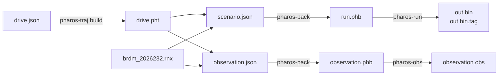

# Quick start

This page builds Pharos and makes two complete runs. One run ends in a
sample file, the other in an observation file. Both read a RINEX
navigation file for the start time, such as the 2026-08-20 file of the
[examples](examples.md).



## Build

Pharos needs Zig 0.16 and nothing else. One command builds the four
tools, the four libraries and the four headers.

```bash
zig build -Doptimize=ReleaseFast
```

All compiled products and build generators omit debug information in every
optimization mode. `-Doptimize` still controls optimization and runtime safety.

Bytes are comparable only within one build mode
([reproducibility](overview.md#reproducibility)). One more command
builds `pharos_traj`, `pharos_pack` and `pharos_obs` into separate
WebAssembly modules for a JavaScript host ([WebAssembly](c-api/webassembly.md)):

```bash
zig build wasm -Doptimize=ReleaseFast
```

| Path | Content |
|---|---|
| `zig-out/bin/pharos-traj`, `pharos-pack`, `pharos-run`, `pharos-obs` | the four tools |
| `zig-out/lib/libpharos_traj.a`, `libpharos_pack.a`, `libpharos_run.a`, `libpharos_obs.a` | the four static libraries |
| `zig-out/include/pharos_traj.h`, `pharos_pack.h`, `pharos_run.h`, `pharos_obs.h` | the four C headers |
| `zig-out/lib/pharos_traj.wasm`, `pharos_pack.wasm`, `pharos_obs.wasm` | the three WebAssembly modules, from `zig build wasm` |
| `zig-out/lib/trajectory.schema.json`, `scenario.schema.json` | the JSON Schemas of trajectory plans and scenarios, from `zig build wasm` ([JSON Schemas](../design/formats.md#the-json-schemas)) |

The build generates headers from the actual Zig ABI declarations. Each
product run step builds only the command it runs.

| Step | Does |
|---|---|
| `zig build traj -- <args>` | builds and runs `pharos-traj` with `<args>` |
| `zig build pack -- <args>` | builds and runs `pharos-pack` |
| `zig build run -- <args>` | builds and runs `pharos-run` |
| `zig build obs -- <args>` | builds and runs `pharos-obs` |
| `zig build wasm` | builds and installs the three WebAssembly modules and the two JSON Schemas under `zig-out/lib` |
| `zig build fmt` | formats `build.zig`, `build.zig.zon` and `src/` in place |
| `zig build fmt-check` | fails when a source is not `zig fmt` clean |

To add Pharos to another Zig project, fetch a published commit from that
project's root:

```bash
zig fetch --save=pharos 'git+https://github.com/Mirai-Research/Pharos.git#<commit>'
```

Replace `<commit>` with the full commit ID. Zig records the URL and package
hash in `build.zig.zon`. During local development, pass
`--fork=/path/to/Pharos` to the consuming project's `zig build` command.

| A build that depends on Pharos takes | As |
|---|---|
| a product's Zig module | `pharos.module("pharos_run")`, and so for `pharos_traj`, `pharos_pack`, `pharos_obs` |
| a library's archive | the named lazy path of its name: `pharos.namedLazyPath("pharos_run")` |
| a C header | its named lazy path, for example `pharos.namedLazyPath("pharos_run.h")` |
| a WebAssembly module | the named lazy path `pharos_traj.wasm`, `pharos_pack.wasm` or `pharos_obs.wasm` ([build](c-api/webassembly.md#build)) |
| the JSON Schemas | the named lazy paths `trajectory.schema.json` and `scenario.schema.json` |

Here `pharos` is `b.dependency("pharos", .{ .target = target, .optimize = optimize })`.

## The trajectory

`drive.json` is a trajectory plan: a five-second journey between two
points, starting and ending at rest. Geometry, timing and motion rules
are solved together ([trajectory plans](trajectories.md#plan-structure)).

```json
{
  "format": "pharos.trajectory-plan",
  "version": 1,
  "name": "drive",
  "coordinates": { "datum": "WGS84", "altitude": "EGM96" },
  "geometry": {
    "points": [
      { "id": "A", "position": { "latitude": 30.5292, "longitude": 114.3642, "altitude": 40 } },
      { "id": "B", "position": { "latitude": 30.5295, "longitude": 114.36455, "altitude": 40 } }
    ]
  },
  "events": [{ "id": "start" }, { "id": "finish" }],
  "sections": [{ "id": "drive", "from": "start", "to": "finish" }],
  "rules": [
    { "id": "start-position", "kind": "hard", "scope": { "event": "start" }, "quantity": "position", "eq": { "point": "A" } },
    { "id": "finish-position", "kind": "hard", "scope": { "event": "finish" }, "quantity": "position", "eq": { "point": "B" } },
    { "id": "finish-time", "kind": "hard", "scope": { "event": "finish" }, "quantity": "time", "eq": 5 },
    { "id": "start-rest", "kind": "hard", "scope": { "event": "start" }, "quantity": "velocityEcef", "eq": [0, 0, 0] },
    { "id": "finish-rest", "kind": "hard", "scope": { "event": "finish" }, "quantity": "velocityEcef", "eq": [0, 0, 0] }
  ],
  "initialGuess": { "eventTimes": { "start": 0, "finish": 5 } }
}
```

```bash
./zig-out/bin/pharos-traj build drive.json
```

This prints the solve report and writes the internal `drive.pht` product
after verification. An optional `pharos-traj export drive.pht` writes
`drive.kml` for viewing the result.

## To a sample file

`scenario.json` names the trajectory, a navigation file, one signal and
the sample stream ([scenarios](scenarios.md)).

```json
{
  "time": { "type": "UTC", "year": 2026, "month": 8, "day": 20, "hour": 18, "minute": 0, "second": 0 },
  "trajectory": "drive.pht",
  "ephemeris": { "name": "brdm_2026232.rnx" },
  "signals": ["L1CA"],
  "samples": { "format": "IQ8", "sampleFreq": 4.092, "centerFreq": 1575.42 }
}
```

```bash
./zig-out/bin/pharos-pack scenario.json -o run.phb
./zig-out/bin/pharos-run run.phb -o out.bin -t
```

`out.bin` holds 5 s of IQ8 samples at 4.092 MHz. `out.bin.tag` is its
sidecar ([samples](samples.md)).

## To an observation file

The same trajectory and navigation data, with `observation` in place of
`samples`, as `observation.json`:

```json
{
  "time": { "type": "UTC", "year": 2026, "month": 8, "day": 20, "hour": 18, "minute": 0, "second": 0 },
  "trajectory": "drive.pht",
  "ephemeris": { "name": "brdm_2026232.rnx" },
  "signals": ["L1CA", "L5", "E1", "E5a"],
  "observation": { "interval": 1 }
}
```

```bash
./zig-out/bin/pharos-pack observation.json
./zig-out/bin/pharos-obs observation.phb
```

`observation.obs` is a RINEX 3.04 observation file with an epoch every
second ([observations](observations.md)).

## Notes

| Topic | Rule |
|---|---|
| File names in a scenario | resolved against the scenario file's directory, then the working directory |
| Where to put the files | `drive.pht` and `brdm_2026232.rnx` beside the scenario, or their paths in it |
| The bundle's name | without `-o`, the scenario file's name with `.phb` |
| Output names | the bundle's name with a new extension, unless `-o`, `--observation` or `--position` names them |
| One bundle for both tools | a scenario may declare `samples`, `observation` and `position` together |

## Limits and messages

| Case | Result |
|---|---|
| an ABI declaration has a type the C generator does not support | the build fails |
| `zig build fmt-check` on a source that is not `zig fmt` clean | the step fails |
| every tool with `-v` or `--version` | prints `<tool> 1.0.0` ([console output](overview.md#console-output)) |
