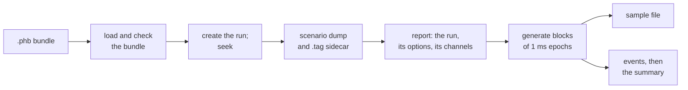
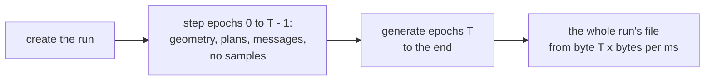

# Samples

`pharos-run` turns a bundle with a `samples` block into a file of
quantised IF samples. The file is one complex stream at the scenario's
sample rate and centre frequency. It holds every listed signal of every
visible satellite, with its navigation message, plus noise.



How an epoch is synthesised is in [design: synthesis](../design/synthesis.md),
and how the run is driven in [design: engine](../design/engine.md).

The bundle fixes the applied [ionosphere model](../models/ionosphere.md)
and coefficients when it is packed. The default is `klobuchar`, shared
by all systems, as is any explicitly selected concrete model. With
`model: "auto"`, each enabled constellation has its own resolved model.
All frequencies of a satellite use that model, with delay scaled by
the inverse square of frequency.

## Command line

```
pharos-run <bundle.phb> [options]
```

| Option | Meaning |
|---|---|
| `<bundle.phb>` | the bundle, from `pharos-pack` |
| `-o`, `--output <FILE>` | the sample file; default: the bundle's name with `.bin` |
| `-t`, `--tag` | write the `.tag` sidecar |
| `--workers <N>` | the threads a pull uses, the calling one among them; default: 0, one per hardware thread ([workers](#workers)) |
| `--seed <N>` | the noise seed; default: 0 |
| `--noise <MODE>` | the noise stream, `counter` or `off`; default: `counter` |
| `--gain <DB>` | a constant digital gain in dB, -60 to 60; default: adaptive, the AGC ([gain](#gain)) |
| `--seek <EPOCH>` | start the file at this epoch, in ms from the run start; needs `--gain` ([seeking](#seeking)) |
| `--dump <DIR>` | write the stage dumps into `DIR` |
| `--dry-run` | creates the run, enters it at `--seek`, prints its report; writes no file |
| `-v`, `--version` | prints `pharos-run 1.0.0` and exits 0 |
| `-h`, `--help` | prints the usage and exits 0; no argument does the same |

The command line follows the tools' convention
([options](overview.md#options)). `--dry-run` ends after the channel
lines: it writes no sample file, `.tag` or dump, and makes no dump
directory.

## The run

The epoch is 1 ms. The run lasts the scenario's `duration`, or the whole
trajectory. A channel is one satellite and one listed signal it
transmits.

| A channel needs | Rule |
|---|---|
| allocation | the satellite's PRN carries the signal at the run start |
| record | a selected record that does not declare the signal gone |
| message | its family's message set has frames for the satellite |
| elevation | at or above the elevation mask |
| mask-out | the satellite outside `maskOut` |
| band | the carrier inside the sampled band |

| Rule | Detail |
|---|---|
| the channel set | re-planned every second; no cap on the count |
| removal | only 0.5 degrees below the mask |
| records | re-selected every GPS minute; GLONASS ones also every superframe boundary |
| a record switch | a 600 s blend ([record selection](navigation-data.md#record-selection)) |
| message sets | rebuilt at every leg boundary of each listed system |
| missing auxiliary data | end the run, rather than skipping the satellite |
| a run without a channel | warns, and still writes its samples: noise alone |

`libpharos_obs` drives the run's own sequencer over these rules to tell
at any epoch which signals hold a channel and which rule keeps each
other one off ([the truth at an epoch](c-api/obs.md#the-truth-at-an-epoch)).
A bundle `pharos-pack` wrote cannot miss auxiliary data
([message sets](navigation-data.md#message-sets)). The epochs generated
before a failure are on the file. The samples are a function of the
bundle, the seed, the noise mode, the gain and the epoch-bound commands
of a C host ([run](c-api/run.md)).

## Seeking

`--seek <EPOCH>` writes the file from that epoch on. The run steps
through the epochs before it without synthesising them, so the file is
byte for byte the tail of the file the whole run writes.



| With `--seek T` | Rule |
|---|---|
| gain | `--gain` is required: the AGC depends on every epoch before T |
| T | 0 to the run's epochs; the run's epochs give an empty file |
| the console | `Starting at epoch T of <m>, <time> GPST`, with the GPS time of T; then the channel lines |
| the channel lines | the ephemeris switches already queued, then `Channel <sat> <signal> added at T ms` for each channel the run holds: at a multiple of 1000 after 0, those before the re-plan at T, whose changes the first pull prints |
| the `.tag` | `TIME` is the time of T |
| the dumps | hold the epochs before T too, so they equal the whole run's |
| `--dry-run` | stops after the channel lines; at a multiple of 1000 after 0 it gives no `No channel` warning, the re-plan at T falling to the first pull |
| the summary | counts the epochs and components from T |
| the observation and position files | `pharos-obs --seek T` starts each at its first epoch at or after T ([epochs](observations.md#epochs)) |

## The sample file

The sample file is a raw stream of complex samples, I then Q, with no
header. A receiver reads it with the rate, centre and format of the
scenario, or of the `.tag` sidecar.

| Format | Bytes per sample | Layout |
|---|---|---|
| `IQ2` | 0.5 | one byte per two samples: bits 0-1 I0, 2-3 Q0, 4-5 I1, 6-7 Q1 |
| `IQ4` | 1 | high nibble I, low nibble Q |
| `IQ8` | 2 | int8 I, then int8 Q |
| `IQ16` | 4 | little-endian int16 I, then Q, on every host |

| Format | Level of a component | Clip |
|---|---|---|
| `IQ2` | bit 1 the sign, set below 0; bit 0 set when `abs >= 1.1 / gain` | `abs >= 5 × 1.1 / gain` |
| `IQ4` | sign in bit 3; magnitude `abs × gain × 3`, truncated, at most 7 | a magnitude above 7 |
| `IQ8` | `value × gain × 25`, truncated toward zero, saturated to [-128, 127] | a saturated component |
| `IQ16` | `value × gain × 3277`, truncated toward zero, saturated to [-32768, 32767] | a saturated component |

The bytes per millisecond are the samples per millisecond times 0.5, 1,
2 or 4. `gain` is the gain: the AGC's, or `--gain`'s constant
([gain](#gain)).

## The .tag sidecar

With `-t`, `pharos-run` writes `<output>.tag`: seven text lines that
describe the recording, with this exact spacing.

```
PROG = pharos-run
TIME = YYYY/MM/DD hh:mm:ss.mmm
FMT  = CS8 | CS16
F_S  = <sample rate in MHz, six decimals>
F_LO = <centre frequency in MHz, six decimals>
IQ   = 2
BITS = 8 | 16
```

| Line | Content |
|---|---|
| `TIME` | the first epoch the file holds, in GPS calendar time: the scenario start, or the `--seek` epoch |
| `FMT` | `CS8` for `IQ8`, the plain int8 pair; `CS16` for `IQ16` |
| `IQ` | `2`: I/Q sampling |
| `F_LO`, `IQ`, `BITS` | the one RF channel |

The format has no 2-bit or 4-bit pair, so `IQ2` and `IQ4` have no tag:
`-t` then warns and writes none. The tag is written once the run is
created, before generation, so it exists even when generation then
fails. `--dry-run` writes none. A tag that cannot be written stops the
run before generation.

## The manifest

A C host can render a manifest of a run with
`pharos_run_manifest_json` ([run](c-api/run.md)). The command line
writes none. It is JSON text with alphabetical keys and four-space
indents.

| Key | Content |
|---|---|
| `scenario_name` | the scenario's `name` |
| `run_id`, `start_time` | the host's own text, from `run_id` and `start_time_iso` |
| `signals` | a `{ "signal", "system" }` pair for each signal with a channel in force from `first_epoch` on |
| `output` | `format`, `sample_freq_mhz`, `center_freq_mhz`, `file`, `first_epoch`, `size_bytes`, `duration_ms` |
| `navigation` | the navigation files as the scenario names them |
| `ionosphere` | the requested `model`, `parameters`, and the applied entries in `systems` |
| `antenna` | the ANTEX file as written, or null |
| `precise` | null, or `orbit` and `clock` as lists of files, and `phase_centre` |
| `services` | `has` and `ppp_b2b`: null, or `clock_interval_s` and `orbit_interval_s`; `has` adds `status` |

`signals` keeps signal order. `G1` or `G2` appears once any FDMA channel
lies in the band. `first_epoch` is the epoch the output starts at: 0, or
the epoch of the last seek. `size_bytes` counts the bytes pulled from it,
and `duration_ms` runs from it to the run's end. `phase_centre` is
`antenna` or `centre_of_mass`.

The ionosphere's `systems` array has one entry per enabled constellation.
Each entry gives `system` (`GPS`, `BDS`, `Galileo` or `GLONASS`), the
applied concrete `model`, its `parameters`, and `source` (`scenario`,
`navigation`, `built_in` or `none`). With `auto`, the top-level
`parameters` array is empty; the per-system entries give the coefficients
actually used. With a concrete model, the top-level array gives its
resolved coefficients, whether they came from the scenario, navigation
data or built-in set. It is empty for `none` or no enabled system.
These choices stay fixed across seeks and channel changes.

## Dumps

`--dump DIR` writes four text files into `DIR`, created if needed. Every
double is written as IEEE-754 hex, so two runs compare to the last bit.

| File | Content |
|---|---|
| `scenario.txt` | the bundle's scenario as `key = value` lines |
| `rows.txt` | one line per satellite and epoch of geometry |
| `plan.txt` | one line per change of the channel plan |
| `params.txt` | one line per channel and generated epoch |

| `scenario.txt` line | Content |
|---|---|
| `time.*` | the UTC start |
| `name`, `trajectory.*`, `run.epochs` | the name, the trajectory file with its knots, duration and first position, the epochs |
| `nav_file[i]` | the navigation files |
| `mask.<system>`, `signals.<system>` | the mask-outs as bit sets, the signals per system |
| `elevation_mask` | radians, in hex |
| `samples.format` | the format's code: 0 IQ2, 1 IQ4, 2 IQ8, 3 IQ16 |
| `power.noise_floor`, `power.init_cn0`, `power.elevation_fade` | the power block |
| `power[i].*` | the schedule; `power[i].unit = 3` marks an entry that restores the default |

| Other file | Fields of a line |
|---|---|
| `rows.txt` | epoch, satellite, range, satellite clock, ionosphere at L1, troposphere, elevation, azimuth |
| `plan.txt` | `<epoch>:`, then every active channel as `<sat> <signal>@<IF in Hz>` |
| `params.txt` | epoch, receiver GPS ms, channel, phase cycles, transmit ms and fraction |
| | carrier phase and step, entry phase and step, period, C/N0, lead bits and lead entries |

`rows.txt` has a line whatever the elevation, but none for a satellite
without a selected record. With `--seek`, the dumps also hold the epochs
the seek passes. `--dry-run` writes no dump. A dump that cannot be
written is an error. The directory, `rows.txt`, `plan.txt` and
`params.txt` are made before the run is created, so a creation or a seek
that fails leaves them with what it computed, and no `scenario.txt`.

## Gain

The quantisers scale every component by one gain.

| Gain | Rule |
|---|---|
| the AGC, the default | 1.0 at the start, adjusted every 100 epochs by the clip rate of those epochs |
| `--gain <DB>` | 10^(DB / 20) on every epoch; 0 dB is the AGC's starting 1.0 |

| Clip rate | AGC gain | Warning |
|---|---|---|
| above 0.01 | multiplied by 0.95 | `AGC gain reduced to <g> at <ms> ms: <x>% clipped` |
| below 0.001, the gain below 1 | multiplied by 1.02, at most 1.0 | `AGC gain increased to <g> at <ms> ms: <x>% clipped` |
| otherwise | unchanged | none |

`<g>` is the gain from epoch `<ms>` on, and `<x>` the clip rate of the
100 epochs before it. The 100 epochs are part of what the samples are.
The gain moves on the same epochs at any pull size and worker count. A
constant gain never moves and prints no `AGC` line: no epoch's bytes
depend on how the epochs before it clipped.

## Noise

The noise is complex Gaussian with sigma 1 per component, the density
`noiseFloor` refers to. Every C/N0 is therefore realised as set, except
on `B2b`: its data component alone is generated, 3.01 dB below the set
value. The noise is a function of the seed and the absolute sample
index. `--seed N` selects another stream, and equal seeds give equal
bytes. `--noise off` writes zeros in place of the noise.

## Workers

| `--workers` | A pull runs on |
|---|---|
| 0, the default | one thread per hardware thread, the calling one among them |
| 1 | the calling thread alone; the run starts no thread |
| N | the calling thread and N - 1 threads the run starts |

The samples are byte-identical at every worker count, and so are the
AGC's adjustments and their epochs. `Options:` prints the count in
force. A thread the system cannot start stops the run at its creation
(`Cannot create the run: a worker thread could not be started`).

## Limits and messages

| Console line | When |
|---|---|
| `Loading bundle: <path>` | first |
| `Scenario dump written: <path>` | with `--dump` |
| `Tag written: <path>` | with `-t` |
| `Trajectory <name> (<file>): <N> knots over <D> s`, or `Trajectory <file>: <N> knots over <D> s` for an unnamed one | the trajectory; `<file>` as the scenario names it |
| `Run: <m> ms from <T> GPST, <U> UTC; leap seconds <n>` | the run's length, its start in GPS time and UTC, and GPS - UTC at the start ([leap seconds](navigation-data.md#leap-seconds)) |
| `Run: ..., then <k> from <C> GPST` | a leap second within the run: GPS - UTC is `<k>` from `<C>` on |
| `Navigation data: <K> Keplerian and <G> GLONASS records` | the records in the bundle |
| `Antenna offsets: ...`, `Precise product: ...` | with `antenna` or `precise` ([navigation data](navigation-data.md#limits-and-messages)) |
| `HAS MT1 on E6-B: ...`, `PPP-B2b on the BDS-3 GEO B2b: ...` | with `has` or `pppB2b` ([scenarios](scenarios.md#limits-and-messages)) |
| `Ionosphere: <requested>` | the requested choice, including `auto` |
| `Ionosphere <system>: <model>, <coefficients> (<origin>)` | one line per enabled constellation: its applied model and coefficient source; `none` has no coefficients or origin |
| `Sampling: <format> at <rate> MHz, centre <centre> MHz: <n> samples, <b> bytes per epoch` | the sample format, rate and centre frequency, and an epoch's samples and bytes |
| `Options: workers <w>, seed <s>, noise <mode>, gain adaptive`, or `gain constant <d> dB` | the options in force; `<w>` the threads a pull uses ([workers](#workers)) |
| `Starting at epoch <n> of <m>, <time> GPST` | with `--seek`, once the run stands at epoch n |
| `Channel <sat> <signal> added at <ms> ms`, `removed at <ms> ms` | a channel event; before generation, an `added` line for each channel the run holds at its first epoch: 0, or the `--seek` epoch ([seeking](#seeking)) |
| `Ephemeris of <sat> switched at <ms> ms` | a record switch |
| `<n> / <m> ms generated` | after a pull that passes a multiple of 10 000 ms |
| `Samples written: <path>, <e> epochs, <x> MiB` | the sample file and what it holds, in whole epochs and MiB of 1024^2 bytes; also after an epoch or a write fails |
| `Clipped: <c> of <n> components, <x>%` | the clipped components of the epochs generated, I and Q counted apart; none when no epoch was generated |
| `AGC gain at the end: <g>` | under the AGC |
| `Generated in <s> s, <x> MiB/s` | timings, not output |

The ionosphere's origin is `the scenario`, `the navigation data` or
`the built-in set`. Under `auto`, the GLONASS line names its GPS model
`Klobuchar substitute`. Missing required coefficients are rejected
while packing; the run consumes the resolved choices in the bundle.

| Warning | When |
|---|---|
| `No channel at epoch <n>: no satellite of a listed signal has a record there and stands above the elevation mask; the samples carry noise alone` | no channel at the run's first epoch: 0, or the `--seek` epoch; at a `--seek` epoch that is a multiple of 1000, after the first pull's re-plan at it, so never in a dry run |
| `No satellite of a listed signal flies a record from <T> s into the run: nothing is transmitted from there on` | the records end before the run |
| `The .tag format has no <format> format: no tag file written` | `-t` with `IQ2` or `IQ4` |
| `AGC gain reduced to ...`, `AGC gain increased to ...` | an AGC adjustment ([gain](#gain)) |

| Error | When |
|---|---|
| `The bundle has no samples block: nothing to generate` | a bundle without `samples` |
| `--seek <n> lies beyond the run's <m> epochs` | a `--seek` past the run's end |
| `--seek needs --gain: the adaptive AGC depends on every epoch before the target` | `--seek` without `--gain` |
| `--seek <n> is refused: the seek starts the run over, which would drop the commands it has applied` | a seek that starts over once a command has applied; `pharos-run` applies none ([seeking](c-api/run.md#seeking)) |
| `<path>: <message>` | an invalid bundle's diagnostic ([the bundle](scenarios.md#the-bundle)) |
| `Cannot create the run: <reason>` | the run cannot start; no sidecar or summary follows |
| `Epoch <n> of <m> could not be generated: <reason>` | an epoch fails; in generation, the epochs before it are on the file |
| `Cannot write <path>: <error>` | the sample file cannot be created, written or flushed; the `.tag` or `scenario.txt` cannot be written; the dump directory or a dump file cannot be created: the run stops |
| `Cannot write <path>: <error>` | `rows.txt`, `plan.txt` or `params.txt` cannot be written or flushed: printed after the summary; generation runs to its end |

| Failure | `<reason>` |
|---|---|
| the navigation data lack what a message family needs | the family's need ([message sets](navigation-data.md#message-sets)) |
| the message content does not fit | `the bundle's supplied message content cannot be encoded into the message sets of the listed signals` |
| a thread does not start | `a worker thread could not be started` |
| memory runs out | `out of memory` |
| an internal failure | `a failure no input explains` |

| Argument message | When |
|---|---|
| `<bundle.phb> is required` | no bundle on the command line |
| `<option> requires a path` | `-o` or `--dump` at the end, or before an argument that begins with `-` |
| `<option> requires a value` | `--workers`, `--seed`, `--noise`, `--gain` or `--seek` at the end |
| `--workers must be from 0 to 4294967295, got <x>` | a worker count other than decimal digits, or outside the range |
| `--seed must be from 0 to 18446744073709551615, got <x>` | a seed other than decimal digits, such as `-1` or `0x10`, or outside the range |
| `--noise expects counter or off, got <x>` | a bad noise mode |
| `--gain must be from -60 to 60 dB, got <x>` | a gain that is no decimal number or lies outside the range |
| `--seek must be from 0 to 18446744073709551615, got <x>` | an epoch other than decimal digits, or outside the range |

The exit status is 0 on success, a dry run included. It is 1 for an
argument, read, validation or initialisation failure, for an output
that cannot be written (the sample file, the `.tag` or a dump), and
when a console line could not be written, the run completing first.
