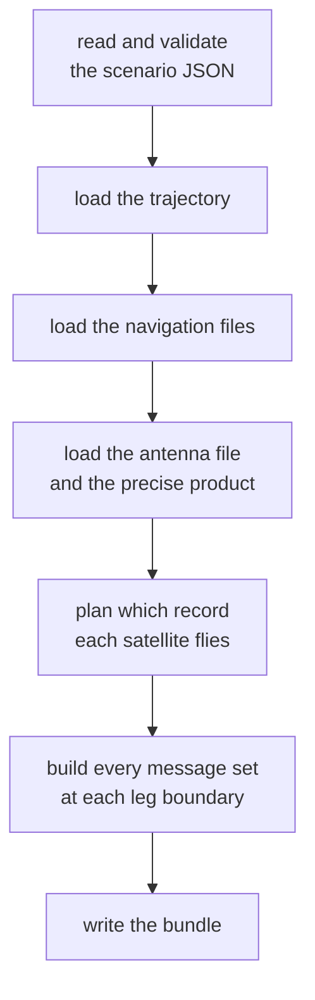
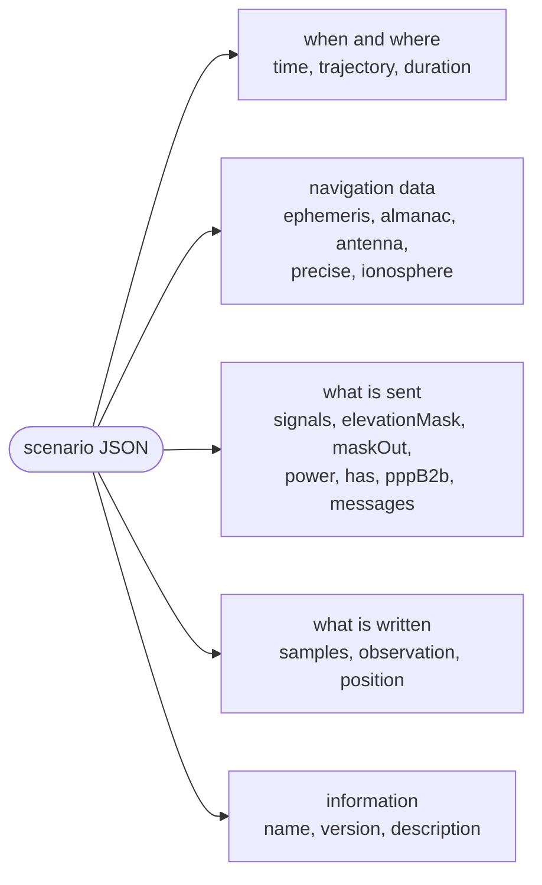

# Scenarios

A scenario is one JSON object. It says when and where a run takes place,
which navigation data and signals it uses, and what it produces.
`pharos-pack` reads it, loads the files it names, validates everything
and packs a bundle `.phb`.



Any error stops the pack before anything is written. The message sets
are built only for a scenario with `samples`, so that `pharos-run` never
meets data it cannot encode.

## Command line

```
pharos-pack <scenario.json> [options]
```

| Option | Meaning |
|---|---|
| `<scenario.json>` | the scenario JSON |
| `-o`, `--output <FILE>` | the bundle; default: the scenario file's name with `.phb` |
| `--dry-run` | reads and checks the scenario and its files; writes no file |
| `-v`, `--version` | prints `pharos-pack 1.0.0` and exits 0 |
| `-h`, `--help` | prints the usage and exits 0; no argument does the same |

The command line follows the tools' convention
([options](overview.md#options)). The default bundle name ignores the
scenario's `name`. `--dry-run` loads and packs as a pack does, and
prints the same lines but `Bundle written`. The console lines are listed
under [limits and messages](#limits-and-messages).

## The scenario JSON



| Key | Content | Section |
|---|---|---|
| `time` | the scenario start, required | [time](#time) |
| `trajectory` | the receiver's `.pht` file, required | [trajectory and duration](#trajectory-and-duration) |
| `duration` | the run's length in seconds; absent: the whole trajectory | [trajectory and duration](#trajectory-and-duration) |
| `ephemeris` | RINEX navigation files | [navigation files](#navigation-files) |
| `almanac` | almanac files | [navigation files](#navigation-files) |
| `antenna` | an ANTEX file | [navigation files](#navigation-files) |
| `precise` | a precise orbit and clock product | [precise](#precise) |
| `ionosphere` | the ionosphere model and its coefficients | [ionosphere](#ionosphere) |
| `signals` | the signals transmitted | [signals](#signals) |
| `elevationMask` | the visibility floor in degrees | [elevation mask and mask-out](#elevation-mask-and-mask-out) |
| `maskOut` | the satellites never transmitted | [elevation mask and mask-out](#elevation-mask-and-mask-out) |
| `power` | the noise floor and the C/N0 | [power](#power) |
| `has` | Galileo HAS on `E6` | [has and pppB2b](#has-and-pppb2b) |
| `pppB2b` | BDS PPP-B2b on the GEO satellites' `B2b` | [has and pppB2b](#has-and-pppb2b) |
| `messages` | GPS, Galileo I/NAV and BDS D2 publications | [messages](#messages) |
| `samples` | the IF stream of `pharos-run` | [outputs](#outputs) |
| `observation`, `position` | the files of `pharos-obs` | [outputs](#outputs) |
| `name` | informational; carried into the run manifest | |
| `version`, `description` | informational, any JSON value | |

| Rule | Detail |
|---|---|
| key order | free |
| dictionary words | matched exactly and case-sensitively |
| a word outside its dictionary | an error listing every word of the dictionary |
| an unknown key | an error with its path, naming the keys the object takes |
| a number beyond the range of a double | `out_of_range` |
| every diagnostic | a code, severity, source name, field path, optional line and column, and message |
| outputs | at least one of `samples`, `observation` and `position` |

| Dictionary | Words |
|---|---|
| systems | `GPS`, `BDS`, `Galileo`, `GLONASS` |
| time types | the four systems and `UTC` |
| signals | the sixteen words of the [overview](overview.md#the-signals) |
| sample formats | `IQ2`, `IQ4`, `IQ8`, `IQ16` |
| position formats | `ECEF`, `LLA`, `KML` |
| power units | `dBHz`, `dBm`, `dBW` |
| ionosphere models | `auto`, `klobuchar`, `bdsKlobuchar`, `nequick`, `bdgim`, `none` |
| HAS status | `test`, `operational` |

`zig build wasm` installs `scenario.schema.json` beside `pharos_pack.wasm`: a
JSON Schema, draft-07, written from the reader's own key tables
([JSON Schemas](../design/formats.md#the-json-schemas)). It gives every
key with its type, range, item count, unit, default and a one-line
description, the form each `type` or `model` takes, the sibling key that
names the unit of a power value, each signal word's system (`x-system`),
and one or many where the reader takes either. An editor or a form reads
it for completion and hints; `pharos-pack` alone validates.

## time

| `type` | Keys | Ranges |
|---|---|---|
| `UTC` | `year`, `month`, `day`, `hour`, `minute`, `second` | year 2000-2100, a real date, hour 0-23, minute 0-59, second [0, 60) |
| `GPS` | `week`, `second` | week 0-100 000, second [0, 604 800) |
| `Galileo` | `week`, `second` | the GST week, GPS week less 1024; as `GPS` |
| `BDS` | `week`, `second` | the BDT week, GPS week less 1356; as `GPS` |
| `GLONASS` | `leapYear`, `day`, `second` | N4 1-31, NT 1-1461, Moscow time of day [0, 86 400) |

`type` is required, and so is every key its form names. Keys of another
form are read and range-checked, then ignored without a warning. `UTC`
and `GLONASS` instants are read on the built-in leap-second history. The
same object gives the `from`, `until` and `reference` instants of
`messages`.

## trajectory and duration

| Key | Rule |
|---|---|
| `trajectory` | the path of a `.pht` file ([trajectories](trajectories.md)), required, non-empty |
| `duration` | seconds in [0.0005, 1e7], run as whole milliseconds; absent: the whole trajectory |

The path resolves as a navigation file's does
([paths and loading](navigation-data.md#paths-and-loading)). A file that
cannot be read, is no trajectory or leaves the receiver domain stops the
pack, naming the file and the line. The first knot is at `time`.

The run lasts `round(duration × 1000)` epochs of 1 ms. It needs at
least one epoch and at most the trajectory's length. Without `duration`
the run is the whole milliseconds of the last knot's time.

## Navigation files

| Key | Content | Form |
|---|---|---|
| `ephemeris` | RINEX 3 or 4 navigation files | `{ "name": <path> }`, or an array of them |
| `almanac` | almanac files | as `ephemeris` |
| `antenna` | one ANTEX file | a path |

| Rule | Detail |
|---|---|
| every path | non-empty (`missing_field`) |
| file order | kept, and it breaks ties between records |
| an almanac under `ephemeris` | the load fails: `AlmanacUnderEphemeris` |
| a file that is no almanac under `almanac` | the load fails: `NotAnAlmanac` |
| `samples` or `observation` | needs at least one navigation file |
| `position` alone | needs none |
| the ANTEX version | not checked |

With `antenna`, each signal leaves its satellite from the phase centre
of its own band, and the satellites fly their yaw laws. Without it,
every signal leaves from the point the orbit describes. The key holds
for a broadcast run and a `precise` one alike. What each file kind
gives, and how records are chosen, is in
[navigation data](navigation-data.md). The antenna model is in
[antennas](../models/antennas.md).

## signals

`signals` is an array of signal words. A single word is accepted. The
system follows from the word. Nothing is implied: a signal is
transmitted only when listed. A satellite transmits the listed signals
its PRN carries at the run start ([GNSS](../gnss/README.md)).

| Case | Diagnostic |
|---|---|
| a word listed twice | warning `duplicate` |
| a listed signal that no satellite transmits at the start | warning `no_effect` |
| a GPS signal listed, the start before 2025-01-01 | warning `out_of_range` on `time`; the first allocation state flies |
| `samples` or `observation` without a signal | error `no_signal` |

`position` needs no signal. The dated GPS allocation begins on
2025-01-01.

## Elevation mask and mask-out

| Key | Rule |
|---|---|
| `elevationMask` | degrees in [-90, 90], default 5 |
| `maskOut` | `{ "system", "svid" }`, or an array of them |
| `maskOut[i].svid` | an integer or an array; absent: the entry masks nothing |

A satellite below the mask gets no channel and no observation line. The
troposphere is evaluated at 3 degrees at the lowest. Under a mask below
3 degrees, the lower rows carry the delay of 3 degrees
([troposphere](../models/troposphere.md)). A masked-out satellite is
never transmitted, whatever its elevation.

| System | `svid` range |
|---|---|
| GPS | 1-32 |
| BDS | 1-63 |
| Galileo | 1-36 |
| GLONASS | 1-24 |

| Case | Diagnostic |
|---|---|
| a `svid` outside its system's range | `out_of_range` at `maskOut[i].svid[j]` |
| satellites masked for a system with no listed signal | warning `no_effect` |
| every transmitting satellite of a listed system masked | warning `no_effect`: that system gets no channel |

## Outputs

`samples` describes the IF stream of [`pharos-run`](samples.md);
`observation` and `position` describe the files of
[`pharos-obs`](observations.md). The tools name the files (`-o`,
`--observation`, `--position`), not the scenario.

| Key | Rule |
|---|---|
| `samples.format` | `IQ2`, `IQ4`, `IQ8` or `IQ16`, required |
| `samples.sampleFreq` | MHz in [0.001, 200], required, kept on the 1 kHz grid |
| `samples.centerFreq` | MHz in (0, 6000], required, kept on whole hertz |
| `observation.interval` | seconds in [0.0005, 4e6], default 1 |
| `position.interval` | seconds in [0.0005, 4e6], default 1 |
| `position.format` | `ECEF`, `LLA` or `KML`, required |

| Rule | Detail |
|---|---|
| a rate or a centre moved onto its grid | a warning: `sample_rate_rounded` or `center_rounded` |
| `IQ2` | needs an even number of samples per millisecond (`odd_sample_count`) |
| an interval | stored as `round(s × 1000)` ms: at least 1 ms |
| a carrier outside the sampled band | a warning (`band_excluded`); the signal gets no channel |
| the band check | exactly `abs(carrier - centre) <= sample rate / 2` |
| `G1` and `G2` | checked per FDMA channel, k = -7 to +6 |

For `G1` and `G2` the warning names the channels outside the band, which
get no channel, and the channels inside.

## power

| Key | Rule |
|---|---|
| `noiseFloor` | the noise density N0 in dBm/Hz, [-250, 0], default -172 |
| `initPower` | `{ "unit", "value" }`: the default C/N0, default 47 dB-Hz |
| `initPower.value` | required |
| `initPower.unit` | `dBHz` (default), `dBm` or `dBW` |
| `elevationAdjust` | `true` fades every default-power satellite; default `false` |
| `signalPower` | `{ "system", "svid", "powerValue" }`, or an array: a timed schedule |

| Unit | C/N0 given |
|---|---|
| `dBHz` | `value` |
| `dBm` | `value - noiseFloor` |
| `dBW` | `value - noiseFloor + 30` |

The fade is `25 (1 - sqrt(sin el))` dB. Every C/N0, the default and
each scheduled value, lies in [-100, 100] dB-Hz. A noise floor outside
[-200, -100] and a default outside [0, 60] are warnings.

| `signalPower` key | Rule |
|---|---|
| `system` | required |
| `svid` | an integer or an array; `0`, `[0]` or absent: every satellite of the system |
| `powerValue` | `{ "unit", "value", "time" }`, or an array; absent: the entry sets nothing |
| `powerValue.time` | seconds in [0, 4e12], default 0, applied on the millisecond grid |
| `powerValue.value` | absent: restores the default C/N0 and the fade |

| Rule | Detail |
|---|---|
| order | the schedule keeps file order |
| size | at most 100 000 entries of one satellite and one value |
| an explicit value | disables the fade for that satellite |
| `dBm` and `dBW` values | refer to the noise floor in force when the entry applies |
| the range check | uses the scenario's `noiseFloor` |
| at one epoch | the entries apply before the host's commands ([run](c-api/run.md)) |
| an entry for a system with no listed signal | warning `no_effect` |

The entries are the same epoch-bound commands a C host submits. The
generated noise has exactly the density `noiseFloor`, so every C/N0 is
realised as set. `B2b` realises 3.01 dB less, being generated as its
data component alone ([BDS signals](../gnss/bds/signals.md)). The IQ4
and IQ2 quantisers cost a fraction of a decibel.

## precise

With `precise` the signals fly with a precise product instead of the
broadcast orbits and clocks. The messages, the common group delays and
the GLONASS frequency numbers still come from the navigation plan.

| Key | Rule |
|---|---|
| `orbit` | one SP3 file or an array of them, required, at least one |
| `clock` | one RINEX clock file or an array of them |
| `clockReference` | `{ "<system>": "<pair>" }`: the pair each system's product clocks refer to |

| System | Pairs | Default |
|---|---|---|
| GPS | `P1P2` | `P1P2` |
| Galileo | `E1E5a`, `E1E5b` | `E1E5a` |
| BDS | `B1IB3I` | `B1IB3I` |
| GLONASS | `G1G2` | `G1G2` |

| Rule | Detail |
|---|---|
| every path | non-empty (`missing_field`) |
| several files | merged in order; a later file wins an epoch |
| the orbit files | one common interval, every epoch on the first file's grid |
| a satellite's clock | its `AS` records when it has two or more, else the SP3 clocks |
| the pair | also places the orbit, with `antenna`, at the pair's ionosphere-free phase centre |
| a pair of another system | error `unknown_name` |
| an unknown system | error `unknown_key` |
| a binding still lacking a group delay of its pair after resolution | the satellite is dark during that binding (`no_record`) |
| a satellite the product does not serve at the start | dark until the product serves it (`no_record`) |

The file formats and their errors are in
[precise products](navigation-data.md#precise-products).

## has and pppB2b

`has` puts HAS Message Type 1 on the `E6` C/NAV pages of every Galileo
satellite, in place of the dummy page. `pppB2b` puts the PPP-B2b
corrections on the `B2b` of the BDS-3 GEO satellites. Without it they
carry the null message with the unavailable flag. What each broadcasts
is in [HAS](../gnss/galileo/has.md) and [PPP-B2b](../gnss/bds/ppp-b2b.md).

| Key | Rule |
|---|---|
| `has.enable` | default `true`; `false` drops the block without a warning |
| `has.status` | `test` (default) or `operational`: the status of the page header |
| `has.clockInterval` | whole seconds between clock messages, [1, 3600], default 10 |
| `has.orbitInterval` | whole seconds between mask, orbit and bias messages, [1, 3600], default 50 |
| `pppB2b.enable` | default `true`; `false` drops the block without a warning |
| `pppB2b.clockInterval` | whole seconds between clock epochs, [1, 3600], default 6 |
| `pppB2b.orbitInterval` | the orbit cycle in whole seconds, [1, 3600], default 48 |

A dropped block's other keys are still range-checked.

| Case | Diagnostic |
|---|---|
| `has` or `pppB2b` without a `samples` block | warning `no_effect` |
| `has` without `E6` listed | warning `no_effect` |
| `pppB2b` without `B2b` listed | warning `no_effect` |
| `pppB2b` with every BDS-3 GEO satellite masked out | warning `no_effect` |

## ionosphere

`ionosphere` chooses the model of the ionospheric delays
([ionosphere](../models/ionosphere.md)). A concrete model applies to every
enabled system with the same coefficients. `auto` chooses one model per
constellation. Each message family keeps its own broadcast parameter set.

| Key | Rule |
|---|---|
| `model` | `klobuchar` (default), `auto`, `bdsKlobuchar`, `nequick`, `bdgim` or `none` |
| `parameters` | a concrete model's coefficients; absent: the navigation data's set; forbidden with `auto` |

| Model | What | Parameters |
|---|---|---|
| `auto` | choose by constellation from navigation data | none allowed |
| `klobuchar` | the GPS Klobuchar model | 8: alpha0-3, beta0-3 |
| `bdsKlobuchar` | the BDS D1/D2 Klobuchar model | 8: alpha0-3, beta0-3 |
| `nequick` | NeQuick G | 3: ai0-ai2 |
| `bdgim` | BDGIM | 9: alpha1-9, in TECu |
| `none` | no ionospheric delay | 0 |

| Rule | Detail |
|---|---|
| `parameters` present with `auto`, even `[]` | `out_of_range` on `ionosphere`, including for position-only output |
| another count of `parameters` | `out_of_range` on `ionosphere.parameters` |
| a coefficient outside its broadcast field | `out_of_range` on `ionosphere.parameters[i]` |
| given coefficients | used by every enabled system and replace the matching message family's broadcast set |
| no set anywhere, `klobuchar` | built-in coefficients |
| no set anywhere, `bdsKlobuchar`, `nequick` or `bdgim` | an error with `samples` or `observation` |

With `"ionosphere": { "model": "auto" }`, the packer chooses once at the
run start for each system with a listed signal, regardless of allocation
or satellite masks:

| System | Choice |
|---|---|
| GPS | navigation GPS Klobuchar, else built-in GPS Klobuchar |
| Galileo | navigation NeQuick G, else an error |
| BDS | navigation BDGIM, else navigation BDS Klobuchar, else an error |
| GLONASS | GPS Klobuchar substitute, from navigation data or the built-in set |

The choices and coefficients stay fixed for the whole run. All
frequencies of a satellite share its chosen model and use the usual
inverse-square frequency scaling. The BDS choice requires actual BDS
data; message fallback coefficients do not count. A scenario with only
position output leaves ionosphere processing inactive.

A family's broadcast coefficients match the applied delays when it
broadcasts that applied model. How the navigation data's set is chosen is in
[ionosphere sets](navigation-data.md#ionosphere-sets).

## What samples and observations need

| Need | Missing |
|---|---|
| a navigation file | `missing_field` on `ephemeris` |
| a signal | `no_signal` on `signals` |
| coefficients for an explicit ionosphere model | `missing_field` on `ionosphere.parameters` |
| navigation coefficients required by `auto` for a listed Galileo or BDS signal | `missing_field` on `ionosphere.model` |
| GST-UTC usable at the start, when `E5a` is listed | `missing_field` on `ephemeris` |

F/NAV has no unavailable form for the GST-UTC parameters, hence the
last row. A scenario with `samples` also needs every message set to
encode at every leg boundary
([message sets](navigation-data.md#message-sets)).

## messages

`messages` holds content only a provider can declare, apart from the
simulated orbits and the ionosphere. Each path is an array of
publications in time.

| Path | Carried by | Payload reference |
|---|---|---|
| `messages.gps` | LNAV, CNAV and CNAV-2 | [GPS data](../gnss/gps/data.md) |
| `messages.galileo.inav` | I/NAV on `E1` and `E5b` | [Galileo data](../gnss/galileo/data.md) |
| `messages.bds.d2` | D2 on the GEO satellites' `B1I`, `B2I` and `B3I` | [BDS data](../gnss/bds/data.md) |


| Rule | Detail |
|---|---|
| `from`, `until` | `time` objects, both required |
| an interval | `from` earlier than `until` |
| one path's publications | ordered and non-overlapping; adjacent ones are allowed |
| in force | from `from` up to, not including, `until` |
| when | at each subframe, message, frame or page epoch |
| each entry | the complete content for its interval |
| an omitted payload | absent, not inherited from an earlier entry |
| a gap | restores absent content |
| a publication | changes content only, never slots or cadence |
| a publication its family cannot encode | with `samples`, `out_of_range` at its entry, `messages.gps[i]` for instance |

## Diagnostics

Every diagnostic carries a source name, a field path, an optional physical
line and column, a code, a severity and a message. Absent locations are
omitted when printing `<source>:<line>:<column>: <path>: <message>`;
an error with no location prints its message alone. Lines and columns
are one-based. Errors stop the pack, warnings do not. A C host reads the
same list with its codes
([pack](c-api/pack.md)).

| Code | Value | Severity | Meaning |
|---|---|---|---|
| `invalid_json` | 0 | error | the text is not JSON; line and column identify the syntax error |
| `wrong_type` | 1 | error | a value of the wrong JSON type |
| `missing_field` | 2 | error | a required key absent or empty |
| `unknown_key` | 3 | error | a key the reader does not know |
| `unknown_name` | 4 | error | a dictionary word not recognised |
| `out_of_range` | 5 | error, or a warning where stated | a value outside its range or field |
| `duplicate` | 6 | error; a warning for a signal listed twice | a value given twice |
| `odd_sample_count` | 7 | error | IQ2 with an odd number of samples per millisecond |
| `sample_rate_rounded` | 8 | warning | the sample rate moved onto the kHz grid |
| `band_excluded` | 9 | warning | a listed signal's carrier outside the sampled band |
| `no_signal` | 10 | error | no signal for `samples` or `observation` |
| `invalid_segment` | 11 | error | a segment of a trajectory plan that cannot be built, or a built path that leaves the receiver's domain; never from `pharos-pack` |
| `no_output` | 12 | error | no `samples`, `observation` or `position` block |
| `no_effect` | 13 | warning | a block or entry nothing uses |
| `implausible_record` | 14 | warning | navigation data outside its fields, or not readable; skipped |
| `unfit_record` | 15 | warning | a record a message family cannot carry |
| `center_rounded` | 16 | warning | the centre frequency moved onto whole hertz |
| `no_record` | 17 | warning | navigation data that give no usable record |
| `invalid_format` | 18 | error | a trajectory, navigation, product or bundle file has invalid content |
| `io_error` | 19 | error | a named input could not be read or exceeded its size limit |

The navigation warnings and their messages are in
[navigation data](navigation-data.md#limits-and-messages).

## The bundle

The bundle `.phb` holds all a run needs, and nothing else.

| Part | Content |
|---|---|
| scenario | the resolved scenario |
| trajectory | the knots |
| navigation | the records the plan references, time offsets, EOP records, ionosphere sets |
| antenna | the offsets and yaw laws of the ANTEX file |
| product | the precise samples of the run's window |
| plan | which record each satellite flies at every instant, and the almanacs |

A bundle is a binary cache of a scenario and its files, not an archive.
Its 16-byte header names the build's bundle layout. A build with another
layout refuses it, and the scenario is packed again. `pharos-run` and
`pharos-obs` check the header, then read the file whole, at most 1 GiB.

| Invalid content | Message |
|---|---|
| wrong magic | `the file does not begin with a bundle header; pharos-pack writes the .phb files` |
| unsupported version | `the bundle format version is not this build's; re-run pharos-pack on the scenario` |
| incompatible layout | `the bundle was written by a build of pharos-pack with other bundle types; re-run pharos-pack on the scenario` |
| truncated data | `the file ends inside the bundle: it is truncated` |
| invalid value or reference | `a value or a cross-reference does not hold`, or the check that failed |

A reader emits an `invalid_format` diagnostic and prints `<path>: <message>`.
Header preflight and full decoding use the same diagnostic contract. The
layout is in [design: formats](../design/formats.md#the-phb-bundle).

## Limits and messages

| Console line | When |
|---|---|
| `Loading scenario: <path>` | the scenario is read |
| `<source>:<line>:<column>: <path>: <message>` | a diagnostic, as `[ERROR]` or `[WARNING]`; absent locations are omitted |
| `<file>: cannot read the file (<error>)` | a named file cannot be read |
| `<file>:<line>: <path>: <message>` | invalid content in a trajectory, navigation, antenna or product file |
| `<file>: a file loaded by name may be at most <n> MiB` | a file over its limit |
| `<scenario>: precise: <message>` | the product's samples do not form a product |
| `Trajectory <name> (<file>): <N> knots over <D> s`, or `Trajectory <file>: <N> knots over <D> s` for an unnamed one | the trajectory; `<file>` as the scenario's `trajectory` names it |
| `Run: <m> ms from <T> GPST, <U> UTC; leap seconds <n>` | the run's length, its start in GPS time and UTC, and GPS - UTC at the start ([leap seconds](navigation-data.md#leap-seconds)) |
| `Run: ..., then <k> from <C> GPST` | a leap second within the run: GPS - UTC is `<k>` from `<C>` on |
| `<n> navigation records skipped (other systems, RINEX 4 blocks or slots the core does not model, values outside their ranges)` | records not taken |
| `Navigation data: <K> Keplerian and <G> GLONASS records` | the records in the bundle |
| `Antenna offsets: <A> satellites with a phase centre per band, <B> without` | with `antenna` |
| `Precise product: <N> satellites at <I> s` | with `precise` |
| `HAS MT1 on E6-B: status <s>, clocks every <c> s, orbits and biases every <o> s` | with `has` |
| `PPP-B2b on the BDS-3 GEO B2b: clocks every <c> s, orbit cycles of <o> s` | with `pppB2b` |
| `Bundle written: <path>` | the bundle is written |
| `Cannot write <path>: <error>` | the bundle cannot be created, written or flushed |
| `<scenario.json> is required` | no scenario on the command line |
| `<option> requires a path` | `-o` at the end, or before an argument that begins with `-` |

The scenario may be at most 64 MiB, a navigation, product or antenna
file 256 MiB, and the trajectory 1 GiB. The exit status is 1 when the
scenario has an error or a file cannot be loaded. It is 1 too when the
bundle cannot be written, an argument is wrong or memory runs out.

| Scenario diagnostic | Code, path |
|---|---|
| `required` | `missing_field`, the key |
| `must be non-empty` | `missing_field`, a path key |
| `expected <a type>, found <what it is>`: `expected a string, found a number`, `expected an array, found an object`; a fraction at an integer key: `expected an integer, found 2026.5` | `wrong_type` |
| `must be from <min> to <max>, got <n>`, the type's range at a key without one of its own: `must be from 0 to 65535, got 70000`; `<v> does not fit an integer`: `1e30 does not fit an integer` | `out_of_range`, an integer key |
| `<s> is beyond the range of a double` | `out_of_range` |
| `must be <range>, got <v>`: `must be from 1 to 12, got 13`, `must be at least 0 and below 60, got 60`, `must be above 0 and at most 6000, got 0` | `out_of_range`, a ranged key |
| `must contain exactly <n> items, got <m>`, `must contain <min> to <max> items, got <m>`, `must contain at least <n> items, got <m>` | `out_of_range`, a list with an item-count constraint |
| `unknown <what> "<word>"; the <what> words are <list>` | `unknown_name` |
| `unknown key; the keys here are <list>`; `unknown key` for each further one of the object | `unknown_key` |
| `the <word> <what> takes no <key>` | `no_effect` warning: a key only another `type` or `service` takes, dropped |
| `<y>-<mm>-<dd> is not a calendar date` | `out_of_range`, `time.day` |
| `the trajectory lasts <D> s` | `out_of_range`, `duration` longer than the trajectory |
| `the trajectory lasts <D> s, less than an epoch of 1 ms` | `out_of_range`, `trajectory` |
| `the samples and the observation file need at least one navigation file` | `missing_field`, `ephemeris` |
| `<signal> is listed twice` | `duplicate` warning, `signals[i]` |
| `<signal> is transmitted by no satellite at the start` | `no_effect`, `signals` |
| `the GPS satellite allocation starts on 2025-01-01; an earlier start takes its first state` | `out_of_range` warning, `time` |
| `no signal is listed` | `no_signal`, `signals` |
| `no samples, observation or position block` | `no_output` |
| `a <System> svid must be from 1 to <cap>, got <n>` | `out_of_range`, `maskOut[i].svid[j]`: a number within [1, 63] beyond its system's count |
| `<System> satellites are masked out but no <System> signal is listed` | `no_effect`, `maskOut` |
| `every <System> satellite transmitting a listed signal at the start is masked out; the run has no <System> channel` | `no_effect`, `maskOut` |
| `IQ2 packs two samples per byte; <n> samples per millisecond is odd` | `odd_sample_count`, `samples.sampleFreq` |
| `sample rate moved onto the kHz grid: <a> MHz -> <b> MHz` | `sample_rate_rounded` |
| `centre frequency moved onto whole hertz: <a> MHz -> <b> MHz` | `center_rounded` |
| `<signal> at <f> MHz lies outside the sampled band and will not be generated` | `band_excluded`, `signals` |
| `<signal> from <a> to <b> MHz (k from -7 to 6) lies outside the sampled band and will not be generated` | `band_excluded`, every FDMA channel outside |
| `<signal> channels k <outside> lie outside the sampled band and will not be generated (k <inside> inside)` | `band_excluded`, some FDMA channels outside |
| `the noise floor is usually from -200 to -100 dBm/Hz, got <v>` | `out_of_range` warning |
| `C/N0 must be from -100 to 100 dB-Hz, got <v>` | `out_of_range`, `power.initPower` or a `powerValue` |
| `the initial C/N0 is usually from 0 to 60 dB-Hz, got <v>` | `out_of_range` warning |
| `the schedule expands to more than 100000 entries of one satellite and one value` | `out_of_range`, `power.signalPower` |
| `an entry sets <System> power but no <System> signal is listed` | `no_effect`, `power.signalPower` |
| `must contain at least 1 item, got 0` | `out_of_range`, `precise.orbit` |
| `unknown key; the keys here are GPS, BDS, Galileo, GLONASS` | `unknown_key`, a `clockReference` key |
| `<pair> is not a <System> clock reference` | `unknown_name`, a `clockReference` key |
| `<service> is transmitted in the samples and there is no samples block` | `no_effect`, `has` or `pppB2b` |
| `<service> is carried on <signal>, which is not listed` | `no_effect`, `has` or `pppB2b` |
| `PPP-B2b is carried by the BDS-3 GEO satellites, which are all masked out` | `no_effect`, `pppB2b` |
| `must contain exactly <n> items, got <m>` | `out_of_range`, `ionosphere.parameters`: the selected model's coefficient count |
| `the auto ionosphere model takes 0 of parameters; 1 given (parameters)` | `out_of_range`, `ionosphere`: `parameters` is forbidden with `auto`, even an empty array |
| `<coefficient> = <v> does not fit the field its messages broadcast it in` | `out_of_range`, `ionosphere.parameters[i]` |
| `the <model> model has no coefficients: none here and no set of it transmitted in the navigation data by the run start` | `missing_field`, `ionosphere.parameters` |
| `auto selected nequick for Galileo, but the navigation data have no coefficients transmitted by the run start` | `missing_field`, `ionosphere.model` |
| `auto requires BDGIM or BDS Klobuchar coefficients for BDS, but the navigation data have neither set transmitted by the run start` | `missing_field`, `ionosphere.model` |
| `an E5a signal is listed but the navigation data transmit no GST-UTC usable at the run start: F/NAV page 4 would be a dummy page for the whole run, carrying neither Cic and Cis nor the GGTO` | `missing_field`, `ephemeris` |
| `must be later than from` | `out_of_range`, a publication's `until` |
| `publication intervals must be ordered and non-overlapping` | `out_of_range`, a publication's `from` |
| `the publication cannot be encoded for <family> (<error>)` | `out_of_range`, `messages.gps[i]` and the like; `<error>` is `a value lies outside its range`, `a value does not fit its field` or `a value is missing` |
| `<family> at <n> s into the run: the navigation data cannot be encoded into its message set (<error>)` | `out_of_range`, `ephemeris`; `<error>` as above |
| `<family> at <n> s into the run: <reason>` | `missing_field`, `ephemeris` |

The `messages` payload diagnostics are on each system's data page. The
navigation diagnostics are in
[navigation data](navigation-data.md#limits-and-messages).
