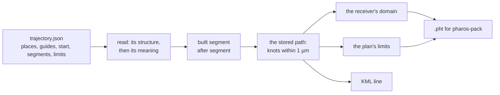

# Trajectories

A trajectory plan, `trajectory.json`, states a receiver's motion as a
start and an ordered list of segments. `pharos-traj` builds that motion
forward, each segment from the state the one before leaves, stores it as
the knots of a `.pht` file, and checks the stored path against the
receiver's domain and the plan's own limits. Nothing is searched: a plan
is refused when it is read, or built and then checked.



A path that leaves the domain or breaks a limit is kept for inspection,
but no `.pht` is written of it. How the build works inside is in
[design: trajectories](../design/trajectories.md).

## Commands

```
pharos-traj build <trajectory.json> [-o <FILE>] [--name <TEXT>]
pharos-traj static (--lla <LAT,LON,ALTITUDE> | --ecef <X,Y,Z>) --duration <SECONDS> -o <FILE> [--name <TEXT>]
pharos-traj info <file.pht>
pharos-traj check <file.pht>
pharos-traj export <file.pht> [-o <FILE>]
```

| Command | Result |
|---|---|
| `build` | builds the plan and writes its `.pht`; default output replaces the source's extension with `.pht` |
| `static` | writes a receiver at rest for a duration; `-o` is required |
| `info` | prints the name, the knots, the duration and the end positions |
| `check` | prints the speed, acceleration, jerk and altitude ranges of the stored path, and its steps |
| `export` | writes the path as a KML line; default output replaces `.pht` with `.kml` |

`--name` replaces the plan's name, or names a static trajectory. `--lla`
takes degrees and metres above EGM96; `--ecef` WGS84 ECEF metres.
`--duration` is in seconds, from 0 to 10^7.

The flight below holds a course of 045 at 250 m/s for 20 minutes, turns
onto 090 at a radius of 20 km and flies on for 800 s; its limit keeps the
turn's lateral acceleration at most 4 m/s^2.

```json
{
  "format": "pharos.trajectory-plan",
  "version": 1,
  "name": "flight",
  "coordinates": { "datum": "WGS84", "altitude": "ellipsoid" },
  "places": [{ "id": "A", "latitude": 30.5292, "longitude": 114.3642, "altitude": 9000 }],
  "start": { "at": "A", "course": 45, "speed": 250 },
  "segments": [
    { "straight": {}, "for": 1200 },
    { "turn": { "radius": 20000, "onto": 90 } },
    { "straight": {}, "for": 800, "id": "arrive" }
  ],
  "limits": [{ "id": "turning", "quantity": "lateralAcceleration", "max": 4 }]
}
```

```
$ pharos-traj build flight.json
[INFO]	Trajectory flight (flight.pht): 34 knots over 2061 s
[INFO]	Trajectory written: flight.pht
$ pharos-traj check flight.pht
[INFO]	Trajectory flight (flight.pht): 34 knots over 2061 s
[INFO]	Speed up to 250.4 m/s, acceleration up to 3.129 m/s^2, jerk up to 0.03914 m/s^3
[INFO]	Altitude from 8999 to 9014 m
[INFO]	Acceleration steps: 2, the largest 3.129 m/s^2 at 1261 s
```

The speed reads 250.4 m/s: the plan's speed is over the ground, and at
9 km the receiver moves 0.14% faster. `check` reads the altitude above
EGM96, whatever the plan's reference. It prints velocity steps the same
way, as information, whatever their size: whether a receiver follows a
step depends on the receiver.

## The plan

| Key | Content |
|---|---|
| `format` | required, `"pharos.trajectory-plan"` |
| `version` | required, `1` |
| `name` | the trajectory's name; default empty |
| `coordinates` | required: `{ "datum": "WGS84", "altitude": "EGM96" }`, or the altitude `"ellipsoid"` |
| `places` | required, at least one: named places |
| `guides` | polylines and Bezier chains through places, which an `along` follows |
| `start` | required: where the path begins, and how |
| `segments` | required, at least one: the motion, one segment after another |
| `limits` | checks of the built path: a limit broken gives no `.pht` |

An unknown key is an error at every level. `zig build wasm` installs
`trajectory.schema.json`, generated from the same reader: field types,
units, ranges, defaults and descriptions. References, times and the
rules between segments are the reader's and the build's to check.

### Places

`{ "id": "A", "latitude": 30.5292, "longitude": 114.3642, "altitude": 40 }`:
latitude in [-90, 90] and longitude in [-180, 180] degrees, altitude in
metres above the plan's reference. Each id is given once, and each place
lies in the receiver's domain: from 6,350 km to 200,000 km from the
geocentre.

### Guides

| Guide | Keys | Path |
|---|---|---|
| polyline | `places` (at least two), `radius` (m, above 0) | straight legs from place to place; each corner rounded by an arc of the radius in the plane of its two legs, tangent to both, which passes the corner's place at its middle |
| Bezier | `places` (four, then three for each piece after the first) | cubic pieces of four places, the last of a piece the first of the next; it passes the first place and each piece's last |

`{ "id": "road", "polyline": { "places": ["A", "B", "C"], "radius": 20 } }`.
A corner whose arc would take more of a leg than the leg has is refused
when the path is built. A Bezier chain's joints should be smooth (the
tangents of two pieces lined up): a joint that is not steps the velocity.
A guide's path is in ECEF; an `along` follows its foot on the ellipsoid,
by length over the ground, at the heights of the guide's places.

### The start

| Key | Content |
|---|---|
| `at` | required: the place the path begins at |
| `speed` | the horizontal speed over the ground it begins with, m/s: 0 at rest; absent, free, the first segment's to choose |
| `course` | the direction it begins in, degrees clockwise from true north, where the first segment takes its direction from the start |

A start at rest takes no course. A first `straight` with no `course` or
`to`, or a first `turn`, takes the start's course; a first `along`, or a
`straight` with its own `course` or `to`, takes none. Before a first
`through`, a moving start states its course; a free one states none.

## Segments

| Key | Content |
|---|---|
| `stay`, `straight`, `turn`, `along`, `through` | the segment's kind: exactly one |
| `id` | names the segment and the event at its end |
| `for` | how long it lasts, s |
| `time` | when it ends, s from the start |
| `speed` | the horizontal speed over the ground it ends at, m/s: 0 at rest |
| `climb` | the climb rate a `straight` or a `turn` ends at, m/s |
| `altitude` | the altitude a `straight` or a `turn` ends at, in the plan's reference |

A segment takes `for` or `time`, not both. Times run forward: each ends
after it begins, and the path lasts at most 10^7 s.

| Kind | Keys | Motion |
|---|---|---|
| `stay` | `for` or `time` | at rest where it is; it must begin at rest |
| `straight` | `course`, `to` or `distance` | the shortest path over the ellipsoid, a geodesic |
| `turn` | `radius`, `rate` or `lateral`; `onto` or `by` | a path of constant geodesic curvature |
| `along` | `guide`, `to` | a guide followed |
| `through` | `places`, `end` | the path of least jerk through places at stated times |

### straight

`{ "straight": { "to": "B" }, "speed": 100 }`. A straight is a geodesic,
not a line of constant bearing: `course` is its initial azimuth, and the
course changes along a long leg (on 045 from 30.53°N, after 300 km it is
46.18°). `to` follows the geodesic to a place, and its course and length
follow from it; a place within 0.6035° of the point opposite the start,
where several geodesics meet, is refused. `distance` gives its length
over the ground. With neither `to` nor `course` it goes on in the
direction it begins in.

### turn

`{ "turn": { "radius": 20000, "onto": 90 } }`. A turn keeps a constant
geodesic curvature, set by `radius` (m over the ground), `rate` (deg/s) or
`lateral` (m/s^2), signed + to the right. `rate` and `lateral` hold at
the speed the turn keeps, so they take no `speed`, but after a free
start, which leaves the speed to them. It ends:

| Key | Where |
|---|---|
| `onto` | when its course reaches the azimuth, after turning by more than nothing and at most a whole turn: onto the course it begins on, it turns once round |
| `by` | when it has turned through the angle, signed as the turn: its length times its curvature. On the ellipsoid the course changes by a little more or less, as a straight's does: by 90 at a radius of 1 km from 090 ends on 180.005 |
| neither | by its `for` or `time` |

### along

`{ "along": { "guide": "road", "to": "C" }, "speed": 20 }`. An along
follows its guide from the place where it begins, which the guide must
pass exactly: a polyline's first place, a Bezier piece's first or last,
or where an along before it on the same guide ended. `to` names the
guide's place it ends at; absent, the guide's end. A polyline's corner
place is passed at its arc's middle. So one road can be run in parts at
different speeds, with exact joins. Its heights are of least jerk by
length over the ground through the heights of the guide's places it
passes.

A corner whose arc would change the velocity by less than 1e-4 m/s and
last under 10 ms is no arc: the legs run on to the corner's place, where
the velocity steps. Inside an along, and where one along ends at a corner
and the next goes on along the guide, such corners are steps; where the
segment after is a `straight` or a `turn`, the corner keeps its half arc,
a piece of microseconds. A road with places every 5 m on a meridian,
rounded at 20 m and run at 20 m/s, builds with 398 velocity steps, the
largest 5.8e-7 m/s. A corner of a few metres' radius on a nearly straight
road can still be refused: places 20 m apart with bends of about 1e-5 rad
at 20 m/s leave the receiver's domain with a radius of 1 or 3 m; with
20 m, or with bends of 3e-6 rad, they build.

### through

```json
{ "through": { "places": [{ "at": "B", "time": 15, "event": "arrive" }], "end": "rest" } }
```

A through passes each of its places at its time. Its path is the one of
least jerk, ties broken by least acceleration, through the places in
ECEF; its height is a fourth axis of the same objective, through the
places' heights, so that the path follows the surface. It begins in the
state the segment before leaves, or free after a free start, and ends
free (`end`'s default), at rest (`"rest"`), or, before a `straight`, a
`turn` or an `along`, in that segment's first state. A place's `event`
names its event where the place's id cannot: a place passed twice. A plan
whose gaps between times differ too much for double precision is refused,
with the places where it fails.

A single gap across a continent has an uneven ground speed: free to free
between two places on the equator, over a long enough time, the largest
horizontal speed is 1.02 times the mean over 30°, 1.27 times over 90°,
2.85 times over 150° and 7.7 times over 170°. Straights are the tool for
long legs.

### Speed, length and time

A plan's speeds and lengths are over the ground. A built segment
(`straight`, `turn`, `along`) begins at the speed the segment before
leaves and steps to its own along a quintic: s(t) = v0 t + (v1 − v0) T
(5/2 u^4 − 3 u^5 + u^6), u = t / T, so its acceleration and jerk are
nothing at both ends.

| The segment's shape | It takes | Its speed |
|---|---|---|
| fixes its length: a straight `to` a place or with a `distance`, a turn by radius `onto` or `by`, an along | a `speed`, or one of `for`, `time`, not both | to the `speed`; with a time, the end speed that covers the length in it, refused below 0; with neither, it keeps its speed |
| leaves its length open: a straight with only a course, or none, a turn with neither `onto` nor `by` | one of `for`, `time`, and a `speed` or not | to the `speed`; without one, it keeps its speed |

A segment that begins at rest, or after a free start, states a speed or a
time where its shape fixes its length, and a speed where it does not; a
free start then runs at the one speed that fits. A segment that begins at
rest cannot end at rest: a stop at a place is a `through` that ends at
rest, or an along run in two parts. A straight from rest to a place 1.1 km
away in 100 s ends at 22.17 m/s.

### Heights

A straight's and a turn's altitude follows its own quintic in time, from
its altitude, climb rate and their rate where it begins to its `altitude`
and `climb` where it ends, the vertical acceleration nothing there:
`climb` defaults to the climb it begins with (0 where an `altitude` is
given or it ends at rest), `altitude` to the one it begins at plus its
duration times the mean of the two climbs; a straight `to` a place ends
at the place's altitude. After a free start or a `through`, the segment
begins with its own `climb`, or level. Every vertical join is smooth to
the acceleration.

Over EGM96 a level leg is level above the geoid: its knots fall where its
track crosses the geoid's 0.25° grid lines, where the geoid's slope steps
its velocity. At 250 m/s from 27.9°N, 86.8°E on 060 for 400 s, then a
20 km turn by 90, the path has 6 such steps, the largest 0.001538 m/s.

### Joins and events

A segment begins exactly in the state the one before left, and a `to`
ends exactly at its place. While moving, the direction changes only in a
turn: a straight's `course` or `to`, and an along that does not go on
along the guide before it, only at rest, at the start or after a through.
Rest, no speed and no acceleration, comes only where the plan states it: a
start at speed 0, a segment that ends at speed 0, a through that ends at
rest.

The events are `start`, the end of each segment with an `id`, and each
place of a through, by its place's id or its `event`. Each name is given
once.

## Limits

`"limits": [{ "id": "turning", "quantity": "lateralAcceleration", "max": 4, "over": ["t"] }]`

| Key | Content |
|---|---|
| `id` | the limit's name |
| `quantity` | required: what it bounds |
| `max` | the most it may be; of a signed quantity, its size |
| `min` | the least it may be: of a speed or the altitude only, not above `max` |
| `over` | the segments it holds over, by id; absent, every segment |

| Quantity | Unit | What |
|---|---|---|
| `speed3d`, `horizontalSpeed` | m/s | the speed, and its part along the ground |
| `acceleration3d` | m/s^2 | the acceleration's size |
| `jerk3d` | m/s^3 | the jerk's size, within pieces |
| `lateralAcceleration`, `forwardAcceleration` | m/s^2 | a·(ĥ × up) and a·ĥ, with ĥ the horizontal direction of travel: every straight reads 0 to the rounding |
| `climbRate`, `verticalAcceleration` | m/s, m/s^2 | the altitude's first and second rates in the plan's reference |
| `altitude` | m | in the plan's reference |

A limit takes a `max` or a `min`, or both; both at least 0 but the
altitude's. The four signed quantities, lateral, forward, climb and
vertical, are bounded in size: `max: 4` holds -4 and 4. A segment's span
is closed, its ends included; at a step, two knots at one time, each side
is its own segment's.

A limit reads the stored path, the knots and the quintics between them,
as the receiver moves at its height: a plan stating `speed 250` at 9 km
reads 250.35. The speed, acceleration and jerk are read by their exact
extremes on each piece; the other six at 16 points a piece, refined where
they bend. Over EGM96 each point is read in the geoid's cell it lies in,
and a knot in its own piece's. A velocity step is not an acceleration:
the limits read both sides of every step. On a piece shorter than 10 ms,
whose quintic carries its knots' rounding as motion, the speeds, the
climb rate, the accelerations and the jerk are read at its two knots
alone, the jerk as the change of acceleration over the piece's time.

| Family | A value within this holds |
|---|---|
| speeds | 1e-6 of max(\|bound\|, 1 m/s) |
| accelerations | 1e-3 of max(\|bound\|, 1 m/s^2) |
| jerk | 1e-2 of max(\|bound\|, 1 m/s^3) |
| altitude | 1 µm |

The worst value is found to a tenth of that tolerance. A broken limit is
an error at `limits[i]`, code `out_of_range`; the build's status is
`input`, no `.pht` is written, and the path stays inspectable. With
`"max": 3` the flight above reads:

```
limits[0]: the lateral acceleration must be at most 3 m/s^2 in size, got 3.129 m/s^2 at 1258 s; it first breaks at 1200 s, in segments[1]
```

The value after `got`, with its sign, has four significant digits, or as
many more as write it nearer itself than it lies from the bound.

## Reading and building

A plan is read in two stages: its structure first (required keys,
counts, types, ranges, unknown keys), then its meaning (references,
times, the rules between segments, rest). Each stage reports every fault
it finds; the meaning is read only once the structure holds. What only
the numbers show, a time that follows from a length and a speed, a corner
its radius cannot fit, a geodesic that does not settle, is found while
the path is built, and the first such fault ends the build.

| Stage | Example |
|---|---|
| structure | `extra: unknown key; the keys here are format, version, name, coordinates, places, guides, start, segments, limits` |
| meaning | `start.at: no place has the id "Z"` |
| meaning | `segments[1]: a stay must begin at rest, and segments[0] ends moving` |
| meaning | `segments[0].speed: a segment that begins at rest and ends at rest does not move: must be above 0, got 0` |
| build | `segments[0].straight.to: lies within 0.6035 degrees of the point opposite where the straight begins, where several geodesics reach a place` |

Where the built motion leaves the receiver's domain, the build marks it
out of the domain from that time, keeps the path as cut so far, and
reports it at the segment, code `invalid_segment`: a through from rest at
(0°, 0°) to rest at (0°, 179.99°) in 100 s reads `segments[0]: the path
leaves the receiver's domain at 46.9 s: an acceleration exceeds
1000 m/s^2`.

| The receiver's domain | Bound |
|---|---|
| distance from the geocentre | 6,350 km to 200,000 km |
| speed | at most 20,000 m/s |
| acceleration | at most 1000 m/s^2 |
| time | at most 10^7 s |

## The stored path

The knots are the built motion cut into pieces: each segment at its
joints (a through at its places, a run where its guide's pieces meet, at
its guide's places, and over EGM96 at the geoid's grid lines), then each
piece halved until the quintic of its knots lies within 1 µm of the built
motion at its quarters and middle, and the receiver's domain holds
between them. Where the motion steps at a joint, two knots share its
time: a step of acceleration (where a straight meets a turn, a corner's
tangent points) or of velocity (the geoid's slope, a Bezier joint, a
corner too gentle to round). A path takes at most 4,194,304 knots,
counted before they are taken.

A segment's length in `inspect` is in the plan's terms, over the ground:
a run's as built; a through's as told, each piece between two of its
places cut where its foot's speed is least inside it (a reversal leaves a
kink there), each part settled to a billionth of its length in at most 16
parts. `inspect`'s `distance3d` is told so too, each stored piece by its
speed in space. A piece that passes near the Earth's centre, as between
places nearly opposite 100 s apart, a path that leaves the domain, does
not settle in 16 parts, and its length is off by up to half.

The native tools and the WebAssembly module round some functions apart,
and the halving can then end at other pieces
([WebAssembly](c-api/webassembly.md#limits)).

## The .pht file

A `.pht` file is UTF-8 JSON Lines: a header object, then a knot a line.

```
{"format":"pht","version":1,"knots":3,"name":"wuhan_drive","frame":"ECEF","interpolation":"quintic-hermite","columns":["t","x","y","z","vx","vy","vz","ax","ay","az"]}
[0,-2268412.853571488,5009005.279173143,3221056.350012006,0,0,0,0,0,0]
[2.5,-2268424.6680195886,5008990.656097318,3221070.6742506367,-8.86082438668803,-10.96733268071339,10.743162263753964,0.000017533919523973887,-0.000038717282657565555,-0.000025065247484137267]
[5,-2268436.482436519,5008976.032952662,3221084.998444709,0,0,0,0,0,0]
```

A knot is its time in seconds from the first, its ECEF position, velocity
and acceleration. Between two knots the path is the quintic Hermite of
their states. Two knots at one time are a step of velocity or
acceleration at one position. Beyond the last knot, its acceleration
goes on. `knots` is always written and checked where it is given; the
writer prints numbers that read back to the same bits.

## Limits and messages

| Limit | Value |
|---|---|
| a plan or a `.pht` file | at most 1 GiB |
| a path's knots | at most 4,194,304 |
| a path's duration | at most 10^7 s |

| Message | Meaning |
|---|---|
| `Trajectory <name> (<file>): <N> knots over <D> s`, or `Trajectory <file>: <N> knots over <D> s` for an unnamed one | the path written or read |
| `Trajectory written: <file>` | `build` and `static` wrote the file |
| `The path breaks a limit of its plan: no PHT is written` | `build`, exit status 1 |
| `The path leaves the receiver's domain: no PHT is written` | `build`, exit status 1 |
| `The path takes more than the 1073741824 bytes a PHT holds: no PHT is written` | `build`, exit status 1 |
| `Speed up to <v> m/s, acceleration up to <a> m/s^2, jerk up to <j> m/s^3` | `check`: the stored path's exact extremes, read as the limits read them |
| `Altitude from <low> to <high> m` | `check`: above EGM96 |
| `Acceleration steps: <N>, the largest <a> m/s^2 at <t> s` | `check`, where there is one |
| `Velocity steps: <N>, the largest <v> m/s at <t> s` | `check`, where there is one |
| `Start: latitude <lat>, longitude <lon>, altitude <h> m`, `End: …` | `info`: altitude above EGM96 |
| `KML written: <file>` | `export` |

The KML line follows the stored path between its knots: each piece in
steps that, drawn straight through space from point to point as a viewer
draws them, keep within 0.1 m of the path at their middle and quarters,
in at most 4,096 steps a piece. The bound is a piece's, not the line's:
a line can hold up to two orders of magnitude more points than the path
has knots. A path of no duration is its point twice.
